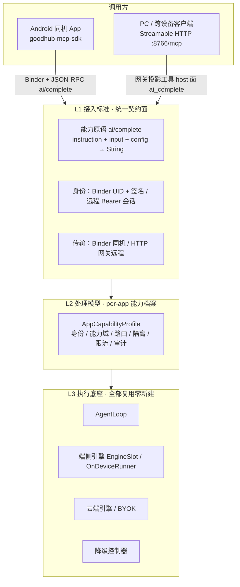
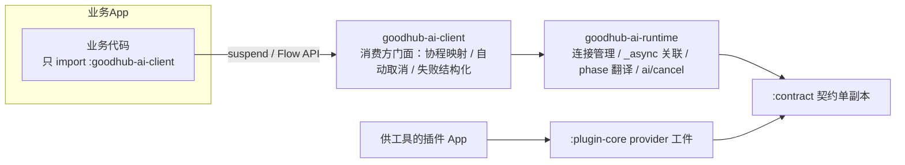

# 对外 AI 能力接入设计（接入标准 + 各 App 处理模型）

> 定位：外部 App 消费 goodhub 的 AI 算力（推理能力反向输出）的统一接入标准与调用方处理模型设计稿。
> 关系：接入通道与信任分级复用 [thirdconnect.md](./thirdconnect.md)（本地 Binder 插件 / 远程网关两档传输）；能力口径承接 [on-device-task-capability.md](./on-device-task-capability.md) 的「能力原语化」裁决（2026-10-31：goodhub 只供 `complete` 原语，任务语义由调用方编排）；远程投影面复用 host-tools-gateway-export 的 Allowlist + 四级过滤铁律。
> 立法义务：改 MCP↔AI 接缝须同轮修 goodshare 仓 `docs/design/ai-app-split.md`（接缝 SSOT）与 `docs/engineering/ai-dev-spec.md` §4（MCP 对 AI 接口契约立法源）。

## 1. 需求评估结论

外部 App 使用 goodhub 的 AI 功能 = **推理能力反向输出**：不是插件向 goodhub 供工具（已闭环），而是调用方来消耗 goodhub 的模型算力。现状对账：

| 现有资产 | 状态 | 在本设计中的角色 |
|---|---|---|
| `goodhub-mcp-sdk` `:contract`（AIDL + `McpContract`，物理单副本） | 0.2.0 已落地，真机 e2e 过 | 接入标准载体：身份 / 信任 / Binder 管道全部现成 |
| `sampling/createMessage` 反向请求链 | 协议闭环已验（SDK 发射端 + 宿主收端 + answerReverse） | 「调 goodhub AI」的第一根管子已在 |
| 端侧 `complete(instruction, input, config) -> String` 原语与转发层 | 已拍板（能力原语化口径） | 对外能力面的唯一推理原语 |
| thirdconnect 信任分级（同签名零弹窗 / 第三方信任卡 / 白名单） | 已落地含 UI | 接入准入闸门直接复用 |
| 网关 `:8766`（PC / 局域网） | 已落地含鉴权 / 投影 | 非 Android 调用方的传输档 |

**定性：结构性引入，非补丁。** 命中否决信号 #2（调用点天然是第 2~N 个）：不做统一能力面，每个接入方都得在 sampling 链上做特例。施工大头在契约立法与调用方处理模型（per-app 身份 / 配额 / 隔离 / 审计），管道层零新建。

关键风险四条：

1. **契约冻结带**：AIDL 包名与发现四常量永久冻结（漂移 = 存量插件 bind 失败）。本设计不动 AIDL 接口签名，只在 JSON-RPC method 层扩展（`ai/complete`），契约仓版本递增 + `toolbox run check-contract-sync` 门禁 + goodshare 侧两份接缝文档同轮修。
2. **端云路由与成本**：外部调用打到端侧 2B 模型还是云端 BYOK，直接消耗用户 token 钱。谁付费 / 谁授权必须显式化（见 §4 路由档）。
3. **上下文污染**：外部 App 的 prompt 绝不能进宿主聊天会话流（transcript / workspace），必须走隔离临时会话（复用网关侧 TC8 临时会话隔离口径）。
4. **滥用面**：无配额的外部 App 可无限白嫖推理。处理模型必须带每调用方并发 / 频率上限，默认从严。

## 2. 总体架构：三层收拢



- **L1 接入标准**：立法层。一个推理原语（`ai/complete`）+ 两档传输（Binder / 网关）+ 既有身份体系。
- **L2 处理模型**：宿主新增的调用方能力档案层，本设计的核心新增件。
- **L3 执行底座**：既有推理栈，`complete` 原语的实现方。

## 3. 接入标准（L1）

### 3.1 原语形态：只做 `ai/complete`，不做任务模板

- 语义：`complete(instruction, input, config) -> String`。任务语义（摘要 / 翻译 / 打标签 / 文本优化）一律由调用方 App 自己编排，goodhub 不内置任务模板——承接能力原语化裁决。
- 落点：JSON-RPC 新 method `ai/complete`，经既有 `IMcpChannel.call` 管道承载。**AIDL 接口签名零变更**；契约仓 `:contract` 加 method 名常量与请求 / 响应 JSON 形状规范，版本递增。
- `config` 载体：`{maxTokens?, temperature?, responseFormat?}` 等声明字段；未声明字段一律取宿主默认，禁止调用方感知宿主内部模型规格（模型适配数据住 assets/model-specs.json，不外泄）。**config 不含路由字段**——端侧 / 云端由设备主在 goodhub 侧选择（见 §4.1），调用方不得强制。`responseFormat` **复用 S17b 既有约束解码承载**（`GenerationConfig.responseFormatType/Value` 双端键集，禁另造 jsonSchema 字段成双源）：端侧 LiteRtLmRunner 接 SDK ResponseFormat 自治，GenieSession 后端显式归因拒服务（结构化失败），云端透传对应 API 的 `response_format`。
- **文本模态边界**：`input` 必须为合法 UTF-8 纯文本，禁 Base64 媒体数据（纯文本 2B 模型喂图必乱码；超 128KB 线走 TC9 中转兜底但语义仍非法）。多模态（Vision）留 v2：输入形态演进为 `inputParts: List<AiPart>`（TextPart / BlobUriPart），不混入字符串。
- 长任务沿用 `_async` 约定（thirdconnect §1.2.2）：预计超 Binder 事务预算即立即回 `{"_async": true}`，真实结果经 `onEvent` 推同 id 终帧。
- 流式：v1 不提供（`complete` 为整段返回语义）；调用方要进度用 `_async` + progress 帧。progress 帧预留 `_meta.delta` 字段位但 **v1 不发射文本**——端侧分帧存在 UTF-8 半字符边界风险（QAIRT detokenize 拆 UTF-8 的既有教训），半字符外溢给外部生态不可接受；v2 评估流式时按整 token 边界发射。

### 3.2 内外同线：sampling 收敛到同一原语实现

- goodshare 等插件的 `sampling/createMessage` 反向请求，宿主收口后**转发到同一个 `complete` 原语实现**——禁止存在两条推理转发路径（否则 L2 的路由 / 限流 / 审计必须各写一遍，重复即能力缺失信号）。
- `sampling/createMessage` 本身保留兼容（存量插件契约），但实现退化为 `complete` 的一个适配壳。

### 3.3 非 Android 档：网关投影

- `complete` 原语按 host-tools-gateway-export 模式登记进 `host__` 导出面（工具名如 `host__ai__complete`）：Allowlist 登记项显式声明 visibility=shared + 只读 hints；描述与 schema 由执行面 `HostSchemaResolver` 单点供给（禁双源）。
- 登记首项须同轮过三关：产品价值 / 隐私影响评估 / 单测断言（沿用 PR3 口径）。
- 远程调用方身份 = Bearer 会话（配对 Token 已落地），复用网关既有 L1/L2 确认卡链。

### 3.4 SDK 双模式接口（业务层 API 形态，非协议分支）

前提裁决：**端侧模型已安装、外部调用不触发下载链路**（用户拍板）；但**冷热交替是用户态端侧引擎的常态**——goodhub 是普通应用进程，模型 1.5~3GB 无法常驻，LMK / 空闲回收 / trimMemory 均可卸载（异步不是模式选择，是用户态端侧 AI 的必然）。同步 / 异步由**宿主按耗时自动决定**，调用方选择的只是 SDK 的 API 形态；`mode` / `allowColdStartup` 类开关不进协议也不进 API（两档形态语义已隐含：sync 恒 fast-fail，async 恒可等冷启动）。同步通道专职服务 `WARM_STANDBY` 命中的低延迟直出，其余状态一律 fast-fail 驱动调用方升阶分流（见 §3.7）：

```kotlin
// goodhub-mcp-sdk :plugin-core（示意）
interface GoodHubAi {
    // 同步便捷壳：仅 WARM_STANDBY 短任务直出；其余状态按结构化 FastFail 立即返回（绝不阻塞等待）
    fun completeSync(request: AiRequest): AiSyncResult

    // 异步全量形态：可等冷启动；宿主同步返回时直接回调 onResult；_async 时回调 onPhase(progress) * N + onResult
    fun complete(request: AiRequest, listener: AiListener): AiCall   // AiCall.cancel() → ai/cancel
}

data class AiRequest(val instruction: String, val input: String, val config: AiConfig? = null)
enum class AiPhase { STARTING_HOST, LOADING_MODEL, QUEUING, GENERATING }
```

同步 / 异步共用一张失败码表（`MODEL_COLD` / `RESOURCE_BUSY` / `HOST_OFFLINE` / `HOST_TERMINATED` / `BUDGET_EXCEEDED` / `UNAUTHORIZED` / `RATE_LIMIT` / `CALLER_NOT_IN_FOREGROUND` / `USER_REJECTED` / `ENGINE_FAILED` / `DEVICE_THROTTLED` / `PREEMPTED_BY_HOST`）——同步侧是 `AiSyncResult.FastFail` 快照，异步侧是 `AiEvent.Failure(AiFailure)`，一个码表两处消费，禁两套枚举。其中 `HOST_OFFLINE` 与 `HOST_TERMINATED` 分工明确：前者 = 发起时宿主不可达（未装 / 未拉起），后者 = `_async` 在途期间宿主被系统击杀（LMK），禁实现期混用映射；`DEVICE_THROTTLED` = 温控降频（≥ SEVERE）或低电量未充电的硬件自保熔断；`PREEMPTED_BY_HOST` = 被宿主自用会话协作式打断（见 §5 QoS）。`RESOURCE_BUSY` 错误帧带 `error.data.retry_after_ms`（宿主按在途任务预估的建议退避值，仅提示非承诺；SDK 不做自动重试，delay 决策归业务层，防重试风暴从调用方搬进 SDK）。

- 业务层心智：**默认用异步形态**（UI 场景天然要进度与取消）；`completeSync` 仅给轻量一行拿结果场景，文档明确它在模型冷态直接失败——失败即引导改走异步。
- 路由分工：异步受理进入宿主后**按设备主在 goodhub 设置里的选择路由**（端侧或云端，复用既有模型选择链路）；`completeSync` 便捷壳固定默认端侧（短任务零成本零云延迟）。调用方两条路径都无权强制路由（见 §4.1）。
- 两形态共用同一个 `ai/complete` method：AIDL 接口签名零变更；契约仓只补 SDK 层 API 规范。
- 既有 `_async` 约定（§3.1 / thirdconnect §1.2.2）承载全部异步语义，不新增协议分支。
- **主线程防护**：`completeSync` 实现入口断言非主线程（主线程调用抛 `IllegalStateException`，引导走 `suspend complete()`）；Kotlin 档默认只暴露 `complete` / `completeStream`，`completeSync` 限定 Java 兜底档。
- **传输上限单线**：大文本荷载沿用 thirdconnect TC9 控制/数据面分离既有约定（128KB 线 + `mcp-blob://` 句柄 / ParcelFileDescriptor 中转），不另立阈值；SDK runtime 侧透明包装还原，业务层无感。

契约层随双模式补两件小东西（均 JSON-RPC method / 字段级，AIDL 仍零变更）：

1. **阶段语义**：`ai/complete` 的 `notifications/progress` 帧约定 `_meta.phase`（`STARTING_HOST` / `LOADING_MODEL` / `QUEUING` / `GENERATING`，与 SDK `AiPhase` 枚举同值单源），替代裸 message 字符串，业务层据此渲染等待态。
2. **取消原语 `ai/cancel`**：异步等待可达分钟级（冷装载 + 长生成），`_async` 只有终帧没有 cancel = 业务层页面退出后任务仍挂算力。SDK `AiCall.cancel()` 映射为 `ai/cancel`（按请求 id），宿主中断生成并把在途请求从受理链摘除。

### 3.5 SDK 分层与业务层分离：按角色拆工件

「业务层不必处理机制，只对标准接口融合」的落点——SDK 按角色拆工件，AI 消费方与供工具插件两条路径互不污染：



- **`:goodhub-ai-client`（新增，业务层唯一依赖）**：稳定 API 面，独立版本。业务层看不到 contract / transport / `_async`。
- **`:goodhub-ai-runtime`（实现件）**：连接生命周期（bind / rebind / DeathRecipient）、同步与 `_async` 判定及结果关联、phase 翻译、协程取消自动映射 `ai/cancel`。
- **`:plugin-core`（既有 provider）**：供工具插件继续走它，不拖 AI 消费面依赖。

业务融合形态（不发明私有范式，贴 Android 通用习惯）：

```kotlin
// :goodhub-ai-client —— 业务层看到的全部
interface GoodHubAi {
    /** 一键挂起调用：内部自动处理连接/异步/关联回调；协程取消自动映射 ai/cancel */
    suspend fun complete(request: AiRequest): AiResult

    /** 需要进度/阶段的场景：冷流，collect 到 Phase/Result 事件 */
    fun completeStream(request: AiRequest): Flow<AiEvent>
}
```

- `suspend` + `Flow` 与 ViewModel / lifecycle 天然融合：页面退出 → scope 取消 → SDK 自动发 `ai/cancel`，业务层零取消代码；Java 兼容档沿用 §3.4 的 `complete(request, listener)` 回调形态，两档同源。
- 失败语义结构化（未就绪 / 超限 / 用户拒绝 / 引擎失败），业务层只做 UI 映射。
- **破层红线**：`AiResult` / `AiEvent` 必须是 client 工件自有类型——`BinderTransport` / contract 类型出现在 client 公开 API 即算破层，挂单测断言（同 host-tools-gateway-export 端口纪律）。打包级同验：`:goodhub-ai-client` 依赖树禁含 AIDL 生成代码、IPC 状态枚举或宿主内部错误类型。
- **零显式初始化**：`:goodhub-ai-runtime` 经 Jetpack App Startup 隐式初始化捕获 Application Context——业务层声明依赖即用（单例 `GoodHubAi.get()` 或注入），无 `bind()` / `onServiceConnected` 等连接 API 泄漏；断线重连（DeathRecipient）与宿主升级重启自动恢复由 runtime 状态机兜住，IPC 异常收敛为可控重试。

职责归属总账：机制（连接 / 异步关联 / phase / cancel）全在 SDK；任务语义（instruction / input 怎么写、结果怎么用）在业务层；路由（端侧 / 云端）在设备主的 goodhub 设置，调用方与业务层均无权干预（§4.1）。

### 3.6 双面接口清单（业务层消费面 × goodhub 立法面）

**业务层（消费方 App）看到的接口**——`:goodhub-ai-client` 五类型 + 一入口，纯消费者，零 Manifest 声明 / 零服务注册 / 零连接管理：

| 接口 / 类型 | 形态 | 职责 |
|---|---|---|
| `GoodHubAi.complete(request)` | `suspend fun` → `AiResult` | 一键挂起调用（短任务便捷档；冷态结构化失败不傻等） |
| `GoodHubAi.completeStream(request)` | `Flow<AiEvent>` | 进度 / 阶段全量档（默认推荐） |
| `GoodHubAi.complete(request, listener)` | 回调档 | Java 兼容，与 Kotlin 档同源 |
| `AiRequest` | data class | `{instruction, input, config(maxTokens?, temperature?, responseFormat?)}`——业务层唯一要「写」的东西 |
| `AiEvent` | sealed | `Phase` / `Result` / `Failure` 三态 |
| `AiPhase` / `AiFailure` | enum / data class | `STARTING_HOST` / `LOADING_MODEL` / `QUEUING` / `GENERATING`；失败码：未就绪 / 超限 / 用户拒绝 / 引擎失败 |
| `GoodHubAi.isAvailable(context)` | 静态探测 | PackageManager 零 IPC 检查宿主安装与契约版本，主线程安全，UI 条件渲染入口 |
| `AiFailure.Unauthorized.createResolutionIntent(context)` | 引导件 | 按公开常量本地构造授权页跳转意图（宿主侧以 `getCallingUid()` 实证，参数仅预填） |

业务层唯一承担：任务语义（instruction / input 怎么写、结果怎么用）与失败码的 UI 映射；协程 scope 取消自动映射 `ai/cancel`。

**goodhub 层对外提供的标准接口**——五块立法面：

| # | 标准面 | 内容 | 载体 |
|---|---|---|---|
| 1 | 协议契约（立法核心） | `ai/complete`（`_async` 约定）、`ai/cancel`、progress 帧 `_meta.phase` 约定、结构化失败码表 | 契约仓 `:contract` 单副本 + 版本绑定门禁 |
| 2 | 传输接入标准 | 同机：既有 Binder Action + meta-data 发现约定（零新增）；远程：网关 `/mcp` + Bearer；投影工具 `host__ai__complete`（Allowlist 显式登记过三关） | thirdconnect 既有约定 |
| 3 | SDK 工件 | `:contract` / `:goodhub-ai-client` / `:goodhub-ai-runtime` / `:plugin-core` | `goodhub-mcp-sdk` 仓，独立版本发布 |
| 4 | 处理模型行为标准 | 对调用方可预期：信任三档、限流上限与超限错误语义、`ops.log` 全量审计 | 宿主 `AppCapabilityProfile` |
| 5 | 用户主权面 | 端侧 / 云端路由由设备主设置里选；云端档（BYOK 成本）对调用方逐个显式授权；信任可随时撤销 | goodhub 设置页 + 确认卡链 |

两面之间的契约只有一条：**业务层写的每个字段都在立法面 #1 有定义，业务层看不到的每件事都被 #3 实现层兜住。**

四个 API 入口的心智对账（防实现期把 `suspend complete` 误当同步接口——它走完整异步受理链，允许等冷启动，与瞬时直出的 `completeSync` 各司其职）：

| API 入口 | 适用语言 | 线程行为 | 冷态容忍度 | 取消机制 | 结果包装 |
| --- | --- | --- | --- | --- | --- |
| `completeStream(request)` | Kotlin | 异步冷流（`Flow`） | **可等**（发射 `Preparing` 阶段） | `viewModelScope` 取消自动发 `ai/cancel` | `Flow<AiEvent>` |
| `complete(request)` | Kotlin | 挂起函数（`suspend`，非同步） | **可等**（挂起直到生成完毕或失败） | 协程作用域取消自动发 `ai/cancel` | `AiResult` |
| `completeSync(request)` | Java 兜底 | 同步阻塞（断言非主线程） | **零容忍**（非就绪立即 FastFail） | 不可主动取消（超预算自动熔断） | `AiSyncResult`（`Success` / `FastFail`） |
| `complete(request, listener)` | Java | 回调通知 | **可等**（回调 Phase 阶段） | `AiCall.cancel()` 显式发 `ai/cancel` | 异步回调 listener |

### 3.7 三层状态模型：SDK Runtime 做状态吸水池

把「引擎生命周期状态」与「单次请求状态」解耦——底层物理态绝不透传给业务层，否则业务层沦为 `when(state)` 泥潭：

| 层级 | 谁在感知 | 内容 | 业务层要不要管 |
| --- | --- | --- | --- |
| L3 引擎物理态 | 宿主内部（`:engine` 状态机单源，见 on-device-lifecycle-single-source.md；`EngineLifecycle.State` 三态） | `COLD_EVICTED`（已析构）/ `WARM_STANDBY`（常驻待命，TTL 计时）/ `ACTIVE`（推理执行中）；`LOADING` 仅为暖机过渡过程，非状态机态 | **绝不管**（宿主黑盒，禁双状态机） |
| L1 协议事务态 | SDK Runtime 拦截 | 请求挂起、`_async` 握手、progress 帧推拉、`ai/cancel` 握手、DeathRecipient 触发 | **绝不管** |
| 业务语义态 | 业务 ViewModel | `Preparing`（`STARTING_HOST` / `LOADING_MODEL` / `QUEUING`）→ `Generating` → `Success` / `Failure` | **只感知这三段** |

Runtime 的四个「吸水」机制：

1. **冷热降维**：宿主拉起进程 / 载权重 / 排队，对业务层统一归一为 `Preparing` 阶梯事件——任务受理成功但未出结果的中间态全部收敛于此。
2. **宿主被杀兜底**：`_async` 在途期间宿主 Binder 暴毙，DeathRecipient 触发 Runtime 向业务层发射**确定性失败** `HOST_TERMINATED`（话术：端侧资源不足，稍后重试），业务层一个 `when` 分支消化，零 IPC 恢复逻辑。
3. **同步原子坍缩**：同步调用不是平行状态机——它是全量状态机在「零等待预算」下的 fast-fail 判定。宿主受理器**先判状态再入队**：引擎非 `WARM_STANDBY` 直接回结构化 FastFail（一 RTT、零排队消耗），业务层按码表无缝升阶为异步流（`ModelCold` / `ResourceBusy` / `BudgetExceeded` → `showLoadingSheet()` 转 `completeStream`；`HostOffline` / `Unauthorized` → 本地规则兜底）。
4. **取消即第一优先级**：冷加载与生成长耗时的反面是——调用方退出后宿主不得继续烧算力。协程取消严格映射 `ai/cancel`（§5 幂等 + 死亡清理为该承诺的宿主侧对账）。

### 3.8 业务层接入标准（规范指南 + 可选 toolkit）

管道标准之外补消费方标准——每个接入方 App 不重复踩坑（裸调 IPC / 模型寒暄废话 / 静默覆盖丢文本）。**宿主契约面零任务模板**（能力原语化裁决不破）：标准全部落在**调用方侧**，交付形态 = `goodhub-mcp-sdk` 仓的《业务层 AI 接入规范指南》文档 + 可选 `:goodhub-ai-toolkit` 工件。

五大规范（指南正文）：

1. **架构分层**：禁 UI 组件直调 `GoodHubAi`，下沉 UseCase/Repository；调用必须绑定 `viewModelScope` / Lifecycle 作用域——页面退出协程自动 Cancel 并驱动 `ai/cancel`，禁 GlobalScope 跑无界任务。
2. **2B Prompt 三段式**：角色与任务（单一明确）+ 负向硬约束（禁寒暄前缀 / 解释 / Markdown 包裹）+ 分隔符定界（待处理文本包围，防与指令混淆）。参数推荐表（temperature / maxTokens 按场景）属指南经验参考，不进契约。
3. **输出清洗与校验**：废话前缀剥离（**启发式**，可误杀）+ Markdown / 引号剥离 + 产物有效性校验（空产物判失败、长度骤变预警）；清洗失败保留原文——真正安全网是规范 5 的 Diff + Undo。
4. **预算预检与升阶**：输入长度三档处理范式（放行 / 提示等待或分段 / 前端拦截）——**阈值数值从 snapshot `maxContextLength`（model-specs 单源）按比例推导，指南不写死数字**；`completeSync` FastFail 后禁自旋重试，无缝切 `completeStream`。
5. **交互状态机**：改写交互满足可撤销 / 可对比 / 防覆盖——Diff 预览优先（用户手动采纳），确认替换时原文本与新文本成对推入 App 自身 Undo 栈。

Toolkit（`:goodhub-ai-toolkit`，**二期**）：`StandardPrompts` 模板 / `TextSanitizer` / `TextChunker` / `FastFailEscalator`。立项时机 = 首个真实接入方（goodshare）按指南接入后提炼踩坑，防闭门造车；破层红线同样适用（toolkit 可依赖 client 工件，禁触 contract / transport 类型）。

## 4. 处理模型（L2）：AppCapabilityProfile

宿主新增 `AppCapabilityProfile` 注册表（per-caller 一条档案），是 `ai/complete` 受理链的**唯一裁决点**：

| 字段 | 内容 | 默认口径 |
|---|---|---|
| `identity` | 包名 + 签名档（同签名 / 已信任第三方 / 远程会话） | 复用 thirdconnect 信任分级，零新增身份体系 |
| `capabilityScope` | 允许的原语集（v1 仅 `ai/complete`） | 白名单制，缺席 = 拒绝 |
| `routingPolicy` | 路由裁决来源：**宿主用户设置**（goodhub 侧既有端云模型选择），调用方 config 不得强制；`completeSync` 便捷壳固定默认端侧 | 跟随用户当前选择 |
| `contextPolicy` | 隔离临时会话，禁入宿主 transcript / workspace / 记忆 | 恒定，不可被调用方覆盖 |
| `rateLimit` | 并发数 + 频率上限 | 默认从严（并发 1），同签名生态可放宽到 2 |
| `lifecyclePolicy` | 调用方进程状态约束（宿主侧 `UidImportance` 校验） | 分档：同签名生态放行后台；已信任第三方仅前台调用，后台回 `CALLER_NOT_IN_FOREGROUND`；特殊后台任务须用户显式授权放宽 |
| `qosPriority` | 调度优先级：`USER_INTERACTIVE`（宿主自用前台）> `FOREGROUND_CALLER` > `BACKGROUND_CALLER` | 外部任务恒低于宿主自用；宿主自用进入时对在途外部任务协作式打断（见 §5 QoS） |
| `audit` | `ops.log` 按 serverId = 调用方身份记账 | 恒开，fail-closed |

### 4.1 按信任档的默认策略分档

| 档 | 对象 | 零弹窗 | 路由 | 限流 | 授权告知 |
|---|---|---|---|---|---|
| 同签名生态 | goodshare 等私有插件 | 是 | 用户设置直用 | 并发 2 | 无需（私有生态） |
| 已信任第三方 | 信任卡白名单 | 首次信任卡 | 用户设置；**云端档（消耗用户 BYOK）须用户显式授权该调用方** | 并发 1 | 信任卡文案显式告知「将使用手机 AI 算力」 |
| 远程网关会话 | PC / 跨设备 Bearer | 否（L1/L2 卡片链） | 用户设置；云端走用户已配 BYOK | 会话级既有背压 | 现网关确认卡机制 |

路由含义：`ai/complete` 受理进入宿主后，**端侧还是云端由设备主在 goodhub 设置里的选择裁决**（复用既有模型选择链路），不由调用方 config 强制——算力消耗与成本归属始终是设备主的决定。信任档只设**授权上限**：同签名生态直用用户设置；已信任第三方吃用户设置里的端侧结果，云端档需对每个调用方单独显式授权（成本敏感项，禁静默放行）。`completeSync` 便捷壳固定默认端侧（短任务零成本零云延迟），不受用户设置影响。端侧引擎不可用即结构化失败（`isError:false` + 失败 status，防熔断误计数），是否重试 / 改异步由调用方决定。

## 5. 安全边界汇总

- **隔离**：每次 `ai/complete` 独立临时会话；调用方 prompt / 产出不落宿主会话流与记忆（`contextPolicy` 恒定）。
- **限流**：`rateLimit` 超限回 JSON-RPC 明确错误码（可自纠话术），不静默排队。
- **取消幂等与死亡清理**：`ai/cancel` 对已完成 / 不存在的任务幂等静默确认，不报错；宿主对调用方回调 `IBinder` 挂 `linkToDeath`，调用方进程死亡（含被 LMK 强杀、未及发 cancel）即自动中断并释放其全部在途推理任务——孤儿任务熔断，防算力悬挂。
- **QoS 防客大欺主**：外部任务恒低于宿主自用（§4 `qosPriority`）。宿主自用会话（`USER_INTERACTIVE`）进入时，对在途外部任务发**协作式打断**——复用 K17 打断注册表与红线（打断未生效不得假设算力已腾出，禁重启引擎腾算力）；未及时让出的外部任务收 `PREEMPTED_BY_HOST` + `retry_after_ms`。无 KV Cache 换出承诺（GenieX / LiteRT 栈不支持）；被打断任务不静默转云端（成本裁决归设备主，禁静默降级），除非该调用方已获云端授权。
- **安全防火墙（fail-closed）**：云端 BYOK 路径强制内容前置过滤（防外部 App 用违规内容刷用户 Key 致云端封号），云端违规错误记 `ops.log`；同一调用方连续触发 3 次违规 → 冻结其 AI 借用权限（`capabilityScope` 撤销，用户面板可解冻）。端侧路径 v1 不承诺内容审查，靠隔离会话 + 免责边界。
- **Token 预算透出**：静态 snapshot（§5 就绪态探测）附带当前模型的安全输入预算——数值**住 model-specs.json 单源**，禁硬编码；SDK 可选本地粗估 `estimateTokens`（非承诺）。超预算受理器 fast-fail 复用 `BUDGET_EXCEEDED`，避免端侧静默截断产废文。
- **受理期临时保活**：外部 `ai/complete` 任务触发冷加载（模型 1.5~3GB 装载分钟级风险窗口）期间，宿主临时启用前台服务 / WakeLock 提升进程优先级，防止「载入到 90% 被系统杀」的算力白烧——复用 GatewayForegroundService 先例；任务终态 / cancel / 调用方死亡三把钥匙任一触发即释放，不常驻。
- **硬件环境守卫（HardwareGuard）**：受理前置拦截器检查 `getThermalStatus()`（≥ SEVERE）与电量（低且未充电），端侧路由命中即 fast-fail 回 `DEVICE_THROTTLED`；转云端仅当设备主已开云端路由**且该调用方已获云端授权**，禁静默降级。
- **授权引导闭环**：宿主注册 `goodhub://settings/capability/authorize` 路由；**Android 陷阱**：授权 Activity 运行在宿主进程内，生命周期里直调 `Binder.getCallingUid()` 返回的是宿主自身 UID（该值仅在 Binder 事务处理栈内有意义），**禁在 Activity 里直调**。身份实证采用**方案 A（挂起请求表，主选）**：受理器回 `UNAUTHORIZED` 时在 `AppCapabilityProfile` 内存表记录 `{callingUid, 时间戳}`，授权页以最近未决记录为准、deep link `caller` 参数仅做比对校验；方案 B 兜底 = SDK 引导外部 App 用 `startActivityForResult` 拉起，宿主取系统记录的 `callingPackage` 反查 UID（存在 null 场景不作唯一依据）。grant 落盘前须校验未决记录时效窗口。
- **就绪态静态探测**：`:goodhub-ai-client` 提供 `isAvailable(context)`（PackageManager `resolveService` + 契约版本 meta-data，零 IPC 唤醒，主线程安全）与最小 `getCapabilitySnapshot`（**仅静态公开事实**：已安装 / 契约版本 / 能力声明；**禁掺运行时态**——模型装载态归 §3.7 运行时通道、授权态归 `UNAUTHORIZED` 码，静态探测掺运行时态 = 宿主状态外泄 + 结果瞬间过期）。UI 条件渲染（无 goodhub 隐藏 AI 按钮）以此为准，不以「调一次挨打碰壁」探测。
- **审计**：受理 / 路由 / 降级 / 拒绝全记 `ops.log`（调用方身份 + method + 路由去向 + 耗时），复用网关审计件。
- **信息不外泄**：宿主私有槽位态 / 服务清单 / 模型规格不出现在错误话术与 schema 描述里（沿用「文案悬空引用 = 幻觉调用源」与零隐私断言纪律）。
- **门禁不变**：保留字断言、四级过滤铁律、契约同步门禁均不受本设计豁免。

## 6. 里程碑切法（各段可独立验收）

| 里程碑 | 内容 | 验收 |
|---|---|---|
| M-A 契约立法 | 契约仓 `:contract` 加 `ai/complete` method 规范与常量 + `_meta.phase` progress 约定 + `ai/cancel` method + 十二码表（含 `DEVICE_THROTTLED` / `PREEMPTED_BY_HOST`）+ `retry_after_ms` 字段 + 版本递增；goodshare 仓两份接缝文档同轮修 | `check-contract-sync` 过；接缝文档 diff 成对 |
| M-B 宿主转发层 | `complete` 原语统一实现（端侧 / 云端路由 + 隔离临时会话）；`sampling/createMessage` 收敛为适配壳；`ai/cancel` 幂等 + 调用方 `linkToDeath` 死亡清理；受理器状态预判（非 `WARM_STANDBY` 同步请求零排队 fast-fail）+ 冷加载期临时保活 + HardwareGuard；QoS 三级调度（宿主自用协作式打断外部任务，K17 红线对齐）+ 云端 BYOK 内容前置过滤 | 单测覆盖路由三态 + 隔离断言（prompt 不入 transcript）+ 取消幂等 / 死亡清理 / 状态预判 fast-fail / 保活释放三钥匙 / 温控低电量熔断 / 宿主自用抢占外部任务（含打断未让出路径）各一例 |
| M-C 处理模型 | `AppCapabilityProfile` 注册表 + 限流 + `ops.log` 审计 + 违规计数冻结（3 次撤销 `capabilityScope`，用户面板可解冻）；SDK `:plugin-core` 拆出 `:goodhub-ai-client` / `:goodhub-ai-runtime` 消费方工件（§3.5），双模式 + 协程 / 回调两档 API + `isAvailable` 静态探测 / `createResolutionIntent` 引导件 / `retryAfterMs` 透出 / snapshot 附安全输入预算（model-specs 单源）+ 本地 `estimateTokens` | 信任三档各一例单测；超限拒绝话术断言；SDK 同步壳冷态失败 / 异步回调 / 协程取消自动映射 ai/cancel / 破层断言四例；探测零 IPC（不触发 bind）断言；违规冻结与解冻各一例 |
| M-D 验收 | sample-dummy-plugin 加 `aiComplete` 靶子；网关投影侧登记 `host__ai__complete`；《业务层 AI 接入规范指南》随 SDK 仓发布（§3.8 五大规范，toolkit 二期按 goodshare 接入踩坑提炼）；后续迭代位 = 各 App 消耗归因面板（SupplyQuota 计数 + ops.log 渲染看板 + 单 App 止血开关，纯 UI 消费零新协议） | 真机 Binder e2e + 网关 e2e 全过 |

### 6.1 既有资产对账（M-B 收口而非重建）

task-capability W5/W6 首包已落地大半底座，实施期严禁重复造轮子——`ai/complete` 是对既有件的**立法收口**：

| 设计条目 | 既有资产 | 处置 |
| --- | --- | --- |
| `complete` 原语执行器 | `host_on_device_tool.dart` 的 `on_device_complete`（failFast 直通 / 降级显式 / schema 单源）+ 私有反向 method `host/onDeviceComplete`（`reverse_wiring.dart`，与 `wireSampling` 并存） | 升格为标准 `ai/complete`：私有 method 退役或映射为别名，收口单 method |
| 调用方配额 | `supply_quota.dart`（K22 事务语义：并发 acquire/release 恒配对、频次产出才计） | `AppCapabilityProfile.rateLimit` 直接复用，不重写 |
| 死亡清理 | K17 `caller_death_interrupt.dart` + BinderTransport `onCallerDied` 独立链路 + 平台侧 `callerDeathRecipient` | 既有三红线原样生效；`ai/cancel` 幂等接进同一注册表 |
| 异步长任务 | W6 `supply_task_pool.dart`（WAL / 身份过滤 / 毒丸死信 / `allow_deferred`） | `_async` 语义映射进该池，不另起 |
| 冷态 fast-fail | W5 failFast 直通 + S16 懒加载边界（后台冷装载不被自动满足） | 与 §3.7 同步坍缩判定同构，接线即得 |
| 受理期保活 | `EngineService.promoteFgs`（引擎运行中通知） | 外部任务冷加载复用同一 FGS 通道 |

真正净新增仅五件：① `ai/complete` / `ai/cancel` 立法与反向分派（契约仓 + reverse_wiring）；② sampling 收敛适配壳（D2）；③ `AppCapabilityProfile` 升格（SupplyQuota 之上加 lifecyclePolicy 前台校验与信任档路由上限）；④ `_meta.phase` 阶段上报接 progress 通道；⑤ 网关投影 `host__ai__complete` 登记。零改动项：AIDL 签名、发现 / 信任闸门、`:engine` 三态状态机与单槽纪律、K22 事务语义、W4 导出面流式聚合口径。

### 6.2 SDK 收纳边界（宿主治理资产不进 SDK）

「已实现部分收进 SDK 并以 SDK 替代」的裁决——收纳只对**中立件与调用方机械件**成立，宿主治理资产原地保留：

| 已实现资产 | 处置 |
| --- | --- |
| `supply_quota` / `caller_death_interrupt` / `supply_task_pool` / `on_device_complete` 执行器（宿主 coordinator） | **原地保留**——裁决 / 治理 / 审计语义，`ai/complete` 立法时仅接线收口 |
| 失败码表 / `AiPhase` / method 常量 | 收进 `:contract`（wire-format 中立件，两端单源消费） |
| 连接管理 / `_async` 关联 / phase 翻译 / cancel 映射 | 收进 `:goodhub-ai-runtime`（§3.5 净新增机械件） |

三条红线：① **信任方向**——SDK 住调用方（不可信）进程，裁决逻辑住被裁决方 = 配额可绕；宿主侧裁决必须住宿主。② **发布节律**——宿主内部治理不随 SDK 对外版本节律走，改一条限流参数不该等 SDK 发版。③ **依赖方向**——宿主不依赖自己对外发布的 SDK 件（防循环消费，护 `check-contract-sync` 与 arch-guard 端口纪律）；宿主自用 AI 走内部 `on_device_capability` 端口直连。

「用 SDK 替代」的正确对象 = **goodshare 侧手写接入代码**（反向请求发射 / 结果关联 / 重试 → `GoodHubAi.complete()`），不是 goodhub 宿主实现——后者只做入口标准化（私有 method 退役映射，见 §6.1）。

### 6.3 goodshare 接入后推演（风险钉与系统级护栏）

首个接入方全链路推演（同签名档）暴露三个真风险，全部细化为可断言验收钉：

1. **外部任务绕过受理链复现空产出竞态（最高危）**：`:engine` Qwen 空产出修复双件（生成开始取消 TTL 定时器 + `isBusy` 谓词）以「所有生成走 :engine 受理链」为前提——`wireAiComplete` 若绕链直起 Runner 竞态原样复发。**测试编排**：TTL 调极短（如 500ms）→ goodshare mock 发 2000ms 长任务 → 断言执行期 `EngineLifecycle.State` 恒为 `ACTIVE`、零析构日志、完成后才重启 TTL 倒计时（验证外部任务确实进了 busy 判定——绕链任务对生命周期管理器隐形则断言必红）。
2. **打断 / 取消的空产出污染 DispatchProfile**：归因防护 reason 过滤**已存在**（2026-11-05 SESSION_ABORTED_BY_EVICTION 修复落地），本钉 = 把外部终止码（`PREEMPTED_BY_HOST` / `DEVICE_THROTTLED` / `CALLER_CANCELLED` / `CALLER_DIED`）**扩进既有白名单**——先找过滤单源再扩，禁建第二份过滤。钉：上述四码采样在 `recordSample` 入口丢弃，不入端侧性能画像（否则 0 token 采样被折算成「端侧严重劣化」，后续任务被误推云端）。
3. **长文本输入的 `mcp-blob://` 依赖未落地**：TC9 数据面是 thirdconnect 存量待办。v1 对策 = 超 128KB 线即 `BUDGET_EXCEEDED` 可自纠话术（诚实降级——中文 128KB ≈ 4~6 万字，本就击穿 2B 模型 KV Cache 物理极限），写进 §3.8 指南规范 4；`mcp-blob://` 留 goodshare 真实撞线后的二期项。

系统级护栏两件（M-B 施工同步挂）：

- **FGS 通知防抖**：`promoteFgs` 仅在受理器判定 `COLD_EVICTED` 且需冷装载时触发；`WARM_STANDBY` 短任务零通知——防通知栏「一闪而过」体验与 FGS 频率告警。
- **后台排空预算**：`drainSupplyPool` 单次批处理最大连续耗时的上限（起步值 30s，真机调优非拍板常量）+ 批间强制冷却数秒——防 goodshare 后台 `allow_deferred` 批任务长占单槽触发极端温控。

零变化不变量：AIDL 签名冻结、契约单副本、transcript / workspace 隔离、EngineSlot 单槽纪律、K17 三红线、K22 事务语义、W4 聚合口径。

## 7. 待裁决决策点

（当前无待裁决项——D2 / D3 已于 2026-11-08 用户拍板关闭，封板节奏由用户另行定。）

已裁决（留档防重评）：

- **路由权归属（原 D1，2026-11-08 用户拍板）**：异步受理进入宿主后按**设备主在 goodhub 设置里的选择**路由（端侧 / 云端），不由调用方 config 强制；`completeSync` 便捷壳固定默认端侧。端侧存在时同步即出结果，长任务走 `_async` 异步——均见 §3.4 / §4.1。
- **D2 sampling 收敛（2026-11-08 用户拍板）**：`sampling/createMessage` 保留兼容对外，实现退化为 `ai/complete` 适配壳，封死双推理路由；配额分池保留。
- **D3 立项归属（2026-11-08 用户拍板）**：新独立 epic 立项推进，不阻塞 thirdconnect 收尾。
