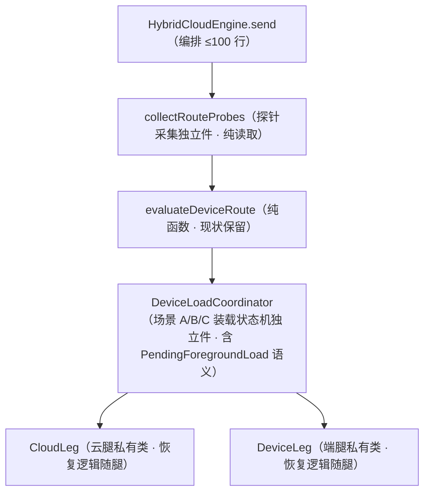

# 扩展性收口施工稿（S0–S5）

> 定位：架构评估「不利于以后扩展」各点（E1–E9）的收口施工稿。范围拍板 = 全量 S0–S5（已全批交付，commit 8623b58，真机验收通过）；协议版本闸口径拍板 = 精确匹配起步。epic 已收尾归档（context/archive/extensibility-hardening）。端侧模型长驻评估（R1–R6）不在本稿范围，见 `on-device-residency.md`。

## 代号说明

- **E1–E9**：评估编号——扩展性风险点，本稿批次一一对应收口。
- **S0–S5**：施工批次编号——S0 对账登记 → S1 小件收口 → S2 实现件单点 → S3/S4 两大主项 → S5 机械收口。
- **R1–R6**：端侧长驻风险编号（仅引用代号，非本稿范围）。

## 评估结论摘要（E1–E9 自含）

| # | 风险点 | 关键证据 |
|---|---|---|
| E1 | `lib/coordinator/hybrid_cloud_engine.dart`（906 行）超标未登记；`send()`（约 260 行）路由 / 传输 / 恢复三合一，`_cloudSend` / `_deviceSend` 云端与端侧两腿各约 160 / 190 行 | 存量超标清单（`docs/project/index.md`）无此件 |
| E2 | TrackEntry 模型 + 编解码住 UI 组件文件（`lib/ui/components/dual_track_stream.dart`：15 子类 sealed 层级 + `TrackEntryCodec` extension 约 400 行 + 渲染穷举），会话持久化事实上是 UI 模型序列化，内核不认识轨道语义 | `chat_session_service.dart` 文件头钉「内核不依赖 ui 类型」，但 track 过边界是 UI 编码后的 JSON |
| E3 | Run 装配签名爆炸：`McpRuntime.assemble` / `_assembleInner` / `ChatSendUseCase.assembleRun` 约 22 / 24 / 20 参；宿主工具 schema 双注册点（gateway.loadCatalog 与 toolsProvider）人工同步 | `lib/coordinator/mcp_runtime.dart` 装配段 / toolsProvider 段 |
| E4 | 端侧引擎实现件被 10 个文件直连，「实现件更换 = 改一行」承诺失效；chat_page 直连白名单双向账实差 | `grep on_device_engine_aidl lib/` 命中 10 文件；白名单基线缺 3 条实存边、含 2 条已消失边 |
| E5 | 单会话全局内核（`ChatSessionService` 单 `_session`），切会话全量快照换入换出 + 配额/激活集重置，无并发会话语义 | `lib/coordinator/chat_session_service.dart` + `chat_page.dart` 会话切换段 |
| E6 | 传输类型 isinstance 散布三处，新传输需逐处定义语义 | `connection_health.dart`（`is HttpTransport`）/ `reserved_namespace.dart`（`is HostTransport`）/ `reverse_wiring.dart`（`is BinderTransport`） |
| E7 | 任务来源 payload 整形（`_payloadFor` 按 task_action 分叉）住在消费循环，属 goodshare 形状 | `lib/task/task_loop_service.dart` |
| E8 | MCP 协议版本不匹配 fail-open：文档已立法「不一致 → 挂载失败」，`negotiate` 只存不比 | `docs/design/local-plugin-access-trust.md` vs `mcp_client.dart` negotiate |
| E9 | `ByokStore` 每 Run 新建重读 SharedPreferences + 安全存储（活跃债 #20 收编未闭环到引擎装配主路径） | `lib/coordinator/hybrid_assembly.dart` assembleDefaultHybridEngine |

## 范围与非目标

**拍板（2026-11-07）**：

- 施工范围 = 全量 S0–S5。
- E8 匹配口径 = 精确匹配起步：`protocolVersion != kMcpProtocolVersion` 即拒装；未来支持多版本时扩支持集，不引入豁免清单。

**非目标 / 红线**：

- 端侧长驻（R1–R6）不动——`:engine` 侧现有拍板（装载单例纪律、TTL 5min、懒加载立法、退后台不释放）一律不触碰。
- E2 搬移**持久化格式字节级不变**：`TrackEntryCodec` 输出的 JSON 形状冻结，存量会话快照必须可解码。
- E5 / E7 不动码，只落占位约束（见「观察项」）。
- 台账（活跃债表 / 超标清单 / 直连白名单基线）按「只减不增」纪律同轮更新，不另立事实源。

## 总纪律（每批适用）

1. **先钉特征测试，再动刀**：结构性拆分前先补特征测试（golden / 等价性锚），改前全绿——复用活跃债 #24（agent_loop golden 四切片 + mcp_runtime 装配等价性）先例。
2. **同轮台账**：每批收口同轮更新 `docs/project/index.md`（债表 / 超标清单 / 直连白名单）+ epic devlog 记账。
3. **验收门禁**：`flutter analyze` + 全量 `flutter test` + drift-guard（含新增 arch-guard 规则）；S3 / S4 各加一次真机冒烟。
4. **方案准入自查**：E1 / E2 / E3 / E4 为结构性收口（带机械门禁防回潮）；E5 / E7 在第二消费者 / 第二来源出现前收口属 speculative，本稿主动不做码。

## S0 对账登记批（纯登记，零行为变化）

| 项 | 动作 | 对应 |
|---|---|---|
| ① | `index.md` 存量超标清单补登 `lib/coordinator/hybrid_cloud_engine.dart`（治理策略：恢复段拆独立件，目标 <800 行） | E1 前置——超标件未登记不得拆 |
| ② | 直连白名单基线**双向对账**：补登实存边 `chat_page → llm/on_device_pending_load`、`chat_page → llm/on_device_engine`、`chat_page → mcp/local_plugin_switches`；删除已消失边 `chat_page → sandbox/memory_store`、`chat_page → sandbox/workspace_state_store`（S2 净减后同轮再核） | E4 账实差 |
| ③ | 协议版本 fail-open 登入活跃债表（落点 `mcp_client.dart`，收敛条件 = S1a） | E8 |

## S1 小件收口批（三个独立小修）

### S1a · E8 协议版本闸（fail-closed）

- `McpClient.negotiate` 增加 `protocolVersion` 比对：不等于 `kMcpProtocolVersion`（`lib/mcp/server_capabilities.dart`）→ 抛 `McpProtocolException`，挂载失败 + ops.log 留痕。口径 = 精确匹配（已拍板）——此即标准 MCP initialize 协商的客户端行为（服务端不回显所请求版本即断开），非自创策略。
- 升级跑不：host 侧升 `kMcpProtocolVersion` 须同轮升 `goodhub-mcp-sdk`（`:contract` 冻结常量绑定）并发版，插件生态经 SDK 重编译跟版；过渡期如需兼容旧插件，扩客户端支持集（多版本并存）兜底，不设豁免清单。
- 文档零改动：`local-plugin-access-trust.md` 已立法，本项是把代码补齐到立法口径。
- 回归锚：`test/mcp/` 新增「版本不匹配拒装 + 留痕」组。

### S1b · E9 ByokStore 注入闭环

- `assembleDefaultHybridEngine` 增加 `byokStore` 注入位（缺省 new 保持测试兼容），装配链 chat_page → `assembleRun` → `McpRuntime.assemble` 传 `service_directory.byokStore()`，消灭每 Run 重读安全存储。
- 语义钉：`ByokStore` 保持读穿（read-through）访问器——进程内不设缓存层；Settings 改 Key 后下一次 send 即生效，不得因共享实例引入配置热更新不生效。
- 回归锚：`test/coordinator/mcp_runtime_test.dart` 装配产物等价性组 + 热更新锚（改 Key → 下轮 send 使用新 Key）。

### S1c · E6 传输能力化

- `McpTransport` 抽象新增能力 getter：`pollable`（可轮询探活）/ `supportsCallerIdentity`（反向请求调用方身份）/ 保留字豁免身份（host 系统保留的合法持有者）；HttpTransport / BinderTransport / HostTransport 各自覆写。
- 空安全策略：调用方身份标识在不同传输下来源不同（Binder = 平台侧 UID/包名；HTTP 无调用方身份概念）——身份取值必须 Nullable（`supportsCallerIdentity == false` 时恒 null），禁非空断言；非鉴权 HTTP 场景走「无身份」分支而非崩。
- 三处 isinstance 消费点改读能力：`connection_health.dart`、`reserved_namespace.dart`、`reverse_wiring.dart`（含调用方身份键取包名还是 serverId 的分派）。
- 回归锚：三消费点既有测试 + 新传输语义测试各一。

## S2 实现件单点收口批（E4，机械改动、零行为变化）

1. **单例声明上移**：`sharedOnDeviceEngine` 从实现件 `on_device_engine_aidl.dart` 上移至抽象件 `lib/llm/on_device_engine.dart`（类型 = `OnDeviceEngine` 抽象），实现经注册函数装配——实现件 import 收敛到单点。
2. **直连分流**：保留 = `lib/llm/**` 域内、`lib/coordinator/on_device_admin.dart`（门面本职）、`lib/app/service_directory.dart`（取用点 owner）、`lib/main.dart`（装配根）；`mcp_runtime.dart` / `hybrid_assembly.dart` / `debug_run_orchestrator.dart` / `gateway_controller.dart` 改 import 抽象件。
3. **chat_page 三条 llm 直连收编**：`on_device_pending_load` DTO 与引擎状态枚举经 `on_device_admin.dart` 门面 export（F16 收口同款手法）；**export 面写死此两组，禁继续扩充**（门面已 export 14 组值类型，防沦为万能垃圾桶）；`cloud_llm` 直连边施工时核对后决定收编或维持基线登记。
4. **机械门禁**：arch-guard 新增规则——白名单（`lib/llm/**`、`lib/app/service_directory.dart`、`lib/main.dart`、`lib/coordinator/on_device_admin.dart`）外禁 import `on_device_engine_aidl`；CI 镜像（`test/architecture/`）同步。
5. 同轮：白名单基线净减 3 条；`on_device_admin` export 面扩充在 `index.md` 对应行注记。

回归锚：全量测试绿 + 门禁 grep 零命中。

## S3 主项一：hybrid_cloud_engine 拆分（E1）

**前置**：S0① 已登记超标；特征测试先行。

1. **特征测试**（改前全绿）：`hybrid_send_golden_test`——场景 A（后台冷装载 → PendingForegroundLoad 暂存不切云）/ B（前台冷装载等待超时 → 自愈类切云）/ C（就绪直发）+ 四类恢复（云端超时 / HTTP / 网络 / 空产出 → 切端侧；EngineDied / 超窗 → 切云）+ 判据优先级组（task-capability S15 既有钉覆盖）+ 并发与中断两组：装载等待期取消（D3 语义：放弃本轮等待、不中止装载）、生成中协作式打断（K11：打断未生效不得假设算力腾出）。
2. **拆分结构**（目标 <800 行，send 编排 ≤100 行）：

   - **不做**跨腿装饰器：云失败切端 / 端失败切云是 hybrid 的路由职责，装饰器化会把路由知识漏进装饰层（FencedCloudEngine 手法在此不适用）。
   - DispatchProfile 第二写入方收敛单源（现两腿各含写入段）。
3. **同轮台账**：降至 800 行以下即从超标清单移除该项。

## S4 主项二：TrackEntry 模型 + codec 下沉（E2）

**两小步，持久化格式字节级不变**。

1. **前置清单**：15 个子类逐一列「数据字段 / 交互态」分离矩阵（每类的 `Completer` / 回调由谁持有、存活多久、如何销毁）；切分形态 = `TrackEntryData` **纯不可变数据模型**（落盘与传输唯一形态）+ UI 侧交互控制器（管理确认卡 `Completer` 挂起、onAction / onUndo 生命周期，按条目 id 侧表挂接）；**侧表生命周期随路清理**——会话切换 / 条目滚出焚毁时控制器必须配套 remove / dispose，防 UI 侧表跨会话无限常驻；decode 不创建任何运行时瞬态（未决卡走既有降级语义），任何 UI 类型引用归零。
2. **搬移**：`TrackEntryData` 数据骨架 + `TrackEntryCodec`（encode / decode 全部穷举 switch）下沉 `lib/coordinator/chat_track_model.dart`；UI 保留渲染映射与交互控制器（ui→coordinator 方向合法）。
   - 回归锚：会话快照 encode→decode 往返幂等 + 存量快照 fixture 兼容组（以 `conversation_archive_test` 既有数据为准）+ **真实快照 fixture 5–10 份**（自真机/测试机导出历史快照 JSON，token / 密钥 / PII 脱敏后方可入库——capture 产物含 token 禁入 git 同款红线）+ `chat_status_controller` 既有回归。
3. **拆渲染子组件**：顺超标清单既定计划拆 `dual_track_stream`（确认卡 / 排查卡先拆），达标后移除超标登记。

收益兑现：内核（ChatSessionService / sandbox）从此认识轨道语义；PC 侧回放、会话导入导出、内核级测试不再绕 UI 层。

## S5 机械收口批（E3）

- **RunAssemblySpec**：`assemble` / `_assembleInner` / `assembleRun` 散参收成配置对象（命名可选字段 + 缺省值），调用方逐层改穿一个对象；纯机械零行为变化。
- **工具 Schema 单源**：宿主本地工具 schema 收 `hostToolCatalog()` 单源产出；`gateway.loadCatalog` 与 AgentLoop `toolsProvider` 各自消费并叠加专有条目（JIT 三件套 / PlanProposalTool 只进 agent 侧）。**施工前置：先做两侧清单差集审计**再定单源边界；审计须核验**命名空间**（`gateway__` / JIT 三件套 / Plan 前缀 vs 宿主工具名），防宿主后期新增工具与专有条目 Name Collision（对齐「文案禁引用未声明工具名」同款悬空引用纪律）。
- 回归锚：`mcp_runtime_test` 装配产物等价性组 + 网关投影既有钉子。

## 观察项（占位约束，不动码）

| 项 | 占位约束 |
|---|---|
| E5 单会话全局内核 | 未来第二消费者（后台 Run / 多会话 / 分屏）走**会话内核多实例化**，禁在全局单例上扩展；网关 headless 与任务管道两条独立装配线为既有先例 |
| E7 任务 payload 分叉 | 登记为「第二任务来源接入前置项」：接入先改边界（`_payloadFor` 收进 TaskSource 适配器）再接来源 |

## 批次依赖与验收勾稽

- 依赖：S0 最先（S3 动刀前置）；S1 三项与 S2 互不依赖、可任意序；S3 与 S4 互不依赖；S5 最后（schema 单源受益于 S2 后的门禁基线）。
- 节奏：S0+S1 可**合批交付**（纯登记 + 点对点小修，一个 PR 快速清外围）；S3 与 S4 **禁同窗口混做**、各占独立施工窗（互不依赖但同属 coordinator 核心重构）；S3 先行（最热区优先，判据钉子上下文最新鲜）。
- 全程验收：每批 CI 全绿（analyze + 全量 flutter test + arch-guard / drift-guard）；台账同轮（S0 三项 + 各批对应行）；epic devlog 每批记账。

## 决策日志（施工期裁决归档）

- **D-1 协议版本闸**：精确匹配起步 + 升级跑不（host 升版须同轮升 SDK 发版，过渡期扩支持集、不设豁免清单）——「SemVer 取 Major」不适用（MCP 版本为日期串）；精确匹配即标准 MCP 客户端协商语义。
- **D-2 能力接口晋升定则**：Dart `is` 晋升要求 S <: T——能力接口必须 `implements` 基接口（OnDeviceGenPerfAware / OnDeviceExplicitLoadAware implements OnDeviceSupplyFace；CallerIdentityTransport implements McpTransport 先例）），消费方探测后成员访问才可用。S1c/S2 两处实证，编译期回归钉覆盖。
- **D-3 端侧单例注册制**：sharedOnDeviceEngine 上移抽象件 + fail-fast StateError；测试语义经 flutter_test_config.dart 进程级注册等价保留（零测试逐文件改动）；实现件更换 = main 装配根注册行一处。
- **D-4 hybrid 拆分形态**：恢复逻辑随腿走（云失败切端在 CloudLeg、端失败切云在 DeviceLeg），**不做跨腿装饰器**（切云/切端是路由职责，装饰器化会漏路由知识）；特征 golden 先行（D3 装载期取消 / I6 非就绪零产出 / eviction 归因过滤三组补真缺口）。
- **D-5 TrackEntry 分离矩阵**：15 子类全数据可迁（PlanProposalCard 实为 coordinator 数据、非 UI widget——取证修正预期）；5 个待决卡 Completer **惰性化**（decode 零运行时瞬态）；持久化格式字节级不变由既有 track_codec_test 照绿 + 新增字面 pin 双锚。
- **D-6 差集审计取舍**：工具 Schema「双注册」实为 Memory/LocalResource 两行字面（agent 专有条目本就单点、不进网关为有意差异）——只收实质漂移面（hostLocalToolSchemas 单源）；assembleRun 单生产调用点、收益不足不收 spec（不为对称而对称）。
- **D-7 F16 延续边**：track_entry_gate_cards→mcp/elicitation 为 dual_track_stream 拆分延续边，按 §1.4「先改清单」同轮登记（门禁 + 基线同步）。
