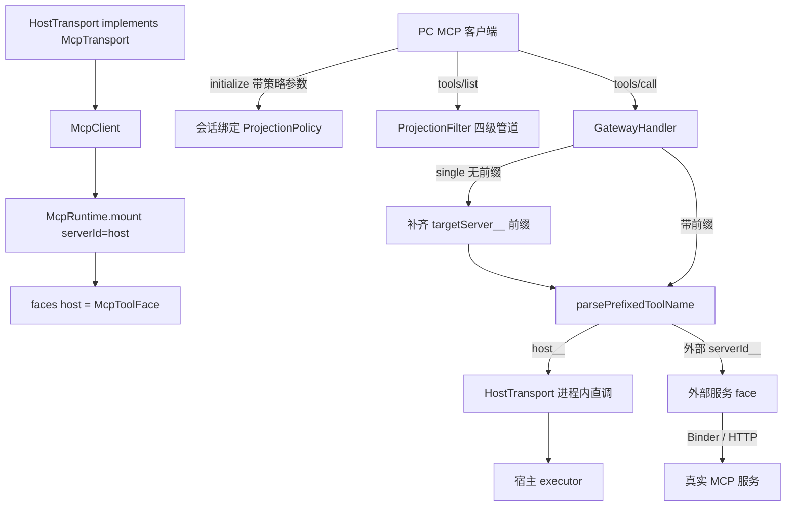
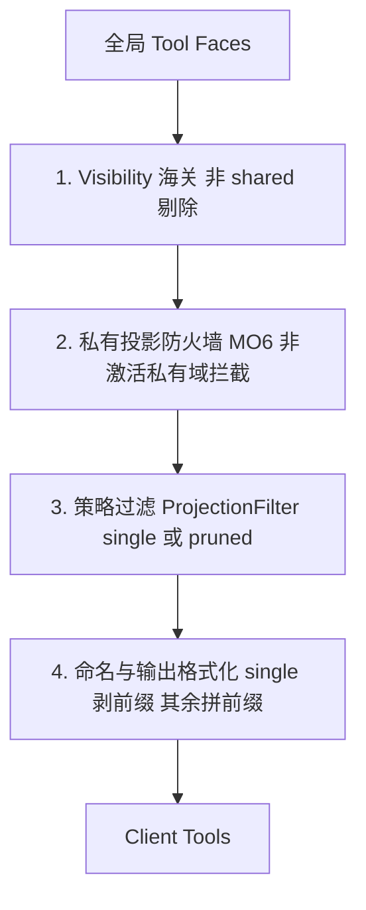

# Host 原生工具经网关导出与策略投影（host__ 虚拟服务）

> 本文是「宿主原生能力如何对网关客户端（PC）可见、可控、按策略分组消费」的唯一设计 SSOT：以 `HostTransport` 伪装标准 MCP 客户端，经既有挂载原语把宿主能力装配为 `serverId='host'` 的虚拟服务；并在网关暴露面引入策略投影管道（单轴 `policy` 四档：`single` / `private` / `full` / `pruned`），使底层装配与对上暴露彻底解耦。访问性模型（Provider×Tier 两维解耦）见 `docs/design/host-gateway-accessibility-memory.md` §1；网关协议与安全闭环见 `docs/design/thirdconnect.md` §7。

## 结论（已拍板）

- **装配路线**：`HostTransport implements McpTransport` → `McpClient(HostTransport)` → `McpRuntime.mount(serverId: 'host')` → `faces['host']`，复用既有「client → negotiate → face → listTools」挂载原语（`lib/coordinator/mcp_runtime.dart`）。
- **消费者视图（装配层合一 · Expand 件，2026-10-23 方向裁决）**：`GatewayController` 即共享能力源单例，面向 App 内链路（chat）开放消费缝——`faceFor(serverId)`（读挂载 face）/ `facesChanged`（变更流，幂等超集口径）/ `ensureEndpointMounted(ep)`（幂等确保挂载：face 表命中直返，未挂载触发一次 `rescan`——**挂载逻辑单点**，绝不复制第二份拷贝）。配套 `McpToolFace` 进度多路复用（`addProgressListener` / `removeProgressListener`）：网关挂载的 face 无构造期 `onProgress`，chat 复用时经监听器注册 UI 委托，共享 face 不丢进度语义。
- **装配层合一（Contract 件，2026-10-23 落地）**：`McpRuntime.assemble` 增 `sharedFaces` 参数——chat 传 `GatewayController.shared.faces`，id 命中即**借用**（跳过新建/协商/连接，消同源双实例双冷启动）。借用边界：进度经监听器接入本会话（close 只摘监听）；client 归源所有，会话失败清理**不关**共享 client、abort **不取消**借用面（共享 client 上可能有其他消费者在途请求，跨消费者取消是踩踏——在途由服务端 90s 超时兜底）；sampling/elicitation/CoW 挂 clients 表，借用面不入表 = 保留源侧既有接线。未命中端点走旧自建路径兜底（缺省空表 = 旧路径，测试隔离不受影响）。chat 侧配套：`_loadEndpoints` 对启用端点 `ensureEndpointMounted` 预热。
- **策略化投影**：网关按连接绑定的 `ProjectionPolicy` 决定对外工具面，策略字面量为 `single` / `private` / `full` / `pruned` 四档（单轴 `policy`：URL 键与控制面参数统一拼写，旧 `strategy=` / `scope=` 为兼容别名）。
- **Host 导出走显式 Allowlist**：严禁把宿主 executor 全量透传；只有登记在 `kHostExportAllowlist` 且逐条配齐 hints / visibility / tags 的工具才进网关面。
- **过滤顺序铁律**：visibility 海关 → 私有投影防火墙 → 策略过滤 → 命名格式化，四级单向、禁止乱序。**海关唯一豁免**：本连接显式绑定的激活私有域（`activePrivateServerId`）不做声明收窄——绑定即信任边界（2026-10-23 用户裁决），目录面与调用面对齐（「能调必可见」）。
- **三条 PR 门禁**：annotations 强制声明、控制面原语黑名单剔除、`host` 保留标识符断言。

## 拓扑与装配链

## 投影策略规范

| 策略字面量 | URL 传参（`policy` 为主键） | 适用场景 | `tools/list` 行为 | 工具命名 | 系统工具 | `tools/call` 边界 |
|---|---|---|---|---|---|---|
| `single` | `?policy=single&server=<id>`（`id` 可为**任意已挂载服务**） | 轻量 / 小上下文模型、单一目标服务 | 仅指定 `serverId` 的工具（**切入即绑定激活域**——私有目标放行防火墙 + 公共/私有目标均豁免海关，2026-10-24 裁决），其余全隐匿 | 对外**剥前缀**直出原生名 | **完全隐藏**（不列出、收到调用显式拒绝） | **拒绝投影集外调用**（含他服务前缀、未投影的私有工具） |
| `private` | `?policy=private&server=<私有服务 id>` | 完整联邦面 + 某一个私有服务（**私有叠加**） | 公共面 shared 全量 + 该私有服务**全量工具**（含非 shared——绑定即信任边界，目录与调用面对齐；其余私有仍隐匿） | 保留 `<serverId>__<tool>` | 列出 | 维持既有「声明非 ACL」口径：调用不因可见性额外拦截 |
| `pruned` | `?policy=pruned&tag=core` | 需编排但上下文受限的模型 | 跨服务聚合，仅含指定 tag 的工具 | 保留 `<serverId>__<tool>` | 列出 | 维持既有「声明非 ACL」口径：调用不因可见性额外拦截 |
| `full`（默认） | `/mcp`（或 `?policy=full`） | 强推理主力模型 | 全量 `visibility == shared` 工具 | 保留 `<serverId>__<tool>` | 列出 | 维持既有「声明非 ACL」口径：调用不因可见性额外拦截 |
| `owner`（**宿主内部档，不经网关暴露**） | 无 URL 入口（`ProjectionPolicy.parse` 显式拒绝） | App 内机主全权视图（机制归一：App 视图 = 管道 owner 档求值，2026-10-23 方向裁决） | **海关全豁免**：全部 face 全量工具（含 private）；私有防火墙照常（由调用方传 `activePrivateServerId` 表达会话绑定） | 保留 `<serverId>__<tool>` | —（不进网关会话） | App 内不经 toolsCall（本机 ToolRouter 直连）；目录集与 `ToolRouter.focusedSchemas` 等价（防漂移断言钉死） |

> **单轴化（2026-10-23 用户裁决 D1）**：策略字面量取**并集** `single | private | full | pruned`，**URL 键与控制面参数统一为 `policy`**——PC 侧只记一套词表（原两轴 `?strategy=…` 与 `scope=…` 并存易混）。
> - **兼容别名（向后兼容，既有 PC 客户端零改动继续工作）**：URL 旧键 `strategy=` 等价于 `policy=`（同传时 `policy` 优先）；控制面旧参数 `scope=` 等价于 `policy=`（**不进入工具 schema**，故 PC 侧看不到第二套词表）。
> - **`pruned` 仅连接建立期可用**（`?policy=pruned&tag=…`）：连接内切换无 tag 来源 → 控制面显式拒绝并给可自纠话术（改用 `policy=single`）。
> - **`private` = 联邦面 + 私有叠加**：私有服务须由本连接显式绑定才进投影面（绑定只改本连接投影，不触碰宿主槽位机 → MO6「PC 无权改写宿主状态」不受影响）。

- 默认策略 = `full`，对既有 PC 客户端保持既有暴露面语义。
- `single` 下**只保留一个网关系统工具** `gateway__select_private`（作为退出通道）：全隐匿会让 PC 切进去后**回不来 = 死锁**；`gateway__list_servers` 在 `single` 下隐匿（已锁定单一目标，无需再选）。
- **`single` 的投影即调用边界**：该策略下拒绝任何不在当前投影集内的调用（含带他服务前缀的名字、以及 `visibility=private` 未进投影的工具）。这是**策略级**拒绝，与「声明非 ACL」（约束对象为 visibility 标记）不冲突；`full` / `pruned` 维持既有口径不变。指向私有服务时，海关豁免（见上）使非 shared 工具**同轮进入目录与投影集**——目录可见性 = 调用可达性恒成立（2026-10-23 用户裁决：修「能调不能看」反向不对称）。

## 会话绑定契约

- **绑定时机**：仅在 `initialize` 握手阶段，网关从该 HTTP 请求的 URL query 解析策略参数，写入派生出的会话 handler（与 `activePrivateServerId` 同级，随 `forSession()` 派生、随连接回收销毁）。
- **后续请求**：`tools/list` / `tools/call` 一律**忽略 URL 参数**，只读会话上绑定的 `ProjectionPolicy`；`Mcp-Session-Id` 查不到会话按既有规则 400。
- **Fail-Fast**：`single` / `private` 指定的 `serverId` 未挂载时，`initialize` 直接返 JSON-RPC error（`-32602 Invalid params: target server not found`），严禁静默初始化为空工具面；`private` 目标非私有服务同样 Fail-Fast（私有叠加只对已配置的私有域开放）。
- **`single` 目标是私有服务 → 连接级私有绑定（2026-10-23 用户诉求增补）**：私有服务**不再要求宿主先激活**——`?strategy=single&server=<私有服务>` 直接把**本连接**投影绑定到该私有服务，PC 即见其无前缀工具面并可实调。**权限集合与既有 `gateway__select_private` 完全相同**（只改本连接投影，绝不触碰宿主私有槽位机，MO6「PC 不得改写宿主状态」不受影响），差别仅在省掉「先连 full 再调一次系统工具」的往返，且 `single` 上下文更小。副作用：`single` 下仍**不列出** `gateway__select_private`（已绑定，无需切换）。
- **策略可经控制面切换，但只改本连接**（2026-10-23 用户裁决，推翻原「策略不可中途变更」）：`gateway__select_private(policy=single|private|full)` 允许会话内改写**本连接**的投影策略（旧参数 `scope=` 为兼容别名，不进工具 schema）。**为何不违反 MO6「PC 无权改写宿主状态」**：被禁的 `use_server` 改的是宿主 `ToolRouter` 槽位（跨 Run / 跨会话共享的宿主态），而此处改的是 per-connection 投影（`forSession` 派生、`disposeSession` 回收）——与既有 `gateway__select_private` 同性质，**权限集合未扩张**，只是省掉「重连一次」的往返。
- **两个网关系统工具（`gateway__` 命名空间，不占业务服务命名空间）**：

| 工具 | 作用 | 边界 |
|---|---|---|
| `gateway__list_servers` | 列出宿主**当前已挂载的全部 MCP 服务**：`server_id` / `tier` / `source` / `shared_tools` / `current` / `policy_target` | **列全部而非只列「私有」**（术语纠错，见下）；只列 id、隐私级别、来源与只读工具数——不含凭据、端点、服务自报名（可能含用户自定义命名）或任何服务内容；**实时现算**（宿主改完配置复查即可，无需重连） |
| `gateway__select_private` | `policy=single` 只看该服务（剥前缀裸名）/ `policy=private` 联邦面+该私有（缺省，既有行为）/ `policy=full` 只看联邦面 | 只改本连接投影；`policy=private` 限私有服务，`policy=single` 允许任意已挂载服务（single 是通用收敛语义）；**旧参数 `scope=` 为兼容别名**（不进 schema）；`policy=pruned` 连接内拒绝（tag 只在建立期可用） |

**`blocked` 诊断段（2026-10-23）**：被信任闸门拦下的本地插件不进 `faces`，只表现为「清单里没这个服务」——用户分不清「没装」与「装了但没信任」，容易被支去错误方向。故列举工具额外输出 `blocked`（serverId + 原因）。**边界**：只给**路由前缀 id 与原因**，**不含包名 / 签名 / Service 类名**（包名才是真正的 app 身份泄露）；且仅 serverId 本就出现在工具名前缀与既有拒绝话术中。

**术语纠错（2026-10-23，PC 侧实测暴露）**：「私有」在本仓有两种含义——① 端点隐私级别 `tier=private`（**仅手填端点**，本地插件恒 public）与 ② 用户口语「我自己单独用的服务」。PC 侧要的是 ②，故列举工具**列全部已挂载服务并逐条标注 `tier`/`source`**，切换用 `scope=single`（允许任意已挂载服务，含 public）。若按 ① 过滤，宿主只装了本地插件（goodshare 等）时清单必然为空，PC 会误判「宿主没有服务可用」并把用户支去改端点隐私级别——**这是工具语义与用户心智错配，不是配置问题**。
- **目录变更广播走投影差分**：`notifications/tools/list_changed` 下发前，重算该连接当前投影的工具集并与上次广播快照比对，**无变化即抑制**。信号本身不携带「哪个服务变了」的负载，故按会话投影判定——同时覆盖「`single` 会话对无关服务上下线无感」与「`full` 会话对私有域变更无感」两类噪音；未维持 GET SSE 订阅的连接按现状收不到下行。

## 过滤顺序铁律（四级单向管道）

- 顺序不可调换：策略过滤必须在海关与防火墙**之后**，否则 `single` 会成为绕开私有投影的后门，并产生「目录看得到、调用被拒」的不一致。
- **海关豁免（2026-10-23 用户裁决）**：激活私有域（`serverId == activePrivateServerId`，含 `policy=private` 叠加目标与指向私有的 `single`）不受 visibility 收窄——调用侧「声明非 ACL」放行一切该域工具，目录若收窄即成「能调不能看」反向不对称；豁免后**目录可见性 = 调用可达性恒成立**（公共面 shared、激活私有域全量）。防火墙（第 2 级）不豁免：非激活私有域依旧目录不可见 + 调用被拒，铁律防越权目的不变。
- **owner 档（2026-10-23 方向裁决）**：宿主内部机主全权视图 = 海关整体豁免（**豁免二的超集**），私有防火墙照常。仅 App 内代码可构造（`ProjectionPolicy.owner()`），`parse` 对网关侧显式拒绝——owner 泄露给 PC 即 MO6 崩塌。目录集与 `ToolRouter.focusedSchemas` 等价（防漂移断言：`projection_pipeline_test.dart` owner 等价用例）；`describeGatewayProjection` 对 owner fail-loud（`StateError`，内部接线错误才可达）。
- **single 切入即绑定（2026-10-24 裁决）**：`policy=single` 指向**任意**已挂载服务都无条件绑定本连接 `activePrivateServerId = target`（URL 初始化路径与 `gateway__select_private` 同语义）——切入即信任边界，与目标 tier 无关：私有目标放行防火墙、公共目标使海关豁免生效，目标服务全量工具面进投影。修「single 切入公共档服务后私有声明工具不可见」（v1.1.1 的可见性来自宿主默认私有绑定 `current:True` 偶然生效，非设计；绑定丢失即复现为 0 工具）。
- `toolsCall` 侧的私有防火墙作为纵深防御**保留**，不因策略而解除。
- 结构化过滤：在 `(String serverId, McpToolFace face, CloudToolSchema schema)` 元组层做对象比对，**禁止**在已拼装的 `name` 字符串上做 `startsWith` / 前缀剥离。

## 命名空间裁决

| 作用域 | 命名形态 | 理由 |
|---|---|---|
| 本机 ToolRouter 调度（`lib/coordinator/tool_router.dart`） | 无前缀 | `serverFor` 对无前缀返 null，承载「本地结果不落 `$ref` 池」语义 |
| 网关 `full` / `pruned` 投影面 | `host__<tool>` | 前缀隔离，防多服务命名冲突 |
| 网关 `single` 投影面 | `<tool>`（对外） | 单服务纯粹交互；入站时由网关隐式补齐 `${targetServer}__` 后复用既有 `parsePrefixedToolName` |

- `host` 为系统保留 serverId，仅限内置 `HostTransport` 独占。
- 与既有网关系统工具命名空间 `gateway__`（`GatewayHandler.kGatewaySelectPrivate`）并列，二者均不占业务 MCP 服务的命名空间。

### single 入站前缀补齐（结构化判定 · 幂等）

`tools/call` 在 `single` 策略下按「先解析、后判定」处理，**禁止**对工具名字符串做 `startsWith` 拼接（会产生 `host__other__tool` 这类畸形名，且违反结构化过滤铁律）：

| 入站形态 | 处理 |
|---|---|
| `parsePrefixedToolName` 成功且 `serverId == target` | 原样放行（覆盖 PC 已带正确前缀，天然幂等） |
| 解析失败（无前缀） | 补 `${target}__` 后重解析；仍失败（工具名自身含 `__`）返 `-32602` |
| 解析成功但 `serverId != target` | 显式拒绝（越出本连接投影面） |

执行顺序：系统工具拒绝 → 本补齐判定 → 既有 `parsePrefixedToolName` 之后的全部分发逻辑。

## Host 导出 Allowlist

`HostTransport` 合成的 `tools/list` 以静态注册表 `kHostExportAllowlist` 为准，**未登记者一律不导出**（留在本地 ToolRouter，本机照常可用）：

| 登记项 | 约束 |
|---|---|
| 工具名 | 与本机 executor 的工具名一致（无前缀） |
| `readOnlyHint` / `destructiveHint` | 必须显式声明其一；未声明者按门禁 1 强置 `destructiveHint: true` |
| `_meta.goodhub.visibility` | 拟对 PC 暴露者必须 `shared`，缺失即 private（不进投影） |
| `_meta.goodhub.tags` | 供 `pruned` 拾取；未打标者不进 `pruned`（见下节） |

宿主能力（记忆读写、内部配置、未沙箱化的工作区 IO）对外属隐私降级，默认不登记；确需导出者逐条评估后入表。

**零项保护**：`tools/list` 返回空数组在 MCP 下合法——空面不报错、仅 DEGRADE 留痕。**不为客户端兼容性向工具面塞 `host_ping` 一类空操作工具**（污染模型上下文、属幻觉源）。保底手段放在测试期：单测断言 Allowlist 至少含一个 `shared` 且 `readOnlyHint: true` 的条目。

### 首项登记：`get_host_status`（2026-10-23 落地）

零隐私 + 有真实推理增益，是四类候选中唯一不推翻既有裁决的路径：

| 维度 | 内容 |
|---|---|
| 工具名 | `get_host_status`（裸名，与本机 executor 一致） |
| 返回 | `{status, host:{app, version, protocol, platform, timezone, locale}}`——宿主身份 / MCP 协议版本 / 平台 / 时区 / 语言区域 |
| hints | 显式 `readOnlyHint: true` → 网关 L1 静默放行 |
| visibility / tags | `shared` / `core`（`pruned&tag=core` 亦可见） |
| 产品价值 | PC 据此对齐**回答语言、时区与协议版本**——真实推理增益，非占位工具 |
| 隐私评估 | 全部字段是宿主自身公开环境事实；**不含**用户数据、服务清单、私有槽位/激活态（后者属已拉黑的 `get_connected_apps` 控制面） |

被否决的候选（留档，防日后重蹈）：

- `query_memory` / `update_memory`：本节「默认不登记」条款直接覆盖；是否向外部 AI 暴露宿主长期记忆属**产品定位**问题，应单独立项讨论，不在工程侧顺手放行；
- `read_local_resource`：网关侧语义不成立（`resource_id` 来自聊天附件上下文，PC 连接不持有该上下文）；
- `get_connected_apps` 等三件：控制面原语，已由 Allowlist 黑名单双层拦截。

**schema 单点拥有**：Allowlist 登记项**不带** `description` / `inputSchema`，二者由宿主执行面（`coordinator/host_status_tool.dart`）单点拥有，装配层经 `HostSchemaResolver` 供给合成面——避免在登记表里复制一份必然漂移的 schema 文本（§5.1 描述引导与 §5.7 契约测试都住在执行器侧）。

## tags 与缺省口径

- **`pruned` 采用保守白名单（Strict Inclusion）**：指定 tag 时，**未打标的工具一律剔除**。`pruned` 的定位就是受限视图，只对显式声明该 tag 的工具开放；未改造的存量插件走 `full` 或 `single`。
- **tags 是服务端静态声明**，不是「低频 / 高耗」的运行时信号——不得据其推断调用成本。
- **生效范围**：tag 匹配当前仅对宿主侧 Allowlist 登记的工具生效；外部插件的打标能力由 SDK 侧追加（跨仓 `loveheng/goodhub-mcp-sdk`），本方案不依赖。

## 三条 PR 门禁（实现前置，随 PR 同轮闭环）

1. **annotations 强制声明**：网关裁决口径为「显式 `destructiveHint` / `readOnlyHint=false` → L2；其余含未声明 → L1 静默放行」。宿主工具无 MCP annotations 来源，故 Allowlist 登记项未显式声明者一律强置 `destructiveHint: true`，确保落 L2 确认卡，严禁裸奔进 L1。
2. **控制面原语黑名单**：合成 `tools/list` 前强制剔除 `use_server` 等控制面原语——PC 不得改写宿主私有槽位；私有投影切换的正道是 `gateway__select_private`（`full` 模式下可用）。
3. **保留标识符断言**：`McpRuntime.mount` 入口断言 `serverId == 'host'` 仅限内置 `HostTransport`，外部插件 / 手填端点声明 `host` 一律抛 `ReservedNamespaceException` 拒绝装配。命名仲裁（thirdconnect §9.3）未落地前重名走静默跳过，本断言是防挤占的唯一手段。

## 落点清单

| 模块 | 动作 |
|---|---|
| `lib/mcp/transport/host_transport.dart`（新） | `implements McpTransport`；响应 `initialize` / `tools/list` / `tools/call`；持 `kHostExportAllowlist` 静态注册表；承担黑名单剔除、annotations 强置、visibility 与 tag 声明 |
| `lib/gateway/projection_pipeline.dart` | 纯函数：策略解析（URL query）+ 元组级四级过滤 + 命名格式化；`single` 入站前缀补齐；投影集签名（`serverId/bareName`）供广播差分与入站边界共用 |
| `lib/coordinator/mcp_runtime.dart` | `mount` 入口加 `host` 保留字断言（三路同点：`mount` / `mountEndpoint` / `assemble` 直挂循环） |
| `lib/coordinator/host_tool_invoker.dart` | 宿主执行端口适配（无裁决）：`assembleHostToolInvoker` 组装「宿主状态 → 记忆 → 资源」执行面 + `HostSchemaOwner` 提供 schema 原文 |
| `lib/coordinator/host_status_tool.dart` | Allowlist 首项 `get_host_status` 的执行器（描述/Schema 的**单点 owner**，§5.1 引导 + §5.7 契约测试住此） |
| `lib/gateway/gateway_controller.dart` | `_assemble` 增第三装配源（host 虚拟服务），与本地插件 / 远端端点并列，单源失败 DEGRADE 不阻断 |
| `lib/gateway/gateway_server.dart` | `initialize` 期解析 URL query 并绑定策略到会话 handler；目标未挂载返 `-32602` |
| `lib/gateway/mcp_gateway_handler.dart` | `toolsList` 接入 ProjectionFilter（`project()` 为目录/差分/入站三处**同一投影源**）；`toolsCall` 按会话策略补齐前缀；`single` 下显式拒绝 `gateway__*` 系统工具调用；`markProjectionBaseline` / `projectionChangedSinceBaseline` 供广播差分 |

## 验收口径

- 单测（**单轴化**）：`?policy=` 新键与 `?strategy=` 旧键同义；同传时 `policy` 优先；`policy=private` 目标非私有/未挂载 → `-32602`；控制面 `policy=` 四档 + 旧参数 `scope=` 兼容；`policy=pruned` 控制面拒绝（带可自纠话术）；**工具 schema 只暴露 `policy`**（`scope` 不进 schema → PC 侧单一词表）。
- 单测：合成 `tools/list` 形状（annotations 强置、visibility、tag）；Allowlist 未登记项不导出 + 非空断言 + 空面 DEGRADE 留痕；`use_server` 剔除；`serverId == 'host'` 保留字撞车抛异常；四级管道顺序（策略不得先于海关 / 防火墙）；`single` 剥前缀 + 入站补齐幂等（已带正确前缀不二次拼接、他服务前缀被拒）+ 投影集外调用被拒 + 系统工具调用被拒 + 目标未挂载 `initialize` 报错；投影差分广播（投影无变化不下发 `list_changed`）；`pruned` 未打标剔除；后续请求改 URL 不影响已绑定策略；PC 调 host 工具经 L2 裁决管道；审计按 `serverId=host` 记账。
- 真机：PC 客户端连 `:8766/mcp?strategy=single&server=host`，仅见无前缀 host 工具且实调成功；连 `:8766/mcp`，见带前缀的完整联邦工具面。**回归项**：已验收 PC 客户端（AtomCode）在 `full` 模式下自动发现 `host__` 工具并正常握手。

## 边界（本文不解决）

- 宿主后台自动化的推理算力：`HybridTaskInference` 仍走 BYOK 云引擎 / 端侧，本文档不改动推理面。
- PC 主脑模式下 PC 离线即无人驱动宿主任务。
- 网关对外仍只声明 `tools` 能力（`GatewayHandler.initialize`），prompts / resources 不在本文范围。
