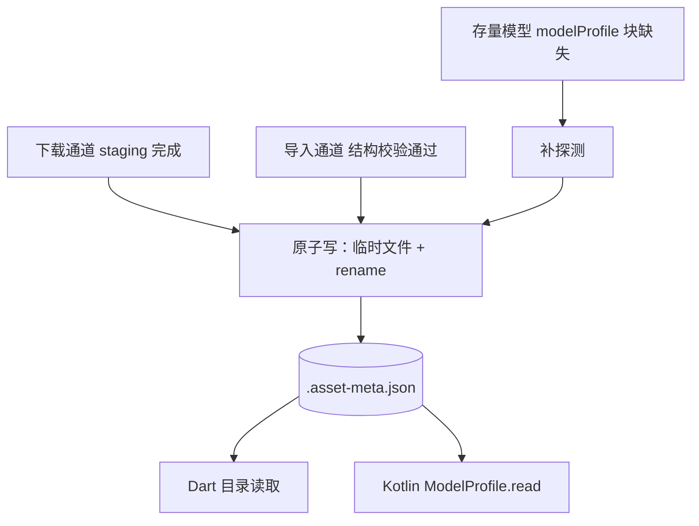

# 端侧模型资产元数据规格（.asset-meta.json）

> 状态：draft（2026-11-02 元数据规格 + 施工批拍板，施工同轮收口后转 active）。
> 关联：`on-device-admission-probe.md`（同目录 `.admission.json` 准入画像，职责分离）、`on-device-lifecycle-single-source.md`（资产身份 modelId）、`on_device_asset_manager.dart`（唯一写方）、`on_device_model_catalog.dart` 与 `engine/ModelProfile.kt`（读方）。

## 1. 定位与边界

`.asset-meta.json` 是模型**静态属性**的唯一真相源：连接 Dart 导入/下载管线（写方）与 Dart 目录 + Kotlin Runner（读方）的跨语言物理契约。它只承载**声明式属性（数据）**，不承载解析逻辑——解析自治归各 Runner（D-3 纪律：AIDL 只承载请求语义，模型静态属性走磁盘 meta 单源）。

同模型目录三文件职责分离：

| 文件 | 性质 | 写方 | 读方 |
|---|---|---|---|
| `.asset-meta.json` | 导入期声明式快照（本稿） | `OnDeviceAssetManager` 唯一写方 | Dart 目录 / Kotlin `ModelProfile.read` |
| `.admission.json` | 运行期准入画像（驱动指纹失效语义） | `OnDeviceAssetManager`（探针/崩溃标注） | Dart 路由查表 |
| 会话票据 | 运行期权威状态 | `:engine` | 主进程入口闸门 |

**meta 是增强面非门禁**：任何字段/块缺失 → 消费方按既有内建口径走，不阻断装载（Kotlin 读方对文件缺失/解析失败一律返回 null）。

## 2. 三分区字段结构

`schemaVersion` = 1。

### 身份区（导入期实测，资产身份依据）

| 字段 | 类型 | 必填 | 溯源 |
|---|---|---|---|
| `version` | string | ✓ | 下载：manifest 版本；导入：`imported-<毫秒时间戳>` |
| `installedAt` | ISO 8601 string | ✓ | 写入时刻 |
| `driverFingerprint` | string? | ✓（值可 null） | 设备驱动指纹；漂移 → 资产整体失效（复用既有脏删重拉链路） |
| `sizes` | map&lt;string,int&gt; | ✓ | 逐文件实测体积 |
| `sha256` | map&lt;string,string&gt; | ✓ | 逐文件实测摘要 |
| `totalBytes` | int | 仅导入通道 | 导入总实测体积 |

### 结构区（结构判定 + 用户声明）

| 字段 | 类型 | 必填 | 溯源 |
|---|---|---|---|
| `runtime` | string | ✓ | 结构校验判定（qairt / llama_cpp / litertlm / auto）；下载通道按 staging 实盘布局判 |
| `family` | string | ✓ | D-1 资产族，`familyOf(runtime)` 单源派生 |
| `displayName` | string | 可选 | 用户声明（导入 UI 输入） |

### 声明区（解析辅助，Runner 装载期自治消费）

`modelProfile` 块（整块可选；块内字段全可选）：

| 字段 | 类型 | 溯源 |
|---|---|---|
| `chatTemplateFamily` | string | qairt：结构判定（qwen_chatml 家族假设显式化）；GGUF：`tokenizer.chat_template` KV 内容映射；探不出 → `unknown`。值域为**开放枚举**——新增家族名不要求契约变更，读方对未识别值的默认行为 = 按「已知他族」处理（手写 fallback 路径 OOD 告警） |
| `stopSequences` | string[] | 从模型模板**闭合 token 推导**（推导非猜测）；litertlm 走 bundle 原生 EOS 终止不写（跨栈模板不引入）；推导不出 → 字段缺席 |
| `contextTokens` | int | GGUF：`<arch>.context_length` KV 实测（架构前缀键单源，如 `qwen35.context_length`；通用 `context_length` 键在真实工件不存在）；litertlm：bundle 规格常量（当前 = Gemma3-1B 1280）；探不出 → 字段缺席 |

## 3. 溯源纪律

每字段有且仅有一类溯源，五类：

| 溯源类 | 含义 | 本稿实例 |
|---|---|---|
| 实测 | 写入时刻对工件的直接测量 | sizes / sha256 / driverFingerprint / contextTokens(GGUF) |
| 推导 | 对工件内容的确定性规则变换 | stopSequences（模板闭合 token）/ chatTemplateFamily(GGUF) / family |
| 规格声明 | 已知特定工件的提供方规格 | contextTokens(litertlm 单 bundle) |
| 用户声明 | 用户在导入面输入 | displayName |
| 结构判定 | 按资产布局/通道结构的判定 | runtime / chatTemplateFamily(qairt) |

硬约束：

- **无实证不写字段**：探不出 → 字段缺席或显式 `unknown`，禁写猜测值。
- **`unknown` 是显式负值**：语义 = 「探测过且探不出」，区别于「字段缺席」（未探测/不适用）——读方不得把两者混同处理。
- **推导必须确定性**：推导规则（如闭合 token 提取）是纯函数，同工件恒同结果。
- **规格声明绑定特定工件**：仅对已知工件有效（Gemma3-1B bundle）；第二款 litertlm bundle 引入时泛化为 per-bundle 规格表（数据非代码，每行 = 一个已知工件的规格声明）。
- **推荐采样参数不进本契约**：GGUF 头无官方推荐采样字段，"按家族预设白名单"属封闭表反模式；按模型采样 preset 归多模型扩展阶段、请求层可覆盖消费（溯源类 = 提供方文档声明）。

## 3.5 来源分级（S0 > S1 > S2）

单字段单源，高优先级来源在场时覆盖低级；多级同时在场且值冲突 = 资产异常（写导入黄灯，禁静默择一）。

| 级 | 来源 | 载体 | 覆盖字段 | 探测实现 |
|---|---|---|---|---|
| S0 | 资产内嵌 | GGUF 头 KV | contextTokens / chatTemplateFamily（模板内容映射）/ stopSequences（家族闭合 token） | `on_device_gguf_header.dart` 单源解析器（v2/v3、12 类 KV、32MB KV 区上限、零权重加载）——`OnDeviceAssetManager._ggufProbe` 委托消费，无私有副本 |
| S1 | 策展声明 | `.asset-meta.json` 声明区 | S0 探不出的字段（litertlm bundle 规格常量 contextTokens 等） | 写方按溯源纪律落盘 |
| S2 | 内建缺省 | 消费方代码 | 最后防线（目录层 litertlm 族 1280 回落等既有口径） | 既有内建口径不变 |

- **值域纪律不变**：任何一级探不出 → 字段缺席或显式 `unknown`，禁写猜测值；S0 探测失败不阻断导入（§1 meta 是增强面非门禁）。
- **context_length 回落语义**（S0 内部）：架构前缀键（`<arch>.context_length`）优先；缺失回落**唯一** context 键；多键冲突不猜（null）。
- **推荐采样（S1，2026-11-03 落地）**：`modelProfile.recommendedSampling {temperature, topP}`（提供方文档声明）——litertlm Gemma3-1B bundle = 官方 Gallery 值 1.0/0.95（0.7/0.9 旧默认真机数字环退化反证）；消费链 = 目录 `OnDeviceModelOption.recommendedSampling` → `_deviceSend` 请求级覆盖引擎内建默认（null 字段不覆盖，缺块走内建默认）；GGUF 头无此字段（S0 恒缺席），Qwen 系待策展数据不猜值。

## 4. 生命周期

- **导入期一次性写**：临时文件 + rename 原子替换（SequentialFileWriter）；下载 / 导入 / 存量迁移三通道同一路径，无第二写方。`:engine` 只读，禁写 meta。
- **导入后不可变**：运行期状态一律不进 meta（准入画像 → `.admission.json`；权威状态 → AIDL 票据面）。
- **只允许整文件重写，禁局部 patch**：任何 meta 修改 = 读全文件 → 内存修改 → 原子重写。
- **身份联动**：modelId = `目录名@version 前 12 位`（`modelIdOf` 单点计算）——**仅 `version` 字段参与身份**。补字段、schemaVersion 升级、存量迁移重写均保持 `version` 不变 → modelId 稳定，不触发资产变更重装。`version` 变更 = 资产身份变更（重导入/OTA 语义）。
- **驱动指纹漂移**：`driverFingerprint` ≠ 当前 → 资产整体失效走既有脏删重拉链路（meta 失效不单独设通道）。

## 5. 消费契约

| 读方 | 落点 | 消费字段 |
|---|---|---|
| Dart 目录 | `OnDeviceModelCatalog`（`InstalledModel.modelProfile`） | 展示 + contextTokens 预算裁剪 |
| Kotlin Runner | `ModelProfile.read(modelDir)`（装载期读自有 modelDir，**不动 AIDL**） | family（手写 fallback 路径 OOD 告警）/ stopSequences（请求未下发时回退）/ contextTokens（诊断） |

前向兼容规则：

- **未知字段忽略**：读方遇到不识别字段不报错、不写入镜像。
- **缺省可选字段 = null**：读方 null 容错恒成立，消费方按既有内建口径走。
- **整块缺失 = 未标注**：`modelProfile` 块缺席语义 = 模型未标注，非异常。
- 读方永不抛错阻断装载（解析失败 = null，留痕走日志）。

## 6. 模板可应用性探针（准入黄灯）

判据 = **模板是否可应用**（资产内是否存在可应用的 tokenizer 模板），不是 meta 字段 null 性——模板优先路径（SDK `applyChatTemplate` / litertlm bundle 原生模板）下，family 标注只在手写 fallback 路径起作用，模板完好的模型即使 family 探测失败仍走正路。

静态探针（导入期）：

| runtime | 探针 |
|---|---|
| qairt | `genie_config.json` + `tokenizer.json` 存在 |
| GGUF（llama_cpp 布局） | `tokenizer.chat_template` KV 存在且非空 |
| litertlm | bundle 布局完整（模板归 SDK 原生 Conversation 角色映射，静态检查止于布局） |

探针不通过 → 导入侧黄灯警告 + 注册表「未验证」徽章。**不定义能力档、不做功能降级**（「仅基础对话」类概念不引入）。

静态探针是必要非充分：资产静态带模板，运行期应用仍可能失败（SDK/资产缺陷）。Runner 侧 `applyChatTemplate` 失败计数是准入复评的一阶数据——稳态非零失败率 = 模型降级为未验证（运行期信号归 `:engine` 日志面，不落 meta）。

## 7. 存量迁移

- 触发：读方侧（目录装载 meta 时）发现 `modelProfile` 块缺失且工件可探测 → 补探测 → 整文件原子重写。
- **幂等**：迁移后块在场，不再触发；探测失败不写（保持块缺席，下次重试，不阻断读）。
- **保 `version`**：modelId 不变，迁移不触发资产变更重装、不产生重装风暴。
- 写方仍是 `OnDeviceAssetManager` 单写方（迁移是其职责内行为，非新写方）。
