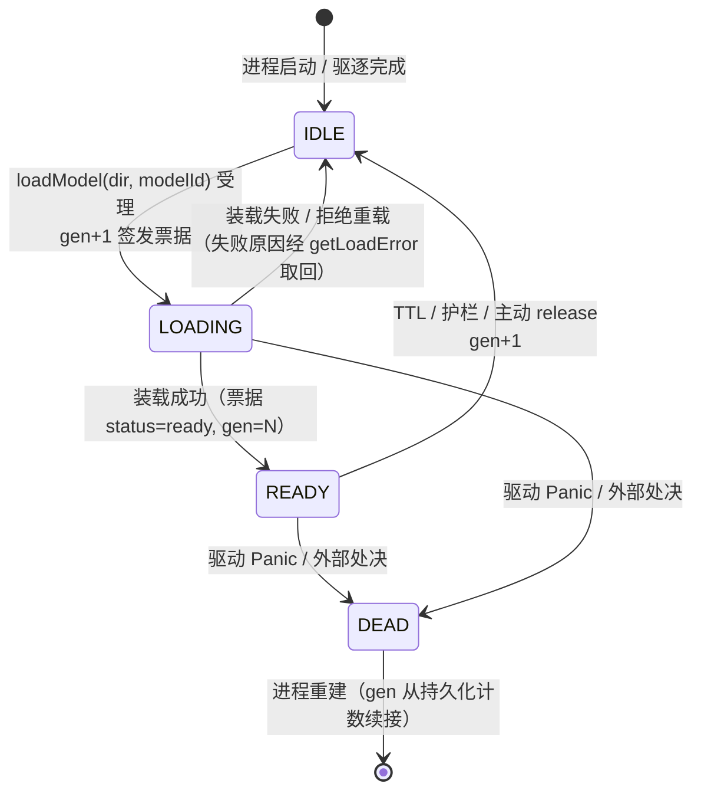
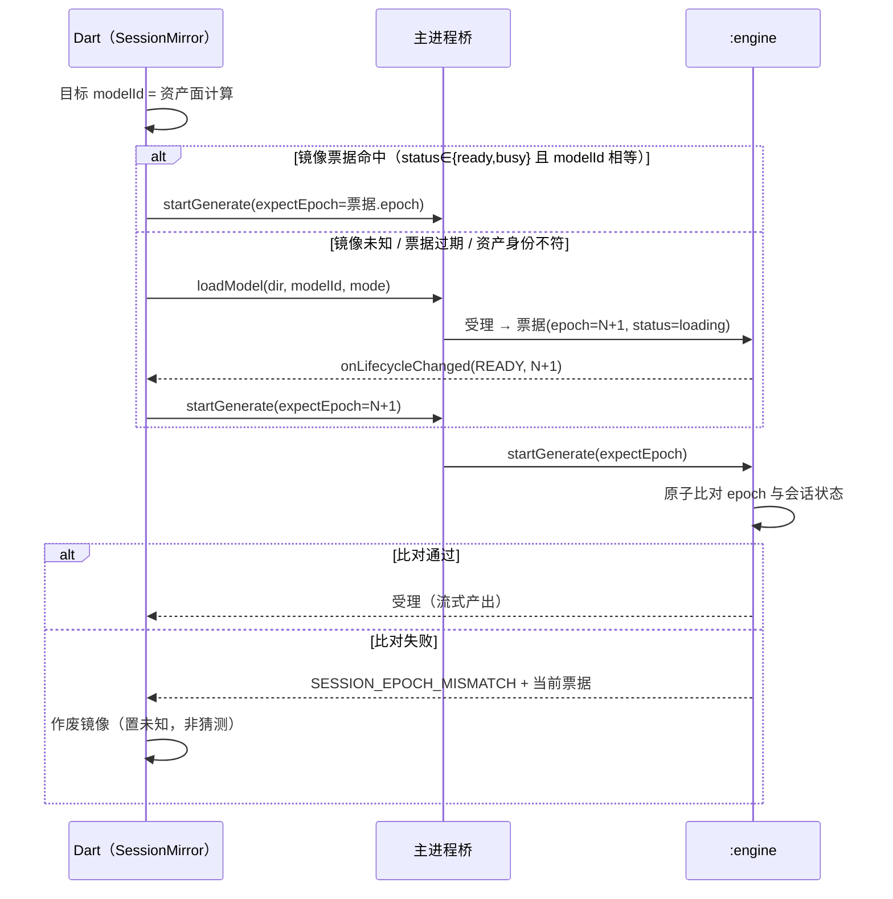

# 端侧引擎生命周期状态单源化（会话票据与代次对账）

> 立项背景：2026-10-29~30 真机连续 11 起事故（ipc deadlock / 映射权限 / 游标回绕 / EPOLLHUP / 句柄符号位 / 受理态误判 / mem-pressure 击杀 / 数据面驱逐后静默短路）复盘定性——其中 7 起为跨进程接缝契约违规、4 起为同一环境（ColorOS）反复击杀 3GB 服务进程。打地鼠的机制根源是**生命周期状态机没有单一主权者**。本文是该缺口的收敛设计；B 工作流（装载存活策略，见 epic devlog 2026-10-30）已独立落地解当前阻塞，本文不重复其内容。
>
> **v2 修订（2026-10-31）**：补四类缺口——① **资产身份**（模型被删除/重导入/切换后会话失效无判据）；② **入口原子自证**（`startGenerate` 前的状态判定存在 TOCTOU，先查后发的两步模型无法收敛）；③ **投影失效语义**（事件应「作废」镜像而非「猜测复位」，后者正是补丁形态）；④ **可测性**（投影依赖注入后可写纯 Dart 回归钉）。代号说明：M1~M4 = 实施步序（Expand-Contract 四步）；I1~I5 = 必须全局成立的不变量。
>
> **v2.1 修订（2026-10-31 外部评审后）**：补 I6（在途生成不被投影作废误伤）/ I7（装载单飞）；epoch 定为 `(instanceId, seq)` 复合键、去磁盘持久化（§2.2）；新增在途驱逐边界（§2.8，含**否决 `DRAINING` 新态**的理由）、通道异常强制作废与冻结超时（§2.9）、装载单飞（§2.10）；§7 五项裁决给出结论并修正两处（UUID 取代时间戳、活体判据优先于时长分档）；新增 §8 边界（控制面 AIDL 载荷上限 / 镜像单实例 / 换模型冷重载成本）。
>
> 相关立法源：`docs/design/on-device-capability.md`（端侧能力公共服务，含 `EngineStatus` 契约）、`docs/design/on-device-npu-deployment.md` §4.1（三态生命周期）、§6.2（LMK 防杀与绑定）、§6.5（熔断口径）、§6.6（单执行槽与原子抢占）。本文只定义**状态一致性机制**，不重复上述内容。

## 1. 问题定性：分布式状态机，无单一真相

「引擎是否可用」这一事实现分散于 3 层 6+ 状态持有者，靠单向事件异步同步：

| 层 | 状态持有者 | 说明 |
|---|---|---|
| Dart | `_loadState`（unloaded/loading/ready/failed） | 混合引擎与 UI 的决策依据 |
| Dart | `EngineCircuitBreaker` / `EngineThermalGate` / `_active` 流表 | 独立判断面 |
| Dart | 资产面（`OnDeviceAssetManager` 的目录与 meta） | 与会话**无任何关联字段**，资产替换后会话身份无从比对 |
| 主进程桥 | `engine` 代理 / connection / dataPlane worker handle | 绑定与数据面句柄 |
| `:engine` | `session.ready/creating` / `dataPlane` / `EngineLifecycle`(TTL/护栏) / thermal / `loadedOnce` | 唯一真正掌握执行真相的一层 |

必须全局成立的不变量没有单点立法，每条重入路径（bind/enable/loadModel/generate 兜底/驱逐回收）各自独立推导前置，任何异步事件（驱逐、进程死亡、热切云、资产替换）打破前置即产生一类新的「说谎态」，而现有处置方式是**在 Dart 侧再加一处复位**——补丁数随失效路径数线性增长。已实证的同类事故：驱逐后 `loadState` 仍 ready（P0-3 前身）、`dataPlane` 驱逐后 `loadModel` 静默短路（2026-10-30）、`assetMissing` 序数承载受理/终态两义（P2-14）、**会话未装载而 `loadState` 仍 ready 撞 `start_rejected`（2026-10-31，修复为在进程死亡与拒绝两处各补一次复位）**。

### 1.1 五条不变量（本设计的全部目标）

| # | 不变量 | 违反后果（已实证） |
|---|---|---|
| I1 | **真相唯一**：`ready` 只能由 `:engine` 侧会话状态产出 | 主进程推断 ready → 跳过装载 → `genie session not ready` |
| I2 | **失效即未知**：未收到权威确认时，投影只能是「未知」，禁止猜测为 unloaded/ready | 猜测复位 = 每类失效一条补丁（打地鼠形态） |
| I3 | **身份绑定**：会话必须绑定装载时的资产身份，资产变更即失效 | 换模型后旧会话继续服务；资产被删后仍持 ready |
| I4 | **判定原子**：状态判定与生成受理在同一 `:engine` 入口内完成，禁止「先查后发」两步 | TOCTOU：查完到发之间会话被驱逐即失败 |
| I5 | **延迟事件可丢弃**：迟到的处账必须能按代次判废 | 旧沿处账覆盖新状态，投影漂移 |
| I6 | **在途生成不被投影作废误伤**：投影作废只影响「下一次请求是否需装载」，不得中断在途流；在途流的生死由 `:engine` 侧 abort + 数据面 EOS/EOF 收口 | 投影作废误伤在途 → 二次错误上报 / 用户看到半截输出 |
| I7 | **装载单飞**：同一目标（`modelId`）的装载在途时，重复触发合并等待同一在途任务；目标变更则作废旧任务 | 惊群：并发预热/请求各发一次 `loadModel`，重复压 2GB 装载 |

## 2. 目标态

### 2.1 权威状态机收敛 `:engine`

- **权威状态机 = `:engine` 的 `EngineLifecycle`**：`IDLE → LOADING → READY / EVICTED / DEAD` 单机承载（含 TTL、内存护栏、驱动 Panic、外部处决全部迁移沿）。
- **主进程与 Dart 沦为投影**：`loadState`/bridge 句柄全部改为票据驱动的镜像（`onLifecycleChanged(state, gen)` 单事件源），**禁止本地独立判定 ready**；判定需求一律转为「等待权威沿」或「发命令看结果」。
- **代次号（gen）贯穿**：装载/驱逐/释放沿递增，旧沿的迟到处账按代次丢弃——消除迟到处账覆盖新状态竞态（B-2 已在 Dart 侧预演同型机制）。

### 2.2 会话票据（SessionTicket）：对账的唯一载体

`:engine` 每次状态变更签发一张票据，主进程只持有「最近见证的票据」，不再持有散落布尔量。

| 字段 | 类型 | 语义 |
|---|---|---|
| `instanceId` | String | `:engine` **进程实例标识**，进程启动时生成；进程重建必变 |
| `seq` | long | 实例内单调自增序号（现有 `EngineLifecycle.generation` 语义上移并对外可见）：装载受理 / 驱逐 / 释放均 +1 |
| `status` | int | `EngineStatus` 序数（终态语义；受理态改用新增 `loading`，见 §2.6） |
| `modelId` | String | 资产身份 = 目录名 + 资产 meta 指纹（`version`/`sizes`/`runtime` 的稳定摘要前 12 位），由资产面统一计算 |
| `runtime` | String | `qairt` / `llama_cpp`（诊断与 UI 归因，不参与路由判定） |
| `issuedAtMs` | long | 签发时刻（诊断面） |

**epoch = `(instanceId, seq)` 复合键，不追求跨进程数字单调**：进程重建即换 `instanceId`，主进程一比即知是新实例。因此**不需要任何磁盘持久化计数器**——端侧被 LMK/OEM 强杀时页缓存不可信，`fsync` 又不可能每次状态变更都做，持久化单调是伪保证（且持久化值回退会让持有旧票据的客户端逃过 `SESSION_EPOCH_MISMATCH`）。`instanceId` 在 `:engine` 进程启动时以 **UUID** 生成：无 IO、无时钟依赖；不用 `elapsedRealtime`（重启归零可碰撞）也不用 pid（可复用）。

**契约面**（AIDL 均为本仓内部契约，不涉及 goodshare 接缝）：

| 方法 | 语义 |
|---|---|
| `checkSession(): Bundle` | 一次取回当前票据，取代 `checkStatus()` 轮询面 |
| `loadModel(dir, modelId): Bundle` | 受理即返回票据（`status=loading`，`epoch=N+1`）；装载异步进行 |
| `startGenerate(requestId, promptJson, params, expectInstanceId, expectSeq)` | 携带主进程见证的 epoch **复合键**（instanceId UUID + 实例内代次 seq），`:engine` **原子**比对后受理或拒绝（I4）。拒绝以 message 前缀分码：`SESSION_EPOCH_MISMATCH:` / `SESSION_LOADING:`（Bridge 折算 PlatformException code `session_epoch_mismatch` / `session_loading`） |
| `getLoadError(): String?` | 终态失败真因查询面（承接 P2-14） |
| `onLifecycleChanged(state, gen)` | 唯一的权威事件源（listener 回调） |
| `onEngineEvicted(reason, evictingRequestId)` | §2.8 I6：驱逐携带被中断的在途 requestId（非空 = 打断在途），Dart 以 `SESSION_ABORTED_BY_EVICTION` 收口 |

`loadModel` 的 `modelId` 由 **Dart 资产面单点计算**（`目录名@meta版本摘要前12位`，`OnDeviceAssetManager.modelIdOf`），`:engine` 票据回显此值承载 I3 对账。

`startGenerate` 的拒绝分码（全部**携带当前票据**，主进程据此决策）：

| 码 | 触发 | 主进程处置 |
|---|---|---|
| `SESSION_EPOCH_MISMATCH` | `expectEpoch != 当前 epoch` | 作废镜像 → 走装载 → 重试一次 |
| `SESSION_LOADING` | epoch 匹配但仍在装载 | 有界等待（沿用现 90s 口径） |
| 终态 + 真因 | 设备不支持 / 内存不足 / 装载失败 | 显式报错，不切云（q-1 口径） |
| 可重试中断 | 进程不在 / Binder 尸体 | 退避重试（沿用 `kEngineInterruptCodes` 口径） |

### 2.3 入口原子自证（I4）

判定与受理合并在 `:engine` 单入口内，主进程不再「先 `checkStatus` 再 `startGenerate`」：

### 2.4 投影语义：失效 = 未知（I2）

这是「不再打地鼠」的机制核心。主进程投影（`SessionMirror`）只有两个操作：

1. **见证**：收到票据 / 装载成功 → 记录 `ticket`；
2. **作废**：任何权威事件（`onLifecycleChanged` 非 READY / 进程死亡 / 通道中断 / 资产变更 / 拒绝码）→ `ticket = null`。

投影**永不**把 `ticket` 置为某个具体状态（不写「设为 unloaded」「设为 ready」）；`unloaded/loading/ready/failed` 全部由「`ticket` + 在途装载任务」派生。于是任何**尚未预见**的失效路径都自动被覆盖——不需要为它新增一条补丁。

### 2.5 资产身份接入（I3）

- `modelId` 由资产面单点计算（目录名 + meta 指纹），导入/删除/切换后取值必然变化；
- 资产变更的三条路径（设置页删除、导入完成、切换选中模型）只做一件事：**作废镜像**（可选：同时在位时主动 `release()` 以尽早归还 ~2GB 权重，见 §7 待裁决）；
- 装载提交携带 `modelId`，`:engine` 侧票据回显该值 —— 换模型后旧会话的票据 `modelId` 与目标不符 → 自动重装，无需事件。

### 2.6 UI 与文案派生

| UI 态 | 派生判据 |
|---|---|
| unloaded | `ticket == null` 且无在途装载 |
| loading | 有在途装载任务（**当前缺失此态**：`_loadState` 从不置 `loading`） |
| ready | `ticket.status ∈ {ready, busy}` 且 `modelId` 匹配目标 |
| failed | 在途装载终态失败（原因取自 `getLoadError()`） |

错误文案由票据 `status` 直出：**装载中/未装载不再复用 `assetMissing` 的「资产缺失」措辞**（该措辞把「没装载」报成「没下载」，已实证误导补救方向）。`EngineStatus` 序数表按既有「仅允许末尾追加」规则新增 `loading`，受理/终态两义分离（P2-14 销账）。

### 2.7 可测性（当前缺回归钉的根因）

投影依赖抽象为 `TicketSource` 接口（生产 = AIDL，测试 = 假件）：纯 Dart 环境即可构造任意票据与任意失效序列，无需真实资产与真实装载。当前「`loadState=ready` 无法在纯 Dart 构造」正是回归钉缺失的根因，本设计下自动消除。

### 2.8 在途生成与驱逐的边界（I6）

`epoch` 是**入口闸门**（请求进入时校验一次），不是「在途吊销令」：生成受理后，中途 `epoch` 递增不影响该次在途生成，判定不再重做（避免流式中途被本地逻辑误中断）。

驱逐与在途的关系由 `:engine` 侧状态机立法（现状：`EngineLifecycle` 的 TTL 只在 `WARM_STANDBY` 生效，**在途（ACTIVE）不被 TTL 打断**；而 `onTrimMemory` / 内存护栏击穿 / 护栏 `onGuardBreached` / 主动 `release` 四条路径在 ACTIVE 态**照常驱逐**——这是有意设计：内存水位优先于本轮产出）。据此：

- **不新增 `DRAINING` 缓冲态**：它会把「内存护栏击穿」这一最需要立即回收 ~2GB 权重的路径变成"等生成跑完"，与 §4.1 三态立法和「端侧内存水位最宝贵」的既定取舍直接冲突；TTL 维度现有 `WARM_STANDBY` 判定已天然实现"在途不驱逐"，无需新态。
- **必须补的是驱逐打断在途的规范化信号**：`onEngineEvicted(reason)` 携带「是否打断在途 + `requestId`」，Dart 侧据此以 `SESSION_ABORTED_BY_EVICTION` 收口（可重试 / 切云，**区别于**进程死亡的 `EngineDied`）。当前该场景靠数据面 EOF 间接收口，语义被混同为「引擎死亡」，既丢归因也让上层切云/重试决策无从区分。

### 2.9 通道异常：强制作废 + 切云，禁止以旧票据重试

`:engine` 被强杀时 `DeathRecipient` 投递存在几十至数百毫秒时隙，此间主进程持"看似合法"的旧票据发出调用。硬约束：

- 任一控制面调用撞 `DeadObjectException` / `not_bound` / `engine_binder_error` → **立即作废票据** + 触发重连重装，**禁止**以旧票据原地重试；
- **generate 路径的通道异常 = `EngineDied` 语义（切云），不是普通 `StateError`**（现状 `startGenerate` 撞 `engine_binder_error` 落 `StateError`，上层按"端侧生成失败"显式报错而不切云——通道中断属可自愈中断，应按 §6.5 切云完成本轮）；
- **进程冻结（假死，非杀死）**同族：OEM 冻结下同步 AIDL 调用可能长时间不返回且**没有** `DeadObject`。控制面调用须有界超时（超时 = 作废 + 切云），否则主线程/平台线程被挂住 = ANR。当前实现无此超时面，属 M3 必补项。

### 2.10 装载单飞（I7）

装载去重键 = 目标 `modelId`：

- 在途装载期间，后续 `enable` / 预热 / UI「验证装载」全部**挂起等待同一在途任务**（Dart 侧 `_loadTask` 单飞已具备此形态，需把去重键从"有无在途任务"收敛为"`modelId` 是否相同"）；
- `modelId` 变更 → 代次作废旧任务，重新提交（换模型不复用旧装载）；
- `:engine` 侧 `session.beginLoad()` 幂等（`creating`/`ready` 不重建）保持不变，作为第二道闸。

## 3. 失效矩阵（证明不再逐路径打补丁）

| 失效路径 | v2 下的收敛机制 | 是否需专属代码 |
|---|---|---|
| `:engine` 进程死亡（LMK/SIGKILL） | 通道中断 → 作废镜像 / 新进程 epoch 不同 → 对账不命中 | 否 |
| 自发驱逐（TTL / 护栏 / trim） | `onLifecycleChanged` → 作废镜像 | 否（事件已有） |
| 热降级切云 | 票据 `status=thermalCutoff` 直出，不判死装载 | 否 |
| 驱动 Panic / 熔断冷却 | 票据终态 + 真因查询面 | 否 |
| 资产删除 / 重导入 / 换模型 | `modelId` 不符 → 对账不命中 → 重装 | 否（仅资产面算身份） |
| 同进程二次装载被拒（`loadedOnce` 单例纪律） | 装载提交返回拒绝票据，主进程按「需冷重载」走重连重试（把隐式自杀副作用改为显式契约） | 否（契约化，非新补丁） |
| 数据面 worker 失效 | 数据面句柄随 epoch 作废，下次装载重建 | 否 |
| bind 重建 / 迟到处账 | epoch 比对丢弃旧沿 | 否（I5） |
| 进程冻结（假死，无 `DeadObject`） | 控制面调用有界超时 → 作废 + 切云 | 否（M3 补超时面） |
| 驱逐打断在途生成 | `onEngineEvicted` 携带在途信息 → `SESSION_ABORTED_BY_EVICTION` 收口，不误伤投影 | 否（I6，补信号语义） |
| 装载惊群（并发预热 / 请求 / 验证装载） | 同 `modelId` 合并在途任务，`modelId` 变则代次作废 | 否（I7） |
| **未来未预见的失效** | 只要未拿到权威票据 → 镜像为未知 → 走装载 | **否** |

## 4. 实施切分（Expand-Contract 四步，每步独立可验证可回滚）

> **实施状态（2026-10-31）**：M1~M4 全部落地——
> M1 checkSession 票据面 + 影子对账；M2 SessionMirror 投影作废化（退役 `start_rejected`
> 字符串 PATCH 与进程死亡/驱逐两处事件复位）、装载单飞去重键收敛 `modelId`（§2.10 I7）、
> `onEngineEvicted` 在途打断信息（§2.8 I6）；M3 `startGenerate(expectInstanceId, expectSeq)`
> 原子自证 + `SESSION_*` 分码收敛重试一次、控制面有界超时（checkSession 3s / startGenerate
> 受理 10s，§2.9）；M4 `checkStatus` 轮询面删除（`authoritativeStatus()` 票据面接管）、
> `EngineStatus.loading`（序数 7）追加销账 P2-14、`assetMissing` 回归终态语义、probe 切票据面。
> 待办：混沌矩阵（`kill × rebind × evict × reload × 资产替换`）真机回归（§6 验收 1）。
> 回归钉：全量 flutter test 1455 项全绿（含枚举双端对齐钉）。

| 步 | 内容 | 契约动作 | 回滚面 |
|---|---|---|---|
| **M1 Expand** | `:engine` 出票据面：`checkSession()` + epoch 持久化计数器 + `modelId` 入参回显 + `onLifecycleChanged`；Dart 侧**双读影子对账**（旧 `loadState` 仍生效，只加对账日志） | 纯新增，AIDL 旧方法不动 | 删新增方法 |
| **M2 Migrate** | Dart 换 `SessionMirror`（`enable`/`generate` 走票据对账）；三处事件复位统一改为**作废**（含已落两处补丁的退役）；资产面暴露 `modelId`；装载单飞去重键收敛为 `modelId`；UI 态派生（补 `loading`）；`onEngineEvicted` 携带在途信息（§2.8） | 消费侧切换，双源并存 | 开关回退旧判定 |
| **M3 Atomic** | `startGenerate` 携带 `expectEpoch` 原子判定；`SESSION_*` 分码接线；通道异常强制作废 + generate 路径按切云语义收口（§2.9）；**控制面调用有界超时**（冻结/假死）+ 载荷上限约束（§8）；移除 `start_rejected` 兜底与 PATCH 标记 | 入口签名变更 | 回退旧签名 |
| **M4 Contract** | 移除 `checkStatus` 轮询面与 Dart 本地 ready 判定；`EngineStatus` 收敛终态语义 + 追加 `loading`；混沌矩阵进回归 | 破坏性收口，单 commit | 单 commit revert |

每步验收：M1 对账零漂移；M2 纯 Dart 回归钉全绿 + 真机复测；M3 混沌矩阵；M4 全量测试 + 真机回归。

## 5. 非目标

- 不改数据面传输语义（UDS socketpair 成帧/EOS/死锁口径，归 S3-7 既有口径；状态机只观测「数据面死/活」信号）；
- 不改熔断分级与环境对抗策略（B 工作流域）；
- 不动 Genie 管线内部（geniex AAR 黑盒边界不变）；
- 不动运行时选择工厂（见 decisions.md 2026-10-31 ADR），本设计只消费票据里的 `runtime` 作诊断。

## 6. 验收

1. **混沌矩阵**（`kill × rebind × evict × reload × 资产替换` 组合，真机 adb 驱动）全组合通过，投影与权威状态**零漂移**（对账日志为证）；
2. 11 起事故中的状态机类（含 2026-10-31 会话未就绪）在矩阵中均有复现用例，且新架构下不复发；
3. **纯 Dart 回归钉**（票据源可注入后）：票据命中不重装 / `modelId` 变更必重装 / 事件到即作废而非猜测 / epoch 不匹配走 `SESSION_EPOCH_MISMATCH` / 装载中派生态为 `loading` / 终态失败文案不复「资产缺失」/ 通道异常必作废且 generate 路径走切云（§2.9）/ 投影作废不中断在途流（I6）/ 同 `modelId` 并发装载只提交一次（I7）；
4. `checkStatus` 移除后全量测试与真机回归全绿。

## 7. 裁决项（外部评审后的定性结论，待用户确认）

| # | 议题 | 结论 | 依据与修正 |
|---|---|---|---|
| 1 | epoch 跨进程单调保证 | **采纳「进程实例标识 + 实例内序号」复合键，不做磁盘持久化** | 见 §2.2：持久化计数器在 LMK 强杀下是伪保证。**修正**：`instanceId` 用启动时生成的 **UUID**，不用 `elapsedRealtimeNanos`（重启归零有碰撞可能）也不用 pid（可复用） |
| 2 | 换模型时是否主动 `release()` | **采纳立即释放**，且升级为不变量：**装载提交前必须已完成旧会话释放** | 旧权重（~2GB）与新模型装载瞬态叠加会推高水位触发系统级 LMK（ColorOS 实证）。**必须知晓的副作用**：`:engine` 侧单例纪律（同进程二次装载必拒并自杀重建）意味着**换模型必然走一次冷重载**（重连 + 新进程装载，数十秒），"立即释放"换的是内存水位，不是"秒级换模型" |
| 3 | `EngineStatus` 追加 `loading` 序数 | **采纳追加** | M4 本就是破坏性收口，不妥协；兼任则 P2-14 不销账，UI 仍会把「装载中」显示成「模型丢失请下载」 |
| 4 | 数据面 worker 是否随 epoch 重建 | **采纳随 epoch 绑定** | 现状 `onEngineEvicted → stopDataPlane` 只做了一半（事件驱动）；把 worker 句柄挂进票据，票据作废即停，消除「句柄在而数据面死」的幂等短路 |
| 5 | 请求侧有界等待时长 | **部分采纳：活体判据优先，时长作上界** | 分档仍会掩盖装载死锁（评审亦指出固定值的问题）。改为：装载期由 `:engine` 侧进度打点作**活体信号**（有进展即不判死），资产 meta 可声明 `loadTimeoutSec`（按体积预填、可改），无声明默认 90s 作上界。与既有云端流「字节活体 + 自适应预算」范式同构 |

## 8. 边界与风险

- **控制面 AIDL 载荷上限**：`startGenerate` 当前把整个 `promptJson` 作为 Binder 事务参数传递；单发提取在多轮长上下文下可能逼近 Binder 事务上限（该上限为**整个系统共享**的缓冲区，不是单进程配额），溢出即 `TransactionTooLargeException`。设计取舍：控制面只传短元数据，大载荷走既有数据面（socketpair）或共享内存/文件描述符。M3 前至少加**有界约束**（promptChars 上限 + 截断留痕），避免把长上下文变成不可预测的通道异常。
- **镜像单实例**：票据镜像必须挂进程级单例（`sharedOnDeviceEngine`），MethodChannel handler 为单槽，第二个实例会互踩回调并各持一份票据 → 一致性机制自毁。
- **换模型的冷重载成本**（见裁决 2）：UI 需在「换模型」路径显式说明将重新装载（秒级~数十秒），避免被读成故障。
- **未纳入**：Genie/ION 同进程二次装载约束（属 `:engine` 后端层既有纪律，本设计只把它协议化为「拒绝票据 → 冷重载」，不试图推翻实证结论）。
