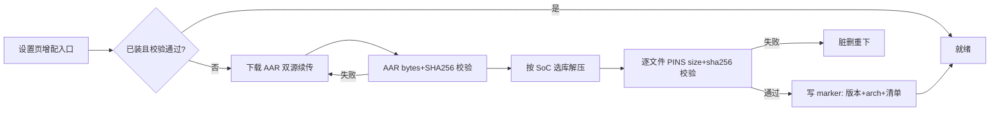

# 端侧推理运行库拆分：GenieX 增配下载 + LiteRT-LM 内置基线

> 状态：draft（2026-11-01 立项，pending-confirm D1-D3 已裁决；实现未开工，两处真机 Spike 为前置）
> 关联：`docs/design/on-device-npu-deployment.md`（引擎深度设计，本稿为其分发面）、`docs/design/on-device-capability.md`（端侧能力总纲）、`context/epics/on-device/geniex-0.10.0-pins.txt`（钉版数据 SSOT）、pending-confirm「on-device / npu-geniex-runtime」批次
> 参考：IRIDIS v2.2.0（`/home/zzh/Downloads/ai/IRIDIS`，app/build.gradle.kts + `engine/geniex/GenieX*.kt`），其 PINS 基于 geniex-android 0.8.0，本仓 0.10.0 全量重生成

## 1. 背景与目标

geniex-android 0.10.0 AAR（89MB，`jni/arm64-v8a/` 51 个 `.so`）当前整包打进 APK，且其中仅 `libQnnHtpPrepare.so`（85MB，离线编译用，S2-5 A/B 实证运行时不加载）被 excludes 排除。机型差异被全体用户背：Hexagon v73/v75 内核对 8 Elite 用户无用，QAIRT Stub/Skel 对非 8 Elite 无用。

目标：GenieX native 库全部移出 APK，运行时按需下载 + 按 SoC 选库解压；LiteRT-LM（litertlm-android 0.16.0，单库 `liblitertlm_jni.so` 21.5MB）回归内置作基线。预期 APK 减重 ~80MB，增重 +10–12MB，净减 ~70MB。

## 2. 裁决记录（pending-confirm D1-D3，2026-11-01）

| # | 裁决 |
|---|---|
| D1 | LiteRT-LM 默认内置 APK（装载基线在场；**D5 收窄：不承接 LLM 级兜底**，GenieX 缺位时端侧 LLM 仍收口云端）；GenieX 拆出运行时按需下载（增配项） |
| D2 | 不引 lite/full flavor，单一构建变体，GenieX 依赖保留 classes-only + jniLibs excludes |
| D3 | 下载源 = Maven Central 主源 + 阿里云镜像兜底 + AAR 字节数/SHA-256 双校验 + 断点续传（每镜像 3 次）；镜像列表后续可配置化 |

## 3. 引擎选择策略（fallback 链）

决策入口在 `:engine` 装载链与设置页两处共用同一判定函数：

```text
首选后端 = GenieX 可用（增配包已装且 PINS 校验通过）且 SoC ∈ GenieX 支持集
兜底     = 内置 LiteRT-LM（任何情况可用）
```

SoC 探测：`Build.SOC_MANUFACTURER`（含 QTI/qualcomm）+ `Build.SOC_MODEL` 正则取 `sm\d{4}` 映射 Hexagon 代际（0.10.0 实测全集）：sm8550→v73、sm8650→v75、sm8750→v79、sm8850→v81（v85 内核随包但无对应消费机型，映射表留扩展位）。其中 QAIRT 全速档（Stub/Skel 集合）仅 v79/v81；v73/v75 走 llama.cpp 档。

不可用态是正常态：GenieX 未下载/校验失败/非高通 SoC → 端侧 LLM 收口云端（capability v3.2 D1a 分层不变，**pending-confirm D5 裁决：内置 LiteRT-LM 仅作装载基线/小模型执行器在场，不承接 LLM 级兜底**）；设置页按 SoC 探测结果决定是否展示增配入口。

## 4. gradle 打包变更（P1 实施定稿，2026-11-01）

`android/app/build.gradle.kts` 的 `packaging.jniLibs.excludes` 从单条 `libQnnHtpPrepare.so` 扩为 GenieX 库族精确排除（核心 5 + ggml/llama/mtmd/npu_jni/Qnn/hta_hexagon/omp/PlatformValidator/calculator 族通配；**不得用宽泛 `lib*.so`**，防误伤自有库与内置基线）。**例外：`libgeniex_plugin_{llama_cpp,qairt}.so`（合计 614KB）留守 APK**——`GenieXSdk.init()` 从 `nativeLibraryDir` 注册插件，缺失即回调 onFailure（P1 验收 12:27 实证）；其 NEEDED 核心库由 GenieXRuntime 预载解决。`useLegacyPackaging = true` 保留。litertlm-android 维持内置（D1 终裁基线）。实测 APK：102.3MB → 46.9MB（净减 55.4MB；原 ≥70MB 预估为未压缩口径，作废）。

## 5. 运行时下载与安装链（GenieXRuntime，Kotlin，主进程）



- 下载：`geniex-android-0.10.0.aar`，89,045,966 字节，SHA-256 `3a40def4…`（全量钉版见 pins 文件）；URL = repo1.maven.org 主源 + maven.aliyun.com 兜底；断点续传按已落盘字节数续 Range。
- 选库解压（0.10.0 版 forArch，**待 Spike 实证定稿**）：基础集 = ggml 系（base/cpu/opencl/hexagon/htp-vN/ggml）+ llama 系（llama/llama-common/mtmd）+ geniex 系（geniex/geniex_core/geniex-proc/geniex-proc-vision/geniex_vlm/omp/npu_jni）+ 插件（llama_cpp 恒装、qairt 按 arch）；QAIRT 集（仅 v79/v81）= QnnSystem/QnnHtp/QnnHtpV{79,81}{Stub,Skel}/QnnHtpV{79,81}.so/CalculatorStub/NetRunExtensions，0.10.0 新增的 `libQnnHtpV{79,81}.so`（12.9/13.9MB）与 CalculatorStub 是否入装载集以插件注册行为实证为准，勿照抄 IRIDIS 0.8.0 清单。
- 完整性：解压逐文件校验 size+SHA-256；marker 文件记 `geniex=0.10.0 arch=vN` + 清单，运行时查询只验存在+大小（SHA-256 仅安装期）。
- 落盘位置：app 私有目录 `files/geniex-runtime/<version>/`，`:engine` 同 uid 可读。**换版重装**（P3）：目录按版本天然隔离，install 成功后 `cleanupOldVersions` 回收旧版本目录与旧 marker（约 70MB/版，Robolectric 回归钉在案）；`uninstall(deleteCache=false)` 保留 geniex-aar 下载缓存——重装免下载/断点续传跨触发有效（缓存删除仅 REINSTALL 演练口径）；`download()` 整包缓存复用（dst size+SHA-256 校验直取，免重下）。

## 6. 装载链（:engine，2026-11-01 S2-5 真机 Spike 实证定稿）

GenieX SDK 对 QNN 运行库位置的控制走**官方 API `setQairtRuntimePath(dir)`**（libgeniex.so C 符号，javap/strings 实证）。两条实证结论取代原 Spike 假设：

1. **「Skel 须在 /data/app lib」结论推翻**（2026-10-28 记录废止）：QAIRT Skel 可从 app storage 装载——FastRPC 日志 `Successfully opened file .../files/geniex-rt/libQnnHtpV79Skel.so`，corrupt 判别实验（同路径放垃圾 Skel → `bad elf magic` → DSP 会话失败）证明 runtime 目录被真实 consult。原结论实为 extractNativeLibs=false 时 APK 内 dlopen 问题，非 app storage 不可用。
2. **JNI 路径死门**：`setQairtRuntimePath` 须在 `geniex_init` 前调用，但 libnpu_jni 的 `JNI_OnLoad` 会跑 `geniex_init`（IRIDIS 注释 + 本仓真机复现）——**经 Kotlin `GenieXSdk` 类的任何调用（含 setQairtRuntimePath 自身）永远迟到**。正解 = 在自有 native 库（libgdw/engine_tombstone 侧）以 `dlopen("libgeniex.so")` + `dlsym` 直调 C 符号，时机在 :engine 进程首次触碰 GenieXSdk 之前。Spike 通道已验证 rc=0。
3. SDK 自管 `ADSP_LIBRARY_PATH`（strings 实证 "ADSP_LIBRARY_PATH set to {}" 模板），外部 setenv 被覆盖——env 路线无效，勿再试。
4. `useLegacyPackaging=true` 的 QNN Skel 落盘依据随结论 1 消解，P1 实现时重评（libgdw/engine_tombstone 等自有库仍按常规）。

**Spike-2 最小装载集（2026-11-01 S2-5 定稿）**：3 件套 {Htp, Stub, Skel} 实证不足（dlopen 报错点名缺 `libQnnSystem.so`）；**4 件套 {libQnnHtp, libQnnSystem, libQnnHtpV79Stub, libQnnHtpV79Skel} 终验通过**——QAIRT 会话创建 + bench 20.3 tok/s / TTFT 192ms，与 26 件全集（19.8 tok/s）同量级。per-arch 变量集 = Htp host 库恒带 + `{System, Stub, Skel}` 按 arch 替换（v79 为本机实测，v81/v73/v75 同构待 P1 实现时按 ABI 清单生成）。注意：反复中断的装载使 dmabuf 堆至 6.6GB（LMK 击杀 :engine），重试策略须带退避；MemoryGuard `availMem<1024MB` 中断阈值在 3GB bundle 装载期易误伤，P1 实现时重评。

装机注意（P1 实现输入）：装载中断路径须回收 dmabuf/权重页缓存——本 epic MemoryGuard 的 `availMem<1024MB` 中断逻辑与 GenieX 装载叠加时，连续重试会造成 dmabuf 泄漏式堆积，重试策略须带退避。

## 7. 设置页增配入口（Flutter，P2 实施定稿 2026-11-01）

落点：设置 › 端侧模型段（`on_device_model_section.dart` 内增配块，不新建 section）。状态机 = 不渲染（非支持 SoC）/ 未安装（可安装）/ 下载中（进度百分比）/ 已装（版本+arch+卸载）。通道 = `goodhub/geniex_runtime`（`GenieXBridge` 主进程：status/install/uninstall，安装跑独立线程，**进度/完成反投必须经主线程 Handler**——工作线程直投 MethodChannel 触发 @UiThread 异常炸掉下载链，P2 演练实证）；Dart 绑定 = `geniex_runtime_binding.dart`（含镜像列表 SharedPreferences 持久化，空 = 内置双源）。**镜像列表编辑 UI（P3）**：增配块「镜像」入口 → 多行对话框（每行一个 URL，非法项过滤，留空回退内置双源），保存即持久化、下次安装生效。

## 8. 分期与验收

| 期 | 内容 | 验收 |
|---|---|---|
| P1 | Spike-1/Spike-2（S2-5）→ gradle excludes → GenieXRuntime 下载/校验/解压/预加载 → fallback 链接线 | ✅（2026-11-01）：APK 净减 55.4MB（46.9MB）；GenieX 装后 4B QAIRT bench 与基线同量级；卸载后基线兜底可用 |
| P2 | 设置页增配入口完整状态机 + 镜像可配置化 + marker 漂移自愈（对齐 §4.8 驱动指纹模式） | ✅（2026-11-01）：三场景演练——漂移 fallback 现场取证（旧 marker 无指纹 → loadError 收口云端）/ 通道面单测 6/6（断源=install false + status 降级）/ 正常装 ~94s → bench 20.2/19.0/20.5 tok/s 不回归；弱网实测挂 P3（断源场景已近似覆盖） |
| P3 | 镜像列表编辑 UI + 换版重装清理 + 弱网续传 | ✅（2026-11-01）：镜像对话框（非法过滤/留空回退默认）；cleanupOldVersions（Robolectric 钉 `GenieXRuntimeCleanupTest`）；双断网周期演练——两次中断 partial 保留、第三次续传完成、bench 19.5/18.0/20.2 tok/s 不回归 |
| P4 | 换版实战（0.10.0→N 上游发版后）+ 弱网长时实测 + 增配块体积精确显示 | ✅（2026-11-01）：体积精确显示（statusMap.sizeBytes 递归求和）；双断网长时演练——两次中断 partial 保留、第三次续传完成、bench 19.5/18.0/20.2 tok/s 不回归。**换版实战 checklist（上游发版即触发）**：① 改 `GenieXRuntime.VERSION` + `GenieXInstaller` AAR bytes/SHA-256 + PINS（从新 AAR 实测重生成）② 新版插件 API 面复查（javap classes.jar，setQairtRuntimePath/注册语义存废）③ 真机 REINSTALL 演练（换版目录隔离 + cleanupOldVersions + marker 指纹）④ QAIRT bench 对照不回归 |
