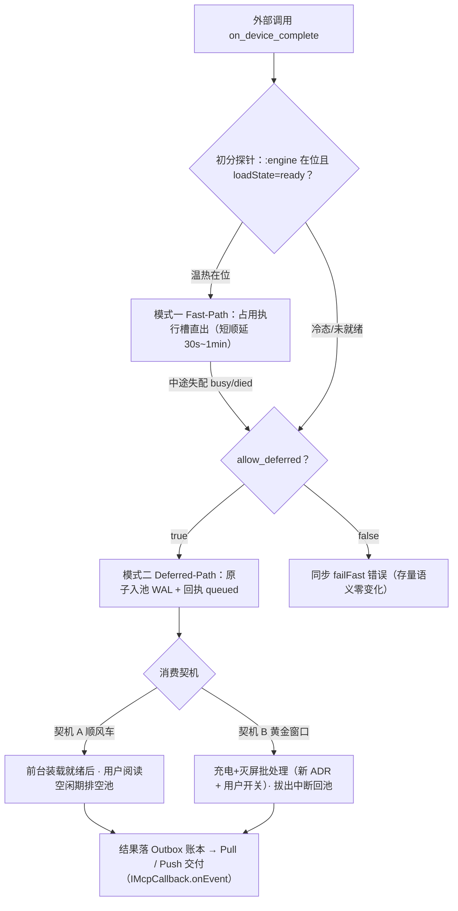

# 端侧模型长驻 · 深化评估（R1–R6 + 能力分级 + 立项路径）

> 定位：「端侧模型长驻」赛道的评估 SSOT（承接 2026-11-07 架构评估的 R1–R6，扩展性半场 E1–E9 已由 `extensibility-hardening.md` 交付归档）。本稿是**评估稿**——P0 施工稿待产品语义优先级拍板后另出。绑定 epic 待 bind。

## 代号说明

- **R1–R8**：长驻风险编号（R1–R6 首评立项、本稿深化复核并修正 R2 定级；R7 驻留绑架 / R8 生存环境分档为评审轮新增）。
- **W6**：跨 App 供给双模机制工作包（本稿第七节 = R7 / Prio-2 的落地设计，分 W6-a/b/c 三步）。
- **L0–L4**：长驻能力分级（现状定位 ↔ 目标阶梯）。
- **P0–P3**：立项路径阶段（P0 施工稿待拍板后另出）。
- **ADR**：`context-stepped-pruning.md` §2.5「端侧不做前缀稳定裁剪」（2026-11-01 拍板）。

## 一、现状基线与拍板边界（不可动项清单）

长驻相关现有拍板（全文见 `context/epics/on-device/decisions.md`，本稿只列与长驻直接相关者）：

| 拍板 | 内容 | 对长驻的含义 |
|---|---|---|
| 生命周期三态 | `ACTIVE → WARM_STANDBY(TTL) → COLD_EVICTED` | 「长驻」现状 = TTL 窗口内待命，非跨 TTL 常驻 |
| TTL 5min | 3~5min 区间取上界（**后台续航优先**，2026-10-30） | 翻动须数据支撑 |
| 退后台不释放（路线 B） | FGS 绑定即挂 + `BIND_IMPORTANT` | 「多活」底盘已扎实 |
| 装载单例纪律 | 单进程单装载，复载 = 进程自杀冷重启（geniex destroy ION/DSP 释放不可实证） | 多模型共存的结构天花板 |
| 懒加载立法 | 启动不预载、`:engine` 不预启；原语绝不触发装载 | 驻留策略只能加在既有装载链上 |
| 协作式打断（K11） | 非抢占，窗口耗尽不得假设算力让出 | 长驻供给面的并发语义已定 |
| 门禁 advisory | RAM/电量/温控只留痕不拦截 | 驻留判定不得重引入拦截式门禁 |
| 前缀稳定裁剪不做（ADR） | Genie 复用零收益实测 + TTFT 102~142ms 达标 + 复杂度不对称 | KV 复用 = 观望项，重评须新实证 |
| 温控全链摘除 | thermalCutoff 永不产出 | 驻留策略不感知温控 |

## 二、R1–R6 深化复核（现状证据 → 长驻阻碍度 → 边界）

| # | 深化结论 | 证据 | 阻碍度 |
|---|---|---|---|
| **R1** TTL 硬编码 | 缺的不是缝，是**上层注入路径**——`ttlMs` 本为构造参数（`EngineLifecycle.kt:34`），AIDL `initEngine` Bundle 缝已存在，Dart 侧无声明入口；5min 常量（`:50`） | `EngineLifecycle.kt` / 票据 Bundle 缝（runtimeDetail 同款先例） | 中 |
| **R2** KV 零复用 | **改判：有实证的观望项，非缺陷**——ADR 三条理由（复用零收益实测 / TTFT 达标 / 复杂度不对称）；`PrefixReuseHint` 契约壳（S18b）已留语义位，插入点在 AIDL/Runner 层 | ADR §2.5 / `on_device_capability.dart:92-100` | 低（裁决内） |
| **R3** [拍板] 单装载+单槽 | 多模型共存的结构**天花板**非缺口；出口 = `OnDeviceEngineFactory.resolve()`（设计稿 §2 留位未建，decisions.md 标 P1-B）+ Dart 侧注册制已多实例友好（`_deviceLeg` 惰性构造） | `EngineService.kt:443-456` / `EngineSlot.kt:89` | 天花板 |
| **R4** 驱逐无驻留优先级 | **最实质缺口**——`onTrimMemory≥BACKGROUND` 即逐（与普通缓存同级），逐了冷装（数秒 + ~6GB ION 瞬态）；水位三层分散：Dart MemGate 1.2/1.6/0.9GB（`on_device_mem_gate.dart`）· Kotlin 6GB/1GB（`MemoryGuardEvaluator.kt`）· hybrid memoryFloor 镜像 1GB；**设计约束：新增驱逐沿必须经 `onEngineEvicted` 既有上行汇入点（四路径汇入现状），禁旁路新增说谎态** | `EngineService.kt` trim 分支 | **中高** |
| **R5** FGS `dataSync` | Android 14+ 对 dataSync 有 6h/24h 配额收紧方向——真长驻的**平台保质期债**；电池白名单入口复用网关的（`on_device_config_section.dart` 复用 `GatewayServiceBridge`），端侧续航无机制身份 | `AndroidManifest.xml:92` | 中 |
| **R6** 端云接口不同构 | S3 拆腿已收敛一半（云/端腿分离）；`responseFormat` 约束解码已双端对齐；finish_reason/usage 仍缺——影响长驻供给面多调用方可观测性 | `OnDeviceLlmEngine` vs `CloudLlmEngine` | 低 |
| **R7** 驻留绑架（评审轮新增） | 跨 App 供给（W5 已上线）的反面：外部插件周期性调用可把引擎**永久钉死在内存**（5min TTL 被无限续命，2~6GB 霸占 24h）——对策 = Caller-Tiered TTL：宿主前台重置标准 TTL；跨 App **只消费温热、不续命**（或短 TTL + 连续 N 次强制睡眠期）；`CallerSubject` 三值主体（hostForeground/hostBackground/externalApp）已在 capability_router 立型，主体维度现成。**机制化落地 = 第七节双模（W6）** | `host_on_device_tool.dart` failFast 现状 / K19 | **中高（W5 上线后真实风险）** |
| **R8** 生存环境分档（评审轮新增） | TTL 单值不感知电源/屏幕状态：低电量（isPowerSave / ≤20%）应即用即焚；充电态可放宽 15~30min；灭屏（SCREEN_OFF）无在途生成应加速衰减（30s~1min）——探针字段现成（`deviceProbe` 已回 batteryPct/isCharging/isPowerSave，现只喂 advisory 门禁）；**联动点：FGS「绑定即挂」须随灭屏策略撤挂（SCREEN_ON + 会话活跃再重建），否则空挂纯耗电** | `LlmBridge.kt` deviceProbe | 中 |

### 二·补 强杀与高侵入场景现状定案

- **驱逐上行链已是现状**：`onEngineEvicted` AIDL 上行 → 四条驱逐路径汇入（`on_device_engine_aidl.dart:1157`）→ 在途生成打断（`:1192`）→ `loadState→unloaded` 写回（:547/:814/:860/:873）→ 票据对账（instanceId 变化不命中即重装）。「TTL 驱逐后 loadState 仍 ready」为已修复史，非现行缺陷；P1 TRIM 分档驱逐的约束 = **新增驱逐沿必须走同一汇入点**，禁旁路。
- **驱逐物理形式 = 开放问题非定则**：`killProcess` 现仅两处（装载停滞自裁 / 复载自杀窗口）；TTL/护栏驱逐走**软释放**（Genie close + stopFgs）以保快速再装载。「软释放的内存卫生（ION 是否真还）不可观测」才是真空白——P0 观测面加**驱逐后 `:engine` 进程 RSS 采样**，数据裁决「软释放 vs 自杀」，禁无数据跳到自杀化（自杀 = 下次使用多 3~8s 进程冷启动，体验换内存卫生须凭数据）。
- **强杀自愈底盘已存在**：`onProcessDied` 上行 + 墓碑（tombstone）+ 票据对账 + cold-reload-restart 窗口——SIGKILL 脏状态自愈非新建制。
- **相机/游戏主动让位的可行边界**：第三方 App **无前台应用检测能力**（`getRunningTasks` API 21 起只返回自身；usage stats 非实时）——可行机制仅系统信号被动响应（trim/LMK/电力监控），「检测到相机/游戏拉起即主动自杀」不可实现，相关设计按此修正。

## 三、能力分级与现状定位

```
L4 多模型共存/多实例     [天花板·拍板]   工厂 P1-B 留位未兑现
L3 上下文温热（前缀复用） [观望·ADR]     实证翻转才动，契约位已留
L2 驻留感知调度          ◄── 真缺口：TRIM 分档 + 水位单 owner（新增驱逐沿走既有汇入点）
L1 驻留策略化            ◄── 真缺口：TTL/让位参数化 + Caller 分级（R7）+ 生存环境分档（R8）
L0 现状 = 「装载后尽量多活」机制集（FGS 绑定即挂 + 5min TTL + 护栏兜底）
```

现状 **L0**；距「策略性长驻」差 L1/L2 两级，两级均**不需要翻任何现有拍板**。

## 四、新增发现（本轮复核）

- **N1 策略层挂点已就位**：实现件单点收口（`extensibility-hardening.md` S2）后的注册制（`registerSharedOnDeviceEngine` + `OnDeviceSupplyFace` 面）= 驻留策略 owner 的天然落点。
- **N2 需求方已真实存在**：跨 App 供给超前落地（W5 `on_device_complete` 已上线）——外部插件调用频率即驻留价值的直接信号，「长驻」非假想需求。
- **N3 设计-实现对齐度好**：生命周期三态、`truncateContext` 契约、TTL 区间（实现取上界）均与设计稿一致——差距集中在策略缺位，非架构背离。`truncateContext` 在 Genie 无 API（DEGRADE 留痕）= 契约已留、实现缺口。
- **N4 实证空白**：无驻留时长/驱逐原因/跨 App 命中率统计面——**是否翻 5min 缺省，现无数据可依**。

## 五、立项路径（P0–P3）

| 阶段 | 内容 | 前置 |
|---|---|---|
| **P0 观测+策略位** | TTL/驱逐让位经 AIDL Bundle 缝参数化（5min 变缺省值）· 驻留观测面（驻留时长/驱逐原因分类/跨 App 命中率/**驱逐时电量区间**/**灭屏驱逐占比**/**被动杀死率**/**驱逐后 `:engine` RSS 采样**/**权重驻留物理形态按栈采样：mmap clean / dmabuf pinned / PSS 三口径**）· 电池白名单独立入口 · **审计项：llama.cpp / LiteRT 的 mmap 权重加载默认未被关闭、权重无 Java 堆中转深拷贝（GenieX AAR 内部行为黑盒登记待证）** | 无——纯增量 |
| **P1 驻留策略 owner** | 水位判定收敛单 owner + TRIM 分档响应（BACKGROUND 降级 / CRITICAL 才逐）+ Caller-Tiered TTL（R7）+ 生存环境分档驱动 TTL（R8：低电归零/充电放宽/灭屏加速衰减 + FGS 撤挂联动）+ **聚焦 bind 预热**（`warmup()`-only 合规变体——bind + waitReady 是既有合法原语、不触权重装载，把 3~8s 进程冷启动/握手掩盖在打字时间里；**loadModel 权重预热仍走 P0 决策点**） | P0 数据支撑 |
| **P2 上下文温热重评** | 条件触发：GenieX prefix API 或新实证 → AIDL `cacheHandle` 位 | ADR 翻转依据 |
| **P3 多实例** | `OnDeviceEngineFactory` 兑现（多模型共存 / 小模型常驻构型） | 翻「装载单例」拍板，独立立项 |

**产品语义优先级（裁决建议，性质 = 显式化既有法律，非新裁决）**：

| 优先级 | 语义 | 策略落点 |
|---|---|---|
| Prio 1 | 宿主前台交互（聊天免装载秒回） | 前台活跃对话流给足标准 TTL；充电态可放宽（R8） |
| Prio 2 | 跨 App 供给（W5） | **搭便车语义**：享受 Prio 1 温热窗口秒回；冷驱逐后默认 failFast / 排队等待，**严禁后台自发唤醒冷装载**（= 确认既有立法：failFast + 懒加载边界 + K19）。机制化 = 第七节双模（W6） |
| Prio 3 | 后台任务链 | 完全让路：内存吃紧优先掐断，绝不为后台链延长驻留（K19 同构） |

**P0 决策点**：①**打字聚焦预热拆两段**——**bind 预热已采纳进 P1**（`warmup()`-only，不翻懒加载立法）；**loadModel 权重预热维持决策点**（聚焦≠提问，1.9GB 可能白付；Apple「全系统分摊预热成本」的类比不适用于单 App 独担，须「聚焦→发送转化率 + 聚焦停留时长 vs 装载时长」观测数据）；②观测面埋点按 Prio 1 主语义设计。

## 六、风险与约束

- **平台保质期**：`dataSync` FGS 在 Android 14+ 的配额方向未实测本 ROM 行为——P0 观测面须含 FGS 存活时长采样，P3 前完成重选型评估（specialUse）。
- **续航成本**：驻留 = 1.9~6GB 权重驻留 + 周期采样开销；TTL 延长直接放大耗电——观测面数据是唯一裁决依据（「后台续航优先」拍板的翻案成本自负）。
- **推进纪律**：L1/L2 不翻拍板可做；L3/L4 各有显式触发条件与翻案成本——严禁未经新实证跳级。
- **观测项（无实证不建机制）**：通话/音频对 HTP 推理的冲突——aDSP（音频）与 HTP（NPU 计算）为 Hexagon 不同内核域，「通话破音/驱动挂死」系推测无实证；真机实证异常再立项，与「温控全链摘除」同款教训（无真机证据不建响应机制）。
- **交互规约说明**：冷装载期间的用户反馈已基本存在（`loadState=loading` 受理态 + `loadPhase` 装载阶段打点 + 状态带指示）——P0 仅需核对其在 3~5s 冷装载场景的可见性，非新建。

### 六·补 Apple Intelligence 模式借鉴定案（评审轮）

| 借鉴模式 | 裁定 | 理由与落点 |
|---|---|---|
| 单一底模 + LoRA 适配器 | **不采纳（登记重评触发）** | 「选定统一底模」与模型导入制拍板冲突（无默认模型、用户自带 GGUF/`.litertlm` 资产）；LoRA 绑死底模权重、用户换模型 adapter 即废，GenieX/QNN adapter 支持未实证；能力差异化已由 `supply/` 提示词模板 + 约束解码承载（= 现状）。**重评触发 = 用户生态出现配套 LoRA 需求且 GenieX adapter 实证可用** |
| mmap 只读 Clean Pages | **栈分治** | llama.cpp（`LLAMA_MMAP` 默认）/ LiteRT 系 mmap = 库默认已具备「高压下变慢而不死」，审计默认未关即得；**GenieX/NPU 主路权重在 ION/dmabuf（DMA pin 内存，非 file-backed clean page），内核不可丢页回收——Apple 类比在主路径失效**。落点 = P0 三口径采样（见 P0 行）+ mmap 未关审计项 |
| 统一中枢透明卸载（PCC） | **内部面 = 现状确认；导出面 = 不采纳** | 内部：`capability_router` + Requirement 声明 + 透明降级链 + localOnly 类型化阻断 = 今天架构；导出面「透明切云」违反「转发方接受降级语义需显式可知」红线（外部 App 数据经宿主云账号出境 = 成本归属 + 隐私授权两宗问题）。外部面演进 = W6 deferred（排队非秘密切云）。**不采纳记录留存防重提** |
| DAS 机会主义调度 | **采纳（W6-c 实现指引）** | WorkManager 声明式约束（充电 + 设备空闲 + 电池非低电）替代自管广播，JobScheduler 底座平台协同；约束 ≠ 授权，M1 ADR + 用户开关仍须（见 7.6） |
| 动线前置预热 | **拆两段** | bind 预热（`warmup()`-only）采纳进 P1——合法原语不翻懒加载立法；loadModel 权重预热维持 P0 决策点（单 App 独担成本、白付风险，凭观测数据拍板） |

## 七、跨 App 供给双模机制（W6 设计 · R7 / Prio-2 落地）

> 定位：`on_device_complete` 导出面的 **v2 演进**——「温热即打（Fast-Path），冷态入池（Deferred-Path）」。核心收益：**绝不因次要任务承受 3~5s 冷装载与 ~2GB 级内存冲击，但模型恰在内存中时充分榨取温热红利**。本节为设计定稿（含评审修正 M1–M6 内嵌），施工前须 `::bind` + 跨仓立法触点同轮修订（见 7.6）。

### 7.1 判定链（M2 修正：探针仅初分，真值由执行兜底）



- **禁 TOCTOU 依赖**（调度纪律 v2.6「禁先查后发」同款）：探针仅作初分——Fast-Path 尝试遇 `ServiceBusy/EngineDied` 且 `allow_deferred=true` 时**自动转池**（降级单飞，与 hybrid 恢复切云同款哲学）；探针失配不产生错误路径。

### 7.2 模式一 Fast-Path 规约

- 温热在位（`loadState == ready`）→ 直接占用执行槽，短文本（分类/提取）亚秒直出，长文本流式。
- **续命规则（R7 落地）**：外部调用**不重置完整 5min TTL**，仅顺延短保底窗口 30s~1min——外部频繁小请求无法把模型钉死在内存。
- 与宿主前台请求撞槽：**前台 > 池任务/外部任务**，抢占走既有 K11 协作式打断，被打断任务回池尾（M6）。

### 7.3 模式二 Deferred-Path 规约

- 冷态（已释放 / 进程死亡 / 整机内存低于警戒线）→ **严禁就地阻塞触发冷装载**：入参原子写入本地任务池，≤5ms 返回回执 `{status: "queued", task_id, mode: "deferred"}`；调用方界面自行呈现「后台分析中」占位，主线程零阻塞。
- **`allow_deferred` 缺省 false（M3）**：存量调用方（goodshare 等）维持同步 failFast 零变化；新语义 opt-in。
- **任务池配额（M4）**：per-caller 上限 + 全局上限（复用 `SupplyQuota` 滑窗形态）；`expiry_ms`（建议 24h）作废时调用方可查（status=expired，非静默消失）；**配额计费点 = 执行时计，非受理时计**（K22「频次产出才计」——惩罚的是产出，不惩罚被积压者）。
- **存储形态**：JSON 账本（`SequentialFileWriter`/`KeyedWriteQueue` 原子写，`task_consume_ledger` 先例）——**不引 SQLite**（配额约束后量级低，新依赖无收益）。

### 7.4 消费契机（两Trigger，零边际成本）

1. **契机 A · 顺风车**：用户前台交互引发的冷装载本来就发生——装载就绪、处理完用户当次提问后，处于 WARM_STANDBY 窗口的**用户阅读空闲期**顺手排空任务池。冷启动成本摊薄为 0。约束：排空中用户新消息 → M6 抢占回池尾。
2. **契机 B · 充电黄金窗口（M1：须新 ADR）**：`ACTION_POWER_CONNECTED` + 灭屏闲置 → 批量吞吐任务池 → 跑完立即卸载深度待机。**与懒加载立法冲突**（无用户交互的后台装载）——须新 ADR + **用户可见开关**（夜间算力批处理 = 电量换算力的交易，充电态由用户授权）；**拔出充电线** → 批处理暂停、未跑任务回池。
3. 严禁第三种契机：不得起后台定时器生硬拉起模型（破坏省电初衷 + 违懒加载立法）。

### 7.5 契约与交付（Outbox）

- **请求载荷（新增可选字段）**：`allow_deferred`（缺省 false）/ `expiry_ms` / 结果交付走账本，`callback_pkg` 仅作展示。
- **联合态响应**：`execution_mode: immediate`（含 result/usage）| `deferred`（含 task_id/status/estimated_trigger）——AIDL `String call(String)` **不动**，联合态装进现有 JSON 信封。
- **交付目标身份（M5 安全修正）**：**必须绑定内核 UID 推导的调用方身份**（既有 `CallerIdentityResolver` 链，S07b 同源）——`callback_pkg` 自报不可信（A 插件可伪装 B 包名截取结果），仅作展示。
- **Outbox 三件**：①结果原子落盘 `PENDING_DELIVERY`；②**Pull**（调用方回前台以 task_id 查询，交付即标记）+ **Push**（复用既有 `IMcpCallback.onEvent` oneway 事件面，**不新增反向接口**；目标 App 被冻结时不盲目拉起，留账本待其自取）；③**过期清账**（>24h 未触达 → 归档清除，防账本膨胀；expired 状态对调用方可见）。
- **与 `PrimitiveSuspension` 划界（防双源）**：K21 挂起态 = **已算完产物**等人工确认（resumeToken 重入、宿主不驻留）；本方案 deferred-WAL = **未受理工作**排队。两者语义不同，禁止互相借用字段。

### 7.6 立法触点与工作包

| 触点 | 动作 |
|---|---|
| goodshare `ai-app-split.md` §3.11.2 | `on_device_complete` 语义 sync failFast → 联合态，**同轮修订**（跨仓立法源） |
| goodhub-mcp-sdk `:contract` | AIDL 不动；plugin-core 解析面 + `api.md` 同轮 |
| `kHostExportAllowlist` | on_device_complete 条目语义注记更新（三关注释钉） |

工作包：**W6-a** 任务池 + WAL + 配额 + 联合态契约（跨仓同轮）；**W6-b** 顺风车排空调度（K11 抢占回池尾）；**W6-c** 充电黄金窗口（新 ADR + 用户开关 + 拔出中断）——**W6-c 实现指引 = WorkManager 声明式约束**（`setRequiresCharging` + `setRequiresDeviceIdle` + `setRequiresBatteryNotLow`，JobScheduler 底座平台协同调度，替代自管广播；**约束 ≠ 授权**，M1 ADR + 用户开关仍须）。

**依赖顺序**：R7 Caller-Tiered TTL（P0/P1）先行——模式一「短顺延」依赖其主体分级；W6 整体属 `on_device-capability.md` 供给面演进，宿主内部调用方（summarizer 等）**维持既有同步语义**，本机制仅作用于导出面。
