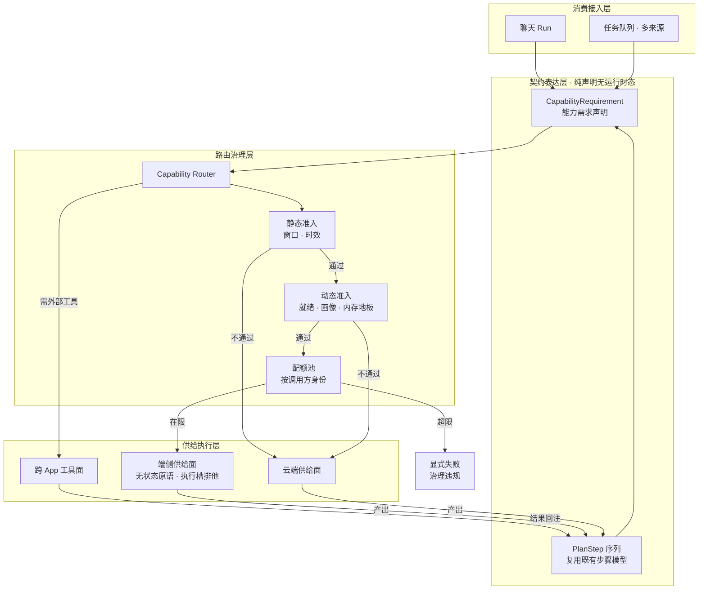
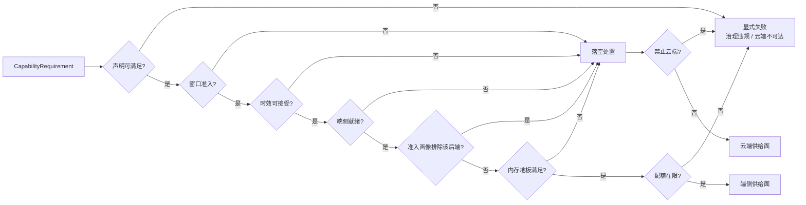

# on-device-task-capability · 端侧算力供给与跨 App 任务协作设计

> 绑定 epic = `task-capability`。本文件是端侧能力从「App 内加速路径」升格为「可被调用的通用算力 + 跨 App 任务协作」的终态设计 SSOT。
>
> 端侧引擎自身的实现细节（进程模型 / 资产分发 / 准入画像 / 熔断降级）不在本稿范围，分别见 `docs/design/on-device-capability.md`（公共服务定位）、`docs/design/on-device-npu-deployment.md`（引擎深度方案）、`docs/design/on-device-admission-probe.md`（准入画像）、`docs/design/on-device-lifecycle-single-source.md`（状态单源化）。
>
> 隐私分级与出站围栏不在本稿范围：现行立法为「端侧路径不设防 + 云端出站正则遮蔽 + fail-closed」（`lib/coordinator/pii_fence.dart`、`lib/coordinator/fenced_cloud_engine.dart`），相关演进议题登记在 epic 待办，随隐私线启动时另行立项，不在本稿预设结论。
>
> 状态：**active**——D1~D4 四项架构决策已裁决（见「裁决记录」），W1 与 W2 门禁已解除；W3 受 D4 前提条件（端侧约束解码承载）门禁约束，W4 形态已定为形态 A。开工仍按 solution-admission 口径逐项放行。

## 代号说明

- **能力需求声明** = `CapabilityRequirement`，任务或步骤级的能力适用性契约（见「能力需求声明」节）
- **算力供给面** = 端侧与云端各自对外暴露的可调用能力集合（本稿统称「供给面」）
- **工作包** = `W1`~`W5`，开发分期编号（见「分期与工作包」节）
- **决策项** = `D1`~`D4`，产品与架构裁决的形态选择（见「裁决记录」节）

---

## 1. 范围与非目标

**范围**

- 端侧算力从「App 内聊天路径的加速分支」升格为**可被调用的通用供给面**。
- 路由判据从**间接推断**（有没有工具 / 工具面是否全本地）改为**显式声明**（这个任务需要什么能力）。
- 跨 App 任务协作的边界形态：goodhub 消费多来源任务队列，或持有跨 App 任务本体并调度参与方。

**非目标**

- 不重新设计端侧推理引擎、资产分发链、准入画像、熔断策略——那些的 SSOT 在各自的 design 稿。
- 不在本稿内定义隐私分级体系与出站遮蔽策略。
- 不定义跨 App 任务的业务语义（各家 App 的任务模型由各自持有）。

## 2. 起点（现行事实）

以下是本设计所基于的现行机制，均可在代码与既有 design 稿中定位。

**供给面已有原语形态。** `lib/llm/on_device_capability.dart` 提供无状态原语 `complete(instruction, input, config) → String`，配三档类型化降级（`failFast` / `degradeToCloud` / `degradeToTruncate`）、独立失败计数与降级冷却窗口、失败必打 `[DEGRADE]` 留痕。任务语义由调用方以 `instruction` 注入。**流式能力在底层已具备**：端侧引擎契约本身是流式的（`Stream<EngineChunk> generate`），是原语入口把流聚合成了全量字符串——因此流式化是暴露既有能力，不是新增机制。

**路由判据当前是两个间接信号。** 一是「请求是否携带工具」——携带云端编排工具时端侧放行被挡（`lib/coordinator/hybrid_cloud_engine.dart` 的工具面判据）；二是「工具面是否全为宿主本地元工具」（`lib/coordinator/hybrid_assembly.dart` 的设备工具面放行条件）。两者把「要动别人的数据」「要调工具」「任务复杂度」「端侧是否适用」压在同一个布尔判断里。

**端侧适用性已有数据来源，缺一张可查的对应表。** 真机基准数据已归档（`assets/model-specs.json` 的 bundle 规格条目 + `context/epics/on-device/decisions.md` 的三档真机基准），`lib/llm/on_device_bench.dart` 是现成驱动器；任务类型与端侧可行性的对应关系目前无表可查。

**跨 App 通道与信任已成型。** 同机 Binder 通道统一为 MCP JSON-RPC 语义（`lib/mcp/transport/binder_transport.dart`），本地插件发现与签名白名单信任分级已落地（`lib/mcp/local_plugin_discovery.dart`、`lib/mcp/trusted_plugins.dart`），宿主工具经 `host` 虚拟服务按 Allowlist 对外导出（`lib/mcp/transport/host_transport.dart`）。

**单次任务语义已有完整实现，但是来源私有。** 接缝侧的任务消费链具备认领、心跳、推理、回写四段与幂等自洽、毒丸防护、熔断、catch-up、对账账本（`lib/task/task_loop_service.dart`、`lib/task/task_consume_loop.dart`、`lib/task/task_consume_ledger.dart`），其纪律条目是跨仓接缝的既有立法（goodshare 仓 `docs/design/ai-app-split.md` 的宿主侧消费纪律）。该链的服务标识当前绑定单一包名常量。

**主体粒度是通道级的。** `Actor` 只有 owner 与 external(id) 两档（`lib/core/actor.dart`），主体在鉴权层推导、禁从载荷读；同机 Binder 通道的主体推导尚未接入。

**能力上限已有声明式落点。** `RunProfile` 三档（chat / gateway / headless）经 `capabilitiesFor` 映射到 `RunCapabilities` 四维（sampling / elicitation / cowSync / planFence），是唯一映射点（`lib/coordinator/run_profile.dart`）。

**跨服务步骤编排已有现成载体。** `lib/coordinator/task_plan.dart` 的 `PlanProposalStep{id, server, tool, intent}` + 每对 (server, tool) 配额 + 写面围栏 `PlanGuard` 构成跨服务步骤模型（设计 SSOT = `docs/design/task-orchestration.md`），其生命周期层级为「计划授权随 Run 焚毁、台账与配额会话级」。任务层的步骤序列以此为载体，无需另造步骤模型。

**端侧路径的历史预算已有专件。** 端侧对话路径的输入预算与历史裁剪由 `lib/llm/on_device_chat_prompt.dart` 承载（全局字符预算 + 输出预留 + 大载荷内联上限三常量），量级与端侧资产的上下文窗口对齐；端侧路径的历史裁剪口径与云端路径分离，不共用云端的窗口策略。

## 3. 终态架构

四层单向流动，是扩展的底线也是防过度切层的红线：

| 层 | 职责 | 边界纪律 |
|---|---|---|
| 消费接入层 | 任务来源（聊天轮次、多来源队列） | 新增入口只须把请求转为契约声明，路由层不因新来源而改 |
| 契约表达层 | 纯声明：能力需求 + 步骤序列 | **不含运行时状态**；步骤序列复用既有步骤模型，不另造映射层 |
| 路由治理层 | 静态准入 → 动态准入 → 配额 | 治理机制只此一处；引擎层不需关心「是谁在调、有没有超频」 |
| 供给执行层 | 端侧 / 云端 / 跨 App 工具 | 只认「输入 → 输出」；换后端不波及上层语义与编排 |

跨 App 任务本体（含生命周期等运行时状态）属形态 B，随其封存不进入本层——形态 A 下契约层是纯声明。

五条设计主线：

1. **声明取代推断。** 路由的输入从「请求长什么样」改为「任务声明它需要什么」。这让端侧适用性成为可契约、可测试、可回归的对象，也使新增供给面（新的端侧后端、新的外部工具源）不需要改路由逻辑。
2. **供给面与任务语义解耦。** 供给面只提供「输入 → 输出」的无状态能力；任务语义由外部注入（`instruction` 参数或 Skill 体系），端侧不内置任务模板中心。
3. **任务边界显式化。** 任务的标识、参与方、作用域成为可寻址对象，跨 App 协作不必依赖「谁的队列里的一条」这种隐式边界。
4. **开放即治理。** 端侧算力是耗电、发热、内存三重密集且共享单执行槽的系统级资源，把它开放给外部调用方即引入新的暴露面——开放面必须与资源治理（调用方配额、并发上限、主体归类、后台调用方限制）同时交付，否则开放本身构成攻击面。
5. **分层不加厚，也不切薄。** 四层单向流动是扩展底线；同时禁止为「将来可能」在层内再套壳——步骤模型复用既有载体、跨进程通信沿用既有通道与导出面、形态 A 下不预架编排中枢。

## 4. 核心抽象

### 4.1 能力需求声明（CapabilityRequirement）

任务或步骤级的能力适用性契约，声明该步需要什么，而非它看起来像什么。

| 维度 | 语义 | 缺省 |
|---|---|---|
| `needsTools` | 是否需要调用外部工具 | 保守取「需要」 |
| `needsStructuredOutput` | 是否需要约束解码 / 结构化产出 | 不需要 |
| `canRunOffline` | 云端不可达时是否仍必须可完成（**下限约束**，非排除约束） | 不要求 |
| `localOnly` | 该步是否**禁止**使用云端（**排除约束**，与 `canRunOffline` 正交：下限约束管「云端不可达时仍要能完成」，排除约束管「任何情况下都不许出境」） | 不禁止（端侧是可选加速路径、云端是产出基线，故缺省不禁止；但须能显式声明） |
| `tokenBudget` | 本步可用的输入 + 输出 token 预算 | 保守取「不预留余量」，由对照表与资产窗口共同裁决 |
| `payloadScale` | 数据体量档（决定走对话通道还是大载荷通道） | 中 |
| `latencyClass` | 时效档：交互级（结果须即时可见）／批处理级（可等待装载与排队） | 批处理级（宁可选云端，不误判端侧可等） |
| `preferLocal` | 是否优先本地算力（用户偏好或策略指定） | 不偏好 |

声明缺省时一律取**保守侧**（宁可选云端，不误判端侧可用）。缺省行为本身是被测对象：任何新增维度必须显式给出缺省值，且缺省变更需同步回归钉。

token 预算以可度量值表达，不以体量档表达：端侧模型的上下文窗口远小于云端模型，档位不足以判定可用性。估算口径复用既有的 token 字符级粗估单源（`lib/core/tokens.dart`），窗口准入判定复用既有的超窗预检纯函数与拒绝异常类型（`lib/coordinator/hybrid_cloud_engine.dart` 的超窗判据与上下文超窗异常），端侧路径不另写第二套截断或估算。

路由优先级：**显式声明 > 用户偏好 > 准入画像（`DispatchProfile`）> 降级链冷却态**。声明优先于偏好，是为了让「声明不可满足」显式失败而非被偏好覆盖。

### 4.2 端侧算力供给面

供给面契约（沿用 `OnDeviceEngine` 已有的抽象粒度，不新增更细的接口）：

| 能力 | 语义 | 约束 |
|---|---|---|
| 流式完成 | 输入指令与输入文本 → 输出文本流 | **基础原语**；不持有会话态；同输入不保证同输出；取消随订阅退订下沉 |
| 全量完成 | 流式完成的聚合包装 | 仅是基础原语的收集形态，不构成独立能力 |
| 能力可用性查询 | 供给面当前是否可提供该能力 | 含端侧就绪态、驻留模型匹配度与模型适用性 |
| 显式装载 | 按需装载算力资源 | 幂等；装载不由供给面调用触发 |
| 降级策略 | 三档类型化降级 + 降级窗口 + 失败留痕 | 降级必留痕，禁止静默；结构化输出场景禁用截断档 |
| 挂起态 | 调用因等待外部授权而无法继续 | **不占用执行槽**；挂起载荷含待确认操作的意图与参数 + **继续签名**（超长载荷可用既有引用句柄承载）；**宿主不驻留等待实例**——调用方凭签名与用户确认凭据在新一轮重入，端侧无状态性不构成障碍（待确认操作是已算完的产物，非半截生成态） |

供给面的六项结构性约束：

- **无状态**：每次调用独立，跨调用不复用隐式上下文。可复用的部分由调用方显式携带。
- **任务语义外注**：语义来自 `instruction` 参数或 Skill 体系（复用 `SkillRegistry` 与 CoW 同步机制，`cow/<promptName>` 命名注册、撞名跳过并通告），供给面不内置任务模板。
- **结构化保证**：失败必类型化、必留痕、必给出可行动原因；降级路径与主路径同样受约束。声明结构化输出时**禁用截断降级档**——被截断的结构化产物必然解析失败，截断在此场景是无效降级；端侧约束解码失败须携带同一份输出规格回退云端重试，而该规格必须是**跨端可归一的中间形态**（各引擎的原生方言差异由各自 Runner 归一），否则「带规格切云」不成立。
- **执行槽主体分类与打断能力**：端侧推理物理单重入，任何时刻至多一个生成在跑。供给面调用须携带主体属性（宿主前台交互／宿主后台任务／外部 App 调用），槽位授予按主体属性裁决——交互级可**请求打断**，后台与外部调用遇槽占用即驳回并转云端，不排队。**打断能力为协作式打断，不是抢占式抢占**：底层推理算子阻塞且不可切分，中断只能在生成循环的检查点生效；打断等待窗口有界，等待耗尽时**不得假设打断已生效**，须按策略性降级处置（前台请求切云或显式上浮等待），不得以重启引擎进程的方式强行腾出算力——重启即冷装载，代价是秒级装载与前台卡顿。跨 App 场景下调用方 App 的前后台状态与宿主进程的前后台状态解耦，主体属性以调用方为准，不以宿主为准。
- **冷热态区分与驻留匹配**：算力就绪分「热态」（权重已驻留，可立即产出）与「冷态」（需显式装载，代价为秒级）。就绪判定须包含**当前驻留资产与目标资产是否匹配**——多资产并存时同一时刻只驻留一份，换驻留即换装载，而既有单装载纪律下换装载等同进程重建，代价是秒级装载与前台卡顿。因此前台交互活跃期不得因后台任务触发换驻留，驻留不匹配的后台任务分流云端。交互级步骤遇冷态不得静默等待装载，须按裁决结果显式分流或显式报错；批处理级步骤可触发装载。装载的触发权归调用方，供给面调用本身不触发装载。
- **前缀复用（可选）**：端侧推理的主要成本在输入预填充，长上下文下预填充为秒量级，逐次调用重算不变前缀会放大时延与能耗。供给面契约暴露**可选**的前缀复用句柄，引用既有前缀缓存与上下文回滚能力，不新建缓存机制；句柄由供给面返回、调用方显式持有与失效。前缀缓存的实际收益依赖引擎侧行为（每请求重置上下文的实现下复用可能不生效），该前提已登记为待实证项——**收益未实证前不承诺命中率**，本条是契约留位而非已实现能力，也不构成任何性能承诺。

治理机制不在供给面：资源准入（内存地板）与配额属**路由治理层**，供给面不自行判断「跑得起吗」「有没有超频」。调用方身份由传输层在平台侧解析后作为治理层输入传入（平台侧解析链路与事实源见开放边界节），供给面只消费已判定的结果与主体属性。

供给面实例化到应用级注册中心（`lib/app/service_directory.dart`），UI 与协调层经注册中心取用，不直连具体实现。

### 4.3 跨 App 任务形态（D1 已裁决为形态 A，形态 B 封存）

两种终态在供给层与路由层完全一致，差异只在任务本体的归属。已裁决为形态 A，形态 B 封存（解封条件见裁决记录）。

**形态 A · Worker（goodhub 消费多来源任务队列）**

任务本体留在各来源 App 侧，goodhub 是执行方。goodhub 侧需要：任务队列消费的多来源接入（去掉单包名硬绑定）、对账账本按来源分组；单次推理内按需调用多个来源的工具时，复用既有的工具环与前缀路由能力，**不新增编排层**。

- 与既有接缝立法零冲突，来源 App 保持任务事实源。
- 落地量约为形态 B 的四分之一。
- 跨 App 协作的编排能力受限：goodhub 只能在单个任务内调用工具，不持有跨 App 的任务生命周期。

**单轮产出边界。** 供给面原语是单次无状态推断，自身不驱动工具往返。往返由宿主的工具环推进：聊天路径复用既有工具环（有步数墙与中断机制）；任务消费路径是单次单轮产出，多轮往返由任务来源方自主推进（发起方拿回结果后自行发起下一轮）。架构图上工具面的结果回注指向步骤序列，含义是「结果回到契约层由调用方处置」，**不是宿主内部自动闭环再推理一轮**。

**槽冲突的消费纪律。** 后台任务遇端侧槽位冲突时**不得误标终态失败**——终态失败不可重试，一次前台交互就足以把排队中的后台任务永久判死。正确处置是**放弃本次认领并退避**（任务留在来源队列，前台空闲后重新调度）；禁止用云端（任务声明禁止云端时）或禁止丢弃。这要求接缝提供「放弃认领」原语：现行接缝只有认领、心跳、回写三段，缺放弃一段，须在跨 App 接入段同轮补齐并同轮修对方仓契约——缺该原语时，槽冲突任务只能退化为「认领后不回写、等超时回收」，代价是任务滞留在队列且占用认领窗口。

**形态 B · 编排者（goodhub 持有跨 App 任务本体）**

任务本体在 goodhub 侧，来源 App 与参与 App 作为被调度方。goodhub 侧需要：任务实体与生命周期状态机、任务级作用域（数据与引用在任务内可寻址）、跨 App 的取消传播、进度聚合、失败域与重试归属、并发写仲裁。

- 编排能力完整，跨 App 的多步协作有统一边界。
- 与来源 App 的任务事实源形成双持，需在跨仓接缝上明确谁持有哪一段。
- 协作的真实难点是三处工程约束，不引入分布式事务机制：① 取消传播——对端调用未必可中断（宿主侧 Dart Future 不可中断，须靠超时与协作式中止），取消是「请求中止 + 等待确认」而非强制撤销；② 部分失败——跨 App 步骤可能部分成功，任务终态须区分「全败」「部分成」「全成」并给出补偿建议，不追求自动回滚；③ 事实源双持——同一任务的状态在两侧各持片段，须在接缝上划定唯一事实段。

**公共内核**：§4.1 声明、§4.2 供给面、§5 路由判据、§6 开放边界在两种形态下完全共用。裁决结果只影响 §4.3 与 §5.3 的接入段。

## 5. 路由判据

### 5.1 判定链

判据顺序固定为七段，分属三段性质：

| 段 | 段内判据 | 性质 |
|---|---|---|
| 声明 | 声明自身可满足性 | 纯声明，随请求给定 |
| 静态准入 | 窗口准入 → 时效 | 只依赖声明内容与端侧资产规格，**路由前即可判定** |
| 动态准入 | 端侧就绪 → 准入画像 → 内存地板 | 依赖端侧与整机运行时状态 |
| 配额 | 按调用方身份的速率与并发 | 依赖调用方身份与历史用量 |

静态与动态分开的好处是「声明不可满足」与「端侧暂不可用」在用户可见文案与降级路径上不混淆——前者是编排问题，后者是资源问题。

**准入落空分两类，处置不同**：

| 类别 | 落空项 | 处置 |
|---|---|---|
| 资源故障（端侧暂态不可用） | 窗口不足、时效不可接受、端侧未就绪、后端被排除、内存低于地板 | **分流云端**（产出优先） |
| 治理违规（调用方超出授权额度） | 配额超限 | **快速失败**：类型化异常，不切云 |

配额超限不切云的理由：配额的作用是保护宿主算力与宿主承担的云端成本。若超限后自动改走云端，等于调用方把自己的算力成本转嫁给宿主的云端账单与并发容量，配额形同虚设。**治理违规与资源故障必须分口径**——前者是「你不该这么用」，后者是「现在用不了」。

内存低于地板时分流云端而非快速失败：云端不在本机执行，本机内存紧张不影响云端产出；若让端侧快速失败，等于在整机内存紧张时把唯一还能产出的一侧也判死。地板值复用既有绝对地板线，不另立数值。

显式声明禁止云端的步骤在落空时快速失败（不切云）——这类步骤的可用性完全依赖端侧就绪，其表达位见能力需求声明的排除约束维度。

**配额记账的事务语义。** 并发数在进入执行槽时占用，退出时无论成功、失败还是切云一律释放。频次计数只在**实际占用端侧算力并开始产出**时计入；因宿主侧资源问题（协作打断未生效、内存跌破地板、槽位被占）被动切云的请求**不扣调用方配额**——资源故障不是调用方的用量。但这类切云产生的云端成本仍由宿主承担，这与「配额超限快速失败」并不冲突：后者是治理违规（调用方超额），前者是资源故障（现在用不了），两者本就该分口径。

窗口准入判定直接复用既有的超窗预检：超窗即拒绝并切云保产出，端侧路径不引入第二套截断。端侧窗口值来自资产声明（随资产元数据下发），窗口未知时按保守值处理并在归因中标明。**预检的载荷口径 = 端侧 prompt builder 按窗口与历史策略裁剪后实际送达的载荷**：原始请求的 system 指令与历史多数会被历史策略丢弃，按原始全量估算会把小窗口资产（如 1280-context 的 1B bundle）每轮误判超窗；路由窗口准入与执行侧超窗预检共用同一份构造结果，不引入第二套估法。

时效判定按网络可达性、冷热态与时效档的组合裁决，处置与理由码一一对应。

**交互级**（结果须即时可见，等待装载不可接受）：

| 网络可达 | 冷态 | 处置 | 理由码 |
|---|---|---|---|
| 可达 | 是 | 分流云端 | `COLD_LOAD_BYPASSED_TO_CLOUD` |
| 可达 | 否 | 端侧直用 | — |
| 不可达 | 是 | 装载等待，上层渲染加载态 | `OFFLINE_COLD_LOAD_WAIT` |
| 不可达 | 否 | 端侧直用 | — |

**批处理级**（可等待装载与排队）：

| 冷态 | 偏好本地 | 处置 |
|---|---|---|
| 是 | 是 | 进入装载候选路径（延迟执行），**不分流云端**——偏好本地在此生效，冷态不得无声忽略该声明 |
| 是 | 否 | 分流云端（无装载意愿，冷态无收益） |
| 否 | 任意 | 端侧直用 |

**装载候选路径须先走完动态准入**（内存地板与驻留匹配度）：准入通过才触发装载并排队，准入拒绝则按资源故障分流云端（禁止云端的步骤除外）。跳过动态准入直接装载，装载请求会被资源门槛拒绝，表现为任务无限等待——这是本表最易落入的陷阱。

两档取向相反：交互级把秒级装载代价落在用户可感知的路径上，故冷态优先分流；批处理级发生在无人感知路径上，且「偏好本地」是明确的成本与流量意图，不应被冷态消解——否则该声明在批处理场景形同虚设。

网络不可达时云端不可用，分流必然失败，故只能等待装载；此时「可离线」类声明在此发挥作用——该类任务本就以端侧为唯一可完成路径，等待装载不是降级而是正常路径。装载等待期间的取消语义是**放弃本轮等待**（装载在后台继续），不是中止装载进程——单进程单装载纪律下中止装载意味着进程自杀重启。

### 5.2 端侧适用性对照表

路由判据的事实基础是一张对照表：任务类型 × 端侧可行性。表结构落在 `assets/model-specs.json` 的 bundle 条目上（`bundles[]` 已存在，扩展任务亲和性字段），由 `lib/llm/on_device_asset_manager.dart` 的现成加载器读取。

表的用途是可查询而非自动判定：给定任务类型，列出适用档位与实测代价（首 token 延迟、吞吐、上下文窗口、产出质量档）。判据逻辑读声明，声明的可行性由对照表支撑。

对照表的数据来自真机基准，由 `lib/llm/on_device_bench.dart` 采集，格式与既有基准归档一致。

### 5.3 接入段（形态相关）

形态 A 下，接入段是「多来源任务队列适配」：消费循环的来源维度从单常量改为可注册集合，对账账本按来源分组。

形态 B 下，接入段是「任务实体 + 生命周期 + 作用域 + 跨 App 协作语义」。

两者的共同前置是主体粒度：主体需可辨到调用 App 身份（同机场景取包名 + 签名指纹，与既有插件信任判据同源），否则授权矩阵在跨 App 路径上不可判定。

## 6. 开放边界

**端侧供给面对外开放的形式。** 端侧算力经宿主工具面导出（`host` 虚拟服务的 Allowlist 机制），命名空间沿用 `host__` 前缀，不新造第二套导出面。导出项携带能力描述与降级语义声明，调用方据此决定是否接受降级结果。

**跨 App 导出的流式口径。** 进程内的供给面调用是流式的（数据面逐批投递，取消随退订下沉），但跨 App 的工具调用遵循 MCP 的请求-响应模型，长流式须借通知机制承载。第一期跨 App 导出**只暴露聚合完成面**，跨 App 流式留待后续——先把「聚合」这一条路径连同治理机制跑通，避免在协议层同时引入分块扩展与治理扩展。若后续开放跨 App 流式，须显式声明承载机制（进度通知扩展或双向通道）并同步处理流中断与半截产物的清理。

**导出面的门禁分四类，算力导出项须逐类通过**：

| 门禁 | 判定内容 | 适用 |
|---|---|---|
| 可见性 | 该条目是否出现在对外目录 | 全部导出条目 |
| 权限 | 主体是否有权调用（主体在鉴权层推导） | 全部导出条目 |
| 标注 | 调用前是否需人工确认（未声明按破坏性处理） | 全部导出条目 |
| **资源治理** | 调用方的速率与并发额度、宿主资源可承载性 | **资源消耗型条目（端侧算力）** |

前三类回答「能不能调」，第四类回答「这次调得起吗、调多少次」。两类正交：权限判定主体资格，资源治理判定额度与承载。**缺资源治理的算力导出项会绕过配额与内存地板，等于把治理机制只写在纸面**；而把算力塞进只覆盖前三类的门禁，等于让长耗时高消耗的元能力借用短平快工具的准入路径。

导出面本身不因新增条目而膨胀：其分派判定是通用规则（保留字、黑名单、成员资格、参数形状），不携带每个条目的治理语义；条目特有的治理（配额、内存地板、执行槽）在执行面实施。

**新增供给面的接入成本。** 新增一种端侧推理后端的接入面已由既有 ADR 收敛：实现 `OnDeviceRunner` 契约、在装载入口按资产族单点路由、控制面契约以自由字符串传递后端选择偏好。外围防护（单执行槽、代次闸、数据面、墓碑、前台保活、生命周期、熔断）保持后端无关。

**跨 App 调用的授权基线。** 跨 App 主体调用写类工具默认进确认层，不适用本机内的静默放行。主体推导落地后，授权矩阵从通道级细化到调用方身份级。

**人工审批不得在算力占用期内同步等待。** 写类工具触发用户确认时，确认是异步的（用户可能数秒乃至数分钟不点），而算力是单重入独占的——同步等待确认等于让整个端侧推理单例被一个未决弹窗霸占，前台交互与后台任务全线阻塞。因此工具调用一旦被判定需人工确认，供给面**立即安全中断并释放执行槽**，以结构化挂起态返回；用户授权后由调用方发起新一轮调用。这条约束对宿主自身的确认卡同样成立，不因调用方是本机而豁免。

**跨 App 算力调用的资源配额。** 端侧算力是耗电、发热、内存三重密集的系统级资源，把它开放给外部 App 调用即引入新的暴露面：单个协作方高频调用即可导致设备发热、续航骤降，甚至宿主被系统看门狗查杀。配额按调用方身份建立（滑动窗口次数制 + 并发上限），形态复用既有的反向请求配额池机制（分池登记 + 计数 + 窗口过期），不新建第二套限流器。**配额判定属路由治理层**：超限即抛类型化治理异常快速失败，**不切云**——配额超限是治理违规（调用方超额使用宿主算力），若超限后自动改走云端，等于把调用方的算力成本转嫁给宿主的云端账单与并发容量，配额形同虚设。这与准入判定中资源故障类落空（分流云端保产出）分属两端口径，不可混用。调用方处于后台时的冷装载请求不被自动满足——装载触发权在调用方，且后台冷装载的暂存纪律仅适用于宿主自身的任务路径。

**调用方身份的事实源。** 调用方身份在平台侧从系统环境解析：进程身份 → 包名 → 签名指纹，解析在平台侧完成，Dart 侧只接收已解析的身份。请求载荷不承载身份字段——载荷自声明身份等于允许任意调用方冒充任意包名，会使信任白名单与授权矩阵同时失效。身份解析失败时按拒绝处理，不按匿名放行。此纪律与既有「主体只在鉴权层推导、禁从载荷读」同构，本次须从协议层延伸到同机通道。

现有的包名与签名字段均取自宿主视角（宿主自身包名用于本地校验，被发现插件的签名用于信任判定），**调用方身份在现有实现中不存在**，须新增解析链路而非复用既有字段。

**调用方进程死亡须联动打断算力。** 跨 App 调用经同机 IPC，调用方进程可能被系统回收或被用户强退；若无死亡感知，宿主会继续跑完剩余推理，占着算力空转发热，回写时才察觉对端已消失。平台侧须为调用方链路注册死亡代理，检测到对端进程死亡时**立即联动打断当前执行槽**（协作式打断，非强制终止），释放算力并作废本次调用。既有方向的死亡代理（宿主作为客户端感知插件死亡）不覆盖反向路径——宿主作为服务端时，调用方死亡需另行链路。

**扩展位与不实现项。** 端侧供给面的对外导出属产品定位范畴（`docs/product/architecture.md` 的对外导出定位条目），本稿只给工程形态，产品放行需单独立项。

## 7. 分期与工作包

工作包按「可独立验证的改动」切分。跨端改动（Kotlin 与 Dart 同改）不跨包切分，避免中间态不可编译。

| 工作包 | 内容 | 产出物 | 前置 |
|---|---|---|---|
| **W1** | 地基修复：状态分类单源、信任判定收口、跨 App 写授权基线、主体粒度与调用方身份取证、端侧服务注册中心化、端侧常量登记 | 端侧状态三分类单源件；信任判定单一入口；主体值对象含 App 身份；同机通道调用方身份的平台侧解析链路；端侧供给面的注册中心接入；常量登记数据行 | 无 |
| **W2** | 判据与对照：能力需求声明值对象、路由判据改造、静态与动态准入、端侧适用性对照表与加载器 | `CapabilityRequirement`；路由判据改造；冷热态与网络可达性判定；内存地板与配额判定段；对照表数据与消费面 | W1（真机采集需人工持机） |
| **W3** | 供给面收口：原语入口收口、语义外注接入、宿主提取分类消费迁移、端侧约束解码承载、可用性查询与显式装载、三档降级矩阵 | 供给面契约与实现（含约束解码规格）；语义注入通道；宿主内置消费迁移为内置静态 Skill；降级矩阵回归 | W2；D4 的前提条件须在本包内满足 |
| **W4** | 跨 App 接入（形态 A）：多来源队列接入 + 对账分组 + 同任务内跨来源工具编排 | 消费循环来源维度可注册；对账账本按来源分组；跨仓接缝泛化契约 | W3 |
| **W5** | 开放：端侧供给面对外导出与跨 App 转发 | 导出项声明与投影适配；调用方配额在开放路径生效（判定归路由治理层） | W3 |

W1 与 W2 门禁已解除，可立即开工；W3 受 D4 前提条件（端侧约束解码承载补齐）门禁约束，W4 形态已定为形态 A（多来源队列接入），形态 B 随其解封门禁封存。

**AI 开发落地的三条纪律**（工程执行约束，非设计条款）：

1. 一个会话 = 一件可独立验证的改动（含其单测、跑测试、修复），跨端不拆包。
2. 先落验收钉（证明改动正确的测试），后写实现——「什么算对」必须先于实现确定。
3. 每工作包结束以全量回归（Flutter 测试 + Kotlin 单测 + 静态检查）作为门禁，不靠抽样。

## 8. 裁决记录

| 决策项 | 裁决 | 依据 | 收敛条件 |
|---|---|---|---|
| **D1** | **形态 A**（Worker：消费多来源任务队列） | 与来源 App 零冲突，来源保持任务事实源；落地量约为形态 B 的四分之一；当前无多 App 双向穿梭的强业务诉求 | 形态 B 解封条件（满足任一即重开立项）：① 出现两个以上来源 App 需共享同一任务上下文；② 形态 A 落地后出现「任务状态须被第三方 App 读取并据此决策」的真实案例；③ 单任务跨 App 步骤数稳定超过五步且需中途可观测 |
| **D2** | **a**（供给面只提供无状态完成能力，任务语义由外部注入） | 供给面保持为通用原语，端侧不成为任务语义中心；语义外注不新增机制（复用既有 Skill 注册与同步通道）；内置模板会使端侧资产与宿主业务代码耦合发版，与资产独立分发的现状冲突 | 若出现「调用方必须接受固定语义才肯调用」的实证协议要求，重开此项修订 |
| **D3** | **分级策略**：网络可达且冷态 → 分流云端；网络不可达且冷态 → 装载等待并向上层渲染加载态 | 分流云端对在线交互最平滑；网络不可达时云端不可用，分流必然失败，等待装载是唯一可完成路径，且此类任务本以端侧为唯一路径，等待不是降级 | 装载等待期间的取消语义（放弃本轮等待而非中止装载）在 W2 的时效判定落地时定死；理由码须随判定落库 |
| **D4** | **① 迁到语义注入路径**（不设过渡豁免） | 豁免会让过渡代码长期留存并增加分支维护成本；迁到语义注入路径后宿主自身成为供给面的第一个种子客户，在 W3 内部即闭环验证语义注入通道，且不破坏 D2=a 的纯粹性，开放阶段无须推翻重写 | **前提条件**：端侧供给面契约须承载约束解码（约束解码规格随生成参数下发，Runner 侧自治匹配），否则「Skill 化的分类」无输出格式保证，迁移即等于能力降级——该前提不满足则本项裁决挂起，W3 须先补契约 |

四项裁决已落，后续工作包按裁决形态施工；W1 与 W2 的 gate 解除。

## 9. 需修订的现有立法

以下条目与本稿终态存在张力，须在对应工作包开工前同轮修订（跨仓条目同轮修对方仓文档）。

| 条目 | 现表述 | 修订方向 | 关联工作包 |
|---|---|---|---|
| `docs/product/architecture.md` 端侧职责条 | 端侧不承担通用调度，仅运行单一提取分类任务与约束解码 | 升格为「按能力需求声明路由后的算力供给方」；约束解码仍为端侧独占能力。该条与 D2=a 存在直接张力——「端侧运行提取分类任务」隐含端侧内置该语义，而 D2=a 要求语义由外部提供，两条须同轮一并对齐。**另须补实证缺口**：该条承诺的约束解码真机实证来自旧裸机桥路径，引擎换线到独立进程通道后未被承载，端侧生成参数契约当前无约束解码规格，须在 W3 内补齐 | W3 |
| 生成参数契约（端侧 Dart `GenerationConfig` + 平台侧生成参数 Bundle + 跨仓立法源） | 端侧生成参数无约束解码规格字段；平台侧参数键集与 Dart 侧各自一份 | 增约束解码规格字段并双端同轮对齐；跨仓接缝条款须同轮修goodshare 仓 `ai-dev-spec.md`（立法源） | W3 |
| `docs/product/architecture.md` 对外导出定位条 | 宿主能力对外导出属产品定位，须单独立项 | 供给面导出面按此立项，工程形态按本稿 §6 | W5 |
| `docs/design/on-device-capability.md` 分期节 | P2 待定（经虚拟服务导出、跨 App 复用端侧引擎） | 与本稿 W5 对齐，P2 项按本稿口径细化 | W5 |
| 接缝契约（goodshare 仓）任务通知节 | 宿主侧消费纪律条目 | 形态 A 下泛化为多来源接入契约；**补齐「放弃认领（Release / Nack）」原语**以承载槽冲突退避（现行仅认领 / 心跳 / 回写三段，缺该原语时槽冲突任务只能认领后不回写等超时回收）；形态 B 下新增任务本体段 | W4 |
| `lib/core/actor.dart` 主体粒度 | owner / external(id) 两档 | 增加 App 身份档（同机取包名 + 签名指纹） | W1 |
| `lib/mcp/tool_visibility.dart` 可见性条 | 声明不等于访问控制 | 导出面的门禁拆为四类（可见性 / 权限 / 标注 / 资源治理），算力导出项须过资源治理门禁 | W5 |
| `context/epics/on-device/memory.md` 端侧职责硬约束条 | 端侧不承担通用调度 | 同架构条，须与本稿同步 | W3 |
| `lib/core/tokens.dart` token 粗估口径条 | 字符级上界估算，口径单源 | 声明层的 token 预算直接引用该口径，不另写估算器 | W2 |
| `lib/mcp/sampling.py` 反向请求配额池条 | 按服务维度的滑动窗口次数配额 + 分池登记 | 端侧算力的调用方配额复用该形态，配额键由服务维改为调用方身份维 | W5 |
| `lib/llm/on_device_pending_load.dart` 后台冷装载暂存纪律 | 暂存标记 + 前台提示 + 不自动并发消费 | 纪律扩展到外部调用方：调用方处于后台时的冷装载请求不被自动满足 | W5 |

## 决策日志
- [2026-11-04] [决策]: 实施期关键裁决五条（W1~W5 + S07/S07b + S18b 全轨落地后收口）——① **S14e 排除位单通道收口**：`localOnly` 排除位落空判定收敛为 `verdict.localOnlyViolation` 单通道（覆盖声明不可满足类 + 端侧状态类全部落空段，快速失败不切云 K10），删除后置重复分支并钉「禁双通道漂移」；② **S17b 约束解码承载**：`GenerationConfig.responseFormat` 双端下发（Dart 契约 ↔ Kotlin `GenerationParams`，键名单源 SessionTicketWire）+ Runner 侧自治匹配（LiteRtLm 接 SDK 0.18.1 ResponseFormat / Genie 管线无承载位**显式 -5 拒服务**禁静默无约束产出），结构化场景禁截断降级档（K15）+ 失败带同一份规格回退云端；③ **S18c/S19 语义单源**：`completeStream` 为基础原语、`complete` 降为聚合包装（S19 修受理段异常绕过降级链回归——旁路 = 计数丢失 + degradeToCloud 档失效）；④ **S07b 身份红线承载**：身份只从内核调用方 UID 推导（`CallerIdentityResolver` 单源），载荷不承载身份字段，解析失败按拒绝（-32001，禁匿名放行）；真机实证 uid=10453 → com.zzh.goodshare + 签名指纹（Ace 6，网关回环 → ai_suggest_tags → Binder 反向帧）；⑤ **S18b 前缀复用契约留位**：可选接口 `OnDevicePrefixReuseAware`（同 OnDeviceInterruptible 铁律隔离可选面）+ `config.prefixReuse` 传递载体，收益未实证前不承诺命中率（K12），不新建缓存机制，引擎侧承载随实证落地。跨仓接缝四处同轮立约（goodshare ai-app-split §3.11/§3.11.1/§3.11.2/§3.12.4 + release_ai_task 原语）。
- [2026-11-03] [SSOT 修正]: 外部评审采纳轮 —— 设计稿补强 5 处（§4.1 声明增 `tokenBudget` / `latencyClass` 两维；§4.2 供给面约束由三项扩为五项，增执行槽主体分类与冷热态区分；§5.1 判定链扩为六段并区分「声明可满足性」与「端侧当前状态」两类落空；§6 开放边界增按调用方身份的速率配额与后台冷装载限制；§4.3 形态 B 协作难点改按工程约束表述）。同时新增待裁决 D3（交互级遇冷态处置）/ D4（语义外注后宿主自身提取分类消费处置），并把「端侧职责条与 D2=a 的直接张力」写入需修订立法清单。评审四条中两条的「现状盲区」经代码实证不成立（单执行槽策略 B 与前台抢占已落地于 `engine/EngineSlot.kt`；端侧超窗预检与拒绝切云已定稿于 `hybrid_cloud_engine.dart`），故采纳落法一律为「扩展既有机制到新主体」而非新建（token 估算复用 `lib/core/tokens.dart`、配额复用 `lib/mcp/sampling.py` 配额池形态、执行槽复用 `engine/EngineSlot.kt`）。编号冲突修正：终态裁决 / 工程选型 / 推后隐私议题改 D／E／P 三类分编。
- [2026-11-03] [决策]: 终态形态四项裁决落定——**D1 = 形态 A**（Worker，形态 B 写三条件解封门禁，不写「封存至下版本」）、**D2 = a**（通用原语，语义外部注入）、**D3 = 冷热态分级策略**（网络可达且冷态分流云端 / 网络不可达且冷态装载等待并渲染加载态，各带理由码）、**D4 = ① 坚决迁到语义注入路径**（自产自销破局：宿主提取分类内置提示抽为内置静态 Skill，宿主成为供给面第一个种子客户）。全部 gate 解除，W1 与 W2 立即可开工。
- [2026-11-03] [SSOT 修正]: 第二轮评审采纳同时修正三处实证错位——① **端侧约束解码缺口**：约束解码规格当前只存在于云端契约（`LlmResponseFormat`），端侧契约的生成参数与平台侧参数键集均无该字段，架构条承诺的约束解码实证来自旧裸机桥路径、引擎换线后未承载 → D4 迁移若不补此前提即为能力降级，故列为 D4 前提条件并新增 S17b；② **调用方身份缺口**：同机通道现有包名与签名字段均为宿主视角插件身份（宿主自身包名 + 被发现插件签名），调用方身份在现有实现中不存在 → 新增 S07b 平台侧解析链路（载荷不承载身份、解析失败按拒绝）；③ **内存门槛取值**：评审建议的 400MB 低于现有全部水位线（起跑 1.2GB / 棘轮 1.6GB / 硬失败 0.9GB / 绝对地板 1GB）且无实测依据 → 改复用既有绝对地板线，落供给面调用的资源准入层（执行槽管并发、准入管可承载性，准入不入画像以免污染后端健康判定）。另澄清「可离线」声明为下限约束而非排除约束，形态 B 协作难点改按取消传播 / 部分失败 / 事实源双持三条工程约束表述，不引入分布式事务框架。
- [2026-11-03] [SSOT 修正]: 第三轮评审（分层纪律）采纳 —— 设计稿 §3 架构图重画为**四层物理分层**（消费接入层 / 契约表达层 / 路由治理层 / 供给执行层，单向流动），并作三处实质修正：① **治理层此前只存在于正文未上图**（图上仅一个 Router 节点）→ 治理层展开为静态准入（窗口·时效）/ 动态准入（就绪·画像·内存地板）/ 配额池（按调用方身份）三个子机制，与正文对齐；② **内存地板位置错误**（原置于供给面调用准入 = 快速失败）→ 上移至路由动态准入，落空改为**分流云端**（内存紧张时把唯一能产出的一侧判死等于放弃产出，与产出优先原则冲突）；③ **配额耗尽行为真空** → 明确超限分流云端不拒绝请求（配额的作用是保护宿主算力，不是让调用方拿不到产出）。另三处对齐：契约层显式声明为「纯声明无运行时态」（跨 App 任务本体含生命周期属形态 B 随封存不进入本层）；「任务层」更名为「契约表达层」；形态 A 描述中「同一任务内跨来源工具调用的编排」改为「单次推理内按需调用多来源工具，复用既有工具环与前缀路由，不新增编排层」（消解被误读为形态 A 下预架编排中枢的歧义，对应评审防腐红线第三条）。设计主线由四条增至五条（增「分层不加厚也不切薄」）。
- [2026-11-03] [SSOT 修正]: 第三轮评审（现实运行尺度：上线 3~6 个月后接入真实业务与外部 App）采纳 ——四处内在张力中三条完全采纳、一条部分采纳。① **配额超限不得切云**：上一轮写「准入落空一律分流云端」把治理违规与资源故障混为一类，现拆为两类——资源故障（窗口/时效/就绪/画像/内存地板）分流云端保产出，**治理违规（配额超限）快速失败抛类型化异常**，理由是超限后自动走云端等于把调用方的算力成本转嫁宿主云端账单与并发容量，配额形同虚设；内存地板落空仍分流云端（云端不在本机执行，快速失败等于把唯一能产出的一侧判死）。② **增声明排除位** `localOnly`（显式禁止云端，落空快速失败），与下限约束 `canRunOffline` 正交——评审要求表达「隐私偏好本地不得静默切云」，但隐私分级体系整体推后，故只留表达位不预设分级方法。③ **打断术语改正**：「抢占」改为「协作式打断」，写明底层算子阻塞不可切分、中断只在生成循环检查点生效、等待窗口耗尽不得假设打断已生效（按策略性降级处置，不以重启引擎腾算力——重启即冷装载）；实证支持 =仓内既有登记「抢占等待可能被停止流调用吃掉、绝不驳回用户实际降级为绝不立刻满足、响应性未实证」，本稿措辞跑在了证据前面。④ **前缀复用句柄**：供给面契约增可选前缀复用句柄，引用既有前缀缓存与上下文回滚能力（不新建缓存机制），收益未实证前不承诺命中率；实证支持 = `GenieSession.query` 每请求 `runBlocking { w.reset() }` 与前缀复用声称的矛盾已登记为待实证项。⑤ **导出面门禁拆四类**（可见性/权限/标注/**资源治理**），算力导出项须过资源治理门禁；**驳回评审的两点具体后果**：「dispatcher 极度臃肿」不成立（导出面分派判定是通用规则、不携带条目治理语义，算力治理在执行面实施），「新建 compute__ 命名空间」代价为第二套导出面 + 第二套保留字断言 + 第二套投影适配，与既有工程选型冲突。
- [2026-11-03] [SSOT 修正]: 第四轮评审（端到端交付与跨系统运行视角）采纳 —— 八项断环全部判定成立，按三分法分流落稿：①**工具回注环**：明确单轮产出边界（原语单次无状态不驱动往返；聊天路径往返由既有工具环推进、任务消费路径单次单轮由来源方推进；架构图工具面回注 = 结果回契约层由调用方处置，非宿主内部自动闭环）；②**约束解码失败降级**：结构化输出场景禁用截断降级档 + 失败须带**跨端归一**后的输出规格回退云端（各引擎方言由各自 Runner 归一到中间形态，否则「带规格切云」不成立）；③**流式原语**：基础原语改流式、全量完成降为聚合包装、取消随退订下沉——实证 = 端侧引擎契约本就是流式（`Stream<EngineChunk> generate`），是原语入口用 `await for` 聚合掉了，流式化属暴露既有能力而非新建机制；④**配额记账事务语义**：并发进入槽占用退出必释放、频次仅在实际产出时计入、宿主资源问题导致的被动切云不扣配额但云端成本仍归宿主；⑤**人工审批挂起**：判定需确认即释放执行槽并返回结构化挂起态，授权后由调用方发起新一轮，对宿主自身确认卡同样成立（现状宿主 L2 亦为同步阻塞，问题不限于跨 App）；⑥**调用方死亡联动打断**：平台侧为调用方链路注册死亡代理（既有方向的死亡代理是宿主作客户端感知插件死亡，不覆盖反向路径）；⑦**驻留匹配度**：就绪判定纳入当前驻留资产匹配度 + 前台交互活跃期不得因后台任务触发换驻留（问题本质是换驻留 = 换装载 = 进程重建 + 秒级冷装载，非内存碎片）；⑧**跨仓协议版本容错**：**不入正文**（该层 SSOT 在对方仓文档，写进本稿造成双源），登记为跨 App 接入段验收测试钉。另驳回评审两处分类判断：前缀复用**不撤出正文**（评审此项为自我反转——前缀复用是供给面契约的可选参数，与能力预算/时效档同级，属契约面非引擎内部实现，本轮仅收紧措辞防误读为已实现）；约束解码**不止补一句**（须含跨端规格归一要求）。评审附带的三分法处置方法论采纳为主干分流依据。
- [2026-11-03] [SSOT 修正]: 第五轮评审（零歧义落地 + 多进程跨 App 真机对账标准）采纳 ——五项全部成立并落稿。① **修正本设计自身引入的内部矛盾**：开放边界段残留「配额超限即分流云端、不拒绝请求」，与准入段落「配额超限快速失败不切云」直接矛盾（成因 = 第三轮改稿时在开放边界段写入分流表述、与同轮准入段落的快速失败相反，第四轮修正后者时漏改前者）；已统一为超限抛类型化治理异常快速失败、不切云，并写明与资源故障类落空分属两端口径不可混用。② **挂起态补唤醒反投契约**：载荷含待确认操作意图与参数 + 继续签名（超长载荷用既有引用句柄承载），宿主不驻留等待实例，调用方凭签名与确认凭据在新一轮重入；点明端侧无状态性在此不构成障碍（待确认操作是已算完的产物而非半截生成态）。③ **槽冲突消费纪律**：放弃认领并退避重试，禁误标终态失败（终态失败不可重试，一次前台交互即足以永久判死排队中的后台任务）；取证 = 接缝现有原语仅认领/心跳/回写三段、**确无放弃认领原语**，故 W4-A 追加跨仓补齐项（缺该原语时只能退化为认领后不回写等超时回收）。④ **跨 App 流式口径**：首期只暴露聚合完成面，跨 App 流式留待后续并须显式声明承载机制与流中断清理（取证 = 同机通道已有进度帧承载但工具调用本身是请求-响应）。⑤ **时效判定按时效档分表**：交互级冷态优先分流云端，批处理级冷态且偏好本地时触发异步显式装载并排队而不分流（否则偏好本地声明在批处理场景形同虚设）。另固化一条改稿纪律：**同一判定结果的多处表述，改稿后须反向扫描全稿关键词确认无残留旧表述**——逐段审读无法发现此类矛盾，因为每次改的都是当时正在看的那一段。
- [2026-11-03] [SSOT 修正]: 第六轮评审（封版前文档卫生）采纳 ——四项文档残影 + 一处判定链顺序修正，并**封版**。① 文首状态句同步（决策已全部落定，改为「现行」并更新表述）；② **代号说明改用节名锚点而非硬编码章号**（原标 §3.1/§5/§6 已随章节扩充全部错位，改锚点后从机制上消除「章节重排即错位」这一类失同步，而非每次手工核对）；③ 工作包表下方门禁说明按当前裁决状态更新；④ 判定链流程图增设**落空处置节点 + 禁止云端判定分支**（评审建议把例外挂在云端节点文案上，会让读者困惑「禁止云端的步骤怎么会到云端节点」，改为资源故障类落空先汇聚再分流，只增两个节点且语义严格）；⑤ 需修订立法表接缝行补记「放弃认领（Release/Nack）」原语。⑥ **判定链顺序修正（唯一实质设计问题）**：批处理级冷态偏好本地的处置若直接触发装载，会被资源门槛拒绝而表现为任务无限等待 → 明确「装载候选路径须先走完动态准入（内存地板 + 驻留匹配度），准入拒绝按资源故障分流云端（禁止云端的步骤除外）」。**驳回评审的状态值建议**：`approved` 不是 frontmatter 合法状态值（规范只允许 draft/active/deprecated，机械校验脚本按三值判定，写第四值会被判错误），改切 `active`。另记一条规律：评审意见本身也须对照规范取证——语义合理不等于合规。
