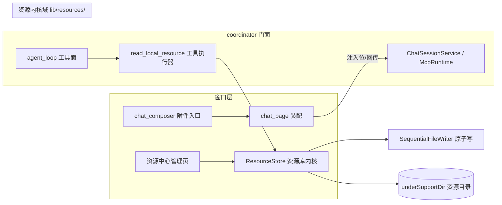

# 资源中心设计（本地文件库 · 一期）

> 绑定 epic = `resource-center`。准入评估结论（2026-10-18）：结构性引入——新能力域，非补丁；补丁方案（composer 直读文件全文塞 prompt）命中 solution-admission 否决信号 #2/#5，已否决。

## 1. 定位与范围

资源中心 = goodhub 自身管理的**本地文件库**：用户把文件「收」进资源中心（导入），在页面对话时把资源「传」给大模型使用，也可从资源中心「传」出（导出/分享）。一期纯 goodhub 内闭环，不依赖 goodshare 协同。

**一期做**：

- 本地文件导入（系统文件选择器）、清单管理（改名/删除/**使用系统外部应用打开**，RC6：不做内建查看器）、持久化存储（跨会话存活）
- 对话附件：composer 选资源 → 以 `$ref` 句柄注入上下文，Agent 经工具按需读全文
- 文件导出（分享出去）

**一期不做**（二期/M3 评估）：

- 二进制多模态（图片/PDF 直读）——端侧 LiteRT-LM 不支持，云端 BYOK 多模态通路未验证；一期仅收文本类文件（text/markdown/json/csv 等可解码为文本者），其余类型导入即拒并明示
- MCP server 资源聚合面（`resources/list`/`resources/read` 协议层已就绪，二期接入统一 UI）
- 跨 App 传出——依赖 goodshare 侧 `mcp-blob://` ≥128KB 数据面（thirdconnect 待办），M3 需同轮修 goodshare 仓 `ai-app-split.md`（跨仓 SSOT 纪律）

## 2. 总体架构

新内核域 `lib/resources/`（纯内核，零 UI 依赖，对齐 `sandbox/` 域模式），窗口层经 coordinator 门面接入：

- **ResourceStore**（`lib/resources/resource_store.dart`）：资源清单 + 文件实体的唯一 owner。清单走 JSON（`SequentialFileWriter` temp+rename 原子写，对账账本同款）；文件实体落 `underSupportDir` 资源子目录，导入时复制入库名（库内以 uuid 命名，防用户原始文件名冲突/路径注入）。
- **注入链路**：composer 选资源 → chat_page 把附件 record 传 `McpRuntime.assemble(resourceAttachments:)` → 装配期全文落 run 级 `$ref` 池（`ResourceAttachmentBinder`，payload 介质，`resourceUri` 记 `local://resource/<uuid>` 合流命名）→ 产出 footer（文件名 + 大小 + resource_id + 句柄）拼进 userPrompt 前部；Agent 需要全文时调用 `read_local_resource` 工具按需读（挂 Gateway 内侧，L2 裁决先于执行，对齐 `memory_tool_executor` 挂载位）。**工具入参用 resource_id 而非 `$ref` 句柄**（实现定稿）：注水管线会把参数里的句柄替换为全文（击穿 RC4 64KB 窗口），句柄仅作上下文合流记账。
- **headPreview（摘要行，2026-10-18 评审补）**：导入时**静态截取**——首个非空行截前 200 字符，随清单持久化。杜绝 LLM 生成摘要（大文件导入即卡/离线不可导入）；导入路径解码全文的当口顺手生成，零额外 IO。提取前**剥离 UTF-8 BOM**（`\uFEFF`，Windows 导出文件常见）再 `trimLeft()`；无有效非空行兜底 `(empty)`——禁 BOM 隐藏字符进清单与会话上下文。
- **附件退回（2026-10-18 评审二补）**：composer 移除附件 / 清空输入框 = 仅注销本次会话装配的 `$ref` 句柄（run 级，随会话焚），**严禁误触 `ResourceStore` 删除**——句柄与会话生命周期绑定，库与句柄永不互相联动删除。
- **禁全文直灌**：文件内容不进初始 prompt——保护 context_governor token 预算与端侧小窗口；上下文里只有句柄与元信息。

## 3. 生命周期：与 $ref 暂存池的边界

| | $ref 暂存池（ref_store） | 资源中心（ResourceStore） |
|---|---|---|
| 生命周期 | Session 即焚 + TTL 30min | 跨会话持久，直到用户删除 |
| 归属 | run 级工具输出暂存 | 用户资产库 |
| 合流点 | ResourceStore 导入后的文件可被 put 进 ref 池获得会话句柄；ref 池 `resourceUri` 指回 `local://resource/<uuid>` | 库是句柄的持久底座 |

会话结束只焚句柄，不删库内文件。

## 4. 安全与治理

- **权限**：`read_local_resource` 工具挂 permission_gateway 分类矩阵——出库读全文按 L2 确认类裁决（首次读某资源弹确认卡，会话内豁免，对齐现有会话豁免语义）；库内只列元信息不裁决。
- **PII 围栏**：文件全文经 `read_local_resource` 回填进 Agent 上下文后，若被云引擎出站引用，走既有 `pii_fence` 遮蔽管线——工具执行器不做二次遮蔽，出站面唯一（避免双源遮蔽不一致）。
- **导入边界**：一期只收文本类；单文件上限 10MB（RC1）；导入即全量复制入库，后续编辑原文件不影响库内副本（明确语义，UI 明示）。**判定 = utf8 严格解码**（`allowMalformed: false`），不用扩展名白名单/魔数探针——严格解码是更强判定，重命名伪装与无后缀代码文件天然覆盖；解码 >1MB 时走 `Isolate.run`（§3.1 Worker Isolate 纪律，防主 isolate 掉帧）。
- **删除容错（两段式口径，2026-10-18 评审补）**：清单为准——先改清单再删实体；实体删除失败（句柄占用/磁盘满）容忍 + DEGRADE 留痕（孤儿文件可由清单对账清理），**禁裸抛 FileSystemException**。运行中会话读已删资源 → `read_local_resource` 返回结构化 isError（`not_found`，C-2 立即回填禁挂起）；M1 不做引用计数/软删除（句柄属 run 级 `$ref` 池会话即焚，悬垂窗口极短，引用计数属过度设计）。
- **读窗口防爆（RC4，2026-10-18 拍板）**：`read_local_resource` 单次返回上限 **64KB**——超限截断 + TrackNote 明示「文件 X KB 超单次直读窗口，已截断前 64KB；需特定段落请在对话中说明」；分段读（offset/limit）维持二期候选。禁 10MB 文本整读 dump 回 agent_loop（≈250 万 token，击穿任何模型窗口）。**截断必须多字节边界安全**（评审二补）：按字节截断后对尾部不完整多字节序列回退丢弃（汉字 3B/Emoji 4B 撕裂会致解码 FormatException），解码兜底 `utf8.decode(allowMalformed: true)` 末防线——落点 = 内核 `readContentWindow`（T3 工具执行器调用）。**工具描述防死循环硬约束**（评审三补，T3 实现）：工具 `description` 与截断 TrackNote 必须明示「本工具仅返回前 64KB，暂不支持分段与全文重试；请基于已截断内容作答，**严禁对同一资源重复调用**」——一期无 offset/limit，模型（尤其小模型）见截断提示极易反复重调烧穿 max_turns。
- **孤儿对账（评审二补，阈值三补修订）**：两段式删除 + Crash/Kill 必然残留清单外孤儿文件，持续吃磁盘且「已占用空间」失真。`ResourceStore.reconcileOrphans()`：扫描资源子目录比对清单，未在册且修改时间 **>2h** 的孤儿静默清理（DEGRADE 留痕；阈值远大于导入落位毫秒级竞态窗口，防误删刚复制未登记的合法新文件），并同步清理 `cacheDir/external/` 中 **>24h** 的导出遗留临时件；接线 = App 启动 / 进入管理页时异步触发（T2 装配）。
- **判重（评审二补 · 2026-10-19 修订）**：两级——① **同名**：导入自动追加序号后缀（`readme (1).md`），UI 可辨识、禁出现两个一模一样的条目；② **同内容**（sha256 字节级哈希，`ResourceEntry.contentHash`）：命中即**复用既有条目**，[import] 返回 `reused=true`，**不落副本**——一期是纯文本库，同内容多副本只会虚增 RC5「已占用」并让清单出现重复条目。改名产生的「同名不同内容」走 ① 而非 ②（名变内容未变 → 复用，名同内容变 → 加序号）。**空哈希永不参与复用**——早于判重特性落库的历史条目 `contentHash=''`，误判为同内容会静默吞掉用户的新导入。
- **导出沙箱防护（评审二补）**：分享/导出禁止把库内 uuid 实体原身路径暴露给外部系统组件——一律复制到 `cacheDir/external/<random_id>_<displayName>` 后再发起系统分享，防外部应用篡改/锁死沙箱实体（评审三补：**路径须带唯一随机前缀**，绝不可同名覆盖——外部编辑器持有旧副本时 Windows 共享占用直接 Sharing violation 崩溃）。落点 = T2 管理页导出动作。**临时副本生命周期**（评审三补）：`cacheDir/external/` 系统几乎不主动清理，`reconcileOrphans` 启动对账时同步清理其中 >24h 的遗留件——防频繁外部打开 10MB 大件造成磁盘隐形暴增。
- **存储配额（RC5，2026-10-18 拍板）**：一期**仅展示已占用空间**（管理页页头小字），不设硬/软上限；膨胀压力出现时再评估软上限。
- **并发纪律**：清单写安全由 `SequentialFileWriter` 路径级进程互斥兜底（同路径跨实例串行）；**装配纪律**：ResourceStore 收敛 `ServiceDirectory` 单实例持有（§1.1 规则 2），不新造 AsyncLock。
- **UI 红线**：资源中心管理页不直连 sandbox/mcp（chat_page 第 13 边纪律）；数据经 ResourceStore，注入位经 coordinator 门面回传。视觉遵循 goodhub-ui ConsoleTokens。

## 5. 分期与验收

| 期 | 内容 | 依赖 | 验收口径 |
|---|---|---|---|
| M1 | ResourceStore 内核 + 导入/管理页 + composer 附件 + `$ref` 句柄注入 + `read_local_resource` 工具 | 纯本仓 | 导入文本文件（重名自动 `(n)` 后缀）→ 会话附件（元信息含 headPreview，BOM 已剥离）→ Agent 工具读全文完成任务（>64KB 边界安全截断 + TrackNote 明示）；删除资源后句柄读返回结构化 isError（`not_found`，C-2 禁挂起）；管理页展示已占用空间 + 启动/进入时孤儿对账；导出走 cacheDir 复制不露实体路径；analyze 0 + 相关单测绿 |
| M2 | MCP server 资源聚合进资源中心统一 UI | 协议面已就绪 | server 资源列表/读取/订阅失效在资源中心可见可注入 |
| M3 | 跨 App 传出（goodshare 协同） | goodshare `mcp-blob://` 数据面 | 传出走接缝契约，同轮修 goodshare 仓 `ai-app-split.md` |

## 6. 已拍板点（2026-10-18 确认）

1. 单文件大小上限 = **10MB**（RC1）；
2. 管理页入口落位 = **侧边栏「设置」区直达**（RC2，对齐任务对账页先例）；
3. `read_local_resource` = **64KB 单次返回窗口**：超限截断 + TrackNote 明示，分段读（offset/limit）登记二期候选（RC3 原拍「整读 + 上限兜底」经评审修订为 RC4——整读挡不住 10MB ≈ 250 万 token 击穿模型窗口）；
4. 存储配额 = **仅展示已占用空间**，不设上限（RC5）；
5. 文本判定 = utf8 严格解码（不用扩展名白名单/魔数探针），>1MB 解码走 `Isolate.run`；删除 = 两段式容错（清单为准，实体删除失败 DEGRADE 不裸抛）；不做引用计数/软删除（评审项 1 简化采纳）；
6. 外部唤起纪律（RC6，2026-10-18 拍板）= **纯外部唤起**：不做内建查看/编辑器；管理页「打开」与导出全量走 `cacheDir/external/<random_id>_<displayName>` 临时副本唤起宿主系统默认应用。

## 7. MCP 工具目录 Tab（2026-10-21 新增）

> 与 §1「一期不做」中的「MCP server 资源聚合面（resources/list，M2）」**正交**：本 Tab 浏览的是 `tools/list` 的**工具声明**（含 `_meta.goodhub.visibility` 三态），非文件/资源聚合；落在资源中心纯因「用户资产/能力集中面」入口便利，性质属**服务/能力浏览**而非文件库。

- **定位**：资源中心第二 Tab（MC1-a）；第一 Tab 仍是文件资源（一期 M1）。
- **取数**：`lib/coordinator/tool_catalog.dart` 收口——已注册服务 = 本地插件 `localPluginDiscovery.scan` + 远端 `ServerEndpointStore.load`（静态注册态，不依赖连接）；工具 = per-service `McpRuntime.mount/mountEndpoint` 拉 `tools/list`，纯浏览拉完即释放，不常驻 face。
- **展示**：按服务分组；服务组按「含 shared 工具数」降序，组内工具 shared→private→未声明（MC2-a 两层都排）；每个服务卡标注「来源/隐私」（本地 / 远程·私有 / 远程·公开），仅作标注不作分组维度（MC4）。
- **可见性三态（MC3-a）**：共享 / 私有 / 未声明——`declared` 区分「显式声明私有」与「SDK<0.2.0 存量插件未声明兜底」，UI 标「未声明」（琥珀）防误判插件坏；`shared` 经网关对外投影、`private`/未声明不投影（对齐 `tool_visibility.dart` 兜底口径与网关过滤面）。
- **落点**：`lib/ui/sections/mcp_tools_catalog_section.dart`（注入位取数 + 包变更热刷新 + keepAlive）+ `lib/ui/resource_center_page.dart`（TabBar）；单测 `test/ui/mcp_tools_catalog_section_test.dart` + `test/coordinator/tool_catalog_test.dart`。
