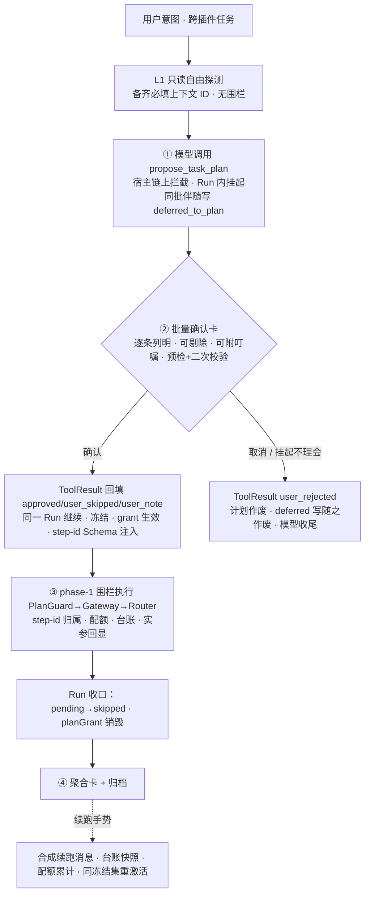

# 多插件任务编排（TaskPlan 计划卡 · 写面围栏 · 步骤台账聚合）

> 本文是「一次用户意图跨多个插件协作完成」的**任务级编排**设计 SSOT：模型经宿主元工具 `propose_task_plan` 提议结构化任务计划 → 宿主一次批量授权 → 写面围栏内由既有 AgentLoop 执行 → 步骤台账聚合呈现与归档。典型场景：「规划云南五日游」＝日程插件记行程 + 笔记插件记攻略 + 收藏插件存地址 + 记账插件估费用。
>
> **与既有两套「编排」正交，勿混淆**：① 可见性编排（`context/epics/mcp-orchestration` + `host-tools-gateway-export.md` 投影策略）管「客户端看到哪些工具」；② 本文管「一次任务内多插件怎么协作」。PC 主脑模式不经本层——PC 经网关看 full 面自行串工具，网关只做代理与投影，**任务语义不长进网关**。

## 结论（方向已拍板 2026-10-24：方案 B；三轮复审收口 D/R 系裁决，遗留项见「待裁决」）

- **编排 = 「计划围栏 + 批量授权 + 台账聚合」，不新建执行引擎**。执行仍由既有 AgentLoop 涌进式完成：单轮多 tool_calls 并发派发（`agent_loop.dart` P3-1）、两步熔断、步数墙、abort 语义全部原样继承。计划冻结的是**写面（write surface）**，不是执行序列——步骤顺序是给模型的软约束，并行与重试由模型与既有机制自然调度。
- **起草走宿主元工具 `propose_task_plan`，不走 in-band 文本提取**（R4）：计划提议是原生 tool_call，宿主在执行链拦截、弹批量确认卡、**Run 内挂起等待用户手势**（与 L2 网关「轮间 await 用户」同一既有先例），确认结果作为 ToolResult（`approved` / `user_skipped` / `user_note`）直接回填，同一 Run 继续——无流式 FSM、无合成唤醒、无 Run 中断。
- **探索先行（R3，三轮增补）**：触发时点 = 「L1 只读工具自由探测 → **发起首个跨服务 L2 写操作之前**提议计划」；探测阶段须**备齐写工具必填上下文**（目标账本/分类/笔记本 ID 等经只读工具确认就绪），防「确认后才发现缺参数」中断请示。单服务写集自动降级（直接回「无需计划」，零 UI）。
- **计划面 = 当前可见面（Q2 收口，三轮拍板）**：全部 public 服务 + **至多一个已激活 private**。跨多个互斥 private 的提议在元工具校验层直接拒绝——不止因单槽互斥，更因 `ToolRouter` Run 快照铁律（切域仅 Run 边界生效），跨 private 计划物理上要求 grant 跨 Run，违反 Run 绑定语义。
- **计划围栏只管写，不管读**。L1 只读调用（`permission_gateway.dart` 裁决口径）不受计划约束；围栏拦截的是**当前阶段外的 L2 写调用**（phase-0：计划确认前；phase-1：冻结集外）。**同批伴随写一律静默并入**（三轮拍板）：同批 `tool_calls` 含 `propose_task_plan` 时，其余 L2 写无论模式统一拦截回填 `deferred_to_plan`（isError=false），杜绝「批量卡与单步卡同屏打架」；计划被取消则这批写随之作废。
- **批量授权合并的是确认手势，不是审计与语义**：一次卡片授权计划内全部普通写步骤（逐条列明、可单项剔除、可附单步叮嘱 `user_note`），`ops.log` 逐调用审计照旧；`destructiveHint: true` 的毁坏性工具**不入批量**（D1），执行期仍逐条实参级 L2。
- **计划一经用户确认即冻结**：模型不可自改；修订必须走新卡再过用户手势（防插件输出注入改计划）。未确认/被取消的计划**不产生任何围栏与授权语义**。
- **生命周期 Run 绑定**：planGrant 绑定确认手势所在的 Run（含多轮工具环）；Run 收口（含 abort）即销毁 grant、剩余 pending 归 skipped、渲染聚合卡；续跑仅经聚合卡显式手势重激活，**配额跨续跑累计**、续跑消息携带**台账快照**防重写。
- **step-id 经 Schema 声明（三轮拍板，修 R2 口头约定漏洞；四轮定时收口）**：Strict Tool Use 模型不生成 Schema 外字段，故须在 Schema 内声明可选属性 `_plan_step_id`。**注入时机 = 每轮经既有 `toolsProvider` 重取**（`agent_loop.dart` M4-T6 钩子，每轮 `engine.send` 调用）：装配层把「基础工具面 +（冻结集激活 ? 对冻结集写工具注入 : 无）」组进 provider 闭包——propose 回填后的首轮即生效、Run 收口自然消失、续跑 Run 首轮即在。Run 快照铁律保护的是**私有槽位**而非工具清单（JIT 激活既已支持工具清单 Run 内刷新），本注入不触任何铁律。PlanGuard 无条件剥离（含无计划态误填）后下路由；仅 App 内工具面，不进网关投影。
- **实参透明化对抗语义漂移（R1）**：planGrant 免卡 ≠ 免视——每步首笔写调用在轨道流回显实参摘要，聚合卡逐笔可查（含配额用量）；注入残余风险显式声明为已接受（红线 7）。
- **零跨仓变更**：插件、`goodhub-mcp-sdk`、AIDL 契约、goodshare 接缝（`ai-app-split.md`）全部无感知；纯宿主 coordinator + UI 加法。
- **D2/D3 维持**：双入口触发（系统提示约定 + 「计划模式 / 总管模式」手动开关兜底——phase-0 包装为「总管模式」产品语义，默认无开关 = 专科模式单服务轻确认）；起草只列写步骤，读步骤渲染信息灰行。D4（FSM 泛化）随 R4 作废。

## 术语（防撞车）

| 词 | 本文语义 | 勿混淆 |
|---|---|---|
| 编排任务 / TaskPlan | 用户意图级多插件协作任务（本文件） | goodshare 推理任务（`ai_task_queue` / claim/apply 管道，`TaskLoopService`）——后者是数据事实源侧的 LLM 任务队列，不经本层 |
| 计划围栏 / PlanGuard | 写面白名单装饰器 | 权限网关 L1/L2（裁决读/写确认）——围栏管「计划内外」，网关管「要不要人确认」，两层串联 |
| `propose_task_plan` | 宿主本地元工具（裸名，`use_server` / `activate_server_tools` 同族） | host 网关导出面（`host__*`）——本工具**不进** `kHostExportAllowlist`，控制面原语黑名单纪律，PC 不可见 |
| 总管模式 / 专科模式 | 手动开关的两种产品态：总管 = phase-0 武装（先计划后写）；专科 = 默认态（单服务写走轻确认） | 可见性两平面（Shared/Private）——正交维度 |
| 计划步骤台账 / PlanLedger | 编排任务的步骤执行账本（本文件） | goodshare 任务对账页（`task_ledger_page`，M4-2）——「任务台账/对账」一词已被其占用，编排侧禁同名 |
| 可见性编排 | mcp-orchestration epic 的两平面/投影 | 本文不涉及 |

## 生命周期（四阶段）



### ① 计划提议（元工具）

- **元工具形状**：`propose_task_plan(goal: string, steps: [{id, server, tool, intent}])`——宿主本地工具，入参经原生 JSON Schema 校验；annotations `readOnlyHint: true`（提议无副作用，卡即其交互）；在 `DiscoveryExecutor` 同族本地拦截链处理，**先于 ToolRouter**、不达插件；**不进** host 导出 Allowlist。
- **校验层（元工具内，拒绝即 ToolResult 引导、不弹卡）**：`server` 须为已挂载 id 且在**当前可见面**（全部 public + 至多一个已激活 private——跨多个互斥 private 直接拒绝并说明单槽纪律）；`tool` 须为该服务真实工具名（裸名）；写步骤 ≤8；写集单服务 → 自动降级回「无需计划」。
- **挂起语义**：收到调用 → 渲染批量确认卡 → Run 不中断，该 tool_call 挂起等手势（L2 网关同一先例）；abort / 卡片取消 → 回填 `user_rejected`，模型无围栏收尾。
- **同批伴随写（拍板）**：同批 `tool_calls` 含本工具时，其余 L2 写统一静默拦截回填 `{"status": "deferred_to_plan", "message": "已并入同批次计划提议，待计划确认后执行"}`（isError=false，模型不重试）；计划取消则该批写作废（`user_rejected` 已告知）。同批多个 propose 以首个为准，其余回「已有计划在确认中」。
- **触发时点（D2 + R3）**：系统提示约定「L1 自由探测并备齐写工具必填上下文；**首个跨服务 L2 写之前**，写操作跨 ≥2 服务则先提议」+「总管模式」手动开关兜底（开关 = phase-0 武装：计划确认前一切 L2 写拒绝并引导提议）。
- **计划粒度 = 意图级**：每步 `目标服务 + 工具名 + 一句话意图`，不带参数（执行期现算，计划期参数必是幻觉）；只列写步骤（D3），读步骤可选信息行。

### ② 批量确认卡（一次手势，逐条语义）

| 卡面元素 | 约束 |
|---|---|
| 步骤行 | `[插件名] 工具名 —— 意图一句话`；徽标：读 / 写 / **毁坏**（取工具 annotations）；写步骤每行独立开关（默认开）+ 可选**单步叮嘱输入**（`user_note`，如「按穷游标准、上限 3000」）；读步骤静态灰行（无开关、不占写步数上限） |
| 计划摘要 | 整体目标一句话 + 写步骤数（上限 8） |
| 确认动作 | 「确认执行」＝授权**开关为开的**步骤集；剔除步进 ToolResult 的 `user_skipped` 显式告知；各步叮嘱合并进 `user_note` 回填——执行期实参本就模型现算，叮嘱零机制成本 |
| 毁坏性步骤 | 不可批量授权（D1）：标注「执行时逐条确认」；其余 L2 步骤凭 planGrant 静默放行 |
| 预检 + 二次校验（R6） | 起草期校验 face 可用性与可见面合规（未挂载/未信任/离线 → 置灰 + 原因，`blockedPlugins` 口径）；**确认手势那一刻**对冻结集再做存活与信任态快照校验（TOCTOU），失效步骤当场置 `failed(服务已离线)`、不入 grant |

### ③ 围栏执行

- **装饰链序（铁律）**：`PlanGuard → PermissionGateway → ToolRouter`。围栏在网关**之前**——阶段外写调用直接拒绝（**不产生确认卡**）。
- **两段裁决**：**phase-0**（总管模式开关武装，计划确认前）：一切 L2 写拒绝 + 引导提议；**phase-1**（确认后）：`(serverId, toolName)` ∈ 冻结集且非毁坏 → 放行、网关凭 planGrant 免卡；∈ 集且毁坏 → 逐条实参级 L2；∉ 集且 L2 → 拒绝；L1 只读 → 直通。
- **step-id 协议（Schema 注入版，修 R2 漏洞；注入时机四轮收口）**：注入**不走静态 Run 组装**——计划确认发生在 Run 中途（同一 Run 继续），Run 启动时不存在冻结集；改为经 `toolsProvider` 每轮重取时对**冻结集激活期**的冻结集写工具注入 `"_plan_step_id": {"type": "string", "description": "属于已确认计划的步骤 id，如 s1"}`（可选属性，兼容 strict schema；非编排会话与冻结集外的工具 Schema 恒干净）。PlanGuard **无条件剥离**（含无计划态误填）后下路由（插件 `additionalProperties: false` 亦无感）。id 有效且与步骤 `(server, tool)` 对匹配 → 按 id 归属；缺失/无效 → 「同对最早未终态步骤」启发式 + `inferred` 标记。并发同批按各自 id 独立归属。
- **拒绝文案分类学（R5）**：三段式终结文案 `[FATAL_PERMISSION_DENIED] <server>__<tool> 本次任务不可调用（原因：用户已在计划卡剔除 / 不在已确认计划内）。严禁重试，跳过此步骤继续剩余计划。` 围栏拒绝照常计入 C1 熔断（排查卡的「跳过」即顽固重试的出口，保留不豁免）。
- **调用配额（防写放大）**：冻结集内每 `(server, tool)` 对总调用次数软上限（**初值 12**，Q1；派发即计数、成败均计、**跨续跑累计**）。超限不熔断——引导「请收尾或说明剩余工作」；起草约定引导「预期大量调用（逐日建条）拆多步」。动机：C1 只计失败、步数墙只界轮数，每对配额补「成功写放大」这道缝。
- **台账**：步骤状态由归属调用聚合——有成功即 `ok×k`、全失败 `failed`、无调用 `pending`；同对全步骤终态后的调用记「计划外补调」。步骤失败不中止任务，熔断与步数墙照常兜底。
- **实参透明化（R1）**：每步**首笔写调用**的实参摘要（关键参数键值一行）在轨道流回显；聚合卡逐笔可展开（调用序列 + 实参摘要 + 配额用量）。

### ④ 聚合卡、归档与生命周期收口

- **Run 绑定**：planGrant 绑定**确认手势所在的 Run**。Run 收口（`LoopFinished` / `Abort`）即：剩余 `pending` 归 `skipped`、销毁 planGrant、渲染聚合卡。**严禁 grant 无手势跨对话轮存活**。
- **续跑防重写（三轮拍板，调整「grant 缩水」提案）**：意图级步骤**无完成谓词**（`ok×3` 是完成还是五天写了三天，宿主不可判定），机械剔除已 ok 步骤会把部分完成步永久关死——故不缩水，改三件套：① 续跑消息携带**台账快照**（`[s1 ok×3（已写部分勿重复）, s2 ok×1；待继续 s3/s4；仅补剩余]`）；② **配额跨续跑累计**（重跑不重置容量）；③ 冻结集原样重激活、不重弹全量卡；剔除步或新增步仍须新卡。
- **聚合卡**：整体状态（完成 / 部分完成 / 失败，**只由写步骤判定**）+ 逐步骤状态与产出摘要 + 计划外补调与配额用量 + 逐笔实参摘要 + 失败白话原因 + 续跑按钮。深链回各插件 App = TO-B2。
- **归档**：计划原文、冻结集、台账、聚合卡、user_note 随会话进 `conversation_archive.dart`；下轮续会话可引用。

## TaskPlan 结构（元工具入参形状）

```json
{
  "goal": "规划云南五日游并落库各插件",
  "steps": [
    {"id": "s1", "server": "shiguang", "tool": "create_event", "intent": "记录 D1~D5 行程骨架"},
    {"id": "s2", "server": "goodshare", "tool": "create_note", "intent": "攻略要点存笔记"},
    {"id": "s3", "server": "goodTools", "tool": "add_bookmark", "intent": "收藏景点/餐厅地址"},
    {"id": "s4", "server": "goodAccount", "tool": "create_budget", "intent": "按行程预估费用"}
  ]
}
```

- 计划面 = 当前可见面（全部 public + ≤1 已激活 private）；写步骤 ≤8（只计写）；`id` 会话内唯一；读步骤可选信息行。
- 无依赖字段（B1 不做 DAG）——顺序即提示软约束；实测乱序损害体验则 TO-B2 再评估。

## 安全红线（钉死）

1. **围栏不替代网关**：planGrant 只覆盖冻结集内非毁坏写步骤；阶段外写调用无任何放行通道。
2. **毁坏性不可批量（D1）**：`destructiveHint: true` 逐条实参级 L2——无实参的毁坏预授权等于盲签。
3. **审计不合并**：每次实际调用照旧逐条 `ops.log`（含 planGrant 放行标记与配额用量），批量只合并用户手势。
4. **计划冻结防注入**：冻结后模型侧只读；修订必须新卡经用户确认。插件工具结果只进对话与台账，**不进计划对象**。
5. **PII 围栏（N7）与熔断照常**：planGrant 不旁路任何既有防线（与 C7 会话豁免同一纪律）。
6. **生命周期 Run 绑定**：planGrant 内存态；收口即销毁、pending→skipped；续跑仅经显式手势 + 台账快照 + 配额累计，不落盘、不跨轮存活。
7. **注入残余风险（显式声明，R1）**：「经 L1 读入的外部内容间接注入 → 已授权工具 + 恶意实参」不可被 `(server, tool)` 级围栏拦截；B1 缓解 = 实参透明化 + 毁坏性逐条 + PII 围栏，**残余风险已接受**；TO-B2 评估非授信内容围栏（需来源信任分类，可能破零跨仓，届时单独立项）。

## UI 搭配与纯网关模式

### App 内聊天链路（UI 归位；视觉与交互规范正文 = `docs/project/ui-design.md`，实现轮先补规范条目再写组件）

| 设计件 | UI 归位 | 要点 |
|---|---|---|
| 计划卡（确认卡） | 双轨消息流操作轨 · 决策卡族（`confirmation_card.dart` 同族）富形态 | 琥珀待确认竖条；步骤行键值两列 + 微型物理开关（禁大圆角胶囊开关）；毁坏徽标；预检置灰灰阶；单步叮嘱输入；终态转灰阶审计行（「✓ 已批准 s1,s2,s4 · 剔除 s3 · HH:mm」）；「多步开关列表卡」属双轨卡片族新形态——实现轮先扩 ui-design.md §3.2 条目（规范先行纪律） |
| 聚合卡 | 双轨消息流面板卡片 | 整体状态语义色（Emerald 完成 / 琥珀部分 / 玫瑰失败）；`ok×k`、配额用量、Trace 类数值走遥测轨等宽；逐笔实参摘要键值两列、超 4 行折叠；续跑按钮随终态灰阶弱化 |
| 执行期呈现 | 复用 CallCard（工具执行卡）+ 输入条状态带 | CallCard 头部加步骤徽标（s1/s2…）分组；实参摘要回显按 §3.2 键值两列；状态带新增相位按构词法入表（「计划待确认」琥珀档） |
| 总管模式开关 | 输入条状态带**上下文胶囊族**（§3.1；禁顶部独立状态行/悬浮窗） | **低暴露位**：B1 藏于上下文胶囊点开的菜单内、不常驻（它是弱模型兜底而非主路径，避免用户面对「模式」概念）；真机观测自动触发遵从率后再决定是否升为常驻胶囊；开启时状态带琥珀提示「写操作先出计划」 |
| 唤醒/续跑合成消息 | 双轨流灰阶事件行 | 渲染为系统事件卡，非普通用户气泡 |
| 台账回看 | 会话历史内聚合卡即回看 | 跨会话计划清单视图 = TO-B2；命名用 PlanLedger（防撞，见术语表） |

B1 零新增设置项（配额为宿主常量，Q1 观测后再议入设置）；新通用组件同轮登记 `docs/project/index.md` 代码落点表。

### 纯网关模式（PC 经 `:8766/mcp`）三阶段

| 阶段 | 搭配方式 |
|---|---|
| 一（B1 基线 = 现状） | **正确性隔离**：PC 主脑自编排（`single/private/full/pruned` 投影决定其编排原料面），宿主只守门——L2 全屏确认卡（L2AlertActivity 亮屏+震动+45s 倒计时，TC12）+ 既有连接级逐工具「本网关会话记住」豁免 + PII 围栏 + ops.log。编排 UI 与 `propose_task_plan` 元工具全部不参与（不进 Allowlist）；headless 下 B1 特性整体休眠（PlanGuard 只挂聊天执行链，网关装配独立，二者仅共享 faces） |
| 二（可选增强） | 把 B1 建成的 planGrant **授权原语**对偶到网关：新系统工具 `gateway__request_write_grant(tools: [...])`（`gateway__list_servers` / `gateway__select_private` 家族先例）——PC 一次申请一组写工具授权 → 宿主一次全屏卡确认 → 本连接内免逐条弹卡。**只合并手势，不引入编排语义**（无计划/台账/围栏，PC 编排智能不变）；destructive 仍逐条、审计逐条、per-connection 生命周期（`forSession` 派生，C7 的网关对偶）。「任务语义不进网关」红线不破：进网关的是授权原语，不是编排 |
| 三（远期，需求触发再立项） | 宿主代 PC 跑编排：PC 下发意图，宿主 App 内跑完整围栏循环，计划卡在手机屏呈现（确认面本就在手机），结果回流 PC。触发条件 = PC 侧模型无力自编排 / 用户要手机一键确认体验——即边界「宿主代 PC 编排」项 |

## 落点清单

| 模块 | 动作 |
|---|---|
| `lib/coordinator/task_plan.dart`（新） | 计划模型 + 元工具入参校验（可见面合规、存在性与 annotations 识别、预检、步数上限、单服务降级、跨 private 拒绝） |
| `lib/coordinator/plan_proposal_tool.dart`（新） | `propose_task_plan` 元工具执行器（`DiscoveryExecutor` 同族拦截位）：同批伴随写 deferred、弹卡挂起、ToolResult 回填（approved/user_skipped/user_note/user_rejected）、abort 路径 |
| `lib/coordinator/plan_guard.dart`（新） | `[ToolExecutor]` 装饰器：phase-0/1 围栏 + step-id Schema 注入与剥离归属 + 每对配额（跨续跑累计）+ 拒绝文案分类 + 实参摘要回显钩子 |
| `lib/coordinator/permission_gateway.dart` | 增 planGrant 授权源（与 C7 并列；毁坏性显式排除；Run 收口销毁钩子） |
| `lib/coordinator/chat_run_orchestrator.dart` | 计划模式装配：约定入静态前缀、装饰链挂接、step-id 注入组进 `toolsProvider` 每轮组装（冻结集激活期）、grant 生命周期与 Run 收口挂钩、续跑消息合成（台账快照） |
| `lib/ui/task_plan_card.dart` / `lib/ui/task_result_card.dart`（新） | 确认卡（步骤开关 + 叮嘱输入 + 徽标 + 预检置灰 + 二次校验结果）/ 聚合卡（逐笔实参摘要 + 配额用量 + 续跑按钮） |
| `lib/coordinator/conversation_archive.dart` | 计划、冻结集、台账、聚合卡、user_note 归档 |

> 元工具走本地拦截链（先于 ToolRouter），`workspace_stream_filter.dart` **零改动**；step-id Schema 注入仅 App 内工具面（`focusedSchemas` 组装路径），网关投影（`projection_pipeline`）不见此属性。

## 分期

| 期 | 内容 |
|---|---|
| **TO-B1** | 上表全量：探测（含必填上下文就绪约定）→ 元工具提议（deferred 并入 + 挂起卡 + user_note）→ 确认（预检 + 二次校验）→ ToolResult 回填 → phase-1 执行（Schema 注入 step-id + 配额 + 台账 + 实参回显）→ Run 收口 → 聚合卡（续跑三件套）→ 归档 |
| **TO-B2** | 计划修订流（delta 卡）；任务黑板（抗 context-stepped-pruning）；毁坏性实参确认卡 UX；聚合卡深链各插件 App；**一键撤销本批次写入**（best-effort：台账提取写入实体 id，仅当全批实体 id 齐备且对应删除工具存在才亮出，撤销走 destructive 逐条 L2——不要求插件契约，缺件即隐藏）；**配方沉淀 Save as Recipe**（全绿聚合卡存 `{server, tool, intent}` 模板进 prompts/skill 体系，一键秒出同结构计划卡）；配额初值回归（Q1）；非授信内容围栏研究（红线 7） |
| **否决留档** | ① 确定性 DAG 执行引擎；② 子 agent fan-out；③ 仅靠跨插件 prompt 配方单独成立（其配方形态在 TO-B2 以 Recipe 名义回归为持久化层，与围栏/授权不冲突）；④ 毁坏性预授权（D1）；⑤ in-band `<task_plan_v1>` 流式提取 + FSM 泛化（R4 推翻——与原生 FC 抢概率、失败模式硬、维护流式 FSM；`<workspace_update_v1>` 保留于记忆提取，失败模式软）；⑥ 续跑「grant 自动缩水剔除已 ok 步骤」（三轮推翻——意图级步骤无完成谓词，缩水会把部分完成步永久关死，改台账快照 + 配额累计）；⑦ step-id「全天候静态注入」（四轮推翻——编排专用字段污染所有对话的写工具 Schema，token 常驻 + 非计划态误填噪音，违背 N2 上下文经济纪律；每轮注入经既有 `toolsProvider` 零成本实现，静态注入唯一优势「不依赖 provider 接线」由验收断言兜底） |

## 验收口径

- **单测**：元工具校验（可见面/跨双 private 拒绝/单服务降级/畸形/超限/未知服务工具）；挂起回填（确认/取消/abort 四字段）；同批伴随写（deferred_to_plan 静默、取消作废、多 propose 首个为准）；围栏两段四分支 + 读直通；step-id（注入仅在冻结集激活期出现——非编排会话与确认前后轮次 Schema 干净、propose 回填后首轮即生效、聊天装配路径已接 `toolsProvider` 断言、按 id 归属、启发式 + inferred、无条件剥离含无计划态误填、剥离后参数干净、并发乱序归属）；拒绝文案两类三段式；配额（派发即计、跨续跑累计、超限引导、拆步不触发）；台账聚合（ok×k / failed / skipped / 计划外补调）；二次校验（起草后掉线 → 确认时置 failed 不入 grant）；grant 作用域（收口销毁、abort 销毁、续跑重激活 + 快照 + 配额累计）；user_note 回填透传；审计逐条含放行标记与配额。
- **UI 测试**：确认卡开关 + 叮嘱输入语义；读步骤灰行；聚合卡部分完成态、逐笔实参摘要、续跑按钮状态机。
- **真机 e2e（云南场景）**：四插件齐装 → 一句意图 → 探测 → 计划卡（4 写步 + 一条叮嘱）→ 一次确认 → ToolResult 回填 → 四插件落库（逐日 5 次 create_event 不触配额、实参摘要轨道可见）→ 聚合卡如实；毒丸 A：卸载其一 → 预检置灰；毒丸 B：确认前断连 → 二次校验置 failed；毒丸 C：重试被剔除步 → 终结文案不弹卡；毒丸 D：同批 propose + 写 → 写被 deferred、无单步卡；毒丸 E：部分完成后收口 → 续跑消息含 ok×3 快照、不重写已完成条目、配额不重置；毒丸 F：跨双 private 提议 → 元工具直接拒绝并说明单槽纪律。

## 待裁决

| # | 问题 | 建议 default |
|---|---|---|
| Q1 | 每对调用配额初值与是否分级 | 初值 12 统一起步，TO-B2 按真机观测回归（须容长行程逐日建条，5~7 次属正常） |

## 边界（本文不解决）

- **工具面懒加载默认翻转（三轮提案「两级曝光」）**：public 服务不默认全激活、名录常驻 + 计划确认期 Schema 注水——方向认同且有既有原语（JIT `activate_server_tools` / N2 守门面 / `pruned` 投影同族思路），但改变的是**全部日常对话的基线体验与幻觉防线语义**（§1.6「挂载即默认全激活」既有拍板），归 JIT/N2/prompt-mgmt 域独立裁决，本文仅在 TO-B2 预留接缝（懒加载落地则「确认期冻结集 Schema 注水」为其必需配套）。
- **PC 主脑编排**：PC 经网关 `full` 面自行编排，不经 TaskPlan（元工具亦不对 PC 导出）；宿主代 PC 跑编排是另一议题。
- **后台任务管道**：`TaskLoopService` claim/apply 管道不经权限网关（拍板 C5），同理不经计划围栏；后台编排待 TO-B2 后按需求评估。
- **插件侧能力声明**（可编排 tag / entity-id 契约 / 非授信内容来源分类进 SDK）：本文零跨仓；撤销与围栏的 best-effort 缺件即隐藏/声明残余风险，若需插件声明届时单独立项。
- **网关投影策略**：`host-tools-gateway-export.md` SSOT 不动。
