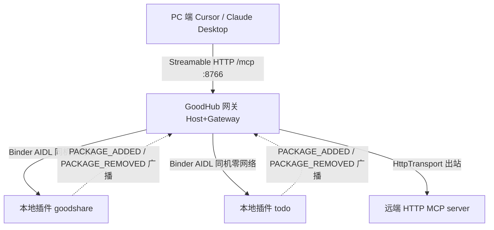

# 外部 MCP 服务接入规范（GoodHub 宿主契约）

> 定位：GoodHub 是**通用 MCP 宿主**，不针对任何单一外界 app 特制适配。外界服务分两类接入——**本地插件（同机 Binder/AIDL，零端口）** 与 **远端服务（Streamable HTTP）**——均能被 GoodHub 连接、发现、调用其工具，必要时认领其任务。本规范已对齐 `thirdconnect` epic 决策 TC1~TC8。
> 实现 SSOT：`lib/mcp/mcp_client.dart`（协议层）、`lib/mcp/transport/mcp_transport.dart`（传输底座 `McpTransport`/`HttpTransport`）、`lib/coordinator/tool_router.dart`、`lib/mcp/server_capabilities.dart`、`lib/mcp/server_endpoints.dart`。任务源高阶协议见 goodshare 仓 `docs/design/ai-app-split.md`。

---

## 0. 拓扑总览



- 本地插件：平时休眠、随调随起，**Release 绝对零端口监听**。
- 远端服务：走既有 Streamable HTTP 客户端。
- GoodHub 网关：双角色（Host 消费 + Gateway 对 PC 暴露），PC 单入口 `http://<IP>:8766/mcp`。

---

## 1. 传输与鉴权

协议版本统一为 `2025-06-18`（GoodHub `kMcpProtocolVersion`）。两类接入的传输层不同，但**上层 JSON-RPC 2.0 语义完全一致**——本地插件只是把 MCP 字节流换了根「管子」（Binder），协议不变。

### 1.1 远端服务（Streamable HTTP）

- **协议**：MCP over Streamable HTTP（无状态逐请求）。
- **Endpoint**：必须以 `/mcp` 路径结尾（如 `https://host/mcp` 或 `http://127.0.0.1:PORT/mcp`）。GoodHub 按字面 POST 该 URL。
- **响应体**：服务端可回单 JSON 或 `text/event-stream`（SSE 帧流，用于 progress）。两者 GoodHub 均兼容解析。
- **鉴权（可选）**：GoodHub 在请求头带 `X-Api-Key`（token 为空则不带）。外界服务按需校验。token 在 GoodHub 侧走安全存储，绝不明文落盘（`ServerEndpointStore` 纪律）。

### 1.2 本地插件（Binder / AIDL，同机零网络）

#### 1.2.1 契约 Action 与 meta-data

- 插件在 `AndroidManifest.xml` 声明 `action="com.zzh.goodhub.action.MCP_SERVER"` 的 `exported` Service，并以 meta-data 静态标注：
  - `com.zzh.goodhub.SERVER_ID`（如 `todo`）
  - `com.zzh.goodhub.SERVER_TITLE`（如 `快捷待办`）

#### 1.2.2 AIDL 契约（钉死 · goodshare 等插件侧对齐底稿）

> 本节为**钉死契约**，goodshare 等插件 App 必须严格实现，T-trans-2/3 按其落地。AIDL 包名固定 `com.zzh.goodhub.mcp`；插件放置于 `src/main/aidl/com/zzh/goodhub/mcp/`。

`IMcpCallback.aidl`（插件 → GoodHub 单向事件）：
```aidl
package com.zzh.goodhub.mcp;

interface IMcpCallback {
    // 插件主动推给 GoodHub 的事件，内容为单条 JSON-RPC 消息字符串：
    //  - 通知帧：notifications/progress
    //  - 反向请求帧：server→client request（带 method + id，如 sampling/createMessage）
    // oneway：投递不阻塞插件；GoodHub 侧经 EventChannel 桥回 Dart。
    oneway void onEvent(String jsonRpcMessage);
}
```

`IMcpChannel.aidl`（GoodHub → 插件 双向）：
```aidl
package com.zzh.goodhub.mcp;

import com.zzh.goodhub.mcp.IMcpCallback;

interface IMcpChannel {
    // 同步 JSON-RPC 请求-响应：GoodHub 发裸请求，插件回裸 JSON-RPC 响应字符串。
    // 用于 initialize / tools/list / tools/call / resources/* / prompts/*。
    // 必须在 Binder 事务预算内返回（见 §1.2.3）；长任务改 _async 异步（见下）。
    String call(String jsonRpcRequest);

    // 注册事件回调（进度/反向请求）。首次 bindService 后、首次 call 前调用一次；
    // 传 null 注销。DeathRecipient 触发视为断开。
    void registerCallback(IMcpCallback callback);

    // GoodHub 回答插件经 onEvent 发来的反向请求：把 JSON-RPC 响应字符串回插件。
    // oneway：应答不阻塞 GoodHub。插件按 id 关联原请求。
    oneway void answerReverse(String jsonRpcResponse);
}
```

**方法语义与消息流**

| 方向 | 通道 | 内容 | 对应 MCP |
|---|---|---|---|
| GoodHub→插件 | `call`（同步返回） | JSON-RPC request → response | initialize / tools/list / tools/call / resources / prompts |
| 插件→GoodHub | `IMcpCallback.onEvent`（oneway） | JSON-RPC notification（progress）或 request（反向） | notifications/progress / sampling/createMessage |
| GoodHub→插件 | `answerReverse`（oneway） | JSON-RPC response（回答反向请求） | sampling/createMessage 的 result/error |

**反向请求闭环**：插件在 `onEvent` 推 `{"method":"sampling/createMessage","id":N,...}` → GoodHub 处理（可能经 Dart 侧采样）→ 结果经 `answerReverse('{"jsonrpc":"2.0","id":N,"result":...}')` 回插件；插件按 `id` 关联。

**长任务 `_async` 约定（钉死，规避 Binder 超时）**：若 `tools/call` 预计超事务预算，插件在 `call` 内**立即**返回 `{"jsonrpc":"2.0","id":N,"result":{"_async":true}}`，真实结果稍后由 `onEvent` 推 `{"jsonrpc":"2.0","id":N,"result":<真实结果>}`（或 `error`）。GoodHub `BinderTransport` 对 `_async` 应答保持 completer 开启，直到 `onEvent` 收到同 `id` 终帧；短任务直接 `call` 返回真实结果，无需 `_async`。

#### 1.2.3 Binder 调用约束（钉死）

- **线程**：GoodHub 的 `MethodChannel` 处理函数在 Android 主线程执行，**必须**将 `channel.call` 派发到后台线程（Kotlin `Dispatchers.IO` / `Executors`）；`IMcpChannel` stub 的 `onEvent` 在 Binder 线程触发，需 post 回主线程再经 `EventChannel` 发 Dart。在主线程同步 `call` 超 5s 触发 ANR。
- **事务大小**：单进程 Binder 事务缓冲约 **1MB**（所有在途事务共享），单条 `call` 请求+响应建议 **< 512KB**。超大体量（大 `resources/read`、批量）必须改为返回内容 URI / `ParcelFileDescriptor` 引用，真实数据走文件描述符或共享存储，响应只带引用句柄。
- **调用预算**：`call` 应在 **< 5s** 内返回（建议 < 1s）；更长 → 走 §1.2.2 的 `_async` 异步结果。
- **错误映射**：插件在 `call` 中崩溃 / Binder 断连 → `DeadObjectException` / `RemoteException` → GoodHub 映射为 `McpNetworkException`，触发 `DeathRecipient` 注销 + 下次调用自动 rebind（`BIND_AUTO_CREATE`）。传输层错误不得伪装成 JSON-RPC error 帧。
- **生命周期**：`registerCallback` 在 `onServiceConnected` 后、`call` 前调用一次；`DeathRecipient.binderDied` 中 `unregisterCallback(null)` 并标记服务离线；重连后重新 `registerCallback`。

#### 1.2.4 发现（零配置热插拔）

GoodHub 经 `PackageManager.queryIntentServices(...)` 扫描匹配 Action 的服务，读取 meta-data 入总线；并注册 `BroadcastReceiver` 监听 `ACTION_PACKAGE_ADDED` / `ACTION_PACKAGE_REMOVED` 实现安装即挂载、卸载即摘除。Android 11+ 需在 `AndroidManifest.xml` 的 `<queries>` 中声明该 Action。

#### 1.2.5 按需唤醒与生命期

调用时 `bindService(... BIND_AUTO_CREATE)`，系统自动拉起被休眠/被杀的插件；`DeathRecipient` 毫秒级感知崩溃。插件平时零耗电、零网络监听。

#### 1.2.6 鉴权

Binder 侧经 `Binder.getCallingUid()` 验真——同签名私有生态（`<permission protectionLevel="signature">`）零弹窗；开放第三方时，首次接入弹信任卡片（包名 + 签名 SHA-256），确认后入白名单。信任分级的完整接入规范 SSOT = [`local-plugin-access-trust.md`](./local-plugin-access-trust.md)。

#### 1.2.7 接入 SDK 契约约束（对齐 TC14 / §11）

> 通用接入 SDK（`goodhub-mcp-plugin-core`，TC14 / §11）把本节的 AIDL/路由/Schema/1MB/异常细节对第三方开发者透明化。以下四条是 SDK 实现**必须满足**的契约红线，与主机侧职责边界钉死：

- **`_async` 透明化（对齐 §1.2.2）**：SDK 必须让第三方 `@McpTool` 方法在 `>5s` 时自动降级为 `_async` 异步结果（建议 `@McpTool(timeout=...)` 标注或 SDK 内部耗时检测），严禁同步阻塞越过 Binder 调用预算（§1.2.3）触发 ANR。
- **URI scheme 统一（对齐 TC9 / §10.1）**：大结果降级句柄统一用 `mcp-blob://<pkg>/<path>`，**严禁**使用 `$ref://` 等非标前缀；GoodHub 解包按 `mcp-blob://` 解析。
- **命名不上仲裁（对齐 §9.3）**：SDK 仅把 `SERVER_ID` 上报给 GoodHub，**不做命名主权仲裁**；物理主键与冲突降级完全在主机侧（以 `PackageName` 为主键，§9.3）。
- **安全无关（对齐 TC4 / §1.2.6）**：SDK 不降低信任门槛——`exported=true` + 公开 Action 下任何 App 均可声明该 Service，非同签名第三方首次接入仍走信任卡片白名单（§1.2.6）。SDK 不持有、不绕过该闸门。
- **可见性只声明、不做访问控制（SDK 0.2.0，对齐 F1.9 / architecture §8）**：`tools/list` 每个工具条目可携带 **`_meta.goodhub.visibility`**（`shared` / `private`，缺省 `private`），SDK 侧语义恒为**声明**——不得因该标记剔除任何 `tools/list` 条目（目录恒为能力全集）、不得拦截任何 `tools/call`；「收不收进共享目录 / 向不向外部 Agent 暴露」由 GoodHub 客户端判断。同理标准 hints（`readOnlyHint` / `destructiveHint`）**选择性下发**：未声明不补默认值，且不得挪作访问控制。

---

## 2. 能力协商（initialize）

- GoodHub 连接时发 `initialize`（`clientInfo.name = "goodhub"`，`version = "0.1.0"`），随后发 `notifications/initialized`（失败仅 DEGRADE 留痕，不阻断连接）。本地插件在 `IMcpChannel.call` 内对 `initialize` 请求返回 `capabilities` + `serverInfo`。
- 外界服务返回 `capabilities` + `serverInfo`（`name` / `version`）+ 可选 `instructions`。
- **Tier 分级**（决定 GoodHub 深度集成程度，见 `ServerCapabilities`）：
  - **Tier 1** = 声明 `prompts` + `resources` 齐全 → 接缝契约全量：Skill 模板注入（CoW）、只读资源面。
  - **Tier 2** = vanilla MCP（仅 `tools`）→ GoodHub Polyfill 接管：无 Skill 注入；只读工具照常暴露；无 progress 时纯 Loading 态。

---

## 3. 工具命名（关键约束）

- 外界服务**只需暴露标准 MCP 工具（裸名）**，经 `tools/list` / `tools/call` 提供。
- GoodHub 在宿主侧自动加前缀 `<server_id>__<tool>`，调用时**剥前缀**把**裸名**传给外界服务——外界服务**无需也不应使用 `__` 前缀**命名。
- `server_id` 约束：不含 `__`（双下划线是两段分隔符，各段自身不含）。首次添加自动生成 `srv_<epoch>`，也可手填稳定标识（如 `shuguang`）。本地插件的 `server_id` 取自其 `SERVER_ID` meta-data。
- 未激活服务的工具不进 tools 列表；调用未激活服务 → 返回 isError 引导先 `activate_server_tools(server_id)`（幻觉调用防线）。

---

## 4. 发现与激活（GoodHub 内部，外界无需实现）

- `get_connected_apps()` / `activate_server_tools(server_id)` 是 GoodHub 的 **JIT 两级发现元工具**（本地执行，不走确认卡），用于列出已连服务与按需激活其工具。外界服务**不需要**实现这两个。
- **远端服务**：在 ⚙ 配置中手填 `id / endpoint / token`（`ServerEndpointStore` 管理，安全存储）。
- **本地插件**：系统级自动发现，零配置热插拔，不进手填配置流程；发现后即入 `ServerEndpointStore` 的「系统托管端点」分区。

---

## 5. 反向请求与进度

- 流式调用期间，外界服务可发 server→client 反向请求（如 `sampling/createMessage`），GoodHub 经原通道回程：
  - 远端服务：经原 HTTP 端点 POST 响应（`McpClient._answerServerRequest`）。
  - 本地插件：插件经 `IMcpCallback.onEvent` 推反向请求 → GoodHub 处理后经 `IMcpChannel.answerReverse` 把响应回插件（闭环见 §1.2.2）；`EventChannel` 仅负责把 Dart 侧处理结果桥回原生层。
- 进度：外界服务支持 `progressToken` → 经 SSE 帧流 `notifications/progress` 实时回传（GoodHub `McpClient.callWithProgress` 分帧消费）。网关对外暴露时，该进度帧经同一 `/mcp` 流回传 PC（见 §7）。

---

## 6. 任务源（可选，高阶）

- 若外界服务要像 goodshare 那样让 GoodHub **认领并 apply 任务**，需额外实现任务协议（claim / apply 接口与 `$ref` 句柄约定），详见 goodshare 仓 `docs/design/ai-app-split.md`。这超出"纯 MCP 工具服务"范畴。
- 注意：若作为任务源，GoodHub 的 `$ref` 句柄 put 端来源按调用目标 server 解析（`ToolRouter.serverFor`），无需外界服务关心前缀。

---

## 7. GoodHub 网关（对 PC 暴露，Host + Gateway 双角色）

> GoodHub 在「消费本地/远端服务」之外，**可对外扮演 MCP 网关**：PC 端只需配置一个节点，即可操作手机内全部生态。

- **对外端点**：`Streamable HTTP` + `/mcp`（协议 `2025-06-18`），默认监听 `:8766`。PC 配置：`http://<IP>:8766/mcp`（ADB 场景即 `http://127.0.0.1:8766/mcp`）。入站出站复用同一套分帧/解析（`json_rpc.dart` + `tool_router.dart`）。
- **聚合单入口**：网关 `tools/list` 全量聚合——本地 Binder 插件工具 + 远端 HTTP server 工具；PC 端对命名空间完全透明。PC 调 `tools/call` 时，GoodHub 按前缀 `<server_id>__<tool>` 分发：本地前缀 → Binder 唤醒并执行；远端前缀 → `HttpTransport` 出站转发。
- **入站安全闭环**：统一在网关层完成 Bearer Token 校验 + PII 过滤 + L1/L2 权限卡片拦截（破坏性操作在手机屏弹确认）+ `ops.log` 审计流水。出站本地走 Binder UID/sig（§1.2），出站远端走 `X-Api-Key`。
- **保活**：开启「PC 远程连接」时启动 `ForegroundService`（通知栏常驻）+ 持有 `WifiLock` + `WakeLock`，避免息屏断连。
- **物理通道**：
  1. **ADB 转发（推荐开发）**：`adb forward tcp:8766 tcp:8766` → PC 访问 `127.0.0.1:8766`，最稳、零 IP 依赖。
  2. **局域网 Wi-Fi**：监听 `0.0.0.0:8766`，界面展示 Wi-Fi IP + 配对 Token；请求须带 `Authorization: Bearer <Token>`。
  3. **虚拟组网（Tailscale/WireGuard）**：跨外网随身调用，无视局域网防火墙。
- **反向请求 / 进度透传**：远端/本地的 `sampling` 与 `notifications/progress` 经网关同一 `/mcp` 流回传 PC。

---

## 8. 最小接入清单

### 8.1 远端服务接入（手填配置，GoodHub 侧零代码改动）

1. 暴露标准 MCP server（Streamable HTTP，`/mcp` 路径）。
2. 实现 `initialize` / `tools/list` / `tools/call`（工具裸名）。
3. （可选）`X-Api-Key` 校验。
4. （可选进阶）声明 `prompts` / `resources` 升级到 Tier 1；实现任务协议升级为任务源。
5. 在 GoodHub ⚙ 配置添加服务（手填 id / endpoint / token），发送任务即走完整链路。

### 8.2 本地插件接入（Binder，GoodHub 侧零配置自动发现）

1. 在 `AndroidManifest.xml` 声明 `exported` Service + `action="com.zzh.goodhub.action.MCP_SERVER"` + meta-data `SERVER_ID` / `SERVER_TITLE`；Android 11+ 加 `<queries>`。
2. 按 §1.2.2 钉死的 AIDL 实现 `IMcpChannel`（`call` / `registerCallback` / `answerReverse`）+ `IMcpCallback`，内部处理 `initialize` / `tools/list` / `tools/call` 等 JSON-RPC，遵守 §1.2.3 Binder 调用约束（离主线程、事务上限、长任务 `_async`）。
3. 安全：同签名生态用 `signature` 权限；开放第三方则实现信任卡片确认流程。
4. 安装即被 GoodHub 自动发现挂载；**Release 不暴露任何 HTTP 端口**。

---

## 9. 运行时鲁棒性守则（Runtime Robustness）

> 静态架构图无法暴露以下隐患；真机在 PC 高并发（如 Cursor 并行工具调用）下会立刻暴露。本节约束为**网关 + `BinderTransport` 的强制红线**，T-trans-2~4 与 G1~G5 实现必须遵守。

### 9.1 `bindService` 异步冷启动竞态 → 挂起队列状态机

- `Context.bindService()` 纯异步，`onServiceConnected()` 回调通常 **200ms~1500ms**。首调触发连接期间，**严禁阻塞等待（死锁当前线程），也严禁直接返回失败**。
- `BinderTransport` 内建**连接状态机** `IDLE → CONNECTING → READY → DEAD` + **挂起请求队列（Pending Request Queue）**：
  - 首个请求触发 `bindService`，进入 `CONNECTING`；
  - 同插件并发请求（含 PC 并行工具调用）全部入内存暂存队列，**不重复 `bind`**；
  - `onServiceConnected` 真正回调后置 `READY`，按序排空（Flush）队列下发调用；
  - `DEAD`（`DeathRecipient.binderDied`）后下次调用自动重入 `CONNECTING` 并经 `BIND_AUTO_CREATE` rebind。
- **冷启动超时 5s**：`CONNECTING` 超时才向上层抛标准 JSON-RPC error（如 `{"code":-32000,"message":"plugin cold-start timeout"}`），而非静默吞掉或卡线程。

### 9.2 插件热更新 Schema 漂移 → 主动推送 `tools/list_changed`

- 监听 `PACKAGE_ADDED` / `PACKAGE_REMOVED` / `PACKAGE_REPLACED`（版本变更）刷新本地工具目录后，**PC 客户端（Cursor/Claude）通常只在连接时拉一次 `tools/list` 并缓存**——它不知手机侧新增/删除工具；结果：新增工具 PC 永不可见，已删工具仍被误调报错。
- 网关须**主动经 PC 持有的 Streamable HTTP/SSE 管道下行标准通知**：
  ```json
  { "jsonrpc": "2.0", "method": "notifications/tools/list_changed" }
  ```
- 符合 MCP 规范的 PC 客户端收到后自动静默重新拉取 `tools/list`，实现跨端 Schema 热同步。落点：网关下行通道（G1~G5 范畴）+ §1.2.4 广播处理器联动刷新后触发该下行。

### 9.3 `SERVER_ID` 命名碰撞与主权仲裁

> **状态（2026-10-15 对账）**：**未落地**（系统对账待办 #11）；以 `PackageName` 为物理主键的设计已定稿，但「同签名优先级仲裁 + 冲突强制后缀降级 + 严禁静默覆盖留痕」的运行时代码未实现，当前重名直接走发现层静默跳过（m4 联调第三批发现撞名静默跳过无用户面通告）。

- 插件自声明 `SERVER_ID`（§1.2.1）存在第三方伪造/重名风险（恶意声明 `goodshare` 劫持，或同机两 App 都叫 `todo`）。
- **唯一键原则**：底层索引物理主键为 `PackageName`，**绝不**以 `SERVER_ID` 作主键；`SERVER_ID` 仅作展示/路由前缀。
- **冲突回退**：扫描到重复 `SERVER_ID` 时，同签名官方 App 优先级最高；若仍冲突或均第三方，次级 App 前缀强制降级为包名后缀（如 `todo__pkg_com_other_todo__xxx`）。
- **严禁静默覆盖**已存在的合法服务——冲突必须显式降级或拒绝，并 `ops.log` 留痕。

### 9.4 多用户 / 应用分身陷阱（Work Profile / Dual Apps）

- 国内双开（小米/华为/三星）、企业版（Work Profile / Knox）底层是多用户沙盒（User 0、User 10…）。`queryIntentServices()` 默认仅扫当前 User 空间；跨 User 的 `bindService` 抛 `SecurityException` 或找不到服务。
- v1 约束：仅支持与调用者同一运行空间（`Process.myUserHandle()`），显式 `catch SecurityException` 降级为「该空间不可见」而非崩溃。
- 扫描服务显式加 `PackageManager.MATCH_CURRENT_USER`，避免越界 IPC 崩溃；不主动做跨 User 穿透。

### 9.5 跨端环路与风暴放大（Loop Storm）

- 双角色（Host + Gateway）存在回环：PC → 网关 → 本地 App → App 内自动化脚本 → 又调对外 `:8766`，或端侧 Agent 失控无限递归调自身网关。
- **Trace-ID + Hop-Count 跨协议强制透传**：
  - PC 入站无 Header 时网关注入 `X-Mcp-Trace-Id` 与 `X-Mcp-Hop-Count: 0`；
  - 经 Binder 下发本地 App 时，将 Trace-ID 与 Hop-Count 封入 JSON-RPC `params._meta` 随请求下发；
  - `hop_count > 2` 时网关层立即短路拒绝穿透（返回标准 JSON-RPC error），切断环路炸弹。

### 9.6 PC 突发并发背压击穿（Backpressure Blowout）

- PC 侧算力/吞吐极高，可瞬时向 `:8766` 抛数十并发；手机受 CPU 调频、发热降频、Binder 驱动线程池（~16 线程）限制。
- 网关入站侧须有**轻量背压保护（并发信号量）**：单本地插件 `max_concurrent = 4` 硬上限；超上限请求在网关层排队等待，**严禁** PC 突发并发无脑穿透压向 Binder 线程池（否则 Dart Isolate 消息堆积 → ANR/系统强杀）。

### 9.7 运行时安全红线速查

| 维度 | 潜在隐患 | 规范红线 |
|---|---|---|
| 冷启动 | `bindService` 异步首调竞态 | `PendingRequestQueue` + `IDLE/CONNECTING/READY/DEAD` 状态机 + 5s 冷启动超时 |
| 缓存同步 | 插件更新后 PC Schema 滞后 | 监听包安装/卸载/替换，网关主动 SSE 推送 `notifications/tools/list_changed` |
| 命名空间 | 第三方伪造/重名 `SERVER_ID` | 以 `PackageName` 为物理主键；同名强制后缀降级；签名优先级仲裁；禁静默覆盖 |
| 多用户 | 双开/Work Profile 跨 User IPC 崩溃 | v1 仅当前 `UserHandle`；`MATCH_CURRENT_USER`；`catch SecurityException` |
| 防环风暴 | 双角色无限递归 | `params._meta` 强制透传 `hop_count`，> 2 级短路熔断 |
| 手机保护 | PC 突发并发击穿 Binder 池 | 网关并发信号量，单插件 `max_concurrent = 4` 硬锁排队 |

---

## 10. 架构重构（系统性缺陷对策）

> 核心设计哲学：**把 Binder 退化为纯粹的「控制信令面」，把大报文、生态兼容与生命周期下沉到专门的物理通道与进程隔离中**。以下五项系统性缺点对策已于 **2026-10-12 锁定为 TC9~TC13**：TC9 控制/数据面分离、TC10 Dual-Stack 双栈引擎（T-stdio）、TC11 原生 200ms 节流、TC12 PC 60s 超时对策、TC13 双进程隔离（G6）。

### 10.1 控制面 / 数据面分离（根治 Binder 1MB 崩溃，细化 §1.2.3）

> **状态（2026-10-15 对账）**：部分实现——`$ref` 句柄 / 30min TTL GC 已落地（M2.5-T3，见 §9）；但 **≥128KB 的 `mcp-blob://` 数据面分离（PFD/SharedMemory 跨进程只读）未实现**（系统对账待办 #11），大负载暂仍走常规 Binder `String` 路径，未走句柄降级。

**信令走 Binder，大负载走句柄**——AIDL `String call(...)` 仅承载常规 JSON-RPC 控制信令，大报文本质上不进 Binder 事务缓冲。

- **阈值拦截（128KB 警戒线）**：
  - 小数据 `< 128KB`：常规 JSON-RPC 走 `IMcpChannel.call`（零额外 IO）。
  - 大数据 `≥ 128KB` 或文件/图片：**禁止**直接回传 String，改走 `ParcelFileDescriptor`（PFD）或 `SharedMemory`/`Ashmem` 内存映射。
- **`$ref` 文件句柄化传输**：插件返回长笔记/大文本时，写入自有沙盒临时缓存，响应仅带标准 `$ref` 句柄：
  ```json
  { "content": [{ "type": "resource", "uri": "mcp-blob://com.zzh.goodshare/tmp/query_9812.json" }] }
  ```
  GoodHub 经 Android 标准 `FileProvider` / `ContentResolver.openFileDescriptor()` 以只读内核管道跨进程读原始流，**彻底绕开 Binder 1MB 限制**（事务上限与 `_async` 原约束见 §1.2.3，本条为其数据面落地细化）。

### 10.2 双栈插件引擎（Dual-Stack Engine，打破生态排他）

> **状态（2026-10-15 对账）**：**未落地**（T-stdio 子项目待排期）；Tier A 原生 Binder 插件已随 T-trans-2/4 落地，Tier B stdio 容器插件（`Dart Process.start` 接管子进程）尚未实现。

插件加载器分层，既保留 Android 深度集成，又能直接吃下 GitHub 开源 MCP 生态：

```
                ┌──► Tier A 原生 Binder 插件（自研/特权，无端口，bindService 拉起 + UID 签名防伪）
【插件加载器】
                └──► Tier B 标准 stdio 容器插件（社区开源，Node/Python 脚本，Dart Process.start 接管 stdin/stdout）
```

- **Tier A（原生 Binder 插件）**：好共享、本地系统待办、剪贴板等自研/特权 App；走 AIDL，享零端口、`bindService` 自动唤起、系统 UID 签名防伪（即 §1.2 现有体系）。
- **Tier B（stdio 容器插件）**：GoodHub 沙盒内预置轻量可执行环境，经 Dart `Process.start()` 启动子进程并接管 `stdin/stdout`；用户粘贴开源 MCP 配置即跑，破「私有生态」孤岛。Tier B 的工具同样经 §3 前缀路由与网关聚合暴露。

### 10.3 原生层批量节流（Batch & Throttle，克服 JNI 穿透掉帧）

> **状态（2026-10-15 对账）**：**未落地**；原生层 `ProgressThrottler` 200ms 滑动窗口聚合未实现，高频 progress 仍逐帧穿透 JNI/`MethodChannel`。

高频进度帧（如 50ms 一次微步）禁止逐帧穿透 JNI/`MethodChannel`：

- **原生滑动窗口聚合**：GoodHub Kotlin 原生层维持 `ProgressThrottler`，无论插件经 `IMcpCallback` 以多高频推进度，原生层强制按 **200ms 时间窗口**聚合、丢弃中间冗余帧，仅将最新状态 + 累计百分比推入 Flutter `EventChannel`。
- **网关旁路直通（Bypass Direct Stream）**：PC 远程调用时，HTTP/SSE 长连接直接在原生层维系，数据转发面与 Dart UI 渲染面解耦——Dart 仅接收汇总事件更新手机屏，进度帧无需每帧绕回 Dart Isolate 再流回 PC。

### 10.4 PC 60s 超时与息屏死锁对策

> **状态（2026-10-23 复核）**：**已实现**（G1~G5 + TC12 FULL_SCREEN_INTENT 醒目呼叫收口 2026-10-13）。Keep-Alive **分两通道**：GET 订阅通道用 15s `: keep-alive` 注释帧（不计入 MCP 帧，仅喂 TCP 计时器）；**tools/call 的 SSE 通道按 15s 主动推真 `notifications/progress` 帧**（`progressToken` 优先回显客户端 `_meta.progressToken`，缺省用本次请求 id）——下游无 progress 支持的长调用（本地插件冷启动 / Binder 慢调用）由此喂狗，根除 PC 60s 掉线。**JSON（非 SSE）模式无法注入**（响应体须整体写出，中途插帧破坏 JSON 单体语义）。L2 45s 主动熔断 + 息屏 FSI 拉起全链路真机通过。回归钉子：`test/gateway/gateway_server_test.dart`「TC12 Keep-Alive：长调用期间推 progress 帧喂狗」（撤修复即红）。

- **Keep-Alive 进度帧（Progress Ping）**：PC 端（Cursor/Claude）超时规则为「连续 60s 收不到任何 HTTP 数据包即超时」。网关在等待手机冷启动或长任务期间，**每 15s 主动向 PC 推一条轻量 `notifications/progress`**（如 `Warming up local plugin...`）；管道有合法 MCP 帧流动即无限重置 PC 计时器，根除 60s 掉线。
- **L2 权限卡片醒目呼叫 + 主动熔断**：PC 请求触发手机 L2 确认时，GoodHub 发 `FULL_SCREEN_INTENT` + 短时 `WakeLock` 震动点亮屏，弹原生全屏授权卡；**显式 45s 确认时限**——超时未点即主动向 PC 回 JSON-RPC 拒绝响应，PC 立即停转，避免无序挂死（与 §7 入站安全 L1/L2 卡片联动）。

### 10.5 双进程物理隔离（消除 SPOF 单点故障）

> **状态（2026-10-15 对账）**：**未落地**（G6 未排期）；当前单进程（architecture §11 单进程硬约束仍生效），`:gateway` 未拆独立守护进程。

拆 UI 与网关为独立进程，防 Flutter 卡顿或端侧模型 OOM 拖垮 PC 远程网关：

```xml
<activity android:name=".MainActivity" android:process=":main" />
<service android:name=".gateway.McpGatewayService"
         android:process=":gateway"
         android:foregroundServiceType="connectedDevice" />
```

- **`:gateway` 独立守护进程**：轻量常驻原生服务，仅监听 `:8766` HTTP + 管理本地各插件 Binder 连接；无重型 UI/大模型，内存 < 30MB，几乎不被 LMK 杀。
- **`:main` UI 进程**：跑 Flutter 界面与本地模型推理；即便主界面加载超大模型 OOM 闪退，`:gateway` 仍存活，PC 远程连接不断；主界面重启后重连 `:gateway` 即恢复同步。

### 10.6 改进前后对照

| 核心痛点 | 改进前风险 | 改进后落地机制 |
|---|---|---|
| Binder 1MB 限制 | 长文本/图片直接 `TransactionTooLarge` Crash | ≥128KB 自动走 `$ref` 临时句柄 + `FileProvider`/`ContentResolver` 只读流 |
| 开源生态隔离 | 只能用专门写 AIDL 的 Android APK | Dual-Stack：标准 stdio 子进程直接跑开源插件（Tier B） |
| JNI 穿透掉帧 | 高频 progress 打爆 PlatformChannel | 原生层 200ms 滑动窗口节流，仅推最新状态帧 |
| PC 60s 超时 | 手机冷启动/息屏 PC 频繁 Timeout | 网关每 15s 注入 Keep-Alive 进度帧；L2 超时 45s 主动回拒 |
| 中枢单点故障 (SPOF) | UI 闪退/模型 OOM 致连接全灭 | 拆独立 `:gateway` 进程 + `:main` UI 进程，网关高可用常驻 |

---

## 11. 对外接入 SDK（通用插件接入，TC14）

> 让第三方 App「5 分钟无脑接入」的工业界标准解：把 GoodHub 侧通信细节封装为通用轻量 SDK（`goodhub-mcp-plugin-core.aar`，TC14），第三方开发者只写业务函数，不知道 Binder 为何物。本条为 Tier A 原生 Binder 插件的**官方接入通道**（对齐 TC10 Dual-Stack）。

> **SDK 已独立成仓**（2026-10-20）：`loveheng/goodhub-mcp-sdk`。仓内 `:contract` 模块是**契约唯一物理副本**（AIDL + 发现约定常量 `com.zzh.goodhub.mcp.McpContract`），`:plugin-core` 是插件侧运行时 SDK，`:sample-dummy-plugin` 是靶子/示例 APK。**宿主已删除自带 AIDL 副本**，改经坐标 `com.zzh.goodhub.mcp:goodhub-mcp-contract` 消费（复合构建优先 / mavenLocal 兜底）；`toolbox run check-contract-sync` 校验「物理单副本 + 坐标版本与契约仓 `VERSION` 绑定一致」。

### 11.1 接入体验（第三方视角）

1. 继承通用基类，用注解写工具：
```kotlin
class FlashlightMcpPlugin : GoodHubPluginService(
    serverId = "flashlight",
    serverTitle = "手电筒工具"
) {
    @McpTool(description = "开关手电筒")
    fun toggleTorch(@Param("enable", description = "是否开启") enable: Boolean): String {
        CameraHelper.setTorch(this, enable)
        return "手电筒已" + if (enable) "开启" else "关闭"
    }
    @McpTool(description = "查询当前电池电量")
    fun getBatteryLevel(): Int = BatteryHelper.getLevel(this)
}
```
2. `AndroidManifest.xml` 声明一行（引用 SDK 预置统一 Action）：
```xml
<service android:name=".FlashlightMcpPlugin" android:exported="true">
    <intent-filter>
        <action android:name="com.zzh.goodhub.action.MCP_SERVER" />
    </intent-filter>
</service>
```
接入完毕——零 AIDL、零 `ServiceConnection`、零 1MB 分包计算，安装即被 GoodHub 自动感知。

### 11.2 SDK 内部抹平的脏活（server 端职责）

```
[GoodHub 宿主 BinderTransport (client 端)]
      │ (AIDL / Binder 底层协议)
      ▼
┌──────────────────────────────────────────────┐
│ goodhub-plugin-sdk (插件侧 server 运行时)    │
│  ├─ 1. 自动实现 IMcpChannel.Stub（§1.2.2 钉死契约）│
│  ├─ 2. 反射/编译期生成 tools/list JSON Schema  │
│  ├─ 3. 自动路由 tools/call → Kotlin 方法       │
│  ├─ 4. 大结果自动降级 mcp-blob:// 句柄（TC9）  │
│  └─ 5. 异常自动转标准 JSON-RPC -32603 Error    │
└──────────────────────────────────────────────┘
      │ (纯本地普通函数调用)
      ▼
[第三方 App 业务逻辑 (toggleTorch)]
```
- **自动 Schema**：扫描 `@McpTool` 生成合规 `inputSchema`（JSON Schema），免手写。
- **1MB 物理保护透明化（TC9）**：返回 `≥128KB` 时 SDK 在 App 私有缓存写临时文件，封 `mcp-blob://` 句柄返回；GoodHub 侧 `FileProvider`/`ContentResolver` 解包，对开发者透明。
- **异常隔离**：第三方抛异常 → SDK 转 `-32603` 标准错误帧，绝不跨 Binder 穿透致宿主崩。

### 11.3 五处纠正（SDK 与主机职责边界·钉死）

1. **`DeathRecipient` / `ServiceConnection` / 冷启动状态机属主机侧（§9.1），非 SDK**：SDK 在插件进程仅实现 `IMcpChannel.Stub`（server 端），既不 `bindService` 也不持 `DeathRecipient`；client 端连接生命周期（含 `PendingRequestQueue` + `IDLE→CONNECTING→READY→DEAD`）完全是 GoodHub `BinderTransport` 的活。SDK 与 §9.1 分工正交。
2. **`_async` 长任务（§1.2.2 / §1.2.7）**：SDK 必须透明处理 `>5s` 调用，禁止同步阻塞越 Binder 预算（§1.2.3 ANR）。
3. **命名主权不上 SDK（§9.3 / §1.2.7）**：SDK 只上报 `SERVER_ID`，仲裁（PackageName 主键 + 冲突降级）在 GoodHub。
4. **URI scheme 统一 `mcp-blob://`（TC9 / §1.2.7）**：禁用 `$ref://` 等非标前缀。
5. **安全闸门与 SDK 无关（TC4 / §1.2.6 / §1.2.7）**：`exported` + 公开 Action 下任何 App 可声明；非签名第三方仍走信任卡片白名单，SDK 不绕过。

### 11.4 跨平台三档接入

| 接入环境 | 通用方案 | 接入成本 |
|---|---|---|
| Android 原生 (Kotlin/Java) | 引入 `goodhub-mcp-plugin-core`（§11.1~11.3） | 5 分钟，写注解方法 |
| Flutter 插件 App | `goodhub_plugin_bridge`：Dart 侧经 MethodChannel 调原生 Service 包装同一 SDK | ~10 分钟（引包 + 写转接） |
| 非 Android（PC/Linux/Mac/iOS） | 走现成 Streamable HTTP `/mcp`（TC7） | 0 成本，任何官方开源 MCP 库 |

### 11.5 工程约束（SDK 分发/版本）
- `.aar` 经 Maven/GitHub Release 分发；SDK 版本须绑定 `kMcpProtocolVersion`(2025-06-18) + AIDL 契约版本，契约变更须 SDK 升版且向下兼容。
- 基础可用版（Stub+路由+Schema+异常+128KB 降级）数百行；加 KSP 编译期 Schema / `_async` / Flutter 桥可上千行，属正常。
- **仓与坐标**：仓 `loveheng/goodhub-mcp-sdk`；Maven 坐标 `com.zzh.goodhub.mcp:goodhub-mcp-contract`（契约）与 `com.zzh.goodhub.mcp:goodhub-mcp-plugin-core`（SDK，传递依赖契约）；仓级版本绑定见该仓 `VERSION` 文件（`version` / `mcp_protocol_version` / `contract_version`）。
- **AIDL 包名 `com.zzh.goodhub.mcp` 永久冻结**：AIDL 生成的 `DESCRIPTOR` = 接口全限定名，随每次 Binder 事务作为 interface token 上线，改包名 = 存量插件全部 bind 失败。发现约定四常量（Action / `SERVER_ID` / `SERVER_TITLE` / permission 名）同样永久冻结。

---

### 附：实现落点

| 规范条款 | 实现位置 |
|---|---|
| 传输 / 鉴权 / SSE 分帧（远端 HTTP） | `lib/mcp/transport/mcp_transport.dart`（`HttpTransport`）+ `lib/mcp/mcp_client.dart`（协议层） |
| 能力协商 / Tier 判定 | `lib/mcp/server_capabilities.dart` |
| 前缀路由 / 激活守卫 | `lib/coordinator/tool_router.dart` |
| JIT 元工具（内部） | `lib/coordinator/discovery_executor.dart` |
| 多端点配置 / 安全存储 | `lib/mcp/server_endpoints.dart` |
| 配置 UI（添加/编辑/删除服务） | `lib/ui/chat_page.dart` `_openSettings` |
| 本地插件发现（规划） | `PackageManager` 扫描 + `PACKAGE_ADDED/REMOVED` 广播（T-trans-4） |
| Binder 传输 | 传输底座 `McpTransport`+`HttpTransport` 已落地（T-trans-1）；`BinderTransport` + Android AIDL/Service 规划于 T-trans-2~3 |
| 网关 Server（规划） | 嵌入式 HTTP `/mcp` + 聚合路由 + 入站安全 + 前台保活（G1~G5） |
| 运行时鲁棒性（规划） | 挂起队列/状态机/冷启动超时（`BinderTransport`）；`tools/list_changed` 下行（G1~G5）；命名仲裁/MATCH_CURRENT_USER/多用户（T-trans-4 扫描）；`hop_count`/`_meta` 透传（`BinderTransport`+网关）；背压并发信号量（G1~G5 入站） |
| 架构重构（TC9~TC13 已锁定） | TC9 数据面分离 `$ref`/PFD（T-trans-2/3）；TC10 Dual-Stack stdio 加载器（T-stdio）；TC11 原生 200ms 节流（G1~G5）；TC12 Keep-Alive 15s + L2 45s 熔断（G1~G5）；TC13 双进程 `:gateway`/`:main`（G6） |
| 对外接入 SDK（TC14 已锁定） | `goodhub-mcp-plugin-core.aar`（插件侧 Stub/Schema/路由/1MB 降级/异常隔离）；`goodhub_plugin_bridge`（Flutter）；契约红线见 §1.2.7，跨平台三档见 §11.4 |

## 决策日志

> 归并自 epic `thirdconnect` 的 devlog（决策与权衡留档；过程流水归 Git log 与 `context/epics/thirdconnect/`）。

| 决策 | 理由与取舍 |
|---|---|
| 插件 SDK 与 AIDL 契约拆独立仓 `loveheng/goodhub-mcp-sdk`，契约采「物理单副本 + Maven 坐标消费」 | 取代「宿主留副本 + golden 指纹比对」——副本必然漂移，而 AIDL 包名/DESCRIPTOR 永久冻结，漂移即存量插件 bind 失败；复合构建优先、mavenLocal 与 GitHub Packages 兜底 |
| 契约门禁升 v2：禁宿主自拷 AIDL + 坐标版本与契约仓 VERSION 绑定一致 | 机械防漂移，取代逐字节 golden 比对 |
| 工具可见性标记由 MCP `annotations` 内的私有字面量改为 `_meta.goodhub.visibility` <!-- drift:keep：变更记录须点名退役拼写 --> | 访问控制标记不得塞进 MCP `annotations`（规范定位 advisory hints，`x-` 顶官方命名空间）；私有维度收在 `_meta.goodhub` 子树，为标准 hints 与未来 `hidden` 等正交维度留位 |
| 可见性「声明≠访问控制」：过滤只在目录层、只在对外暴露面 | SDK 不剔条目、不拦调用；本机链路保持能力全集，避免私有工具在本机发现/调用路径上被误伤 |
| L1/L2 裁决口径由「双缺从严落 L2」改为「按是否显式声明」 | SDK 0.2.0 起 hints 选择性下发（`annotations` 可整体缺席），旧的从严条款会把未声明工具全部打成 L2；取舍 = 生态体验 vs 保守，选前者并以显式 `destructiveHint` 兜住危险面 |
| 云端 SSE 流内断连统一映射 `CloudNetworkException`，且必须 `await for` 而非 `yield*` | `yield*` 把内层流错误事件直接转发消费者、不在生成器体内抛出，外围 try 捕不到（实测证实） |
| `firstTokenTimeout` 8s→30s | 推理型提供商思考期首字节前静默误杀率高；reasoning delta 本身即字节活体会重置看门狗，本阈值只管辖「连接后首字节前」窗口 |
