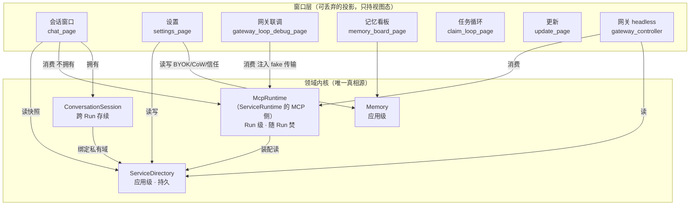

# 从「胖窗口」到「内核 + 多投影」

> **定位**：跨域架构设计稿（UI / 装配层的状态所有权重构）。续 [`page-revamp.md`](page-revamp.md)——本文处理它在 2026-10-14 评估中已识别、但 10-16 轮只部分根治的「服务端点多个平行入口」。
> **状态**：draft，**未立项**。架构裁决已拍板（**十二项**，台账见 §8.1）；§8.2 待确认已清空——**冻结解除，步 0 可开工**。
> **纪律**：本文是内容 SSOT；epic 的 `memory.md` 只记状态与指针，不抄本文内容。

## 1. 定性：不是 ChatPage 太胖，是一个窗口同时扮演多个角色

2026-10-16 快照下，聊天页（`lib/ui/chat_page.dart`，约 66KB）仍同时是：

| 角色 | 证据（当前行号） | 判定 |
|---|---|---|
| ① 会话窗口（本职） | 双轨渲染 `_track`(96)、composer、流控 `_streamBuf`(142)、在途卡 `_activeCallEntry`(138) | 本职，保留 |
| ② 装配中枢（越权） | `_send`(605-1110) 内：读 store → 逐端点 `McpClient.http` + `McpToolFace`(707-789) → `ToolRouter`(793) → `MemoryToolExecutor`→`PermissionGateway`→`HydratingExecutor`(809-849) → `assembleDefaultHybridEngine`(850)；`_GuardedExecutor`(65-80) 是 coordinator 件却住在 UI 文件 | **越权，待拆** |
| ③ 应用外壳（越权） | 已于 2026-10-16 解除：`_openSettings` / `_openDebugMenu` 整体迁出至 `settings_page.dart`（后者在 1542 行），聊天页 AppBar 已清空，设置/记忆看板入口收敛到侧边栏 | **已解决，本文不再处理** |

结论：聊天页的「外壳」角色已摘除，剩下的是 **②装配中枢**这一个越权。而装配的重复已经扩散到聊天页之外（见 §2）。

## 2. 现状实证（2026-10-16 快照）

### 2.1 服务目录路径被拼了 3 次

| # | 落点 | 形态 | 遗留差异 |
|---|---|---|---|
| 1 | `lib/ui/chat_page.dart:303` `_epStore` | `ServerEndpointStore(file:…, prefs: flutterPrefsLike(…))` | 带旧 SharedPreferences 单端点迁移 |
| 2 | `lib/ui/settings_page.dart:268` `_epStoreProd` | 同上（含迁移） | 与 1 是两份独立代码，靠"恰好拼了同一个字符串"保持一致 |
| 3 | `lib/gateway/gateway_controller.dart:148` `_assemble` | `ServerEndpointStore(file: File('$support/mcp_servers.json'))` | **不带 `prefs` 迁移**——旧配置在网关侧读不到，是已存在的行为不一致 |

第 3 条不是"重复代码"，是**正确性缺陷**：同一个"服务目录"，三个消费点读到的内容可以不一样。这是把 Directory 立成契约的最硬理由。

### 2.2 装配逻辑有 3 个调用点

| 调用点 | 形态 | 与聊天页的差异 |
|---|---|---|
| `chat_page._send`(658-870) | 多端点 + 本地插件 + 路由 + 全链路装饰器 + 韧性连接 | 完整版 |
| `gateway_controller._assemble`(109-168) | 本地插件 + 手填端点 → faces；无装饰器链 | **漏了 prefs 迁移**（2.1 #3），信任闸门独立实现(124) |
| `gateway_loop_debug_page._run`(294-360) | 单端点直连 URL / 本地插件，自建 client + face + onProgress | 简化版（联调定位，可接受简化，但 face 构造与进度桥接是抄的） |

对照：`assembleDefaultHybridEngine`（`lib/coordinator/hybrid_assembly.dart`）已被 4 处调用（chat 850 / debug 406 / claim_loop 81 / gateway 172），且 `fenced_cloud_engine.dart:9` 注释明写「一个实例 = 一次 Run」——**Run 级装配的既有表达已经存在，但只覆盖云端引擎侧，没覆盖 MCP 连接池侧**。ServiceRuntime 要做的是把这半边补齐并统一。

### 2.3 会话态靠手工枚举维护

新增一个会话级字段要改 3 处：字段声明(`chat_page` 103-121)、`_resetSessionState`(219)、`_persistConversation`(199-205)。当前 5 个字段（`_history`/`_skills`/`_degradation`/`_activePrivateServerId`/`_wsStates`）全靠这 3 处手工对齐，任何一处漏改都是静默 bug。

## 3. 核心抽象：四内核 + 窗口即投影



### 3.1 内核全清单（11 个）

| # | 内核 | 持有 | 生命周期 | 现有实现侧面（立契约，不是新建文件） |
|---|---|---|---|---|
| 1 | **ServiceDirectory** 服务目录 | 端点配置、令牌、挂载位、发现项、探活态 | 应用级 · 持久 | `mcp/server_endpoints.dart` + `local_plugin_discovery.dart` + `server_probe.dart` |
| 2 | **McpRuntime** 服务运行时 | 连接池、faces、路由、私有槽位、韧性回告、RefStore、StuckWatcher | **Run 级 · 随 Run 焚** | 现散在 `chat_page._send`(658-1108) 与 `gateway_controller._assemble`(109-168) |
| 3 | **EngineSupply** 模型供给 | BYOK profile、密钥、生效位、设备分级门禁、引擎实例 | **二分** 配置持久 / 引擎 Run 级 | `llm/cloud/byok_store.dart` + `llm/device_tier.dart` + `coordinator/hybrid_assembly.dart`（4 处调用） |
| 4 | **TrustGovernance** 信任与授权 | 持久白名单 + 会话级豁免 + 入站鉴权 | **二分** 白名单持久 / 豁免会话级 | `mcp/trusted_plugins.dart`（已事实单例）+ `gateway/gateway_security.dart` + `coordinator/permission_gateway.dart` |
| 5 | **ConversationArchive** 会话档案 | 会话列表、快照落盘、切换 / 删除 | 应用级 · 持久 | `sandbox/conversation_store.dart`（**现被 chat_page 独占**） |
| 6 | **ConversationSession** 会话活态 | transcript、技能激活集、降级判据、私有域绑定 | 会话级 · 跨 Run 存续 | `chat_page` 4 个裸字段 + `_degradation` + `_skills` |
| 7 | **Memory** 记忆 | 三件套 + scope（user/srv 域 + session 域） | 应用级 + 会话级双域 | `sandbox/memory_store.dart` + `workspace_state_store.dart` + `coordinator/workspace_stream_filter.dart` |
| 8 | **SkillSupply** 技能与覆写 | CoW 覆写正文 + 激活集 | **二分** 覆写持久 / 激活集会话级 | `coordinator/cow_sync.dart` + `skill_registry.dart` + `skill_activation_executor.dart` |
| 9 | **Gateway** 对外代理（host） | 起停、配对 Token、命名空间 / 工具面虚拟化、循环守护、背压 | 应用级（起停） | `gateway/*` 七个文件 |
| 10 | **TaskLoop** 对上服务 | claim → 心跳 → 推理 → apply 状态机 | 应用级（长跑循环） | `task/task_loop_service.dart` + `mcp/goodshare_task_api.dart` |
| 11 | **Updater** 自更新 | 清单、下载、安装、串包防御 | 应用级 | `update/*` + `ui/update_page.dart` |

> **认领状态（2026-10-16 二轮）**：本轮**只碰 3 个**——#1 ServiceDirectory、#2 McpRuntime、#6 ConversationSession。其余 8 个（#3 EngineSupply / #4 TrustGovernance / #5 ConversationArchive / #7 Memory / #8 SkillSupply / #9 Gateway / #10 TaskLoop / #11 Updater）统一标注 **已识别·未认领（Deferred / Catalog Only）**：无 owner 判定、无接口契约、不构成承诺。
> **防误读**：Deferred 指**不改其内部**；装配**必然依赖**其接口（`skills` / `memoryStore` / `engine` / `trusted_plugins` 均为装配入参）。

**视图态（不入内核，永远留在窗口）**：`TrackEntry` 双轨模型、`DualTrackStream`、`StreamTextBuffer` 流控、滚动与自动跟随、CallCard 相位、状态带胶囊。

### 3.2 辨析：清单里混了「内核」与「投影」

- **「设置」不是内核**——它是**多内核的配置投影**（§4）：BYOK 段 → EngineSupply，节点卡 / 本地信任段 → ServiceDirectory + TrustGovernance，Skill 覆写段 → SkillSupply，PC 网关段 → Gateway，跨源授权段 → TrustGovernance，关于段 → Updater。
- **「记忆看板」不是内核**——它是 Memory 的编辑投影。内核是 Memory，含 In-band 提取管道（`WorkspaceStreamFilter` 当前在 `chat_page._send` 内联构造，**没有窗口归属**）。

### 3.3 命名边界

落地文件与类名用 **`McpRuntime`**（`lib/coordinator/mcp_runtime.dart`），**不用** `ServiceRuntime`。理由：本次只收 MCP 连接池侧；**云端引擎侧的 Run 级装配已存在且已跑通**——`lib/coordinator/hybrid_assembly.dart`（4 处调用：chat 850 / debug 406 / claim_loop 81 / gateway 172），`fenced_cloud_engine.dart:9` 已明写「一个实例 = 一次 Run」。取名 ServiceRuntime 会被误解为连云端一起收，凭空放大范围。

### 3.4 「服务信息流本身」不是内核，是端口组

MCP 的 progress 通告、resources 变更、断连 / 积压回告、sampling 反向请求——**不单立模块，也不引事件总线**（§9 边界）。它们是**装配时注入的回调端口**（§7.1 六端口）。理由：总线会把生命周期拉成应用级，而服务信息流是 **Run 级**，随 Runtime 生灭；做成总线必然泄漏。

## 4. 职责矩阵（谁拥有、谁只读）

| 窗口 | Directory | Runtime | Session | 视图态 |
|---|---|---|---|---|
| 会话窗口 | 读快照 | **消费**（不拥有，随 Run 取还） | 拥有 | 拥有（TrackEntry / 流控 / 滚动） |
| 设置 | **读写**（CRUD / 挂载 / 探活 / 信任） | — | — | 拥有（节点卡态、BYOK 生效位） |
| 网关联调 | 读 | **消费**（注入 fake 传输） | — | 拥有 |
| 网关（headless） | 读 | **消费** | — | — |
| 记忆看板 | — | — | — | 拥有（编辑态） |

> **修正（相对首轮抽象）**：设置页**不是**「Directory 的窗口」。它六段中只有「MCP 服务端点（节点卡）」属 Directory，其余五段各有内核——BYOK(`byok_store`)、Skill 覆写(`cow_sync`)、本地插件信任(`trusted_plugins`)、PC 远程网关(`gateway_controller`)、跨源授权语义。准确表述是：**设置 = 多内核的设置投影**，它是 Directory 的事实唯一读写 owner，同时也是另外四个内核的配置面。

### 4.1 对话页分离后的形态

**移出**（现 `chat_page` 行号 → 去向）：

| 现状 | 行 | 去向 |
|---|---|---|
| `_epStore` 端点目录拼装 | 303 | ServiceDirectory |
| 装配：连接池 / faces / router / 装饰器链 / CoW 同步 / 引擎 / AgentLoop 构造 | **658-970** | McpRuntime + EngineSupply（事件循环 991+ 不搬，见 §7.1） |
| `_startConnection` 韧性连接与三回调 | 1113-1138 | McpRuntime（`connectionReport` 端口） |
| `WorkspaceStreamFilter` 记忆提取构造与落盘 | 663-700 | Memory |
| 会话持久化与切换 / 删除 / 侧边栏列表 | 174-290、1103 | ConversationArchive + ConversationSession |
| 会话五字段 + `_resetSessionState` 手工枚举 | 103-121、219 | ConversationSession（枚举随之消失） |
| `_endpoints` / `_localPlugins` 缓存 + composer 菜单 | 405-604 | 读 Directory 快照 |
| `_samplingQuota` | 106 | **ConversationSession**（60 分钟窗口跨 Run 共享，是**会话级**不是 Run 级） |

**留下**（纯视图态 + 端口实现）：`_track` 双轨渲染、composer 输入、`_streamBuf` 流控、`_scrollCtrl` / `_autoFollow` 滚动跟随、状态带与胶囊、CallCard 相位机、侧边栏（订阅 Archive 快照）、以及六个端口在 UI 侧的实现（`_ChatGate` / `_ChatFence` / `onNote` / `onProgress` / `consent`）。

**粗估**：`chat_page.dart` 现 65.8KB（约 1500 行）→ 瘦身后约 600-700 行纯 UI。会话页从此只做一件事：**把内核事件渲染成双轨**。

## 5. 四条所有权铁律

1. **单一 owner**：每个状态只有一个 owner，其余窗口拿**快照**而非引用。现状 2.1 的 3 处拼装是典型的"靠巧合保持一致"的隐式共享，是耦合的真正根源，必须由 Directory 单一实例取代。
2. **窗口间不共享可变状态引用**（降级版）：原拟「窗口间零直接调用 + App Shell 路由器」——评估后降级。Flutter 的 `Navigator.push` 本就是平级关系（无 embed），真问题是状态共享而非路由方式；引入 Router 要动 `main.dart` + 所有 push 点 + 测试，收益仅形式。故：**路由维持 `Navigator.push`，只禁止跨窗口共享可变引用**。
3. **视图态不下沉、领域态不上浮**：`_track`（双轨 UI 模型）永远留在窗口；`_history`（模型输入）永远留在 Session。两者同居一个 State 是 §2.3 手工枚举的根源。
4. **生命周期单向依赖**：**长生命周期实体可被短生命周期依赖，严禁反向**——应用级（ServiceDirectory / ConversationArchive）← 会话级（ConversationSession）← Run 级（McpRuntime）。短周期消亡时不得拉扯长周期实例销毁；长周期变更经**快照 + 端口**传给短周期（措辞与 §3.4「不引事件总线」一致，**不写"事件通知"**）。
   > **防误读**：本轮「只碰 3 个内核」指**不改其余内核内部**；装配**必然依赖**它们的接口（`skills` / `memoryStore` / `engine` / `trusted_plugins` 均为装配入参）。「未认领」≠「不接触」。

## 6. 分期与准入判定

| 步 | 一句话 | 展开 |
|---|---|---|
| **0** | 立契约：`SessionContext` + `RuntimeDelegates`（八端口）+ `McpRuntime.assemble` 签名 + ServiceDirectory 单一入口；修 gateway 漏迁移；**建基线测试** | §7.5 |
| **1** | 搬迁装配内核（658-970）至 `mcp_runtime.dart`；`chat_page` 改为调用方；等价性单测 + 冒烟 | §7.5 |
| **2** | 收敛其余调用点：`gateway_controller`（生产）→ 联调页（挂载原语）→ `task_loop_service`（ephemeral 适配） | §7.5 |
| **3** | `chat_page` 接线与瘦身验收（剥离 `_samplingQuota` 与记忆 In-band 提取面） | §7.5 |
| ~~4~~ | ~~设置升格独立窗口~~ | **2026-10-16 已完工**（`page-revamp.md` P1-终态有账），本文删除该项 |

> **内核顺序已调整**为 **Directory → Runtime → Session**（原抽象为 Runtime → Session → Directory）：Runtime 装配要读 Directory，属顺序依赖；Directory 是**已存在的正确性缺陷**，Runtime 是维护成本，正确性优先且 Directory 工作量最小。

**准入判定（solution-admission 口径）**：**S2 结构性引入**，否决信号 #2（同一处理需在第 2 个以上调用点重写）命中——且实际是 3 处不是 2 处。命中 #2 的落点是 **Directory**，不是 Runtime，故 Directory 排在步 0。

## 7. 实施策略：先抽纯壳，再逐个换芯

> 法则：**先定边界（拆壳），再修零件（改服务），最后连线验证（组装）。**
> 理由：底层子服务内部改动与架构拆分若混做，报错无法归因（分不清"调用链接口接错"还是"服务内部逻辑改崩"）。

### 7.1 第一步不是"原封不动搬迁"，而是"先定义端口再搬迁"

装配过程本身在**流式产出 UI 事件**——不是返回一个值的纯函数。`chat_page._send` 的 658-1108 里，装配代码与 UI 交织：

| # | 端口 | 纠缠点位置 | 现有形态 | 成本 |
|---|---|---|---|---|
| 1 | `onNote` 轨迹 / 告警 | `_add(TrackNote)` ×8：712 / 780 / 787 / 854 / 913 / 925 / 934 / 1087 | 内联 | **新建** |
| 2 | `onProgress` 状态带 + LoopToolProgress 桥接 | 723-729 / 766-772 | 内联 `_setPill` + `loopBox?.` | **新建** |
| 2a | `onNotice` 网关通告（**步 1 迁移补记**：L1 放行/会话豁免的状态带+触感，触发时机不与 confirm() 重合，无法并入 gate 挂起端口；语义属 onProgress 同族，独立成第 9 广播口） | 800-803 | 内联 `_setPill` + haptic | **新建** |
| 3 | `connectionReport` 断连 / 积压 / 资源变更 | 1115-1135 | `_startConnection` 三回调，含 `mounted` 守卫 | **新建** |
| 4 | `majorJumpDelegate` CoW 大版本跃迁确认 | 884-904 | 内联 `showDialog` + `Navigator.pop` | **新建** |
| 5 | `consentDelegate` 跨源授权 | 833-847 | 已是闭包入参 | 零（原样传） |
| 6 | `gateDelegate` 确认卡 | 812 | 已有 `_ChatGate(this)` | 零（**可空**：headless 传 `null`，见 §8.1-2） |
| 7 | `fenceDelegate` 围栏 | 852 | 已有 `_ChatFence(this)` | 零 |
| 8 | `blockDelegate` 熔断 / 步数墙 | 957 | 已有 `_ChatBlock(this)`，接口 `BlockDelegate` 已抽象 | 零 |

**边界判据（写死）**：装配段 = **658 → 970**（`loopBox = loop`，即 `AgentLoop` 构造完成）。**991 起的 `await for (loop.run(...))` 事件循环不搬**——工具调用事件（`LoopToolCallStarted` / `LoopToolProgress` / `LoopToolCallFinished`）是**执行期**事件流消费，属窗口渲染，不是装配期 delegate；把 `onToolCall` 塞进端口组会把搬迁范围扩大到 1015-1105 的双轨 UI 核心，直接违反"先抽纯壳"。

直接"原封不动"搬到纯 Dart 模块，要么编译不过（无 `BuildContext`/`setState`），要么把整个 `_ChatPageState` 传进去——后者等于没解耦。**故第一步的真正工作是定义上面 8 个端口，其次才是搬代码。**

### 7.2 搬迁单元是整个 try-finally，不是 assemble 那一段

`connections` 在函数作用域声明（658），`finally`（1089-1108）统一释放：`c.stop()`、`refStore.expireAll()`，同处还有 UI 收尾 `_streamBuf.flush()` / `_persistConversation()` / `setState(_running=false)`。只搬装配、把 finally 留在页面 → Run 级生命周期（随 Run 焚）不成立，连接泄漏风险立刻出现。

**划分判据 = 谁持资源谁释放**：

- 进 McpRuntime：连接池 `stop()`、`refStore` 生命周期、faces / router 引用；
- 留窗口：`_streamBuf.flush()`、`_running` 置位——视图态（铁律 3）；
- **勘误（2026-10-16 二轮）**：**会话快照落盘（`_persistConversation`）不是视图态**，是**持久态**，归属 `ConversationArchive`（应用级内核），铁律 3 不适用。本轮**不迁**——Archive 属 Deferred（§3.1），`_persistConversation` 暂留窗口作临时替身，步 3 收口后另立 epic。

故 McpRuntime 暴露的是 **`assemble()` + `close()`** 一对，不是单个函数。

### 7.3 「改内部服务」不在本流水线内

`MemoryStore` / `ToolRouter` / `ContextGovernor` / MCP Client 的内部改造，归属 **chatmessage epic 的 G1 / G3 / D-H / D-I 缺口**（keyed upsert、三段式路由、2000 token 硬截断、Synthetic Masking），不是窗口解耦的零件。把它们并入本流水线会污染"搬迁后冒烟绿"这条基线，重新制造 §7 开头要避免的归因困难。

**两条流串行纪律**：重构流水线 = 步 0 → 1 → 3 → 4（搬迁 → 装配点对齐 → 补测试）；内部服务改造走它自己的 epic 流水线（由浅到深：纯存储 → 纯函数与治理策略 → 网络连接与协议）。重构先落地并冒烟绿，之后改造才动那些文件，禁止同文件并发改。

### 7.4 落点与测试基线

- 落点：`lib/coordinator/mcp_runtime.dart`（与 `hybrid_assembly.dart` 同级）。
- **勘误（2026-10-16 四轮）**：本文曾称 `lib/mcp/tool_router.dart` 是「无人引用的死件」——**表述错误，已更正**。它是 **F1.9（P0）海关过滤的唯一实现**，有测试引用（`test/tool_router_test.dart:9`），且 **SA-Q6 已于 2026-10-15 拍板「保留待接线」**（`context/pending-confirm.md:49`；启用前置条件：服务端普遍下发 annotations + 未打标降级口径通告 + 装配层与网关对外目录两处同时过过滤）。**不得删除、不得从索引中清除**（删它 = 删 P0 需求实现 + 推翻已拍板项）。
  > **但装配仍不得引它**：生产路由走 `lib/coordinator/tool_router.dart`（`chat_page` / `discovery_executor` / `mcp_gateway_handler` 都引它）。**警告保留**——两者同名，IDE 自动导入易误命中 `mcp/` 那份。
- **步 1 只服务 chat 一个调用点**。`gateway_controller` 形状不同（填 `handler.faces`、无装饰器链、无 UI），联调页是单端点简化版；一次统一三处等于又回到"设计外壳"而非"搬迁"，它们分别在步 2 / 步 3 用装配选项参数化接入。
- **测试基线缺口**：`test/` 下无 chat_page 级测试（现有 `coordinator/` 18、`mcp/` 11、`ui/` 13、`tool_router_test`、`debug_hall_test`），"证明没搞坏"目前只能靠真机。**搬迁前先补装配级绿基线**，直接沿用仓内已有两个注入范式：`server_probe.dart:51` 的 `clientFactory` 注入位、`settings_page` 的 `storeOverride` / `endpointStoreOverride`。

三次成本对比（Directory）：
- A 结构性：1 个工厂 + 3 调用点改造，之后新增第 4 个消费点（如记忆看板要探活）零成本；
- B 补丁：只给 `gateway_controller:148` 补上迁移参数，10 分钟止血，但第 4/5 个消费点仍会重踩「漏带迁移 / 漏带信任闸门」——gateway 那处已是活证据。

### 7.5 执行路线图（步 0 → 步 3）

> 物理推进顺序：**先立纯 Dart 契约与基线测试 → 搬迁装配并瘦身 ChatPage → 收敛外部调用点**。

#### 前置裁决（两条）

| 议题 | 裁决 | 理由 |
|---|---|---|
| `MemoryStore` 兼作审计日志（`opsLog`） | **本轮坚决不动，维持现状** | 两者存储模型同为追加式；动审计会横向牵涉 `gateway_security` 与 `permission_gateway`，破坏本轮「只碰 Directory / McpRuntime / Session」的收敛铁律。**须另记技术债**（memo-collector 口径：`风险` 待办 + `[long]`），不只写在本文 |
| `TaskLoop` 直连 `baseUrl` 绕过目录 | **步 2 仅做适配兼容，不改业务流程** | 由 `McpRuntime` 提供 `mountEndpoint(ServerEndpoint.ephemeral(url, key))` 挂载原语消除重复装配胶水；**不开 `assemble(baseUrl:)` 重载**——那会让 McpRuntime 出现两套入口语义 |

#### 步 0 · 立契约与基线（零破坏性改动）

交付（`lib/coordinator/mcp_runtime.dart`，纯 Dart，**严禁 import Flutter Widget**）：

- `SessionContext`：**纯不可变快照**（`activePrivateServerId` / `activatedSkills` / `conversationId` / `degradationState` / transcript(`_history`) / `_wsStates`）——**不含配额**（§8.1 裁决 4）。即 ConversationSession 的轻量前身。
- **配额独立入参**：`SamplingQuota` 实例本身作 `assemble(quota: …)` 入参，不进 `SessionContext`。真实语义 = `Duration? tryConsume(String serverKey, DateTime now)`（`sampling.dart:14-32`：**20 次 / 60 分钟，按 serverKey 分桶**；返回建议重试等待）——**不是 token 数、不是 bool**。chat 侧传 Session 持有实例，gateway 侧 `new`（现状 `gateway_controller:173`）。
  > **行为变更（须入步 3 验收）**：`chat_page:106` 注释「D3：重启清零」= 现为**页面级**；归 Session 后**切会话即重置**。
- `RuntimeDelegates`：§7.1 的**八个**端口（`onToolCall` **不在内**，它是执行期事件流消费，属窗口）；**`gateDelegate` 可空**（§8.1 裁决 2）。端口分两类，**取消语义写死**（§8.1 裁决 8）：

  | 类别 | 端口 | 约束 |
  |---|---|---|
  | **挂起**（`Future<T>`，Human-In-The-Loop，内核 `await`） | `gateDelegate` / `fenceDelegate` / `blockDelegate` / `consentDelegate` / `majorJumpDelegate` | 必须可 await。其中 gate / block / fence **现已是 Future**（`permission_gateway.dart:67` / `tool_breaker.dart:63` / `chat_page:1641`），缺口不在 Future 化而在取消感知 |
  | **广播**（`void`，火即忘） | `onNote` / `onProgress` / `connectionReport` | 不得返回 Future，内核不得 await |

  **Abort 兜底（防悬挂，必做）**：`TrackConfirm.completer`（`dual_track_stream.dart:69`）无超时/取消路径，而 Abort 只收尾在途调用卡（`chat_page:1154-1162`）→ 挂起中的确认卡 **Future 永挂**。契约要求：Abort 时以 `GateDecision(approved: false, reason: 'aborted')` 兜底完成**所有** pending 卡（`TrackConfirm` / `TrackBreaker`），按既有 `user_rejected` 语义回传模型自纠。
- `McpRuntime.assemble(...) → Future<McpAssembly>` + `McpAssembly.close()`（§8.1 裁决 3）：

  ```dart
  class McpAssembly {
    final AgentLoop loop;
    final ToolRouter router; // 仅在 close() 前有效——Run 焚后引用悬空，窗口不得缓存
    final List<McpToolFace> _faces; // 内部闭环，不对外暴露

    /// 中断在途（可重复调用、同步完成）：遍历内部**全部** face 调
    /// cancelActiveRequest（无在途流的 face 立即 return，不发多余通知），
    /// 再 loop.abort()（**无参**）。**不释放资源**——释放仍须 [close]。
    void abort({required String reason});

    /// 释放（**幂等**）：先 abort，再 connections.stop() + client.close()
    /// + refStore.expireAll()/dispose()。多次调用仅首次生效；
    /// 失败 DEGRADE 留痕、不抛穿 finally。
    Future<void> close();
  }
  ```

  - **句柄内部持有 `List<McpToolFace>`**（闭环、不暴露）：`abort()` 遍历全部 face 取消在途，**不依赖"当前哪个 face 在跑"**。理由：现状 `chat_page:972` 取 `faces[router.serverIds.first]` 作「主服务面」，属"恰好第一个"的偶然性；遍历更稳，且彻底消除窗口层 `_activeFace` 残留。
  - **两处实现约束**（照抄伪代码会编译失败）：`McpToolFace.cancelActiveRequest` 返回 **void**（`mcp_tool_face.dart:203`，内部 `unawaited` 发通知）→ **不可 `await` / `Future.wait`**；`AgentLoop.abort()` **无参数**（`agent_loop.dart:193`）→ `reason` 只用于 cancel notify。
  - **两段语义**：`abort()` 只中断在途、**不释放**；`close()` 才释放且**幂等**（内部 `_closed` 标志）。
  - **关到哪一层写死**：`close()` = `McpConnection.stop()`（cancel 订阅 + 停健康探活）**+ `client.close()`（释放底层传输）**。现状 finally 只调 `stop()`、未调 `client.close()`——底层传输未显式释放，属既有技术债，**随本次搬迁一并修正，不单列**。注：`stop()` 本身不关传输，故不会引发在途 SSE/stdio 抛异常。
  - **并发踩踏当前无路径**：`_send` 单飞守卫（`chat_page:607`）+ 连接池 per-Run 独立 + §9「不做全局单例常驻连接池」→ 无共享连接池可踩。**不引入 RunContextId**（单飞前提下无收益，徒增字段）。
  - `connections` / `refStore` 封死在内核内，**不向外泄漏引用**；
  - **装配必须接受 `McpClientFactory? clientFactory` 注入，默认 `McpClient.http`**（范式 `server_probe.dart:49-52`）——否则句柄封死后步 1「全部连接已 close」无从断言。
- `ConversationSession` 写回契约（步 0 立签名，步 3 接线，§8.1 裁决 1）：

  | 方法 | 语义 | 陷阱 |
  |---|---|---|
  | `replaceTranscript(List<…>)` | **全量替换** | `chat_page:1067` 是 `clear() + addAll()`，**不是追加**；命名成 `append` 会致 transcript 跨轮翻倍 |
  | `bindPrivateServer(String? id)` / `unbindToPublic()` | 私有域**三态** | `null` = 未绑定走回退链 ／ `''` = 曾绑定但显式回公共（不再回退）／ `id` = 锁定。二态会丢 `chat_page:1084` 已实现的"显式公共" |
  | `toJson()` / `fromJson()` | **步 0 只立签名、不实现持久化** | 零成本预留，防日后落盘返工；真实持久化属 `ConversationArchive`（Deferred，见 §8.3） |
- `ServiceDirectory` 单一入口（收敛 2.1 三处拼装），顺带修 `gateway_controller:148` 漏 `prefs` 迁移的活 bug。

**基线测试（与契约同轮完成，不得推到步 1）**：

- 归档 `test/coordinator/discovery_executor_test.dart:177-305` 已有的私有槽位 / 三段式序断言为基线——**不要重写**；
- 补 `_resolveBinding(endpoints)` 回退链纯函数测试（全局钉选 → 首个启用 private → null）：私有方法、**最易改错**的一段；
- 补**私有域三态往返断言**（`null` / `''` / `serverId` 各一次）：`ConversationSnapshot.activePrivateServerId` 是 `String?` 且注释已明写三态（`conversation_store.dart:61-63`），落盘/反序列化**原样无损**（`null` → JSON `null`、`''` → `""`，无 `isEmpty ? null` 归并）→ **契约无需改**；此断言专为防日后被"顺手优化"成二态——`''` 归并进 `null` 会让重启后「显式回公共」**回跳**成自动绑定私有。

验收：新增文件零接线，`flutter analyze` 0 新增，583/583 不变。

#### 步 1 · 搬迁装配内核

搬迁 `chat_page._send` **658-970**（边界判据见 §7.1：末行 `loopBox = loop`；991 起事件循环不搬），含 `_startConnection`(1113-1138) 与 `_GuardedExecutor`(65-80)。

单测 `test/coordinator/mcp_runtime_test.dart`：

1. **装配产物等价性**——搬迁后 `privateServerIds` / `activatedServers` / `activePrivateServerId` / `focusedSchemas()` 与搬迁前逐项一致（不是重测 `ToolRouter`，那段已被 `discovery_executor_test` 覆盖）；
2. **资源释放**——装配异常与 Run 结束 `finally` 两条路径下，全部连接句柄 `close()`，且 `refStore.expireAll()` / `dispose()` 被调用，无泄漏。**断言手段**：经 `clientFactory` 注入 fake client 计数（句柄封死，不能从句柄观测）；`close()` 内部失败按 DEGRADE 留痕、不抛穿 `finally`。

验收：`chat_page` 改为调用方后，真机端到端冒烟通过（聊天 + 私有域切换）。

#### 步 2 · 收敛其余调用点（按此顺序）

| 顺序 | 调用点 | 做法 |
|---|---|---|
| 1 | `gateway_controller._assemble`(109-168) | **生产路径，且带漏迁移活 bug，优先接入**。装配选项参数化：无 UI 通知 / 无装饰器链 / 填充 `handler.faces` |
| 2 | `gateway_loop_debug_page._run`(294-360) | **不复用完整装配**——它单端点、无路由、无装饰器链、自有 `_TextEntry` 轨迹。只复用**挂载原语**（`client → negotiate → face → listTools`，三处重复的就是这段） |
| 3 | `task_loop_service:206` | 仅适配：`mountEndpoint(ServerEndpoint.ephemeral(url, key))`，不动 claim → 心跳 → apply 调度模型。**凭证隔离（§8.1 裁决 9）**：① `ephemeral` 端点**不进 Directory 列表、不参与 `save()`**——`store.save()` 是**全量覆写**（`server_endpoints.dart:152-162`），进了列表即落盘；② 其执行期记忆/日志 **scope 强制任务上下文**，禁写 user / srv 全局域（`upsertFacts(scope:)` 已有 scope 参数） |

#### 步 3 · ChatPage 接线与瘦身验收

- `_send` 变薄：收集当前会话上下文 → 组装 `SessionContext` → `McpRuntime.assemble` → `finally` 释放；
- 剥离 `_samplingQuota`（→ **ConversationSession**，不是 Runtime）与记忆 In-band 提取面——`WorkspaceStreamFilter` 本身已是纯 Dart，要搬的是它内联在 `_send` 663-700 的**构造与落盘**，UI 胶囊部分走 `onNote` 回传；
- 验收：`flutter analyze` **0 新增 issue**（存量基线 = 1 条已知 info：`gateway_loop_debug_page.dart:670 value deprecated`，不是零告警）、**583/583 全绿**、端到端聊天与私有域切换回归正常；
- **行为变更回归**（步 0 裁决引入，须显式验收）：① 配额归 Session 后**切会话即重置**（原页面级「重启清零」）；② headless 路径 L2 写操作恒返回 `user_rejected`（不挂起）；③ transcript 全量替换语义不变（同会话多轮后条数不翻倍）。

## 8. 与已锁决策的对齐 / 待确认项

对齐：

- **D-D「连接平面全局 / 投影平面按工作区隔离」**——本设计是它的 UI 侧落地：Directory 是连接平面（全局），各窗口是投影平面（按窗口隔离）。与 `chatmessage/todos.md` 依赖跟踪「§2.4 投影平面按工作区隔离（从 `GatewayController.shared` 单例拆出）」同一条线。
- **§15「激活集属会话，跨会话必须重开」**——`ConversationSession` 就是这个生命周期边界。
- **D-C「私有 + 私有由单一槽位保证」**——私有域绑定归 Session，不归窗口也不归 Runtime。

### 8.1 架构裁决台账（2026-10-16 二轮拍板 · 六项）

| # | 议题 | 裁决 | 依据 |
|---|---|---|---|
| 1 | 事件循环内的内核态写回 | 窗口（Session owner）显式调 `session.replaceTranscript(...)` / `bindPrivateServer(...)` / `unbindToPublic()`。**全量替换非追加**（命名 `append` 会致 transcript 跨轮翻倍）、**三态非二态**（`null` 未绑定 / `''` 显式公共 / `id` 锁定）。不新增端口、不违反单向依赖 | `chat_page:1066-1085` |
| 2 | headless 确认挂死 | **`gateDelegate` 可空，headless 传 `null`**——复用 `PermissionGateway` 既有 fail-closed（`_rejected('宿主无确认界面…')` → `user_rejected`，`isError=false`，模型可自行修正重调）。**不新建 `HeadlessGate`**；`ToolPendingConfirmation` 只有 `toolName`+`argumentsJson`、**无只读判据**，且 L1 只读在到达 delegate 前已放行 → **禁止在 delegate 内做"只读自动放行"**（会造第二判定源） | `permission_gateway.dart:40-45,137-148,169-175` |
| 3 | `assemble()` 出参 | `Future<McpAssembly>`：`loop` / `router`（**仅 `close()` 前有效**，窗口不得缓存）/ `abort({required String reason})`（内聚 `primaryFace.cancelActiveRequest` + `loop.abort`）/ `close()`。`connections` + `refStore` 封死不泄漏；装配**须接受 `clientFactory` 注入**，否则步 1 释放断言无从观测 | `chat_page:1154-1155`、`server_probe.dart:49-52` |
| 4 | `SessionContext` 矛盾 | 纯化为**不可变快照、不含配额**；`SamplingQuota` **实例作独立入参**（`20 次/60 分钟`·按 serverKey 分桶，**非 token 数、非 bool**）。归 Session 后**切会话即重置** = **行为变更**（原页面级「重启清零」），入步 3 验收 | `sampling.dart:14-32`、`chat_page:106,858` |
| 5 | §7.2 落盘分类 | **勘误**：`_persistConversation` 属 `ConversationArchive`（持久态），铁律 3 不适用；**本轮不迁**（Archive 属 Deferred），暂留窗口作临时替身，步 3 收口后另立 epic | §7.2 |
| 6 | 范围与生命周期规则 | 补**铁律 4 生命周期单向依赖**（应用级 ← 会话级 ← Run 级；变更经**快照 + 端口**，措辞与 §3.4 一致）；其余 8 内核标注 **Deferred / Catalog Only**；「未认领」≠「不接触」 | §3.1、§5 |
| 7 | `close()` 生命周期语义 | **幂等** + **两段**：`abort()` 仅中断在途**不释放** / `close()` 释放且幂等（先 abort 再释放）。关到哪一层写死 = `McpConnection.stop()` **+ `client.close()`**（现状只 stop，底层传输未释放 = 既有技术债，随搬迁修正）。**并发踩踏当前无路径**（单飞守卫 + 连接池 per-Run 独立 + §9 不做全局池）→ **不引入 RunContextId** | `connection_manager.dart:187-192`、`chat_page:607,1154` |
| 8 | 端口异步与取消感知 | 分类写死：挂起 `Future<T>` = gate / fence / block / consent / majorJump（**三个 delegate 现已是 Future**，缺口在取消感知不在 Future 化）；广播 `void` = onNote / onProgress / connectionReport。**Abort 兜底**：以 `GateDecision(approved:false, reason:'aborted')` 完成所有 pending 卡，杜绝 `TrackConfirm.completer` 永挂 | `dual_track_stream.dart:69`、`chat_page:1154-1162` |
| 9 | ephemeral 凭证隔离 | ① 不进 Directory 列表、不参与 `save()`（`store.save()` 全量覆写，进列表即落盘）；② 记忆/日志 **scope 强制任务上下文**，禁写 user / srv 全局域。落在步 2 第 3 项 | `server_endpoints.dart:152-162` |
| 10 | §5 铁律 2 降级 | **接受降级**：路由维持 `Navigator.push`，**不引 App Shell Router**——Flutter 原生平级入栈语义已足，上 Router 是纯形式主义，徒增改动面与回归成本；「窗口间不共享可变引用」已达成解耦实质 | §5 |
| 11 | 联调页 fake 传输注入位 | **保留挂载原语、拒绝特权分支**：步 2 仅复用 `mountEndpoint`；**不开 `isFakeDebug` 之类装配参数**——需要 fake 传输时经步 0 已定的 `clientFactory` 注入 FakeClient，与生产**同路径、同一套装配基础设施** | §7.5 步 0 / 步 2 |
| 12 | `lib/mcp/tool_router.dart` 处置 | **不删、不脱索引**——它是 F1.9（P0）海关过滤唯一实现，SA-Q6 已拍板「保留待接线」。§7.4 原「无人引用的死件」表述**勘误**；装配仍不得引它（生产走 `coordinator/tool_router.dart`） | `pending-confirm.md:49`、`test/tool_router_test.dart:9` |

### 8.2 待确认

**无未决项，冻结解除**（2026-10-16 四轮清空）：

- ~~§5 铁律 2 降级~~ → **已拍板：接受降级**，不引 App Shell Router（§8.1-10）；
- ~~联调页 fake 注入位~~ → **已拍板：保留挂载原语、拒绝特权分支**，fake 走 `clientFactory`（§8.1-11）；
- ~~是否新建 epic 承接~~ → 已解决：`context/epics/window-kernel-split/` 已建，CURRENT 已绑该 epic；
- ~~八端口 / 步 0 基线测试~~ → 已裁决并入 §8.1（端口定义优先于搬迁；基线测试前移步 0）。

> 后续新增议题一律进 §8.1 台账或 §8.3（不入本轮），本表不再累积。

### 8.3 已评估 · 不入本轮（记技术债，非遗忘）

| 议题 | 结论 | 去向 |
|---|---|---|
| `SamplingQuota` 落盘（防杀进程刷新额度） | 真实但轻：属**本地 token 额度**（20 次/60 分钟），非服务端配额；落盘须存时间戳并防篡改，工程量不小；归属 Archive（Deferred） | `context/epics/window-kernel-split/todos.md` · `(风险)[long]` |
| `ConversationSession.toJson/fromJson` | 步 0 **只立签名、不实现持久化** | §7.5 步 0 |
| ServiceDirectory 变更通知通道 | 具体场景**不成立**——Composer 菜单每次打开已 `await _loadEndpoints()`（`chat_page:490`）；陈旧者仅为页面内 `_endpoints` 缓存字段。不上 Stream / ChangeNotifier（后者是 Flutter 依赖，违反内核纯 Dart）；日后若需要，用纯 Dart `revision` 计数 | `todos.md` · `(风险)` |
| 底层传输未显式释放 | `finally` 只调 `c.stop()`、未调 `client.close()` = 既有技术债，**随步 1 搬迁一并修正** | `todos.md` · `(清理)[short]`（不单独立项） |
| 切会话写冲突 | **不存在**：`_guardRunning('切换会话')` + `_persistIfAny()` 已挡（`chat_page:241-250`） | 无需处理 |
| `clientFactory` 离线装配 | **已解决**：§7.5 步 0 强制项，默认 `McpClient.http` | §7.5 步 0 |

## 9. 不做边界

- 不做全局单例常驻连接池（撞 D-D，且依赖未做的 G8 前后台探针）；
- 不改 `AgentLoop` / `PermissionGateway` 内部；
- 不引入事件总线 / 状态管理框架——内核是普通对象，窗口持有引用即可；
- 不重开 `page-revamp` 已结项的主题/动效/token 整改。
