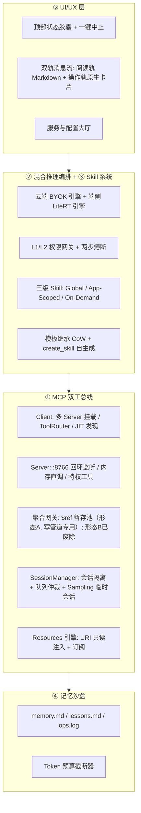

# GoodHub 产品架构 · 双角色 MCP 智能中枢

> 2026-10-10 定稿（七轮评审收敛，ADR-001~005 已归档 `context/decisions.md`）。前瞻扩展锚点见 [future-considerations.md](future-considerations.md)；需求清单见 [requirements.md](requirements.md)。待拍板清单仅余「契约回写闭环」与 M2 实测项。

## 定位

GoodHub = **随身双工 MCP 智能中枢（Dual-Role MCP Host & Peer Node）**：

- 对下挂载各业务 App、对上编排混合模型（端侧 + 云端）——**调度客户端（Host / Client）**
- 向外部与本地暴露系统特权能力与记忆事实——**标准服务端（MCP Server）**

> ~~**2026-10-10 裁决（用户）**：Server 角色（`:8766` 对外暴露 + 特权工具）**暂缓不做**——当前无真实接入场景，依赖与结构边界不清晰；交互形态走「桌面平台先记录待完成 → 宿主批量处理」（FC6），而非实时直调宿主功能。~~ **该裁决已于 2026-10-12 翻转，仅作历史留痕。**
>
> **2026-10-12 解冻（TC5~TC8，用户拍板；现行口径）**：GoodHub 升为 **Host + Gateway 双角色**——对内经 Binder（AIDL）调度本地 App 插件，对外起 **Streamable HTTP 网关 `:8766/mcp`**（协议 2025-06-18，路径统一 `/mcp`）聚合暴露给**桌面 AI 平台（MCP 客户端，如 Claude Desktop / Cursor / ZCode）**，PC 侧单入口；聚合范围 = 本地 Binder 插件 + 远端 HTTP server 全量。本文 Server 相关章节（§1 Server 能力 / §11 / §13 / §15 调度仲裁 / §16 中 Server 侧项）**由「预案设计」转为已生效**。实现见 [design/thirdconnect.md](../design/thirdconnect.md) §7 与 `lib/gateway/`（G1~G5 于 2026-10-13 设备 e2e 与 PC 真机连调通过：AtomCode LAN 直连完成 initialize / tools/list 聚合 / tools/call 实调）。
>
> **配套状态（2026-10-15 对账回填）**：① FC6「待完成队列」形态**已被实时网关取代**（见 [future-considerations.md](future-considerations.md) FC6 注记）；② 环路防护（环检测）**已落地**（F1.10 + §13 注记）；③ SessionManager 仲裁与有界队列 429 **显式关闭**（见 §15 与待拍板清单，含触发条件）；④ TC13 双进程 `:gateway` **未落地**，现状单进程（见 §11 注记）。N7 PII 围栏仍生效，且已扩展至网关出站路径（PII 出站 fail-closed 遮蔽）。

## 六层功能架构（草案）

### 1. MCP 双工总线（Dual-Engine）

**Client 能力**：JSON-RPC 2.0（Streamable HTTP/SSE）多 Server 挂载（goodshare:8765、todo:8767…）；ToolRouter 命名空间前缀隔离（`goodshare__list_items`）；两级按需发现（首轮仅暴露元工具，命中才下发完整 Schema）；心跳探活与断线重连。
- **静态首级摘要（2026-10-10 三轮评审补完 JIT）**：系统提示词常驻每 Server 一行的能力摘要（`- goodshare: 笔记/待办管理`），挂在尾部注入区（与元工具声明相邻，护住前缀缓存）——模型 Turn 1 即可直接 `activate_server_tools("goodshare")`，发现链路从「查列表→激活」缩为单步激活。**修正理由**：纯元工具查询对云端多空转一轮（2~4s 延迟），对端侧小模型更是多轮元规划瘫痪——JIT 两级结构保留，第一级从「元工具查询」升级为「静态摘要直读」。

**Server 能力**：独立端口 `:8766`（默认绑 127.0.0.1，可切局域网 + Bearer Token）；进程内零拷贝直调（自调用不走 TCP，但 handler 必须与 HTTP 路径完全共用，防双语义）；出厂特权工具：`update_memory` / `query_memory` / `read_clipboard` / `send_capsule_notification` / `abort_task`。
- **OS 权限合规（2026-10-10 二轮评审补齐，三轮裁撤音频方案）**：`read_clipboard` 受 Android 12+ 剪贴板焦点约束——强制前置条件「前台 + 交互焦点」，不满足时向 LLM 抛结构化权限拒绝异常（让模型可向用户解释，禁止静默失败/猜测性兜底）；iOS 侧 UIPasteboard 约束更严，特权工具集上 iOS 须重新审计（挂双端策略）。`POST_NOTIFICATIONS` 被拒时降级：**仅应用内胶囊 + 切后台允许被系统回收 + 外部 App 显式 Intent 重唤醒**——无声音频会话保活方案正式废除（三轮评审：流氓保活，发热/耗电/Play 合规三杀，且本产品主场景是前台交互，无长时间无感驻留需求）。

**环路防护（2026-10-10 评审采纳，六轮修死锁）**：桌面 AI 平台经 `:8766` 调入后 GoodHub 再回调出去的级联环——全链路注入 `Trace-ID` + 调用深度 `hop_count`（请求头传递，硬限制 ≤2），总线层做环检测。待实现时定义：hop 计数按调用链归属。
- **重入穿透（六轮评审：解环路/排队死锁）**：与前台运行会话同 `Trace-ID` 且 hop_count ≤2 的重入请求，作为该会话子任务**内联优先执行，不进后台阻塞队列**——否则 A 反向调 GoodHub 时（前台等 A、A 的请求在队列等前台）同机级联死锁。穿透的只是队列，**不穿透权限**：内联执行仍受 hop 硬限与 L1/L2 网关约束；重入路径弹 L2 卡时同样走「结算流 + 新 Turn」（§10 原则复用）。

**传输层生命周期（2026-10-10 二轮评审补齐，三轮修正端口策略）**：
- **端口策略（三轮评审修正：禁止静默漂移）**：`:8766` 固定端口，被占（多开/共存版）即报错拒绝启动 Server 并提示用户，**不静默自增**——桌面平台发首个请求前无法知道漂移后端口，「响应头广播」对首连是死锁。跨 App 端口发现走 Android IPC：ContentProvider `content://com.zzh.goodhub/port`（BroadcastReceiver 时序不可靠，缓议），作为接缝契约扩展回写 goodshare 仓。
- **网络切换（Wi-Fi↔蜂窝）**：Server 侧监听 IP 漂移后重新初始化 Socket 并重新广播；Client 侧 SSE 断连走指数退避重连，重连期间积压 Tool Call 队列**整体丢弃并回告模型**（不静默重放——写操作重放有副作用风险）。
- **密钥安全存储**：Bearer Token 与云端 BYOK Key 一律走 Android Keystore / EncryptedSharedPreferences，严禁明文落盘与入 context/docs。

**移动端保活（2026-10-10 评审采纳）**：Doze/进程回收会静默断开 `:8766` 监听——Server 活跃期挂前台服务（Foreground Service + 药丸通知）；外部唤醒机制属接缝契约扩展（goodshare 唤醒 goodhub 的 Intent 约定），与端口规划同批回写契约。⚠️ 同一风险作用于 Client 角色长连接心跳（F1.4），保活策略须双向覆盖。

### 2. 混合推理编排（Hybrid Coordinator）

- 云端 BYOK：OpenAI / Anthropic / DeepSeek / Qwen 协议聚合，自定义 BaseURL/Key/Temperature；SSE 流式解析（正文 Token 与 tool_calls 分离）
- 端侧兜底：LiteRT/ONNX 接 1.5B~3B 量化模型（离线资源包按需下载）；断网/连续报错/超时自适应降级
- **降级判据（2026-10-10 定量初值，M2 实测调参，用户可配置）**：物理断网（Connectivity 零连接且离线模型就绪）立即切入；云端单请求连接 >5s 或首 Token >8s；连续 2 次 HTTP 5xx/429。**T7 实测补强（2026-10-11）**：新增「云端流完成但零可见产出 → 当次端侧兜底（产出优先），无兜底位显式上抛」——推理型云模型把 max_tokens 烧在思维链时出现（step-3.7-flash 真机复现）；判据状态机单测全覆盖，真机已验证空产出兜底路径，401/5xx 真实场景未复现（现网 key 有效，状态机口径不变）
- **端侧职责硬约束（评审采纳）**：端侧模型不承担通用调度，仅运行单一提取/分类任务 + 约束解码（Grammars/Regex）；✅ LiteRT-LM 0.16.0 `ResponseFormat.json/regex` 约束解码已真机实证（2026-10-11，CPH2767 + qwen25-1.5b-q8：regex 严格合规、JSON Schema 严格合规，热跑延迟 regex 1861ms / json 2911ms vs 无约束基线 2094ms，约束开销可忽略；首跑含约束首次编译开销更高），入口 = LlmBridge `generate` 可选 `response_format`
- **端侧内存与冷启动（2026-10-10 二轮评审补齐）**：~~INT4 1.5B 约占 0.8~1.2GB 权重 + 运行时开销（M2 实测为准）~~ **T7 实测修正（2026-10-11）**：现网包为 Q8 1.5B（1.49GB 文件），全量加载增量 ~1.9GB、进程峰值 PSS 2.70GB（CPH2767 实测，见 §16 拍板项）——**预热策略**：前台活跃期预加载驻留，Doze/后台期释放；冷加载时检测到降级到权重载入有秒级真空期，UI 须有「离线引擎唤醒中」反馈。**抢占语义**：云端恢复不抢占端侧已开始的推理（防双引擎撕扯），仅新任务回归云端。
- **Prompt 缓存保护（评审采纳）**：JIT 动态注入的工具 Schema 固定置于上下文尾部注入区，不打乱 System Prompt 前缀缓存结构
- 安全熔断：同一工具连续 2 次被拒/抛错 → 强中止 + 排查卡片（与工程侧 dev-loop 护栏 3 同构，**口径已对齐定稿 2026-10-11**：dev-loop 护栏 3 管「AI 改码会话」对同一卡点的修正尝试，宿主熔断管「AgentLoop 执行」同一工具的连续报错——同构映射：连续 2 次→停 ↔ 同工具连续 2 报错→强中止+排查卡；「用户补充新信息/明确指示继续→计数重置」↔「人工单步重试/新用户轮次→重置」；宿主细化「该工具成功才重置、交叉工具成功不重置」= 工具维度的新信息等价于该工具自身故障排除，比 dev-loop 更严；dev-loop 第 3 轮「还原优先」扩展 ↔ 宿主排查卡「人工接管」选项。详见 §12 拍板行）
- L1（只读）静默执行 + 药丸反馈；L2（写操作）拦截弹原生确认卡片

### 3. 三级 Skill 系统

- 分层加载：Global（常驻 <300 Tokens）/ App-Scoped（绑 Server 动态注入）/ On-Demand（`activate_skill` 按需）
- 出厂继承 CoW：MCP `prompts/list`、`prompts/get` 拉取 goodshare 模板 → 本地沙盒覆写最高优先级 + 一键重置；版本差异 UI 提示（**前置依赖：goodshare 须实现 prompts 能力，属接缝扩展，须先修契约**）
- **CoW 合并策略（评审部分采纳）**：`min_hub_version` 兼容声明 + 基础模板大版本跃迁强制告警（提示差异 + 用户选择重置/保留）；否决三路合并引擎（Markdown prompt 冲突不值得引入合并器——过度设计）
- 自进化：`create_skill(name, scope, content)` 特权工具 + Skill Hub 管理面板（启停/在线编辑/Token 测算）。**⚠️ 三轮评审裁撤：`create_skill` 从 M1~M2.5 完全剥离**——Prompt Injection 可诱导云端模型动态篡改/覆盖系统 Skill 造成提权，且小模型易产出格式坏损模板；Skill 来源收敛为「官方预置 + goodshare CoW 同步 + 用户 UI 手动编辑」，自进化 M3+ 复评（回归前置条件：内容审计门禁设计完成）。

### 4. 记忆沙盒

- 纯文本三件套：`memory.md`（长期事实）、`lessons.md`（踩坑教训）、`ops.log`（Tool Call 审计）
- Token 预算截断 + 超限归纳压缩；看板查看/编辑/导出/粉碎
- **文件并发（评审采纳，降格实现）**：单 isolate 内串行写队列 + 临时文件原子替换（File Mutex 语义），杜绝并发裸写；否决 Actor 框架化方案（过度设计）
- 隐私约束：记忆暴露为 MCP 工具时，局域网模式下必须过 L2 确认

### 5. UI/UX

- 顶部状态胶囊（应用内 OverlayEntry → 未来系统通知/灵动岛）：阶段展示 + 常驻 Abort
- 双轨消息流：阅读轨（流式 Markdown 原生排版）；操作轨（参数确认卡片 / 执行状态卡片状态机 / 熔断排查卡片：单步重试/跳过/人工接管）
- 服务大厅：已连 App 管理面板 + 模型配置面板
- 视觉与交互语言 SSOT：[ui-design.md](ui-design.md)（工业实用主义 × 现代控制台风格）

### 6. 聚合网关（Inter-MCP Aggregator）

| 形态 | 机制 | 评估结论 |
|---|---|---|
| A 隐式编排 | LLM 多步调度 + `$ref:<server>:<id>` 暂存池注水 | ✅ 采纳——近乎免费（Agent Loop 自然行为） |
| B 显式复合工具 | 预打包跨 App 管道（Dart 代码） | ❌ **正式废除（2026-10-10 评审终裁）**——硬编码违背开闭原则，每次工作流变更需发版；编排逻辑全量走 Skill + 形态 A，从 M3 清单移除 |
| 接线策略 | 读写流向白名单 + 跨 App 联合确认卡片 | ✅ 采纳 |
| 互联看板 | Integration Hub 开关 + `ops.log` 标记 `CROSS_APP_PIPELINE` 审计 | ✅ 采纳 |
| 数据隔离 | `$ref` 解析注水、跨 App 权限沙盒 | ✅ 采纳 |

## 分期路线（草案）

| 期 | 内容 | 依赖 |
|---|---|---|
| M1（当前） | MCP Client + 任务闭环（claim/touch/apply——goodshare 接缝契约 §3 定义的任务原语） | 契约已定（goodshare ai-app-split.md） |
| M1.5 | **已落地（2026-10-12 解冻，TC5~TC8 → G1~G5）**：MCP Server/Gateway 角色——`:8766/mcp` Streamable HTTP 单入口 + 本地 Binder 插件与远端 HTTP server 全量聚合 + Bearer Token 鉴权 + L1/L2 确认卡（含 FSI 醒目呼叫与 45s 熔断）+ PII 出站遮蔽 + ops.log 入站审计 + per-server 背压（上限 4 排队）+ `tools/list_changed` 下行热同步；N7 PII 围栏随 M2 coordinator 云端出站链路已落地 | M1 |
| M2 | 混合引擎 + L1/L2 网关 + 熔断 + **拒绝反馈分支** + N7 PII 围栏（云端出站）+ 降级判据实测调参 + 端侧约束解码实证 + **设备分级探针 + 环境门禁** + 上下文治理（滑动窗口/摘要化） | M1（原 M1.5 工具面依赖随 Server 角色暂缓解除） |
| M2.5 | 三级 Skill + `$ref` 暂存池（形态 A）+ CoW 版本告警 + **Resources URI 合流 + Progress 通告 + Tier 2 降级垫片** | prompts/resources 接缝扩展 |
| M3 | UI 全量（~~形态 B 已废除~~）+ **Subscriptions + Sampling（配额制）** | Skill 上线后的真实需求验证 |

> 分期吸收 §12-16（五轮评审重排）：安全（鉴权/PII）前置于能力（Resources/Sampling）；步数墙成本近零提前进 M1；拒绝反馈随 L2 网关进 M2。

### 7. JIT 动态工具发现（2026-10-10 补充评估）

- **采纳：二级元工具机制**——常驻元工具 `get_connected_apps()` + `activate_server_tools(server_id)`，命中后才动态注入该 Server 的工具 Schema。与 MCP 标准 `tools/list` 客户端门控组合实现，与 ToolRouter 前缀隔离叠加。
- **否决：数据中继代理**（`fetch_external_data(source, query_type, params)` 自由文本形态）——放弃 Schema 类型约束，恰是小模型最易错形态；权限网关失去工具粒度拦截点。
- 端侧降级不需要独立机制：降级时收敛为「只读元工具 + 已激活工具子集」，复用同一工具面。
- 待定义工程细节：激活状态缓存与去重、已激活工具 Token 预算上限（超限摘要降载）、activate 动作权限级（建议 L1 静默 + 药丸反馈）。

## 双端策略（2026-10-10 评估，待拍板）

**结论建议：Android 首发，iOS M2.5~M3 接入，但从第一天守双端纪律（N1）。**

- 决定性约束：本开发机 Linux（无 macOS/Xcode），iOS 同步构建不可行；非选择而是事实。
- 三方案对比：同步双端（❌ 不可行）/ **Android 首发 + 双端纪律（✅）** / 双原生实现（❌ 与 Flutter 拍板冲突，双倍维护）。
- 双端纪律（违反即债）：
  1. 平台能力（剪贴板/通知/状态展示/LLM 引擎）全走 Dart 抽象接口 + 平台适配器，业务层零平台 import；
  2. LLM 引擎层预留双后端：Android=LiteRT-LM（LlmBridge.kt），iOS=MLX/Core ML 适配位（接口 M1 留，实现 M2 做）；
  3. 「顶部胶囊」抽象为「任务状态展示」：Android=OverlayEntry 胶囊，iOS=Live Activity（延后），UI 核心不绑死胶囊；
  4. MCP 网络层纯 Dart（天然双端）；
  5. 端侧引擎缺失在 iOS 初期视作「引擎未挂载」既有分支，不新增代码路径。
- iOS 接入前置条件：macOS 构建环境、Apple 开发者账号、MLX/Core ML 适配实现。

### 8. 声明式能力导出 + 客户端聚合总线（2026-10-10 评估：采纳）

**模型**：服务端通过 `tools/list` 的 annotations 声明对外开放（`export_to_shared: true`），未打标即私有，客户端坚决不收集；客户端共享层做「海关过滤 → 命名空间隔离 → 虚拟接线管道 → 共享总线 Facade」。

- **采纳且升格为硬约束**：服务端自治权——能力边界由服务端声明决定，客户端零业务入侵；对外暴露（F1.5 Server 角色）的 tools/list **只返回海关过滤后的目录**，第一天即如此，不留全量暴露过渡态。
- **三个缺口修复（落地前提）**：
  1. **权限裁决双源**：`read_only` 注解与客户端 L1/L2 网关冲突时——服务端注解只作建议值，客户端权限网关保持最终裁决权，冲突按更严格者执行（防御性：不信任声明，只信任验证）；
  2. **注解非标准字段**：MCP 规范 annotations 标准字段为 `readOnlyHint`（Hint 后缀=提示非保证，恰好支持裁决建议）；`export_to_shared` 为自定义扩展——落地前核对 goodshare MCP SDK 对 annotations 的透传支持，并将字段组写入接缝契约；
  3. **payloadTransformer 隐式清洗**：接线管道的脱敏/截断对模型不可见，须静默失真风险——transformer 结果必须附带截断/脱敏说明回传（对齐「正文不预截断」契约精神）。
- **注解命名规范（2026-10-10 评审修正）**：标准字段用 MCP 规范 `readOnlyHint`；自定义扩展统一 `x-` 前缀（`x-mcp-export-to-shared: true`），符合 JSON Schema 扩展惯例，防与官方未来字段撞名——F1.9 早期草案的裸命名 `export_to_shared` 废弃。
- **缺省分类（2026-10-11 拍板）**：服务端 annotations 就绪前，客户端本地只读白名单表作过渡建议值（goodshare 工具面已核对，纯查询七项：list_items / get_item / query_machine_data / list_workspaces / list_jobs / get_job_status / get_timeline_context）；**表未命中一律按 L2（未知从严，堵表漂移洞）**。annotations 就绪后 hint 优先（表降级为无 hint 工具的兜底），hint 与表冲突按更严格者执行。
- **缓存失效**：服务端改标（true→false）后客户端共享池不得继续暴露旧能力——能力目录带版本/时间戳，`tools/list` 变更时全量刷新（复用 F1.4 探活心跳时机）。
- **分期落位**：海关过滤进 M1（ToolRouter 注册表加门控）；`getExportedCatalog()` 作为 Server tools/list 数据源进 M1.5；MeshWireController 接线管道进 M2.5（依赖 `$ref` 暂存池）。
- **接缝契约扩展**：`export_to_shared` 注解 + 共享池缓存失效语义 → 回写 goodshare 仓 `ai-app-split.md`（与端口规划同批）。

### 9. 暂存池与数据治理（Ref Store Specification，2026-10-10 二轮补齐，三轮瘦身）

- **介质（三轮评审裁撤 SQLite）**：内存 `Map<String, RefMetadata>` + >1MB 大 Payload 落 `cacheDir/ref_xxx.tmp` 临时文件；SQLite 元数据方案否决（30min TTL、单会话 2~5 个引用的场景撑不起数据库的升级/并发/I/O 成本）。Session 结束直清临时文件。
- **作用域与 GC**：`$ref:<server>:<id>` 与单次 Agent Session 绑定，Session 结束即焚；全局兜底 TTL **30 分钟**；会话崩溃后下次启动全量清池（幂等清扫，挂在启动流程）。
- **跨 App 越权校验（三轮明确注水时序）**：`$ref` 句柄携带来源 Server 绑定；**注水拦截点 = ToolRouter 路由分发前**——检测入参含 `$ref:` → 挂起下发 → 跨源弹 L2 联合授权卡片（卡片须展示注水后数据摘要：标题+前 N 行，禁止对不可读句柄盲签）→ 确认后网关内存内提取真实 Payload 替换参数 → 发往目标 Server。**语义写死：Server B 永远只见真实数据、永不见 `$ref` 字符串——句柄是模型侧行话，翻译责任在网关。**

### 10. 取消与异常链路（Abort & Cancellation Flow，2026-10-10 二轮评审补齐）

- **级联顺序（评审建议修正）**：UI Abort → ① 终止本地 LLM Generator → ② 终结本地执行队列 → ③ 对外部 Server 下发 MCP 标准 `notifications/cancelled` 通知（不只断 SSE；原文 `$/cancelRequest` 为早期草案方法名，2026-10-11 随 M3-T2 实施修正为 MCP 2025-06-18 规范名）→ ④ 操作轨卡片状态机终结为 `Cancelled`（区别于 `Failed`）。
- **设计原则（2026-10-10 三轮评审升格）**：**用户交互不占用网络连接生命周期**——L2 拦截发生时立即以 `finish_reason: tool_calls` 正常结算当前流式会话（落盘上下文），用户确认后作为新 Turn 触发下一轮推理。LLM 流式响应本就以 tool_calls 为合法终点，等待用户操作而挂起长连接从根上就是错误设计（Socket 超时断裂风险）。
- **写操作半程悬挂**：已提交的写调用不可撤销——Abort 时 UI 必须明示「已部分完成 N/M 步」，不得假装全部取消。**补偿语义设计稿（2026-10-11 拍板 C6，实现归 M3 UI 全量）**：
  1. **步骤溯源零新采集**：AgentLoop 的 `LoopToolCallStarted/Finished` 事件流已含每次调用与结果——Abort 收尾卡按事件流生成三态清单（已完成 / 未执行 / 被拒），N/M = 已完成写调用数 / 总写调用数；
  2. **宿主不做自动回滚**：goodshare 无统一 undo 原语、per-tool 补偿语义各异，自动回滚超出宿主职责——补偿 = **人工接管语义的延伸**（复用 C3）：收尾卡列未完成步骤、逐项重跑或用户口述结果回填；
  3. **重跑防重写**：同会话续跑靠上下文保留（步数墙放宽语义已覆盖）；全新会话重跑须注入上轮半程摘要（「此前已完成 N 步：…」）进首轮 prompt，防模型重复执行已完成的写操作——实现位 M3；
  4. **任务管道特例**：TaskLoopService 的 `not_found` apply note 收尾（M1 已实现）即管道级半程补偿既有机制；Agent Loop 未来若接管任务态，Abort 须以 apply note 声明「处理中断于第 N 步」，防任务悬挂 30s 被回收。
- **阅读轨截断**：流式 Markdown 中止时保留已渲染内容 + 尾部「已中止」标记，不回滚抖动。

### 11. 进程模型与系统权限（Process & Sandbox Constraints，2026-10-10 二轮评审补齐）

- **单进程架构（硬约束，六轮修正并发措辞）**：GoodHub 全组件（UI/前台服务/Server 监听）严格**单 OS 进程**，禁用 `:remote` 独立进程——跨进程并发使串行写队列失效。**进程内并发分层（六轮评审纠偏）**：主 Isolate 串行约束仅施于「文件写操作 + SessionManager 状态机」；PII 正则密集运算、50MB 临时文件解析、JSONSchema 校验等无状态 CPU 密集任务**必须走 Worker Isolate / `compute()`**——全塞主 Isolate 会卡死 UI（ANR 风险）。
- **2026-10-15 对账注记（双进程）**：thirdconnect TC13 规划的 `:gateway` 独立进程物理隔离**尚未落地**——`AndroidManifest.xml` 中 `GatewayForegroundService` 未声明 `android:process`，现状仍是单进程，与本硬约束一致（非冲突）。**延后理由**：UI 进程 OOM / 闪退牵连 PC 连接的真实问题尚未出现；**触发条件**：真机复现「UI 崩溃导致 PC 连接断」后按 TC13 拆分（届时本硬约束须同步修订）。
- **跨 App 沙盒不共享**：goodshare 与 goodhub 不共享文件系统沙盒（Android 沙盒隔离本就不允许），数据流转只走 MCP 协议——任何「共享目录直读」的想法直接砍掉，写入接缝契约精神。
- **日志轮转**：`ops.log` 单文件上限 10MB，滚动备份 `ops.log.1`（保留 1 代），启动时清理超限旧档。

### 12. MCP 标准原语补齐（2026-10-10 四轮评审：业界生态对齐）

**Resources（名词）与 Subscriptions**：
- **只读数据全走 Resource URI**（`goodshare://notes/102`，`resources/list`、`resources/read`）——模型「阅读」数据是上下文注入，不再伪装成 Tool Call；与 Tools（动词，副作用）正交，符合 MCP 规范两大支柱。
- **`$ref` 不废弃，收缩定位**：Resource URI 管「只读注入」，`$ref` 池管「跨 App 写管道的参数传引用」（A 工具输出 → B 工具入参的大 Payload）——两者正交非替代；`$ref` 元数据可指向 Resource URI 合流命名。
- **Subscriptions**：`resources/subscribe` + `notifications/resources/updated`——用户在 goodshare 手改数据后宿主感知上下文失效，替代 LLM 轮询。
- ⚠️ 前置依赖：goodshare 须实现 resources/* + 订阅能力 → 接缝契约扩展 +2（与 prompts 同批核查）。

**Sampling（反向推理）**：
- `sampling/createMessage`：轻量级 Server（无 LLM SDK 的纯业务 App）反向请求宿主代跑推理——与「混合编排中枢」定位自洽，免每 App 自带 API Key。
- **滥用面（评审未提，宿主补上）**：Server 级配额上限（次数/Token 额度），超限拒绝——宿主推理资源不无限外借。
- 方向 M2+，依赖端侧引擎稳定后开放。

**Progress（长任务进度）**：
- 客户端下发 `progressToken`，Server 经 `notifications/progress`（progress/total）回传；操作轨卡片状态机补 `Running(progress)` 态，胶囊同步展示；无更新超阈值才提示疑似卡死——解决 >3s 工具的「Loading 死等 → 误 Abort」。

**Agent Loop 上下文治理（Context Compaction）**：
- **滑动窗口**：仅保留最近 N 轮 Tool Call/Result 原始对（N 初值 6，可配）；
- **结果摘要化**：>1000 Tokens 的工具结果回填前先摘要，原文退化为引用（摘要由端侧小模型跑——其「单一提取任务」职责内的活）；
- **步数墙**：单任务 Agent Loop 硬限 `max_turns=10`（可配），超限熔断出排查卡——**与两步失败熔断分工**：熔断管「同一工具连续报错」，步数墙管「逻辑无错但空转」，互补不互替。排查卡「重试」=人工批准放宽上限 +10 续跑（上下文保留，HITL 越过护栏——墙防无人看管的空转，不防人，2026-10-11 拍板）。
- **2026-10-11 拍板（T6，E1）**：窗口在**发送边界**裁剪（本地历史不裁——步数墙放宽续跑依赖完整上下文，与 T5 D5「本地历史保留原文」同构）；摘要化在**回填前**（端侧引擎跑——治理在 send 前、N7 围栏在云引擎 send 上，顺序天然正确）；摘要化失败兜底 = **保留原文发送 + [DEGRADE] 留痕**（体积问题非安全边界，窗口上界限代价，禁静默）；「原文退化为引用」M2 以宿主注标记落位，$ref 暂存池引用归 M3 Skill 编排；token 口径=字符级粗估（CJK 上界），N=6/1000T 初值 T7 真机调参。实现：`lib/coordinator/context_governor.dart`（裁剪纯函数保证 Assistant/ToolResult 配对完整，拆对即协议 400）。

**HITL 拒绝反馈（Rejection with Feedback）**：
- L2 卡片补 `Rejected(reason)` 分支：用户拒绝时可附理由/快捷选项，reason 包装为 Tool Result（`{"status":"user_rejected","reason":...}`）回传模型原地修正重调——拒绝 ≠ 中止会话。
- **与熔断联动边界（评审未提，宿主补上）**：用户主动拒绝**不计入**两步熔断计数——熔断管系统报错，用户纠正是对话的一部分；否则用户改两次意见即触发熔断杀会话。
- **会话级豁免（2026-10-11 拍板）**：L2 确认卡附「本会话记住该工具」勾选——勾选后该工具会话内后续调用静默放行（L1 式药丸通告）；豁免为客户端内存态，会话结束/Abort 即失效、**不落盘**；仅豁免确认卡，不旁路 N7 出站围栏。

**隐私围栏（Data Redaction，升格 N7；六轮评审扩围至全量出站）**：
- **出站遮蔽**：进云端 BYOK Prompt 前强制 PII 遮蔽（正则层强制 + 可选端侧模型层，Worker Isolate 执行），推理返回后反向映射还原。**覆盖范围（六轮评审补洞）＝全量本地数据源出站**：特权工具返回值（剪贴板/记忆）+ **Resource 读取内容**（否则 goodshare://notes 私密日记裸传云端——围栏旁路）+ 本地记忆事实。
- ⚠️ UNCERTAIN：正则覆盖面有限、端侧遮蔽模型质量未实证（M2 实测）；**遮蔽失败宁可拦截发送请用户确认，严禁静默放行**（DEGRADE 禁区）。
- **2026-10-11 拍板（T5 五项 D1-D5，内核 = `lib/coordinator/pii_fence.dart`）**：①挂点＝**云引擎装饰器单咽喉**（遮蔽所有 engine.send 出站消息：系统/用户/历史/工具结果/未来 Resource 内容；端侧与局域网回环不设防）②映射＝会话粒度纯内存（一次 Run 一个映射集、同值同占位符跨轮稳定、不落盘、会话结束即弃）③还原＝展示文本＋工具入参双面（流式分片缓冲处理占位符跨 delta 切分；本地历史保留原文、仅发送边界遮蔽）④遮蔽操作失败拦截＝有人值守双选项卡「取消 / 明文发送一次（显式确认、不记忆不豁免）」、无人值守 fail-closed 中止任务 ⑤正则类目初值＝基础四类（手机号 / 邮箱 / 18 位身份证含校验位 / 银行卡 13-19 位 Luhn），占位符 `[手机号1]` 型类型标注＋同值同号；地址、人名等非结构化 PII 归端侧模型层（T7+）。
- 对标 Apple Private Cloud Compute 的 on-device masking 思路；局域网回环调用不受此层约束。

### 13. 安全威胁模型与同机接入准入（2026-10-10 五轮评审：采纳，升格）

**回环假安全（本轮最大遗漏）**：Android 沙盒不隔离 `127.0.0.1`——同机任意 App/SDK 可裸扫 `:8766` 调用特权工具（窃取记忆/剪贴板、投毒 memory），无需任何系统权限。
- **鉴权升级**：Bearer Token **回环模式同样强制**（原文「默认绑回环、可切局域网+Token」的免密回环选项删除）——回环与局域网同一套凭证握手，配置差异仅在外网可达性。
- **对端身份核验（六轮评审：双轨鉴权模型）**：Binder 是本机机制，跨设备够不着——分两轨：
  - **本机访问（127.0.0.1）**：ContentProvider + Binder `getCallingUid()` → 包名 + 签名证书 SHA-256 白名单 → 下发带 TTL 的本地 Session Token，自动握手免人工介入；未授权一律 403。与端口发现同通道：一次握手完成发现+准入+发 Token。
  - **局域网访问（LAN IP）**：用户在服务大厅生成/重置长期 Bearer Token（可扫码配对），首连弹窗确认放行。
  - **泄露半径控制（宿主补）**：局域网 Token 权限绑定已授权 Server 目录白名单；服务大厅展示活跃连接列表、支持一键吊销。
- **特权工具三重防线**：UID 白名单准入（网络层）→ L1/L2 网关（语义层）→ 隐私围栏 N7（出站层）。

### 14. 极简兼容与能力协商（2026-10-10 五轮评审：采纳）

**问题**：接缝契约前置依赖已膨胀至 7 项，第三方 Vanilla MCP Server（官方 SQLite/Filesystem Server 等）不可能全量实现——必须非对称降级。
- **Tier 1（全量生态契约）**：goodshare 类深度集成 App——Resources/Progress/Prompts/Sampling + 私有扩展（x-mcp-export-to-shared/端口发现/Intent 唤醒）。
- **Tier 2（Vanilla MCP）**：仅 `tools/list` + `tools/call`——宿主自动提供降级垫片（Polyfill）：无 resources → 只读工具照常暴露；无 progress → 纯 Loading 态；无 prompts → 无 Skill 注入；无订阅 → 不做失效感知。**降级是默认行为，不抛异常**。
- **能力协商走 MCP 标准 `initialize` 握手 capabilities 字段**（规范现成，不自造协议）；7 项依赖重分类：标准 MCP 能力（prompts/resources/sampling/progress，按 capabilities 声明有无）vs 生态私有扩展（Tier 1 专属，缺失即降级）。
- **静态摘要生成策略（六轮评审：补 Tier 2 数据源）**：Tier 1 在契约注解声明 `x-mcp-app-summary`；Tier 2 首次挂载时读取 `tools/list` 前 3 个工具 name+description 自动拼接摘要回填配置表，用户可在服务大厅手动编辑——自动生成摘要**须标注「自动生成」**（防模型把拼凑摘要当服务端权威声明）。

### 15. 会话与并发模型（SessionManager，2026-10-10 五轮评审：采纳）

- **会话为隔离粒度**：每会话独立持有——前缀缓存区、JIT 已激活工具表、滑动窗口历史、暂存池归属（§9 TTL 挂会话）；**共享**的只有 Server 连接池与总线。
- **2026-10-15 显式关闭（SA-Q1 裁决 b）**：具名 `SessionManager` 仲裁器**本轮不做**——现状会话态分散在 `chat_page` / `gateway_server`（会话表与豁免集）/ `skill_registry`（激活集），单机自用 + 单 PC 会话场景下无并发隔离的实测需求，提前建属早产。**触发条件**：多客户端并发接入（≥2 个 PC 会话同时经 `:8766` 调用，或同一会话并发工具流出现态串扰）→ 解冻并按本节口径收编为具名仲裁器。在此之前，网关侧并发隔离由 per-server 背压（`gateway_backpressure`，上限 4 排队）与环路防护（`gateway_loop_guard`）承担。
- **调度仲裁（六轮评审：补重入穿透）**：前台 UI 会话优先；后台外部 RPC 请求进入有界队列（默认深度 4，可配），超限返回 `429 Too Many Requests`——**否决并发执行**（单进程单 Isolate 约束 + LLM 客户端并发上限，且上下文按会话隔离后无并发必要）。**例外**：与前台会话同 Trace-ID 且 hop ≤2 的重入请求内联执行不排队（见 §1 环路防护——否则级联死锁）。
- **Sampling 隔离（六轮评审：补 Ephemeral Session）**：`sampling/createMessage` 请求强制作为**独立临时会话**运行——无记忆沙盒注入、无 UI 轨迹渲染、独立 Token 配额扣减；严禁与用户前台对话上下文混淆（否则构成外部 App 的上下文注入面）。

### 16. 设备性能分级与环境门禁（Device Tiering，2026-10-10 五轮评审：采纳，门槛修正）

- **硬件准入（M2 实测调参）**：端侧模型加载门槛初值 **RAM ≥ 6GB 且可用 ≥ 2.5GB**（评审建议 8GB 偏保守——INT4 1.5B 实测 0.8~1.2GB，8GB 会误杀主流中端机）；不达标**硬性禁用端侧**，直接退化「无网报错提示」，杜绝无差别兜底。
  - **⚠️ T7 实测修正输入（2026-10-11，CPH2767/SM8750）**：现部署模型包实为 **qwen25-1.5b-Q8**（单文件 1.49GB，非 INT4）——真机全量加载**增量 ~1.9GB，进程峰值 PSS 2.70GB / 稳态 2.65GB**，远超 INT4 预估。可用 ≥2.5GB 门槛按 Q8 包口径偏松（3.65GB 可用的机型加载后仅剩 ~1.7GB，已实测触发系统 lowmem 杀后台潮）。**拍板项**：a) 门槛起调至可用 ≥3.5GB（Q8 口径）；b) 换发 INT4 包（内存减半，门槛维持 2.5GB）；c) 双档并存按设备分级选包。定案前 Q8 包维持现网。
- **加速探测**：无 NPU 时先实测 CPU/Vulkan 推速，首 Token > 15s 判定端侧不可用（降级体验比报错更差时宁可不降）。
- **环境门禁**：电量 <15% 或系统省电模式 → 抑制端侧预加载与推理；连续推理触发系统温控降频 → 本次会话端侧冷却退出，回归云端/报错。
- **T7 实测记录（CPH2767，§16 初值全过）**：RAM 11.4GB / 可用 3.65GB / 电量 90% 充电中 / 温控档 0（电芯 25.9°C）/ 省电关——门禁放行端侧，与真机端侧推理行为一致。

## 待拍板问题（转终稿前必须清掉；2026-10-10 外部评审后部分收敛，已定项标注裁决）

- [x] ~~形态 B 存废~~ → **已定（评审终裁）**：正式废除，编排全量走 Skill + 形态 A
- [x] ~~双端策略确认~~ → **建议拍板采纳**：Android 首发 + 双端纪律 N1，iOS 壳工程后接入（Linux 无 macOS 为硬约束）
- [x] ~~端侧降级触发判据~~ → **已定初值**：断网即切（模型就绪）/ 连接 >5s / 首 Token >8s / 连续 2 次 5xx/429；M2 实测调参
- [ ] ~~JIT 激活权限级~~ → **已定并实现**：L1 静默 + 药丸（T6 元工具经 `discovery_executor` 落地）。**预算部分仅定口径、代码未实现**：已激活 Schema 预算默认 1200 Tokens（用户可配）与「超限精简模式（name + description 首句）」——`lib/` 无对应实现（M4-T6 剩余自注，见 `docs/design/m4.md` §T6 剩余）。**缺口影响**：多 Server 全量激活时 Schema 可能挤占上下文预算，现靠 JIT 聚焦（`use_server`）人工规避
- [x] ~~`export_to_shared` 字段规范~~ → **已定**：`x-mcp-export-to-shared`（x- 前缀）+ `readOnlyHint`；缓存失效语义随契约回写
- [ ] Server 端口策略（:8766 固定 + 被占报错 + ContentProvider 端口发现）与局域网鉴权 + Doze 唤醒机制 → 回写 goodshare 仓 `ai-app-split.md`（接缝扩展）
- [ ] goodshare prompts 能力是否实现（Skill 继承前置依赖）
- [x] ~~端侧模型抽取质量（extractActionItems 类任务）实测标准 + LiteRT-LM grammar 约束解码支持实证 + INT4 内存占用实测~~ → **已实测（2026-10-11 T7）**：① grammar 约束解码 T3 真机实证通过（三探测合规）；② 抽取质量——qwen25-1.5b-Q8 真机产出可用摘要（结构完整、中文通顺，CPH2767），任务 note 内核单发提取路径闭环；③ 内存实测——**部署包实为 Q8 非 INT4**：增量 ~1.9GB / 峰值 PSS 2.70GB（§16 拍板项：门槛重校准 or 换 INT4 包，定案前 Q8 维持现网）
- [x] ~~PII 遮蔽正则覆盖面~~ → **已实测（2026-10-11 T7）**：基础四类 + 分组书写归一化（手机号 3-4-4 / 银行卡任意组+剥隔 Luhn，换行不作分隔符）+9 用例全绿；已知残余=全角数字/人名地址（后者归端侧模型层 T7+，§12 D3 口径不变）。端侧遮蔽模型质量实证随地址/人名层一并后移
- [x] ~~熔断阈值与 dev-loop 护栏 3 语义对齐口径~~ → **已定（2026-10-11）**：按工具计数——同工具连续 2 次执行报错（isError 回填与协议异常均计）→ 强中止+排查卡；该工具成功/新用户轮次/人工单步重试才重置（交叉其他工具成功**不**重置）；用户 L2 拒绝不计；阈值 2 为初值，T7 实测调参
- [x] ~~写操作半程悬挂的补偿语义（M2 设计项）~~ → **已定（2026-10-11 设计稿，C6 拍板）**：步骤溯源走 Loop 事件流三态清单；宿主不做自动回滚（补偿=人工接管延伸）；全新会话重跑注入半程摘要防重写；任务管道沿用 not_found apply note 收尾语义——实现归 M3，详见 §10
- [ ] iOS 特权工具集重新审计（剪贴板/通知约束差异，挂双端策略）
- [ ] `create_skill` M3+ 复评前置：内容审计门禁设计（防 Prompt Injection 提权）
- [x] ~~goodshare resources/* + 订阅 + sampling 能力核查（MCP 原语接缝扩展 +3，与 prompts 同批）→ 契约回写~~ → **已落地（2026-10-11 M3-T1/T5）**：capabilities 增 `sampling` + `resources.subscribe`，GET SSE 下行 + sampling 反向请求闭环真机通过；契约 §3.10/§3.11 已回写 goodshare 仓 ai-app-split.md
- [x] ~~上下文治理参数初值（滑动窗口 N=6 / 摘要阈值 1000T / max_turns=10）M2 实测调参~~ → **初值维持（2026-10-11 T7）**：云端真模型 Agent Loop 真机通过（step-3.7-flash，2 轮工具环+L2 确认+真写回——短环未触发窗口裁剪，语义由单测钉住）；N=6/1000T 的**调参**需长环/大结果数据，随 M3 双轨消息流真实使用观测，无初值变更证据。另：max_tokens=512 note 内核对推理型云模型偏紧（思维链烧尽输出预算→空产出，已加端侧兜底+可观测上抛），云端预算放宽随 M3
- [x] ~~端侧硬件门槛实测（RAM ≥6GB 且可用 ≥2.5GB 初值 / CPU+Vulkan 推速 / NPU 加速矩阵）M2 实测项~~ → **已实测（2026-10-11 T7）**：CPH2767/SM8750 全门禁过（11.4GB/3.65GB/90% 充电/温控 0），端侧推理真机闭环；**门槛校准遗留**＝§16 拍板项（Q8 包实测 2.65GB → 可用门槛须 ≥3.5GB 或换 INT4 包）；NPU 加速矩阵随双端策略 M2.5+
- [ ] Tier 1/Tier 2 能力协商细节与 goodshare 对齐（initialize capabilities 分类清单）→ **核心传输方案已定（2026-10-11 M2.5-D2 拍板，ADR-007）**：progress 走 POST 响应 SSE 帧流（通知夹带帧间、终帧含 result）；分类清单回写随 M2.5-T1 落 goodshare 仓 `ai-app-split.md`（施工设计见 [design/m2-5-skill-refstore.md](../design/m2-5-skill-refstore.md)，goodshare prompts/resources 实现同程，D1 拍板）
- [x] ~~Server 角色存废~~ → **已解冻并落地（2026-10-12 TC5~TC8；2026-10-15 回填，历史裁决见定位节）**：`:8766/mcp` 聚合网关已生产可用（PC 单入口 + 本地 Binder / 远端 HTTP 全量聚合 + Bearer 鉴权 + L1/L2 卡片 + PII 出站遮蔽 + 入站审计），见 [design/thirdconnect.md](../design/thirdconnect.md) §7；FC6「待完成队列」形态已被实时网关取代
- [x] ~~环路防护（F1.10）~~ → **已落地（2026-10-15，SA-Q5 双保险）**：入站 `X-Mcp-Trace-Id`（缺失则网关自派）+ 在途 traceId 引用计数集合（`hop_count>0` 且同 traceId 在途 → 判为嵌套回环）+ `hop_count` 上限 2 熔断 + TTL 300s 惰性驱逐 + `try/finally` 必释；落点 `lib/gateway/gateway_loop_guard.dart`，阻断回 JSON-RPC `-32000`
- [ ] **有界队列与 429 仲裁（显式关闭，SA-Q1 b）**：现网仅 `gateway_backpressure` per-server 并发上限 4 + FIFO 排队，**无 429 拒绝语义**。不做理由：单机自用、ADB/局域网调用并发压力极小。**触发条件**：网关对外正式分发或多 PC 并发接入导致排队可见时延 → 解冻补 429 语义
- [ ] **SessionManager 会话隔离（显式关闭，SA-Q1 b）**：详见 §15 注记，触发条件 = 多客户端并发接入
- [ ] **TC13 双进程 `:gateway`（延后，非冲突）**：现状单进程，详见 §11 注记

> 需求清单见 [product/requirements.md](product/requirements.md)（草案，与本文件配套）。
