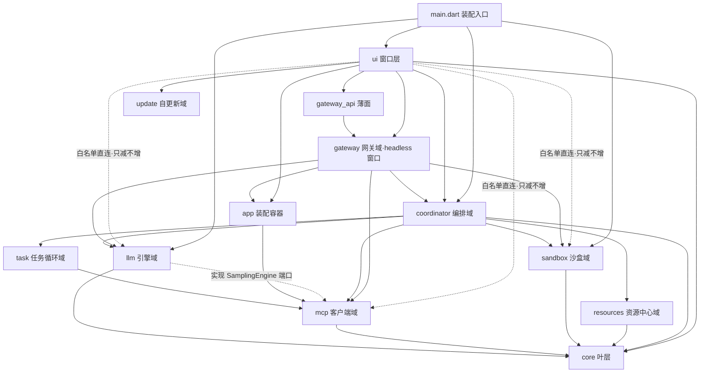

# GoodHub 工程规范（Engineering Specification / Architecture SSOT）

> 本文是工程编码的**规则契约 SSOT**——对齐架构认知、锁定模块边界、提供机械门禁依据。只写规则，不写演进史；**项目现状数据（内核登记、白名单基线、超标清单）一律住 [`index.md`](index.md)**，本文按节引用。
>
> 冲突裁决：`context/epics/<epic>/memory.md` 显式决策 ＞ 本文 ＞ 通用规约。
>
> 需求映射（`docs/product/architecture.md` / `requirements.md`）：N1 双端纪律、F1.2/F1.9 命名空间与海关、F1.10 环路防护、F4.5 Session 即焚、F4.6 日志轮转、F4.7 单进程、§2 围栏与熔断、§10 Abort 语义。

## 1. 架构拓扑与分层依赖（Dependency Rules）

### 1.0 分层依赖矩阵（权威）

拓扑 = **扁平域目录**。`lib/` 一级域共 12 个，依赖方向**严格自底向上，无文件级环**（`test/architecture/dependency_rules_test.dart` 持续守护）。

| 域 | 角色 | 允许的域内出向（内部 import） |
|---|---|---|
| `core/` | 基础设施**叶层**（存储/安全/错误/网络底座/跨域 DTO） | **零出向**（红灯；SDK `dart:io` 允许，仅做具名类型判定与文件底座） |
| `llm/` | 引擎域（端侧 `llm.dart` + `cloud/` 双协议 BYOK + codec） | `core`；经端口实现可引 `mcp` 的接口定义（`SamplingEngine`，依赖倒置） |
| `mcp/` | MCP 客户端域（json_rpc/client/transport/端点/探活/信任/sampling/`goodshare_task_api`） | `core` |
| `sandbox/` | 记忆沙盒域（memory/conversation/workspace 三 store） | `core` |
| `task/` | 任务循环域（goodshare 远程任务 claim→推理→apply） | `mcp`、`core`（串行写基准件） |
| `resources/` | 资源中心内核域（本地文件库 ResourceStore；resource-center M1） | `core` |
| `app/` | 装配容器（依赖注入 seed，`service_directory.dart`；`task_consume_bootstrap` 宿主接管装配） | `mcp`、`coordinator`（hybrid 装配件）、`task`（消费接管）、`llm`（引擎类型装配）、`resources`（资源中心单例 seed）、`sandbox`（会话/工作区 store 的应用级 seed，2026-10-28 随 S1 增） |
| `coordinator/` | 编排域（AgentLoop/权限/熔断/PII/上下文治理/`$ref`/内核四件套/Run 装配核） | `core`、`llm`、`mcp`、`sandbox`、`task`、`resources` |
| `gateway/` | 聚合网关域（Server 角色，`:8766/mcp`；headless 窗口） | `core`（Actor 值对象等跨域 DTO，2026-10-28 随 S6 增）、`coordinator` **执行面白名单**（§1.4）、`mcp`、`llm`、`sandbox`、`app`；**禁 `ui`**（红灯） |
| `gateway_api/` | 网关 API 薄面 | `gateway`；`coordinator`（mcp_tool_face，gateway_control 装配引用）、`mcp`（server_endpoints，同上） |
| `ui/` | 窗口层（聊天/设置/看板/更新/联调页 + components/sections） | `coordinator`、`core`、`app`、`gateway`（仅窗口→窗口面，如 consent 弹层）、`gateway_api`、`update`；对 `mcp`/`sandbox`/`llm` 仅**白名单直连**（§1.4，只减不增）；对 `task`/`resources` 仅**管理面窗口**直连（§1.4 类别 1） |
| `update/` | 自更新域（manifest/service/installer） | 无内部出向（独立叶子域） |

`main.dart`（装配入口）可 import 任意域——装配层唯一例外，收敛纯装配职责（引擎预热 / 记忆清扫 / `$ref` 启动清池 / 首页挂载），**业务逻辑不得回灌 `main.dart`**。



**拓扑纪律**：`lib/app/`（装配容器）是装配唯一 seed（`service_directory.dart` 单入口）。**新增文件一律沿用扁平域目录，禁止引入任何新前缀**；整体拓扑收敛重评须显式拍板后方可进行。

### 1.1 窗口层 / 内核层分层纪律（window-kernel-split）

> 内容 SSOT：[`window-kernel-split.md`](../design/window-kernel-split.md)。本节只固化**编码时必守的判据与规则**，内核终态形态与设计细节一律查该文（防双源漂移）。

架构形态 = **两层 + 端口**：**窗口**（`ui/` 各页 + headless 的 `gateway_controller`）**单向依赖内核**（领域层）；向下传**值对象**（`SessionContext` + 装配选项），向上传**回调端口**（`RuntimeDelegates`，控制反转）。

**形态判据（新增代码必过；用于判「形式合规但实质走偏」）**：① 新消费点**不得就地构造**共享内核——一律取装配容器单一实例；② 新窗口**不得持有领域态**——只持视图态与端口实现；③ 新内核须**先登记生命周期层级**（应用级 / 会话级 / Run 级），**未定层级不得开工**。

1. **内核纯 Dart**：内核文件**严禁 import Flutter**（`material.dart` / `BuildContext` / `setState` / `ChangeNotifier`）——内核须可被 headless 路径复用。机械验收：新增内核文件 grep 无 `package:flutter`。
2. **单一 owner，禁止就地构造**：跨窗口共享的应用级状态**只能有一个 owner**，由装配容器供给单一实例；消费点禁止就地 `new` 或自行拼路径。
3. **生命周期单向依赖**：应用级 ← 会话级 ← Run 级，严禁反向；短周期消亡不得拉扯长周期实例销毁；长周期变更经**快照 + 端口**下传。**不引事件总线**——总线会把 Run 级生命周期拉成应用级，必然泄漏。
4. **视图态不下沉、领域态不上浮**：双轨渲染模型 / 流控 / 滚动跟随 / CallCard 相位**永远留在窗口**；transcript / 技能激活集 / 降级判据 / 私有域绑定**永远留在内核**。
5. **内核命名须登记**：新增内核先在 [`window-kernel-split.md`](../design/window-kernel-split.md) §3.1 内核清单登记，禁止自造同义名（内核命名以清单为准，如 `McpRuntime`）。
6. **跨域协作走端口，禁反向 import**：域间能力需求一律落**最小抽象端口 + 注入**，既有范式（新代码照此，勿另造）：
   - **能力端口**：消费方域内定义 `abstract interface class` 最小能力集，实现方 `implements`（实现方依赖消费方 = 合法方向）。范式：`mcp/connection_face.dart`（`ConnectionFace`，face/faceFactory 二选一注入、双缺快速失败）、`mcp/sampling.dart` 的 `SamplingEngine`、`core/audit_sink.dart`（`AuditSink`）。
   - **跨域消息货币落 core**：多域共用的数据模型一律放 `core/`（纯数据无依赖）——`core/tool_result.dart`（`ToolExecutionResult`）、`core/chat_message_data.dart`（`ChatMessageData`）；**禁止把 A 域具体类型经端口签名漏进 B 域**（端口只暴露最小能力集）。
   - **编解码归模型所有方**：transcript/协议 codec 住模型域（`llm/cloud/chat_message_codec.dart`），存储层只认 core DTO + JSON Map，**禁止在存储层 import 模型域类型**。
   - **无 UI 裁决 fail-closed**：服务域触达 Human-In-The-Loop 能力（确认卡/弹层）时，UI 实现住窗口层、经端口注入；**桥缺位/超时/异常三路必须恒 `approved: false` 快速拒绝**（范式：`gateway_security.dart` + `ui/gateway_consent_dialog.dart`，reason 前缀 `headless_no_ui_prompt`），严禁悬挂 Completer 或静默放行（详见 §4.3）。
   - **生命周期 Owner 随端口声明**：注入对象「谁创建谁销毁、有无独立 dispose」必须写进端口文件头注释（范式：`connection_face.dart`——face 无独立 dispose，释放唯一入口 = owner 调 `client.close()`）。
7. **海关过滤（F1.9）：已接线在对外暴露面，本机链路不过滤**（2026-10-21 随插件 SDK 0.2.0 更正）。标记口径 = `tools/list` 条目的 **`_meta.goodhub.visibility`**（`shared` / `private`；缺失 / 形状异常 / 未知取值一律 private）；**旧 `annotations` 私有字面量口径已作废** <!-- drift:keep：旧口径特指禁令叙述 -->（不得把访问控制标记塞进 MCP `annotations`——其规范定位是 advisory hints，且 `x-` 顶官方命名空间）。三条纪律：
   - **声明非 ACL**：服务端 / SDK 不得因标记剔除 `tools/list` 条目或拦截 `tools/call`；过滤只在**目录层**收窄，且**只发生在对外暴露面**（`gateway/mcp_gateway_handler.dart` 的 PC 投影只回 shared）。**本机链路（`coordinator/tool_router.dart` 与宿主聊天装配面）保持能力全集**——未打标服务端在此口径下全量归 private，过滤即生产工具面归零。
   - **不合成安全边界**：调用方可信性另由同签名 / 信任白名单 / L2 确认卡把关，可见性标记不得与之合并成一套。
   - `lib/mcp/tool_router.dart` 是规则的独立实现与单测面，**不删不引**（机械红灯：§1.0 护栏表；收编进 `coordinator/tool_router.dart` 记为架构债 #9）。落地须带等价性单测 + 全量工具可见性回归（已随本轮补）。

### 1.2 core 边界纪律

- `core/` 是**叶层**：零域内出向（机械红灯）；SDK `dart:io` 仅用于文件底座与具名类型判定（`errors/transport_error_kind.dart`——UI 只消费枚举，判定下沉本层）。
- `core/network/` 只放**纯传输底座**（HTTP client、指数退避算法 `backoff.dart` 等通用件）；**JSON-RPC/SSE 协议语义必须住在 `mcp/`**——重连期间「积压队列整体丢弃并回告模型、不静默重放」（F1.12）是总线策略，漏到 core 即围栏旁路。
- 跨域共享类型（DTO / 错误枚举 / 端口接口）下沉 `core/` 是**首选收敛手段**；新增此类类型前先问「是否纯数据、是否任何域都可能用」。

### 1.3 平台边界与依赖注入纪律（N1）

- **UI 层零 `dart:io`**：`lib/ui/` 下绝对禁止 `import 'dart:io'`。**处置原则 = 修而非加白名单**（白名单纪律只减不增）。
- **UI 层禁平台分支与通道直连**：`Platform.isX` 分支（arch-guard R2）、`MethodChannel(` 直连（arch-guard R3）一律禁止——平台差异收敛到接口实现/工厂，平台通道在 `lib/app/` 装配期注入。
- **接口驱动**：所有系统特权能力（剪贴板、通知、端侧推理引擎、前台服务桥、安全存储）必须定义纯 Dart 抽象类（`abstract interface class`），平台实现经装配容器依赖注入。注入位范式（新增内核/窗口照此，勿另造）：`clientFactory`（`server_probe` / `mcp_runtime`）、`storeOverride` / `endpointStoreOverride` / `probeOverride`（settings 各段 / `chat_page`）。
- **机械验收**：`flutter analyze` 0 issue + `arch-guard.sh` R1~R3 + `dependency_rules_test`（§1.0 护栏表）。

### 1.4 跨域直连白名单纪律（只减不增）

窗口对下层域、gateway 对 coordinator 的直连按以下四类处置，白名单**只减不增**；**现状边与存量基线数据查 [`index.md`](index.md)「直连白名单基线」**：

1. **配置类 / 管理面窗口**：设置 / 看板 / 更新 / 资源中心 / 任务对账等窗口即该服务的管理面，**允许**直接依赖目标域的 store / 配置模型 / 服务面（含 `task` / `resources` 域，与 §1.0 ui 行一致）；新增此类直连须在段文件头注释声明「管理面直连」理由，并登记 `index.md` 直连白名单。
2. **装配容器消费**（`ui/` → `app/service_directory.dart`）：**允许**，且是**推荐路径**——跨域 store 一律经装配容器取单一实例（§1.1 规则 2），不手拼。
3. **联调/spike 窗口**：非生产路径，**豁免**直接依赖内部件（含 coordinator 内部编排、mcp 假传输）——但**不得复制装配胶水**（复用 `McpRuntime.mount/mountEndpoint` 挂载原语 + `clientFactory` 注入 fake 传输）；新增 spike 页须先登记于 `index.md`。
4. **存量直连（遗留债）**：存量清单逐边登记于 `index.md`，**新增任何清单外直连即违例**；收敛方向 = 经 coordinator 门面 + 端口回传，每清一边同轮更新 index.md。
5. **gateway → coordinator 执行面白名单（默认拒绝）**：gateway 可 import 的 coordinator 文件仅限登记于 `index.md` 的执行面清单；**coordinator 新增文件默认对 gateway 不可见**，确需引入先改清单再写 import。

> 尾注（前瞻项）：§1.4 第 4/5 条白名单目前为**文档态基线**，机械镜像（dependency_rules_test / arch-guard 新规则）待立项补——**CI 已就绪**（`.github/workflows/ci.yml` 跑整个 `test/architecture/`），镜像落 `test/architecture/` 即自动被 CI 覆盖。

### 1.5 新功能落点决策表

| 新功能类型 | 落点域 | 关键约束 |
|---|---|---|
| 新云端 LLM 协议 / 流式解析 | `lib/llm/cloud/` | 独立 client + codec 归 llm/cloud 所有（§1.1 规则 6：编解码归模型所有方）；装配入口沿用 `engineFor` 链 |
| 新端侧引擎能力 | `lib/llm/` + `android/`（LlmBridge.kt） | 端侧走纯 Dart 接口 + 平台实现装配注入（§1.3）；proguard keep 教训查 `context/lessons.md` |
| 新 MCP 传输通道（HTTP/Binder 之外） | `lib/mcp/transport/` | 传输只搬字节；协议语义住 `mcp/` 域（§1.2） |
| 多服务新能力（端点配置 / 探活 / 信任） | `lib/mcp/` | 端点/探活/信任模型住 mcp；配置面（表单/段）走 `ui/sections/`（§1.4 类别 1） |
| 新编排策略（降级 / 熔断 / 上下文治理 / 权限） | `lib/coordinator/` | 窗口层**禁止内联新编排**（编排一律下沉 coordinator 纯 Dart 件）；headless 可复用必须内核纯 Dart（§1.1 规则 1） |
| 新持久实体（记忆 / 会话 / 配置） | `lib/sandbox/` + `lib/core/`（DTO） | 存储只认 core DTO + JSON Map（§1.1 规则 6）；跨域模型先下沉 core；写路径必须接 `KeyedWriteQueue`（§3.2） |
| 新远程 AI 任务流（goodshare 接缝） | `lib/task/` | 接缝契约 SSOT = goodshare 仓 `ai-app-split.md` §3（跨仓只读，改接缝须同轮修该文档）；`lib/mcp/goodshare_task_api.dart` 为传输适配 |
| 网关新能力（暴露 / 安全 / 背压 / 聚合） | `lib/gateway/` | 入站安全闭环走 `gateway_security` 范式；Human-In-The-Loop 弹层经端口（`GateDelegate`）由窗口层实现，gateway 禁 import ui（§1.0 红灯） |
| 新对外暴露工具（经网关给外部 AI） | 实现住对应域（多 `coordinator/`） | 必须过 §5.7 自查清单；特权工具同步主体矩阵（§6.2） |
| 新窗口（页 / 设置段） | `lib/ui/`（分段进 `ui/sections/`） | 先过 §1.1 三条形态判据；有状态段混 keepAlive（§8.1） |
| 新自更新 / 发布能力 | `lib/update/` | 发布侧 `scripts/`（release-r2 链）；UI 只持路径不持文件句柄（§1.3） |
| 新跨域共享类型（DTO / 错误枚举 / 端口） | `lib/core/` | core 叶层零出向（§1.0 红灯）；纯数据才配进 core |
| 新装配 / 依赖注入 | `lib/app/` | 单入口工厂（`service_directory` 范式）；窗口取实例不手拼（§1.1 规则 2） |

### 1.6 新顶层域纪律

`lib/` 新增一级域（当前 12 域之外的任何新前缀）须**三处同步**，缺一即护栏盲区：① `test/architecture/dependency_rules_test.dart` 的 `kGoodhubDomains` 集合；② 本文 §1.0 分层矩阵（角色 + 允许出向）；③ `index.md`（域内文件落点）。**拍板前禁止新增前缀**——需要新域先问「是否可落现有域的子目录」（如 `llm/cloud/`、`mcp/transport/` 先例）。

## 2. 状态、数据不可变性与生命周期（State & Lifecycle）

### 2.1 生命周期所有权表

| 资产类型 | 生命周期所有者 | 共享方式 | 释放/销毁纪律 |
|---|---|---|---|
| **应用级状态** | 装配容器单例（`ServiceDirectory`） | 只读快照 / 广播流 | 随进程存亡，禁止外部提前销毁 |
| **会话级状态** | 会话内核（`ChatSessionService` + `ConversationSession`） | 领域门面传参 | 会话切换或重置时整体落盘并释放 |
| **运行级句柄** | Run 装配核（`McpRuntime` Run 句柄） | 局部传递，禁止常驻 | 任务结束（成功、失败、取消）**即焚** |

现行内核登记（层级 + 落点）见 [`index.md`](index.md)「内核登记表」。

### 2.2 实体不可变性

- 数据模型统一 `@freezed` 或手写全 `final` 不可变类，禁止可变集合（裸 `List`/`Map` 出参）；更新一律 `copyWith`。
- **禁 `dynamic`**：网络层解析完成后第一时间 Schema 转强类型；内部总线管道禁止 `dynamic` 传递。
- **显式错误传递**：统一 `Result<T, McpError>` 包装或领域异常（`core/errors/`），禁止随处裸抛无类型异常（详见 §5.5）。

### 2.3 状态机密封性

- 操作轨流转用受保护密封类（Sealed Class），不可逆转：

```dart
sealed class ActionCardState {
  const ActionCardState();
}
class ActionCardPending extends ActionCardState { /* ... */ }
class ActionCardRunning extends ActionCardState { final double progress; /* ... */ }
class ActionCardApproved extends ActionCardState { final DateTime approvedAt; /* ... */ }
class ActionCardRejected extends ActionCardState { final String? feedback; /* ... */ }
class ActionCardCancelled extends ActionCardState { /* ... */ }
class ActionCardFailed extends ActionCardState { final String error; /* ... */ }
```

- **Cancelled ≠ Failed（§10 纪律）**：用户 Abort / `notifications/cancelled` 级联终态必须落 `Cancelled`；仅真实错误落 `Failed`。**禁止混用**——审计语义不可逆。
- **Abort 级联固定顺序（§10）**：UI Abort → ① 终止本地 LLM Generator → ② 终结本地执行队列 → ③ 对外部 Server 下发 `notifications/cancelled`（不只断 SSE）→ ④ 卡片终结为 `Cancelled`。实现必须按此顺序，不得乱序/跳步。
- **命名口径**：取消通知一律用 MCP 2025-06-18 规范名 **`notifications/cancelled`**，禁止早期草案名 <!-- drift:keep：禁令条款须点名退役拼写 -->`$/cancelRequest`。

### 2.4 状态归属纪律

- **领域态与视图态不得同居一个 `State`**——新增会话级字段一律落内核并随之持久化，**禁止在窗口 `State` 加裸字段 + 手工枚举 reset**（漏改即静默 bug）。
- Run 级资源句柄（连接池 / RefStore / 路由 / 引擎）**随 Run 焚**：`close()` 必须**幂等**且覆盖正常与异常两条路径（范式：`BinderTransport._closed` 防重入守卫、`McpClient.close`）；窗口**不得缓存 Run 焚后的引用**（详见 §7）。

## 3. 并发模型与写安全（Concurrency & Write Safety）

### 3.0 单进程硬约束（F4.7）

全组件（UI / 前台服务 / 网关 Server 监听）严格单 OS 进程，禁 `:remote`——跨进程并发使串行写队列（§3.2）失效。

### 3.1 执行线程划分

- **主 Isolate**：Flutter UI、`KeyedWriteQueue` 串行写队列、会话状态机——只做轻量状态驱动与渲染调度，禁止大 JSON 解析、密集正则、大文件 IO。
- **Worker Isolate（CPU 密集强制离主线程）**：PII 正则脱敏（`pii_fence.dart`，`Isolate.run` + **3s 超时守卫**——防正则灾难回溯拖死主 Isolate，超时后底层 Isolate 自然跑完丢弃）、大 JSONSchema 解析、>1MB 临时文件数据处理。**CPU 密集任务必须带执行超时看门狗。**

### 3.2 文件写安全（File Mutex，F4.6）

权威实现 = `lib/core/storage/keyed_write_queue.dart` + `sequential_file_writer.dart`（基准件，勿复制出第二套）：

- **接口必须含 `append` 语义与轮转钩子**（memory.md 为全量重写内存态后落盘，ops.log 为追加 + 10MB 单代滚动）。
- **互斥粒度必须是「文件路径」，不是「writer 对象」**：一切写路径经 `KeyedWriteQueue` 的**进程级按路径键注册表**排队（链排空且无后继即惰性除名，防无界增长）；`MemoryStore` / `WorkspaceStateStore` / `ConversationStore` 的 `underSupportDir` 均为 factory，同路径会被 new 出多个实例——若链随实例走，同路径多条链交错即**静默丢失更新**。单次失败向调用方透传异常但**不毒化队列**（续链与透传分离）。
- **复合「读-改-写」单元同样必须接入**：只串行化底层 `write` 不够——两个实例仍会各自读到同一份旧内容、后写覆盖前写。键粒度：MemoryStore 取沙盒目录（三件套共锁），WorkspaceStateStore 取目录 + 会话 id（不同会话仍可并行）。
- **排空握手一律用 `settled` / `ioDrained`，禁止用固定 `Future.delayed` 猜等**（全量并发 CPU 饱和即 flaky）。
- ops.log 轮转（10MB 上限 + `.1` 单代滚动 + 启动清理）由调用方在 append 链路上检查触发，**轮转本身也必须入队串行执行**。
- 禁止并发裸写磁盘；禁止绕过 writer 直接 `File.writeAsString`。**原子写唯一入口 = `KeyedWriteQueue.instance.enqueueAtomicWrite(path, bytes)`**（队列内 `tmp → flush → rename`；手写副本禁止再造，机械门禁 R10）——2026-10-28 §S4 收口后，六处手写副本已全部迁入该入口。

## 4. 容错、熔断与降级（Fault Tolerance & Degradation）

### 4.1 熔断与步数墙语义边界（§2）

- **两步熔断**：同一工具连续 2 次被拒/抛错 → 强中止 + 排查卡片。**管「同一工具连续报错」**。
- **步数墙**：单任务 `max_turns=10`（可配）超限熔断出排查卡。**管「逻辑无错但空转」**——互补不互替。
- **用户主动拒绝不计入熔断计数**：熔断管系统报错，用户纠正是对话的一部分；禁止「用户改两次意见即熔断杀会话」。

### 4.2 降级可见性分级（数据面 / 非数据面）

`[DEGRADE]` 埋点按**数据面 / 非数据面**两档划界，禁止一切「磁盘满/权限失败静默丢数据」：

- **数据面写失败**（落盘事实、会话快照、配置持久化等用户资产的写路径）：失败必须**升为用户可观测**——经回调升 UI 轨道（如 `MemoryKernel.onWriteFailure` → `TrackNote(danger)`），未接回调时至少 `[DEGRADE]` 留痕；`unawaited` 只允许挂在**已接错误上报**的 future 上，裸 `discarded_futures` 即违例。
- **非数据面降级**（心跳保活、progress 瞬态帧、审计流水等：失败不丢用户数据，只损可观测性）：允许 `[DEGRADE]`/空吞留痕不阻断主链路，但**须在代码注释声明其非数据面属性**。
- **fail-closed 边界成文**（与 §6.1 衔接）：出站安全过滤（PII 遮蔽）失败一律拦截（fail-closed，§6.1）；网关 progress 帧 message 走 `redactSync` 同步遮蔽、遮蔽失败原样透传属**非数据面豁免**（瞬态文本，终局结果由会话级遮蔽兜一致性）——该豁免仅限 progress 帧，不得类推到结果帧（`gateway_security` 会话级遮蔽 + handler `onProgress` 注释为两处口径锚点，改任一处须同步另一处）。

### 4.3 Fail-Closed 铁律

- **安全围栏异常/超时恒拒绝**：数据脱敏（§6.1）、越权校验、无界权限拦截发生异常或超时时，一律按拒绝处理，禁止静默通过。
- **Headless 无 UI 恒拒绝**：无人值守运行模式下，涉及 Human-In-The-Loop 的确认逻辑必须立即返回 `approved: false` 快速拒绝（§1.1 规则 6：桥缺位/超时/异常三路恒拒绝），禁止阻塞挂起或静默放行。

## 5. 接口契约与标识符规范（Interface Contracts）

> 约束对象 = 网关对外可达的工具面（`lib/gateway/` + 经网关聚合的本地 Binder 插件与远端 HTTP server 工具）；不经网关的纯 Client 侧内部工具链不受强制约束，但建议同口径。立法来源：goodshare 仓 `docs/engineering/ai-dev-spec.md` §4「AI 操作者专章」（跨仓只读指针，不复制正文）。

### 5.1 工具描述主动引导

每个 MCP 工具的 `description` 必须写「怎么用才对」，不只「干什么」——给出推荐用法、适用场景、参数约束与反例（如「多步记忆修改优先合并为一次 `update_memory`，勿逐条碎写」）；空泛描述（"更新记忆"）不合格。

### 5.2 长窗口读改写必带乐观锁

「读→推理→写」路径必须携带版本/校验字段（参照接缝契约 `expected_version`），缺失即拒绝——静默覆盖风险自证，Server 侧工具按此立参。

### 5.3 写后必回最新快照

写类工具返回**变更后的最新状态**（与对应读工具同形状），禁止回 void/纯成功文案——调用方（大模型）上下文必须与库内状态对齐；数据移出可见域时显式置空并说明。

### 5.4 错误契约：机器可读 code + hint

拒绝统一走领域异常（`core/errors/`），`code` 机器可读（`version_conflict`/`permission_denied`/…）且枚举化；**可纠正分支必须带 `hint`**（告诉调用方下一步该做什么——模型需要向用户解释）；禁止底层异常（IO/平台/堆栈）裸漏到 MCP 层。与 N7 同口径：遮蔽失败拦截请确认，严禁静默放行。

### 5.5 显式错误传递

领域代码统一 `Result<T, McpError>` 包装或领域异常（`core/errors/`），禁止随处裸抛无类型异常。

### 5.6 标识符与命名约定

- **MCP 命名空间隔离（F1.2）**：工具与路由统一 `<server_id>__<tool_name>`——**双下划线仅作两段分隔符**，各段自身 snake_case（如 `goodshare__list_notes`）；工具名内部禁止再出现双下划线。生产路由只引 `lib/coordinator/tool_router.dart`（`lib/mcp/tool_router.dart` 为海关隔离件，§1.1 规则 7）。
- **数据引用前缀（F1.7）**：惰性注水句柄统一 `$ref:<server_id>:<unique_id>`。
- **能力可见性声明（F1.9）**：对外共享声明统一收在 `tools/list` 条目的 **`_meta.goodhub.visibility`**（取值 `shared` / `private`；解析口径、三条纪律与 ISOLATED 实现见 §1.1 规则 7）；GoodHub 私有扩展一律落在 `_meta.goodhub` 子树，**不得占用 MCP `annotations` 命名空间**（其规范定位是 advisory hints）。
- **取消通知命名**：一律用 MCP 2025-06-18 规范名 **`notifications/cancelled`**，早期草案名作废（§2.3）。
- **文件命名**：小写蛇形（`session_manager.dart` ↔ `SessionManager`），文件名与主要暴露类型严格对应。

### 5.7 新增工具自查清单（任一缺失即不合格）

工具注册（含 §5.1 描述引导）→ 主体矩阵（§6.2）→ 参数 Schema（强类型，禁 `dynamic`）→ 契约测试（`test/`，与 §8 质量门禁同交付线）。

## 6. 安全、脱敏与隐私护栏（Security & Privacy）

### 6.1 出站 Payload 统一脱敏管道（N7）

发往云端 BYOK 的**全量出站载荷**（用户输入、Resource 读取内容、工具返回值**含特权工具返回值**——剪贴板/记忆）在组装 Payload 阶段必须过脱敏管道（`coordinator/pii_fence.dart`：Worker Isolate + 3s 超时守卫，§3.1）；覆盖不全即围栏旁路：

- 遮蔽运算走 **Worker Isolate**；返回清洗后文本 + 反向映射还原字典，推理返回后**反向还原占位符**（同步纯替换，主 Isolate 即可）。
- 遮蔽失败（Isolate 异常/超时）**拦截请确认，严禁静默放行**（fail-closed，§4.3）：调用方必须拦截发送（`PiiMaskException`），debug 面给「明文发送一次 / 取消」双选项卡，无人值守（网关 headless）恒 fail-closed。

### 6.2 操作者身份传输层绑定

调用主体（`local`/`external:<app>`）一律从鉴权层（F1.17 UID 白名单 / Bearer Token）推导，**禁止从请求载荷字段读取**——否则外部 AI 可在 JSON 里自称 `"actor":"local"` 越权。主体 × 工具矩阵在 Server 注册表维护，新增特权工具必须同步矩阵。

### 6.3 零明文留痕

密钥、Token、私有凭证严禁出现在日志输出、崩溃堆栈或未加密的本地持久化中——凭证类一律走系统安全存储抽象（`core/security/secure_key_value.dart`，平台实现经装配注入，§1.3）。

## 7. 资源释放与内存防泄漏（Release Hygiene）

- **成对生命周期（谁构造谁销毁）**：每条装配链上每个 `new` 都必须指向某个 `close` 调用点；「谁创建谁销毁、有无独立 dispose」写进端口文件头注释（§1.1 规则 6）。
- **幂等 close**：一切资源句柄 `close()`/`dispose()` 幂等，防重入守卫覆盖正常 + 异常双路径；断言走注入 fake 计数，`test/mcp/release_hygiene_test.dart` 为基准件（含 12 路并发 save 不损坏）。
- **SSE/长连接**：`dispose` 时主动关闭；网关侧 SSE 订阅通道与心跳 Timer 在 `stop()` 中显式释放（`gateway_server.dart`）。
- **临时资源即焚**：`$ref` 临时缓存（含 >1MB 落 cacheDir 文件）挂三层清理——会话结束即焚（`RefStore.expireAll`）+ TTL 30min + 冷启动孤儿扫描兜底（`sweepStartupOrphans` 挂 `main.dart`），**须有断言验证**（`test/coordinator/ref_store_test.dart` 钉住）。
- **环路防护**：在途 traceId 集合走 `try/finally` 必释 + TTL 300s 惰性驱逐，防长连接强断导致记录泄漏。

## 8. 自动化门禁与架构看门狗（CI Guardrails）

> 凡本文明确规定的红线，必须有机械拦截；规则正文在本文，机械实现只镜像不立法。

### 8.1 测试覆盖要求

- `mcp`：ToolRouter 命名空间隔离（`<server_id>__<tool>` 剥前缀路由）、JIT 元工具命中解析。
- `coordinator`：两步熔断、步数墙、**用户拒绝不计入熔断计数**、`$ref` 注入生命周期（Session 即焚 + TTL 30min + 启动幂等清池）、PII 遮蔽失败 fail-closed 三路。
- **内核须带注入位 + 装配级测试**：装配函数**必须接受依赖注入位**（`clientFactory` / `storeOverride` 范式）——资源句柄封死后，「连接是否全部 close」**只能靠注入假件计数断言**；同时补**装配产物等价性**单测（搬迁前后逐项一致），**不得只靠真机冒烟**（真机侧载是 UI 唯一验证路径，但不是装配正确性的验证路径）。
- **链式装配等价性（多层执行面 / 装饰器链）**：链式装配**一律经唯一装配器** `lib/coordinator/tool_executor_chain.dart`（`composeToolExecutorChain`：层按「优先级高 → 低」给出，折叠方向固定逐层向外 → 调用点**无法表达**「inner 指向链中段」的丢层形态），并补「全成员在场可调」单测——链条任一层被覆盖即产生「目录可见、调用全败」；实证 2026-10-23 宿主执行链丢层（架构债 #19 已结项）。机械门禁 = `arch-guard.sh` R9 + `test/architecture/executor_chain_rules_test.dart`（含金丝雀）
- **有状态 UI 段**：设置页各段 State 必须混 `AutomaticKeepAliveClientMixin`——不变式由 `test/ui/settings_sections_keepalive_test.dart` 反向闸住。
- **测试基线纪律**：门禁 = **不劣于开工前实测基线**（`flutter analyze` 0 issue + `flutter test --timeout 180s` 全绿），**不锁死测试总数**——新增用例只增不删，删用例须在 devlog 说明理由。

### 8.2 机械门禁矩阵

| 规则项 | 门禁实现 | 拦截时机 |
|---|---|---|
| 层级依赖防腐（§1.0 护栏表 R1~R6） | `test/architecture/dependency_rules_test.dart`（flutter test 版，剥注释匹配 import/export URI） | `flutter test` |
| 同上（镜像） | `scripts/agent-tools/arch-guard.sh` 秒级版（R4~R8） | pre-commit 钩子 |
| 平台隔离（UI 禁 dart:io / Platform.isX / MethodChannel） | `arch-guard.sh` R1~R3 | pre-commit 钩子 |
| 执行面链构造（禁手工把执行面实例塞进另一层的 `inner`） | `arch-guard.sh` R9（秒级版）+ `test/architecture/executor_chain_rules_test.dart`（flutter test 版，含金丝雀） | pre-commit 钩子 / `flutter test` |
| 释放完整性（注入 fake 计数断言） | `test/mcp/release_hygiene_test.dart` 等（§7/§8.1） | `flutter test` |
| 契约面漂移（退役词条 / 单源常量 / 超标登记核对） | `test/architecture/drift_rules_test.dart`（flutter test 版，读 `scripts/agent-tools/drift-registry.txt`） | `flutter test` |
| 同上（引擎，跨项目共用） | 全局 `toolbox run drift-guard`（shell 版，读同一 registry） | pre-commit 钩子 |
| 原子写唯一入口（§3.2 + §S4） | `arch-guard.sh` R10 + `test/architecture/atomic_write_rules_test.dart`（CI 镜像，含金丝雀） | pre-commit 钩子 / `flutter test` |
| 文件膨胀控制 | 单文件软红线 800 行（§8.3） | 评审 + `index.md` 清单 |

> **契约面漂移的规则数据 = `scripts/agent-tools/drift-registry.txt`**（唯一数据源；引擎与 Dart 镜像同读，registry 缺行即漏检）。三类登记：`BANNED` 退役词条（token 级，面向下游 copy 与 docs）· `CONST` 单源常量（字面量级，只许出现在声明处 + 登记镜像）· `OVERSIZE` 超标登记核对（行数级，>800 行的 lib/ 件须登记在 `index.md` 超标清单）。**新规则只加数据行、不改引擎代码**——新退役词条 / 新单源常量 / 新超标件须**同轮登记**，缺登记即被门禁拦下（发现即维护）。诚实边界：docs 与代码的散文级集合描述一致性（如三档 vs 四档）机械不可靠，**不做扫描**，归 `::audit` 人判。

> 两套镜像**编号相互独立**（shell 版多出 3 条 `ui` 平台纪律），引用时带实现名。规则 SSOT 链：`window-kernel-split.md` §5 铁律 → 本文 §1.0/§1.1 → 两套脚本。**新增跨域 import 前先查 §1.0 护栏表与 [`index.md`](index.md) 索引行**：命中红灯 = 先改结构（端口注入 / 类型下沉 core）再写 import，而不是申请白名单。CI 已覆盖全量门禁（`.github/workflows/ci.yml`：analyze + 全量 test + arch-deps）；**白名单机械镜像**仍为待接项（§1.4 尾注）。

### 8.3 单文件体量护栏

- **软红线 800 行**：新文件评审时超 800 行须拆分；800~1200 行的新文件须在文件头注释声明拆分计划。
- **存量超标清单（只减不增）**：登记于 [`index.md`](index.md)「存量超标清单」，行数为软参考（以实测为准，不锁行号防漂移）；任一件降到 800 以下即从清单移除。
- **超标登记的机械核对**：`drift-guard` 的 `OVERSIZE` 登记项（`OVERSIZE|800|docs/project/index.md`）拦「新增超标件未登记」——新件长过 800 行而未进清单即红灯（清单内的只减不增基线跟踪留 `git diff --numstat` 人判，机械不记基线防漂移）。

### 8.4 新内核 / 新装配件检查清单（开工前过一遍）

1. **生命周期层级先登记**（应用级 / 会话级 / Run 级），未定层级不得开工（§1.1 判据③）；
2. **纯 Dart**：文件 grep 无 `package:flutter`（机械验收，§1.1 规则 1）；
3. **装配容器单入口 + 注入位**：生产拼装收敛 `lib/app/`（或域内 `assemble` 入口，如 `McpRuntime.assemble`），且**必须接受依赖注入位**（§8.1）；
4. **测试三件套**：装配产物等价性单测 + 资源释放断言（注入 fake 计数）+ 纯编排件独立单测（零 UI 依赖可跑）；
5. **命名登记**：进 `window-kernel-split.md` §3.1 内核清单，禁同义名（§1.1 规则 5）；
6. **消费侧合规**：窗口只经快照 + 端口消费（§1.1 规则 4），不自建第二份状态。

## 9. 与 dev-loop 工程护栏的对齐

两步熔断语义须与全局 dev-loop 护栏 3 对齐口径——落地时在 epic `memory.md` 显式登记口径结论。规范变更（本文任何节的实质修改）须同轮：① 刷新 `updated` 字段；② 检查 §1.0 护栏表与两套脚本是否需同步；③ 涉及 docs/ 文档归属的按 goodhub-docs 维护协议三处同步；基线数据同步 [`index.md`](index.md)，workflow skill 事实面同轮刷新。
